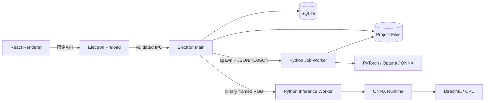
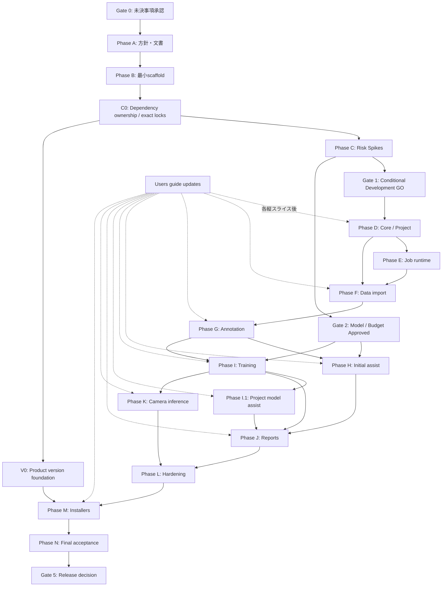

# AutoVision Studio 詳細実装プラン

| 項目 | 内容 |
|---|---|
| 文書バージョン | 0.5 Draft |
| 作成日 | 2026-09-02 |
| 最終更新日 | 2026-09-07（UI改善・明示スキップ追補） |
| 対象 | Version 1（MVP） |
| 状態 | **デフォルト決定承認済み・実装中** |
| 要求基準 | `docs/requirement-definition.md` v0.5 Draft（2026-09-07 UI改善追補、245要求）。SHA-256: raw CRLF `03f81681a96feaaf06976f03cf95065032573a1e2b0f07aa198ac755b1790638` / LF canonical `8fef22ac943b43362f6e78b790c03e506f33412232537f3659fda10bb129cca0` |
| 実装開始条件 | 2026-09-02 にユーザーが全デフォルト案の採用と全タスク実行を指示（充足済み） |

> D-01〜D-19 と V-D01〜V-D15 はデフォルト案を採用する。Version 1 は Windows 11 24H2 以降 x64 のみを対象とし、macOS は将来対応とする。検証できない事項は成功扱いにしない。2026-09-07にユーザーが明示的に対象外としたSPI-03、SPI-09、SPI-19は`SKIPPED_BY_USER`としてPASSと区別し、同じPoCを別名で開発前提へ戻さない。残存リスクと正式出荷の受入条件は別に追跡する。

## 1. 調査結果と計画の前提

### 1.1 リポジトリの実在状態

2026-09-02 時点で確認できた実在ファイルは `.gitignore`、`LICENSE`、`README.md`、未追跡の `docs/requirement-definition.md` である。アプリケーションコード、テスト、ビルド設定は存在しない。

本節は計画作成時のスナップショットであり、現在の実装状態を示すものではない。現在の開発手順は [`developer-guide.md`](developer-guide.md)、実装済み範囲と目標設計の対応は [`architecture.md`](architecture.md) を参照する。

- 指定された `hve-dev/requirement-definition.md` は存在しない。
- 実在する要求定義は `docs/requirement-definition.md` v0.4 Draft のみである。
- `users-guide` を名前に含む文書は存在しない。
- `copilot-instructions.md` および `.github/copilot-instructions.md` は存在しない。したがって、現時点で無視対象となる `## §0 最優先ルール（認知プライミング）` も存在しない。
- `docs/` は Git 上で未追跡である。

この計画では、捏造を避けるため、実在する `docs/requirement-definition.md` を唯一の要求基準として扱う。パス差異は D-01 でレビュー対象とする。

### 1.2 `users-guide` 更新要否の調査結論

**必要である。新規作成が必要。**

理由は、利用者が操作する次のフローが要求されているためである。

- Version 1のWindowsインストール、初回診断、アップグレード、アンインストール、および将来macOS導入（FR-INS-001〜020）
- Project CRUD（FR-PRJ-001〜010）
- Copy/Reference 取り込み（FR-DAT-001〜016）
- 分類ラベルと検出矩形の作成（FR-ANN-001〜014、FR-ANN-101〜107、FR-ANN-201〜209）
- モデル候補の確認・修正（FR-AST-001〜020）
- AutoML、版管理、レポート（FR-TRN、FR-MOD、FR-REP）
- カメラ権限と推論（FR-INF-001〜019）

最終段階で一括執筆すると実装との乖離が起きやすいため、`docs/users-guide.md` を初期段階で作り、各ユーザー向け縦スライスの完了時に該当節だけ更新する。

### 1.3 オーバーエンジニアリング防止ルール

1. MVP は single-label multi-class 分類と axis-aligned rectangle 検出だけに限定する。
2. Cloud API、認証、共同編集、プラグイン、汎用ワークフローエンジンは作らない。
3. Strategy/Factory/DI container/汎用 repository framework は導入しない。
4. 分類と検出で実装が異なる箇所は、明示的な2モジュールに分ける。未採用モデル向け抽象層は作らない。
5. Redux 等の全体状態管理は導入せず、React state と画面単位の hooks を使う。必要性が実測で生じた場合のみ別タスクを起票する。
6. DB ORM は導入せず、少数の SQL migration と機能別 repository を使う。
7. Python worker はジョブ単位の CLI process とし、常駐 HTTP server、localhost API、message broker は作らない。
8. モデルを実行時 download しない。未承認 checkpoint の placeholder を製品経路へ入れない。
9. エラー処理は要求された失敗経路と実際に再現した失敗に限定する。
10. 各タスクで関係のないリファクタリング、先行する将来拡張、未使用フラグを追加しない。

### 1.4 現在の実行環境による制約

現在の Version 1 対象と確認済み作業環境は Windows 11 24H2 以降 x64 だけである。Gate 1〜5 は Windows の実機・package・署名証拠だけを要求する。macOS arm64 の build、MPS/CoreML、camera permission、Developer ID署名、notarization、PKG/Gatekeeper試験は将来 backlog であり、Version 1 の Gate を停止しない。既に保存した macOS 調査結果と `NOT_RUN` は履歴として保持し、Windows 結果で macOS 合格を主張しない。

## 2. 不明点・選択肢・デフォルト

実装開始前にユーザーが変更しない限り、次のデフォルトを採用する。`必須決定` は該当 Gate より前に確定しなければならない。

| ID | 不明点 | 選択肢 | デフォルトの選択肢 | デフォルトを選ぶ理由 | 決定期限 |
|---|---|---|---|---|---|
| D-01 | 要求定義の正しいパス | A. 実在する `docs/requirement-definition.md` / B. `hve-dev/` へ移動 / C. 別ファイルを提示 | **A** | 現在実在し、v0.4 Draft・229要求・出典S1〜S55を持つ唯一の文書だから。存在しない文書を参照したとは扱えない。 | 実装開始前・必須決定 |
| D-02 | Desktop stack | A. Electron+React+TypeScript / B. Tauri / C. OS native 2実装 | **A** | 要求定義 §13 の参考構成と整合し、camera/file/desktop packaging を単一 UI codebase で扱える。Electron security checklist は公式に公開されている [P01]。 | Gate 0 |
| D-03 | SQLite の所有 process | A. Electron main の `better-sqlite3` / B. 常駐 Python `sqlite3` service / C. Electron 同梱 Node の `node:sqlite` | **A** | 単一利用者・小規模 metadata に対して、常駐 service と追加 IPC を避けられる。native addon の packaging 可否は先に SPI-01 で検証する [P10]。 | Gate 1 |
| D-04 | Annotation editor | A. React-Konva で task-specific 実装 / B. Label Studio 組込み / C. CVAT 組込み | **A** | MVP は classification choices と axis-aligned rectangles に限定される。Konva は選択、drag、resize、境界制約、zoom/pan の公式例を持ち [P06]、server/認証/不要機能を同梱しない。 | Gate 1 |
| D-05 | Installer build tool | A. `electron-builder` / B. Electron Forge / C. WiX+個別macOS scripts | **A** | Version 1 は electron-builder の NSIS EXE、`extraResources`、Windows署名を使う [P02][P03]。macOS PKG・署名/notarization設定は将来 lane で同じ設定系へ追加する [P04]。 | Gate 1 |
| D-06 | Python bundle 形式 | A. PyInstaller `onedir` を installer へ内包 / B. PyInstaller `onefile` / C. Python runtime をそのまま同梱 | **A** | top-level installer は1ファイルのまま、worker 起動ごとの展開を避けられる。PyInstaller は `onedir` を既定とし、`onefile` は起動時展開を行う [P05]。 | Gate 1 |
| D-07 | Camera frame → inference process | A. 固定サイズRGB binary pipe / B. localhost HTTP / C. custom-built `onnxruntime-node` | **A** | network listenerを作らず、Version 1はWindowsのDirectML/CPUを公式Python packageで検証する [P07]。CoreML検証は将来macOS laneへ残す [P08]。Gate 1ではSPI-07の10 Hz protocolとSPI-08のproviderを測定し、camera込みの製品性能は実装後のINF-15で測定する。SPI-09は明示スキップである。 | Gate 1 |
| D-08 | Curated/Assist model | A. 要求定義候補から法務・PoC 合格モデルを選定 / B. 未監査モデルで先行実装 | **A（fail closed）** | 要求定義 §13.3 は承認済み Assist Model がないと明記する。モデル固有実装は checkpoint、学習データ由来、再配布、品質の承認後にのみ開始する。 | Gate 2・必須決定 |
| D-09 | 承認済み model binary の保管 | A. build machine の `vendor/models/` に手動配置し hash 検証 / B. Git LFS / C. build 時自動 download | **A** | runtime/build の暗黙通信を避け、大容量 binary を通常 Git 履歴へ入れない。manifest の `sourcePath` は検証元 `vendor/models/`、`payloadPath` は同一bytesの同梱先 `resources/models/` として分離し、追跡対象はmanifestと証拠文書だけにする。 | Gate 2 |
| D-10 | Product identity | A. `io.github.dahatake.autovisionstudio` / B. 所有 domain ベース / C. 別 ID | **A（暫定）** | repository owner を基に衝突しにくい。Version 1のWindows署名・servicing identityに影響するため正式build前に確定する。macOS TCC identityへの適用は将来laneで再確認する。 | Gate 3・必須決定 |
| D-11 | CI/release 実行場所 | A. local/self-hosted Windows（将来Macを追加） / B. GitHub-hosted CI / C. hybrid | **A** | Version 1はlocal/self-hosted Windowsに限定し、model/signing keyを外部runnerへ置かない。将来macOS対応時はnative Mac laneとApple notarization例外を別途有効化する。 | Gate 1 |
| D-12 | Update | A. 新しい署名済み installer を手動実行 / B. online auto-updater | **A** | MVP は更新確認と runtime 通信を禁止する。in-place upgrade は新 installer の実行で満たす。 | Gate 0 |
| D-13 | Chart UI | A. 小さな React chart dependency / B. 自前 SVG | **A** | loss/PR curve、混同行列、tooltip、accessibility を自作する範囲を抑える。採用 package は依存監査タスクで1つに固定する。 | REP phase 前 |
| D-14 | User guide path | A. `docs/users-guide.md` / B. `users-guide/` directory | **A** | 現在の文書が `docs/` にあり、単一日本語 MVP guide で十分だから。 | Gate 0 |
| D-15 | AutoML の最大 Trial/時間 | A. 実機 mini-run 後に versioned policy を確定 / B. 根拠なく固定値を置く | **A（分類・検出とも CPU と CUDA を実測条件で確定。実データ規模は未決定）** | 要求定義 TBD-03 が未決であり、測定前の数値を捏造しないため。2026-09-22 に Gate 2 lane `G2-08` として Windows 実機（`10.0.29671` / `AMD64` / CPython `3.14.7` / Optuna `4.9.0`）で mini-run を実測した。共通条件は beans fixture 45 枚・4 epoch・128px・TPESampler・seed `20260922`・8 trial。**CPU**（`torch 2.11.0+cpu`、thread `1`、4 回実測）は 1 trial あたり最小 `2.016`〜`3.889` 秒 / 中央値 `2.462`〜`5.133` 秒 / **最大 `7.768` 秒**、study 合計 `24.326`〜`42.699` 秒。**CUDA**（`torch 2.11.0+cu130`、CUDA build `13.0`、`NVIDIA GeForce RTX 4060 Laptop GPU`、3 回実測）は最小 `0.562`〜`0.601` 秒 / 中央値 `1.053`〜`2.128` 秒 / **最大 `4.353` 秒**、study 合計 `14.077`〜`16.380` 秒。study の管理 overhead は CPU `0.041` 秒 / CUDA `0.035` 秒で trial 費用に対し無視できる。trial 番号に対する所要時間の増加傾向はなく、費用は trial 数に線形である。この実測に基づき、**分類・上記 fixture 条件での有限 budget を「最大 Trial 数 20」「最大時間 CPU 180 秒 / CUDA 120 秒」**とする。`20` は budget を有限化するための上限選択であり、その所要時間は実測最大 trial（CPU `7.768` 秒 / CUDA `4.353` 秒）× 20 = `155.4` 秒 / `87.1` 秒 + overhead で上から押さえられる。`180` / `120` 秒は**実測最大 trial × 最大 Trial 数を上回る 60 秒単位の切り上げ**であり、**実データ規模への外挿を根拠にしていない**。いずれかに到達した時点で打ち切り、未完了 trial は破棄する。**検出の CPU budget（2026-09-22 追加実測、利用者の許可に基づく暫定測定）:** 同 host で `spikes/models/detection.py --mode automl-mini-run` を 2 回実測した。条件は gwhd-2021 fixture の学習 15 枚・3 epoch/trial・320px・TPESampler・seed `20260922`・8 trial・batch size 探索 `{3,4,5}`（端数 1 の batch を生む値を除外）。1 trial あたり 1 回目が最小 `9.234` / 中央値 `11.887` / **最大 `14.529`** 秒、2 回目が最小 `13.354` / 中央値 `15.166` / **最大 `19.479`** 秒（study 合計 `95.884` / `125.644` 秒）。最終 epoch 平均 loss は 8 trial すべてが 2 回とも同値で、**探索は決定的**である。この実測に基づき、**検出・CPU・上記 fixture 条件での有限 budget を「最大 Trial 数 20」「最大時間 420 秒」**とする。`420` 秒は 2 回の実測で観測した最大 trial `19.479` 秒 × 20 = `389.58` 秒を上回る 60 秒単位の切り上げであり、**実データ規模・製品の学習 pipeline への外挿を根拠にしていない**（TRN は未実装であり、本測定は spike の学習ループの費用である）。loss 値は品質の主張に使わない。**検出の CUDA budget（2026-09-23 追加実測）:** 同 host・同条件（trial 8・3 epoch・seed `20260922`）で `--device cuda` を 2 回実測した（`torch 2.11.0+cu130` / CUDA build `13.0` / RTX 4060 Laptop、optuna は CPU 実測と同じ `4.9.0` に固定、依存は repository 外の隔離環境）。1 trial あたり 1 回目が最小 `1.303` / 中央値 `1.832` / **最大 `3.945`** 秒、2 回目が最小 `1.157` / 中央値 `1.729` / 最大 `3.065` 秒（study 合計 `16.090` / `14.755` 秒）。これに基づき **検出・CUDA の budget を「最大 Trial 数 20」「最大時間 120 秒」**とする（実測最大 `3.945` × 20 = `78.9` 秒 を上回る 60 秒単位の切り上げ）。**CPU と異なり CUDA は 2 回の実行で loss が一致せず、本条件の CUDA 学習は非決定的である**（detection-result.md §12.3）。budget の算出には所要時間のみを用いる。**未決定（未測定）:** 実データ規模（数千枚）の budget（利用者指示により本 lane では測定対象外）、DirectML 学習（`onnxruntime-directml` は推論専用）。**CUDA 測定用の依存採用:** `torch==2.11.0+cu130` / `torchvision==0.26.0+cu130` を repository 外の隔離環境へ導入して測定した。**製品 lock（`ml/pyproject.toml`・`ml/uv.lock`）は変更していない**。製品の推論 provider は A-07 で `windows-x64/cpu` と `windows-x64/directml` の 2 件に固定されており CUDA を含まないため、製品同梱の可否は TRN phase で別途判断する（先回りで lock を CUDA へ切り替えない）。mini-run の eval accuracy は全 trial `0.3333`（3 クラスの偶然水準）であり、**探索空間の品質根拠には使わない**。実測の全文は [`spikes/models/classification-result.md`](../spikes/models/classification-result.md) §11 に記録した。 | Gate 2・必須決定（検出・実データ規模は継続） |
| D-16 | Windows release signing identity | A. 組織の正式Windowsコード署名証明書 / B. test署名のまま出荷 | **A** | Version 1のFR-INS-008が正式署名を必須とする。証明書名・保管方法はユーザー提示が必要。Apple signing identityは将来macOS laneの決定事項とする。 | Gate 5・必須決定 |
| D-17 | Node/Electron/Python の版 | A. Windows 11 24H2+ x64で全採用依存が公式対応する安定版を調べ、exact lock / B. 現時点で未検証の版番号を固定 | **A** | B-01/B-11で基盤を固定し、Phase C依存とB-13品質ツールの所有権不足はC0で是正済み。C0のmacOS調査と`NOT_RUN`は履歴として保持するがVersion 1 lock/Gateの要件ではなく、将来laneで再検証する。 | B-01/B-11、Phase C 前の C0 |
| D-18 | UI component | A. semantic HTML/native control を先に使い、不足する操作だけ1つの headless libraryを追加 / B. UI kit 全体を先行導入 | **A** | 現在必要と判明しているのは dialog/table/tab 等に限られ、全 UI kit の先行導入は YAGNI になる。追加時は対象操作、accessibility、licenseを個別に検証する。 | 各 UI task 前 |
| D-19 | Reference モードの永続アクセス | A. absolute path+file identity+hashを保存し、起動後に再検証・必要時relink / B. macOS App Sandbox/bookmarkを前提化 / C. Copyだけに制限 | **A（Windows通常検証を伴う）** | Version 1のWindows direct-distribution appで非破壊参照を最小構成で満たす。SPI-19は2026-09-07に明示スキップされたためPoC合格を実装前提にしない。DAT-12でprocess再起動、read/hash、変更・消失、安全停止、relink、参照元非破壊を検証し、OS再起動後の継続アクセスは正式製品受入のDAT-15で確認する。DAT-15の結果をSPI-19のPASSまたはGate 1前提へ転用せず、macOS bookmark/access検証は将来laneとする。 | 決定済み |

### 2.1 アプリケーション製品バージョン

2026-09-04 にユーザーが次のデフォルト案を全て採用した。ここでいう製品バージョンは配布する AutoVision Studio 自体の版であり、ML worker package、Preload API contract、model manifest schema、Project の Model Version、DB migration sequenceとは別の名前空間として扱う。

| ID | 不明点 | 選択肢 | 採用 | 理由 | 決定期限 |
|---|---|---|---|---|---|
| V-D01 | 要求定義の正本 | A. 実在する `docs/requirement-definition.md` / B. `hve-dev/`へ移動 / C. 別文書 | **A** | D-01と同じ。指定された`hve-dev/requirement-definition.md`は存在しないため。 | 決定済み |
| V-D02 | 製品バージョンの正本 | A. root `package.json` / B. `ml/pyproject.toml` / C. 専用version file | **A** | Electron `app.getVersion()`とelectron-builderがpackage metadataのversionを使用でき、重複した正本を追加しないため [P17][P18]。 | 決定済み |
| V-D03 | 製品バージョン形式 | A. 数値3要素`MAJOR.MINOR.PATCH` / B. prerelease/build metadataを含むSemVer / C. CalVer | **A** | 現行model manifestの`productVersion`制約と同じ形式に限定し、必要のない形式を先行追加しない。 | 決定済み |
| V-D04 | prerelease/build metadata | A. 許可 / B. 不許可 | **B** | 現行manifest schemaで表現できず、release channel要件もない。 | 決定済み |
| V-D05 | `0.x`の特別な互換規則 | A. 独自規則を設ける / B. 通常の数値比較だけ行う | **B** | FR-INS-007/016が必要とする同一・新・旧だけを判定し、互換性を版番号から推測しない。 | 決定済み |
| V-D06 | ML worker package version | A. 製品版へ強制同期 / B. 独立component版 | **B** | 同期要求はなく、worker内は`pyproject.toml`と`__version__`の既存testで整合を検査する。 | 決定済み |
| V-D07 | 利用者向け製品版表示 | A. 新About画面 / B. 既存header / C. 表示しない | **B** | 新route/dialogを増やさず、既存AppShellで確認可能にする。 | 決定済み |
| V-D08 | Rendererへの版供給 | A. build時のroot package metadata / B. 新規IPC / C. 専用設定file | **A** | 製品版はbuild中不変であり、新しいIPC境界を設ける必要がない。packaged appでは`app.getVersion()`との一致を別途検証する [P17]。 | 決定済み |
| V-D09 | 版比較実装 | A. 数値3要素専用関数 / B. 外部SemVer package | **A** | 必要な入力形式と比較が限定され、新規依存を追加する必要がない。 | 決定済み |
| V-D10 | 更新方式 | A. 新しい署名済みinstallerを手動実行 / B. online updater | **A** | D-12と同じ。更新確認通信を実装せず、installerによるin-place upgradeを行う。 | 決定済み |
| V-D11 | DB schema versionとの関係 | A. migration連番を独立管理 / B. 製品版と1対1対応 | **A** | schema変更のない製品releaseを許し、CORE-03の順序付きmigrationを正本とする。 | 決定済み |
| V-D12 | Git tag | A. annotated `vMAJOR.MINOR.PATCH` / B. lightweight / C. tagなし | **A** | release gate通過済みcommitだけを識別する。版変更時の自動tagは行わない [P19]。 | Gate 5 |
| V-D13 | Product CHANGELOG | A. 今回追加 / B. 初回公開releaseまで保留 | **B** | 現在は配布物がなく、FR/NFRにも独立CHANGELOG要件がない。 | Gate 5で再確認 |
| V-D14 | build number | A. 製品版へ含める / B. 使用しない | **B** | 現行release環境にbuild番号要件がなく、要求された成果物名はproduct versionだけで成立する [P18]。 | 決定済み |
| V-D15 | release automation場所 | A. local/self-hosted / B. GitHub-hosted workflow | **A** | D-11と同じ。version検査scriptはlocal/self-hostedの双方から同一に呼び出す。 | 決定済み |

**2026-09-07 UI改善の承認追補（UIR-009）:** ユーザーがUI/UX改善プランのDU-01〜23の推奨Aと全タスク実行を明示承認した。V-D07の2026-09-04「既存header」は履歴として保持し、以後の表示先を既存の改善対象である設定「ライセンス・情報」へ移す。専用About route/dialogは増やさない。正本は引き続きroot `package.json`、Renderer供給は既存`PRODUCT_VERSION`とし、worker/API/schema/model版を製品版として表示しない。UIR-015/016で実装・検証し、この決定だけで表示実装済みとはしない。

V-D13の過去のCHANGELOG保留判断も履歴として保持する。今回のUI実行対象と必要な依存・独立レビューが**全て完了した後だけ**、Keep a Changelogの`Unreleased`に概要と該当エントリーを記載し、その後root package/lockのPATCHだけを1増やす。未完・BLOCKED・本人確認待ちが残る間は実行しない。製品版の記入済みmodel manifestだけ同期し、未記入manifest・worker版へ先行追加しない。commit/tag/releaseや既存Gate解除は本承認に含めない。実行状況は[単一のUI実行記録](ui-ux-execution.md)で管理する。

## 3. デフォルト実装アーキテクチャ

### 3.1 Process 境界

- Renderer は filesystem、Node、Electron raw API、Python process へ直接アクセスしない。
- Preload は画面ごとに必要な narrow API だけを公開する。
- Main は window、permission、path、SQLite、job lifecycle、atomic commit を担当する。
- Python worker は DB を直接変更しない。入力 JSON と immutable Dataset Revision を読み、成果物 JSON/file を作る。Main が成功後に DB transaction で commit する。
- 長時間処理は job ごとに別 process とし、常駐 local server を作らない。
- Camera inference だけは session warm-up のため専用 process を推論画面の間だけ維持する。
- Version 1の実行providerはWindowsのDirectML/CPUである。CoreML/MPSとmacOS固有permission/package境界は将来laneであり、現行Gateには含めない。

### 3.2 最小 dependency 方針

| 領域 | デフォルト | 導入理由 | 導入しないもの |
|---|---|---|---|
| UI | Electron, React, TypeScript, Vite | Desktop UI と build | Next.js、SSR、web server |
| Desktop package | electron-builder | Version 1のNSIS EXE、resources、Windows signing [P02][P03]。PKG/notarizationは将来macOS lane [P04] | 複数 installer framework |
| UI components | semantic HTML/native control。必要性を test で示した操作だけ1つの headless library | 依存を先行追加せず accessibility を満たす | UI kit 全体、複数 UI kit |
| Rectangle editor | Konva + react-konva | pointer hit-test、drag/resize、zoom [P06] | generic design canvas |
| Renderer state | React hooks | 画面単位 state で足りる | Redux、MobX、global event bus |
| IPC validation | Zod | untrusted inputのruntime parseとTypeScript型推論を1 schemaで行い、依存0・MIT [P14] | schema code generator |
| Metadata | better-sqlite3 + hand-written SQL | server 不要、transaction、少量 metadata [P10] | ORM、remote DB |
| Python env | uv + `uv.lock` | cross-platform lock と exact sync [P11] | 複数 Python manager |
| Python bundle | PyInstaller onedir | Python不要のWindows x64配布 [P05]。macOS arm64 buildは将来lane | runtime pip install |
| ML | PyTorch, Optuna, ONNX Runtime | 要求定義で調査済み [RD §13] | ML framework の複数併用 |
| TS test | Vitest + React Testing Library + Playwright Electron | Vite/TS単体testとrole中心のuser操作test [P15][P16]、desktop E2E。Electron automationはexperimentalなのでpackage testを併用 [P09] | browser-only E2E への依存 |
| Python test | pytest | worker/domain unit test | notebook を test runner に使用 |

### 3.3 Worker protocol

- Control input: versioned JSON file (`schemaVersion`, `jobId`, `projectId`, command-specific payload)。
- Progress: stdout の NDJSON (`started`, `progress`, `warning`, `completed`, `failed`)。
- Diagnostics: stderr。画像本体や機密 path は出力しない。
- Result: job directory に JSON と artifact を一時出力し、Main が hash 検証後に rename/DB commit。
- Camera: 4-byte payload length + compact header + fixed-shape RGB bytes。結果は NDJSON。仕様は SPI-07 の実測に合格した場合のみ確定する。

汎用 RPC framework、HTTP、WebSocket、protobuf codegen は導入しない。

## 4. タスク粒度と実行規約

### 4.1 1タスクの上限

通常タスクは次を上限とする。

- production file: 1〜3
- test file: 1〜2
- documentation section: 1
- requirement group: 1つ
- 完了条件: 観測可能な1挙動

上限を超える場合は開始前に分割する。migration とそれを使う repository、backend と UI、Windows と macOS、分類と検出は原則として別タスクにする。

### 4.2 各タスクで読む Context Pack

各タスク開始時に読むものを次だけに限定する。

1. 対象 requirement ID
2. 依存 ADR の該当節
3. 編集対象 file 全文
4. 直接 import 先/元
5. 隣接 test

全 repository の再読込は phase gate のときだけ行う。

### 4.3 各タスクの完了手順

1. 対象要求と非対象を再確認。
2. 1挙動だけ実装。
3. その挙動の unit/integration test を追加。
4. Type/lint/editor diagnostics を確認。
5. 対象 test だけ実行し、実コマンド・環境・終了コード・件数を記録。
6. 実装者とは別の担当者が、要求範囲、境界、失敗経路、証拠の過大評価を独立に敵対的レビューする。
7. 指摘を修正し、対象 test・diagnostics・指摘箇所を再検証して所見を閉じる。test と独立レビューが完了する前に依存タスクを開始しない。
8. user-visible 挙動なら `docs/users-guide.md` の該当節を更新する別 DOC タスクを続ける。
9. phase gate で初めて広い suite を実行する。

この手順は文書・素材準備を含む全タスクに適用する。文書タスクは§4.4の静的検査・判断証拠を使う。レビュー担当が未実施なら `REVIEW_PENDING`、外部条件が未充足なら `BLOCKED` のまま保持し、自己点検を独立レビューと呼ばない。

### 4.4 タスク表の入出力の読み方

- **入力:** `依存` 欄にある task/gate の合格成果物と、対応 requirement ID である。
- **出力:** `作成・編集 file` 欄に列挙した file だけである。未記載 file のついで編集は禁止する。
- **検証:** 同じ行の test file と `完了条件` を満たす最小 test である。test file が未記載の文書判断 task は、一次資料 URL、取得日、hash または判断記録を review する。
- **並列性:** 依存が完了し、出力 file が重ならない task だけを並列実行できる。表中の範囲依存（例: `SPI-01〜17`）は全 task 完了を意味する。
- **要求対応:** §9 の計画時 traceability map を入力とする。実装完了を意味する最終 traceability は FIN-01 で test evidence と共に確定する。

本書の `DOC-01`〜`DOC-10` は、各製品機能の完成・実測後に `users-guide.md` を更新する feature-completion task である。文書体系、横断導線、図、自動検証などの `DOCS-*` task はドキュメント整備計画が所有し、既存の `DOC-*` task を置き換えたり完了扱いにしたりしない。

上記の `DOCS-*` は2026-09-04の文書整備IDである。§14の固定サンプル追加 `DOCS-*` とは別のタスク集合とし、記録には計画日または節番号を付ける。§14の `SYNC-*` は現在の要求基準だけを同期するもので、feature guideの完了には数えない。

Version 1に対する`DOC-01`〜`DOC-10`と関連`DOCS-*`の完了証拠はWindows 11 24H2以降x64の実装・実測だけを対象とする。将来macOSの章・手順・スクリーンショットlaneは埋込みbacklogとして残せるが、Version 1のDOC taskやGateの完了条件には数えない。

## 5. 依存関係と並列実行設計

### 5.1 並列 lane

- **Lane UI:** Renderer、annotation、report、camera display。
- **Lane Core:** Main process、SQLite、IPC、job supervisor。
- **Lane ML-Class:** classification import/assist/train/export/evaluate。
- **Lane ML-Detect:** COCO/rectangle assist/train/export/evaluate。
- **Lane Release-Windows:** Version 1のfreeze/sign/package/test。
- **Future Release-macOS:** 将来版のfreeze/sign/notarize/package/test。Version 1の依存・Gateには接続しない。
- **Lane Docs:** user guide と ADR。実装より先走らず、完成済み挙動だけ記載。
- **Lane Version:** product version正本、整合検査、承認済みの設定「ライセンス・情報」表示。Installer servicingはRelease laneへ合流する。

同じ migration、shared contract、model manifest を編集するタスクは並列にしない。分類・検出は shared contract が固定された後のみ並列化する。

### 5.2 UI改善の実行順・編集排他（UIR-007）

§7.1に登録した133 UIRタスクは、各依存のtest・独立レビュー・修正再検証を閉じてから実行する。計画v2 §9の順序を採用し、既存Gateの変更ではなくUI担当の具体化とする。

| 段階 | 実行順と並列化 | 停止境界 |
|---|---|---|
| 正本登録 | UIR-001→002→003→004→008→009→005→089、009→088の合流後007。006のicon採用は001後に別fileで並列。 | 現在の明示承認を採用し、過去の承認待ち表記へ戻さない。 |
| M1 shell | 007後に010 token／012 window／013 routesを別fileで並列。006＋010後011、011＋013後014 tabs／015 settingsを並列、010〜015合流後016→017。 | Gate 1前でもshellだけは可能。DB/API/mockは追加しない。017の実測と本人確認を分け、未確認ならM1全体は未完。 |
| M2 | Gate 1＋既存CORE/Job/DAT/ANNの必要leaf→019以後のProject/import→031系・029系→validation/Revision/confirm境界→041→ANN-27/28→041Q。診断はW08/066→066C。 | 確定APIまで作成・登録し、手動編集の実Queueを確認。sample・modelの完成を不要な入力にしない。 |
| M3 | Gate 2/3＋各domain後に初期補助A/W→043、学習/版/report→052、Project補助→053、Profile/camera→063を必要入力順に実行。report DTO固定後048/049/050/051は別fileで並列。 | 未承認model・性能値を代用せず、旧実機Gateを維持。初期補助をProject補助待ちにしない。 |
| 設定書出し・運用 | 実domain後070〜075、079と運用panelを076へ合流。074は069、076は063の完成を待たない。 | Main確認・排他・実保存値が前提。txtを設定正本にしない。 |
| 回帰・文書 | 078→080/081/082→083→084、085→086→実測対応DOC（D18/D19含む）→087。段階DOCは各縦スライス実測後に更新。 | 独立testの作成だけ並列可。端末実行は親が直列管理。全完了までCHANGELOG/PATCH保留。 |

共有ENTRY（Main/Preload index・AppApi）、shared contract、migration、`AppShell`/`ProjectWorkspace`/`SettingsPage`、package/lock、README/guide/本計画は編集権を1タスクずつ渡す。ファイル排他だけを理由に無関係な機能の完成依存を追加しない。UIR-005で登録した旧親とUIRを二重実行せず、実行記録の状態を唯一の進捗とする。既存sample laneの同file編集とも排他する。

#### v3承認後の実行順（UIN-02、2026-09-11）

§7.1のUIN-01とv3 §6〜10に従い、上表から変更された経路だけを次で具体化する。行は進行索引であり一括タスクではない。すべてのleafで対象test→独立敵対的レビュー→指摘反映・再検証を閉じた後だけ、直接依存の後続へ進む。

| 到達段階 | 直列経路・並列可能な枝 | 維持する停止条件 |
|---|---|---|
| 再開登録 | UIN-01→UIN-02。既承認CORE-06A〜Fはその直接依存で継続し、登録待ちへ戻さない | 原本hash・既存完了・§15担当を保持。M1本人確認を新たなCore開始Gateにはしない |
| 独立した基盤 | CORE-01後のREL-01、B-12/SPI-08後のCORE-11、CORE-03後のJOB-01は別出力で並列可。JOB-02はJOB-01の検証・レビュー後 | 共通Project排他はCORE-06D/Fが担当。REL-01へ所有marker/移動/lockを重複実装しない |
| Project・手動編集 | CORE-06A〜F→CORE-07C→H→P→UIR-019→Project画面。UIN-05→06→UIR-025→CORE-13A。取込/保存/確認/Revision/実Queueは既存DAT/ANN/UIRの直接依存で進める | 未配線のserviceを動作済みにしない。CORE-13D・sample全体・model承認を手動編集の新前提にしない |
| モデル・結果・推論 | Gate 2/3と各domain→初期補助、学習/結果、Project版補助、Profile/cameraの個別経路。report契約後の別レポートfileは並列可 | 未承認model・仮の成功値なし。cameraの実機/同意/停止を省略しない |
| txt・削除・運用 | 実3domain→070〜075→076T→082T。REL-04/079→UIN-07→08→09→CORE-13D/082D。STO-01/02→STO-04C→H→P→W10→067、診断/通知と076Mへ合流 | 076T/082Tはcamera/078/全運用panel待ちにしない。076・082親は各両子完了が必要。txtは実UUID子rootの派生file |
| 回帰・文書・終了 | 各縦スライスで実測後DOC、D11は082T後。078→080/081、082両子→083/084/085→086→到達DOC→087 | 本人確認・必要Gateを未完のまま全完了宣言しない。全対象完了後だけCHANGELOGのUnreleased概要/entry→PATCH+1→再検証 |

**編集権と端末:** 同一fileの編集は一担当ずつ行う。CORE-06A〜FのProject関連fileは既存Core担当と共有し、CLIはCORE-11→DAT-01→AST-04→TRN-14、migration/shared contract・ENTRY・AppShell/ProjectWorkspace/SettingsPage・全docs・package/lockは直列管理する。固定契約と直接依存が完了した別feature/fileだけを並列委譲し、各reviewも実装担当とは別担当にする。テスト/ビルドの端末実行は親が1本ずつ所有し、別担当は同時に実行しない。

§15のSP-21は076Mの通知部分、SP-18〜20はProject/取込UI、SP-15/16はENTRYと編集権を共有する。既存成果を検証して再利用し、サンプル全件を標準UIの完成依存にしない。実行中の別作業のfileを上書き・巻戻しせず、担当が競合する間は別の依存解放済みleafを進める。

進捗は`docs/ui-ux-execution.md`。3分進展なしの報告、未終了test/watch/入力待ち/長いMCP待ち/反復の停止、10分実質進展なしの終了を適用する。未確認の終了コードをPASSにせず、実行中の同一コマンドを再投入しない。

## 6. Phase Gate

| Gate | 合格条件 | 不合格時 |
|---|---|---|
| Gate 0 | D-01〜D-19 のレビュー完了。特に要求パス、stack、Cloud境界を承認。 | 実装開始しない。 |
| Gate 1 | A-07、SPI-01/02/05/07/08/10がWindowsで合格し、SPI-03/09/19を`SKIPPED_BY_USER`として残存リスクと共に記録する。これを`CONDITIONAL_GO`としてcore/manual annotationの開発依存にだけ使用し、元の全PoC成立または正式出荷可とは表示しない。macOS証拠は要求しない。 | 残る必須証拠が不足または失敗したcomponentだけ代替案を再評価し、依存feature実装へ進まない。スキップしたPoCを別名で要求し直さない。 |
| Gate 2 | Windowsで分類/検出のCurated Base WeightとAssist checkpointが法務・hash・実機品質gateを通過し、Windows CPU/acceleratorのAutoML budgetを実測決定。 | 未承認モデルを同梱しない。manual annotation/core のみ継続可。 |
| Gate 3 | Project→Import→Annotation→Dataset Revision→Queued Runの縦スライスがWindowsで成立。 | Training/assist の機能実装を開始しない。 |
| Gate 4 | WindowsでInitial/Project model assist、Train→ONNX parity→Model Version→Report→Camera inferenceが分類・検出の両方で成立。 | package release を開始しない。 |
| Gate 5 | Windows署名済みEXE、offline clean install、upgrade/rollback、Windows向け全受入条件、SBOM、users guideが合格。macOS証拠は要求しない。 | release 不可。 |

Gate 1の`CONDITIONAL_GO`は、表と§7で`Gate 1`に依存するcore、Project、data import、manual annotationの開発開始条件だけを満たす。SPI-03/09/19のPASS、Gate 2〜5、PKG-11/13/14、INF-14/15、Referenceの通常・package受入、署名、SBOM、モデル承認の代替証拠にはならない。

## 7. 詳細タスク

以下の file は将来タスクの成果物であり、現時点では存在しないものを含む。

### Phase A — 方針・基盤文書

| ID | タスク | 作成・編集 file | 依存 | 完了条件 / 根拠 |
|---|---|---|---|---|
| A-01 | 要求パスを確定し、要求基準 hash を固定 | `README.md`, `docs/implementation-plan.md` | Gate 0 | D-01 の決定を記録。存在しない path を参照しない。 |
| A-02 | Process architecture ADR | `docs/adr/0001-process-architecture.md` | A-01 | Renderer/Main/Python job/inference の責務と非採用案を記録。RD §13。 |
| A-03 | Data lifecycle ADR | `docs/adr/0002-data-lifecycle.md` | A-01 | Workspace→Ground Truth→Revision→Run→Model の不変性を固定。RD §5, §9。 |
| A-04 | Packaging ADR | `docs/adr/0003-packaging.md` | A-01 | Version 1のWindows electron-builder/PyInstaller onedir buildとmanual updateを固定し、macOS buildは将来laneとして分離する [P02]〜[P05]。 |
| A-05 | Dependency/license policy | `docs/dependency-policy.md` | A-01 | 許可/禁止 license、追加手順、unknown fail を記録。FR-LIC。 |
| A-06 | Model adoption template | `docs/model-governance/adoption-template.md` | A-05 | code/checkpoint/data/terms/hash/quality の証拠欄を定義。FR-LIC-004/014。 |
| A-07 | Model manifest schema | `resources/models/manifest.schema.json`, `resources/models/manifest.json` | A-06 | 空の承認済み一覧から開始。未承認 model を登録せず、`vendor/models/`検証元と`resources/models/`同梱先を別fieldで保持する。 |
| A-08 | User guide skeleton | `docs/users-guide.md` | A-01, D-14 | Install/Project/Data/Annotation/Training/Report/Camera/Troubleshooting 見出しだけ作成。 |
| A-09 | 開発・検証方針 | `CONTRIBUTING.md` | A-02, A-04 | 小タスク規約、Version 1のWindows pwsh 7+ test方針、将来macOS test laneを記録。 |
| A-10 | 生成物と秘密情報の ignore 規則 | `.gitignore` | A-04 | `node_modules/`、Electron/Python出力、local Project/cache、`vendor/models/`、署名秘密を除外し、`package-lock.json`、`uv.lock`、`ml/packaging/*.spec` は追跡対象にする。既存の `build/` と `*.spec` 除外を確認してから例外を追加する。 |

### Phase B — 最小 scaffold

| ID | タスク | 作成・編集 file | 依存 | 完了条件 |
|---|---|---|---|---|
| B-01 | Node package 初期化 | `package.json`, `package-lock.json` | A-02 | Electron/React/TS/Vite の必要最小依存だけ lock。 |
| B-02 | TypeScript config | `tsconfig.json`, `tsconfig.main.json`, `tsconfig.renderer.json` | B-01 | Main/Preload/Renderer 境界が型検査可能。 |
| B-03 | Vite entry config | `vite.main.config.ts`, `vite.preload.config.ts`, `vite.renderer.config.ts` | B-02 | 3 entry を build できる。 |
| B-04 | Electron lifecycle | `src/main/index.ts`, `src/main/app-lifecycle.ts`, `src/main/app-lifecycle.test.ts` | B-03 | 起動・single instance・終了だけ動く。 |
| B-05 | Secure window | `src/main/window.ts`, `src/main/security.ts`, `src/main/security.test.ts` | B-04 | sandbox/contextIsolation/remote navigation deny [P01]。 |
| B-06 | Narrow preload shell | `src/preload/index.ts`, `src/shared/contracts/app.ts`, `src/preload/index.test.ts` | B-05 | raw IPC/Node を renderer に公開しない。 |
| B-07 | React entry | `src/renderer/index.html`, `src/renderer/main.tsx`, `src/renderer/App.tsx` | B-03 | Local content だけで window 表示。 |
| B-08 | Navigation shell | `src/renderer/routes.tsx`, `src/renderer/layout/AppShell.tsx`, `src/renderer/layout/AppShell.test.tsx` | B-07 | UI-01〜11 の空 route を作るが機能は作らない。 |
| B-09 | Base theme | `src/renderer/styles/tokens.css`, `src/renderer/styles/global.css` | B-07 | OS theme、focus、200% zoom の基礎。 |
| B-10 | TS test setup | `vitest.config.ts`, `tests/setup.ts` | B-01 | DOM/unit test 1件が通る。 |
| B-11 | Python project | `ml/pyproject.toml`, `ml/uv.lock` | A-05 | Python version と最小 dependency を lock [P11]。 |
| B-12 | Python package/health CLI | `ml/src/autovision_ml/__init__.py`, `ml/src/autovision_ml/cli.py`, `ml/tests/test_cli_health.py` | B-11 | `health` command が version/OS を JSON で返す。 |
| B-13 | Python quality config | `ml/pyproject.toml`, `ml/tests/conftest.py` | B-12 | pytest/Ruff/type check の対象を設定する。Ruff実行packageのlock所有権は後続C0-PYTHON、Microsoft公式Pyright実行packageのlock所有権は後続C0-NODEとする。 |

### Checkpoint C0 — Phase C 依存lock所有権の是正

C0 は完了済み B-01/B-11/B-13 の履歴を上書きせず、Phase C で初めて必要になる依存と、設定だけ存在して実行packageが未固定の品質ツールに所有者を与えるための**管理チェックポイント**である。下表の項目は §7 の正本260 taskには数えない。C0を `CLOSED` とするまでは SPI-01〜19を開始しない。正本はVER-00でV0の6件を追加し、PKG-09を2件へ分割したため、従来の253件から7件純増した。

C0の完了記録、当時の両OS依存調査、および保存済みmacOS `NOT_RUN` factsは監査履歴として変更しない。WIN-SCOPE-02以後、それらはmacOS合格を意味せず、Version 1の現在依存・GateはWindows対象だけを参照する。将来macOS laneはC0相当の依存・wheel・license・脆弱性・実機検証を再実行する。

| 項目 | 作成・編集 file | 依存 | 完了条件 |
|---|---|---|---|
| C0-PLAN | `docs/implementation-plan.md`, `docs/dependency-adoption/c0-plan-review.md` | B-GATE 初回実行 | 本節、D-17、依存DAG、Phase C開始条件を整合させ、独立敵対レビューで成果物不足・循環依存・正本task数不変を確認し、指摘・裁定・修正・再確認を記録する。 |
| C0-NODE | `.npmrc`, `package.json`, `package-lock.json`, `docs/dependency-adoption/node-phase-c.md` | C0-PLAN | `better-sqlite3`、`electron-builder`、`konva`、`react-konva`、Microsoft公式npm `pyright`について、必要性、安定版、Node/Electron/React・Windows x64/macOS arm64対応、直接/transitive license、脆弱性、native binaryを一次資料と実installで確認し、runtime/devを分けてexact lockする。npm 12のdependency lifecycle default-denyとstrict未審査script停止を固定し、N-API prebuildを同梱する`better-sqlite3`の不要なsource buildを明示denyする。registryが別hostのtarballを返す場合だけ、frozen lockと全entryのintegrity検査を境界としてremote取得を許可する。PyPIの非公式Pyright wrapperやruntime downloaderは採用しない。 |
| C0-PYTHON | `ml/pyproject.toml`, `ml/uv.lock`, `docs/dependency-adoption/python-phase-c.md` | C0-PLAN | PyInstaller、PyTorch/TorchVision、Optuna、ONNX/ONNX RuntimeのOS別package、およびRuff、`pip-audit`について、Windows x64はPython 3.14、macOS arm64はPython 3.13を対象にwheel、license、脆弱性、provider競合を確認し、CUDA/cuDNNを暗黙導入せずexact lockする。`requires-python`、`tool.uv.environments`、`required-environments`をこの2組だけに整合させ、Pyright/Ruffの共有code targetをPython 3.13へ変更する。macOS 13+を満たさないwheelを理由に製品OS要件を黙って引き上げない。`pip-audit`はdev dependencyとしてexact lockし、自身を含むlock済みPython依存の監査に使う。 |
| C0-REVIEW | `docs/dependency-adoption/c0-review.md`, `docs/dependency-policy.md` | C0-NODE, C0-PYTHON | lock差分・integrity/hash・OS marker・license・Critical/High・clean install・最小import/build smokeを独立敵対レビューする。明示allowlist外licenseをownerが裁定する場合は、一般allowlistを拡張せずexact package・version・用途・配布条件・再審査条件を記録する。指摘反映後のB-GATE実コマンド、環境、exit code、test件数、lock不変性とPASS/BLOCKED判定を同fileへ記録する。macOS実行をWindows結果で代替しない。 |

C0-NODE と C0-PYTHON は出力fileが重ならないため C0-PLAN のレビュー完了後に並列実行できる。各採用記録には、package、用途と代替不能理由、runtime/dev区分、候補と採用exact版、一次資料URL・取得日・文書/release版、直接/transitive licenseとNOTICE、脆弱性確認コマンド・結果、対象OS/architectureの配布artifact・hash、実install/smoke結果、review指摘・裁定を記録する。

採用版は調査時点の一次資料と実installで確定し、未指定の `latest`、`^`、`~`、未承認model binary、runtime downloadを入れない。PyInstallerの採否は採用版のbootloader exceptionを含むlicense全文を確認し、SPDX名だけで判断しない。ONNX RuntimeのWindows providerは公式の現行保守状態と配布packageを確認し、D-07/SPI-08の実測前に利用可能と断定しない。

Python minorはOS別の公式wheel可用性に合わせてmarkerで分離し、共有worker codeとPyright/Ruffの言語targetは低い側のPython 3.13に合わせる。同一minorを根拠なく強制すること、macOS 14以上のwheelをmacOS 13対応として扱うこと、wheel tagを書き換えること、未計画のsource buildで回避することは禁止する。将来両OSで同一minorへ更新する場合も、C0と同じ依存・license・脆弱性・実機Gateを再実行する。

### Checkpoint V0 — Application product version foundation

V0はC0 CLOSED後に開始でき、残りのPhase Cと編集fileが重ならない範囲で並列実行できる。製品版の基盤だけを実装し、installer、DB migration、online update、release channelを先行実装しない。

| ID | タスク | 作成・編集 file | 依存 | 完了条件 |
|---|---|---|---|---|
| VER-00 | 承認済みversion planを正本へ登録 | `docs/implementation-plan.md` | C0-REVIEW、ユーザー承認 | V-D01〜15、task DAG、要求対応、非対象、正本task 253件から260件への差分を記録。登録自体を後続実装の合格とは扱わない。 |
| VER-01 | 開発者向けproduct version policy | `CONTRIBUTING.md` | VER-00 | root `package.json`を唯一の製品版正本とし、許容形式、component版との分離、更新・検証・tag順を記録。 |
| VER-02 | Product version整合checker | `scripts/release/verify-product-version.mjs`, `scripts/release/verify-product-version.test.mjs` | VER-01 | root package/lockとrelease model manifestのversion関係だけをfail-closed検査。実repositoryを変更しないfixture testを持ち、新規依存を追加しない。 |
| VER-03 | Version checkerを既存gateへ接続 | `package.json` | VER-02 | `verify:version`とNode標準`test:version`を追加し、aggregate `npm test`/`npm run build`から実行する。個別`build:*`はrelease gateとせず、既存Vitestの`src/**`境界、dependency、lockを変更しない。 |
| VER-04 | Existing header product version表示 | `tsconfig.renderer.json`, `src/renderer/product-version.ts`, `src/renderer/product-version.test.ts`, `src/renderer/layout/AppShell.tsx`, `src/renderer/layout/AppShell.test.tsx` | VER-01 | root package metadata由来の版だけを既存headerへ表示。新route、About dialog、IPC、設定optionを追加しない。 |
| VER-GATE-01 | Version foundation gate | task commit/review記録 | VER-01〜04 | version検査、全Node test、typecheck、Main/Preload/Renderer build、lock不変性が合格。各taskの敵対的レビュー所見を全て閉じる。このGateが合格するまでV0を完了扱いにしない。 |

VER-02とVER-04はVER-01後、出力fileが重ならないため並列実行できる。VER-03はVER-02後に直列、VER-GATE-01は両lane完了後に実行する。`resources/models/manifest.json`が`releaseStatus.ready=false`かつ`productVersion`省略の場合は有効とし、release対象版を未決定のまま書き込まない。`ready=true`または`productVersion`が存在する場合だけroot product versionとの一致を要求する。

### Phase C — 高リスク PoC（本実装前）

**開始条件:** C0-REVIEW後のB-GATEがPASSし、C0がCLOSEDしていること。

PoC code は `spikes/` に隔離し、Gate 1/2 後に採用部分だけ production file へ移す。不要な spike は Gate 記録後に削除する。

| ID | タスク | 作成・編集 file | 依存 | 完了条件 |
|---|---|---|---|---|
| SPI-01 | Electron SQLite package smoke | `spikes/sqlite/main.ts`, `spikes/sqlite/smoke.test.ts`, `spikes/sqlite/README.md` | B-05 | better-sqlite3 が dev/package で CRUD。D-03 判定 [P10]。 |
| SPI-02 | Electron→Python spawn smoke | `spikes/worker/main.ts`, `spikes/worker/worker.py`, `spikes/worker/README.md` | B-12 | JSON input、NDJSON progress、exit/cancel を確認。 |
| SPI-03 | Windows Python onedir | `ml/packaging/worker-windows.spec`, `spikes/packaging/windows-result.md` | SPI-02, A-10 | **SKIPPED_BY_USER（2026-09-07）**。従来のclean Windows完了条件と既存PARTIAL証拠は履歴として保持し、PASSへ変更しない。SPI-05/PKG-02は利用するonedirごとに全fileのsize/SHA-256と実起動を独立検証する。 |
| SPI-04 | **FUTURE — macOS** Python onedir | `ml/packaging/worker-macos.spec`, `spikes/packaging/macos-result.md` | SPI-02, A-10 | 将来、clean Apple Silicon MacでPyTorch/Optuna/ORTのimport、health、CPU/MPS/CoreML probe、サイズ・cold start・nested codeを実測する [P05]。Version 1 Gateから除外。既存`NOT_RUN`は履歴として保持する。 |
| SPI-05 | Windows EXE resource smoke | `spikes/packaging/electron-builder.windows.yml`, `spikes/packaging/windows-installer-result.md` | SPI-02, A-10 | 同タスクの最初に、使用する既存Windows onedirの由来・build入力を記録し、全fileのsize/SHA-256 manifestとhealth/probeを現ホストで検証する。欠落・不整合時は既存specから現ホスト用PoC入力を再生成するが、clean-host認定またはSPI-03の代替PASSとは扱わない。その後、隔離した開発用NSIS EXEがworker directory全体を同梱し、install後に実workerのhealth/probeを起動する [P02][P03]。同梱前後のmanifestを照合し、production config・正式署名・clean-host認定はまだ作らない。 |
| SPI-06 | **FUTURE — macOS** PKG resource smoke | `spikes/packaging/electron-builder.macos.yml`, `spikes/packaging/entitlements.mac.plist`, `spikes/packaging/macos-pkg-result.md` | SPI-04 | 将来、PKGがworkerを同梱しnested code構造を検証する [P04]。Version 1 Gateから除外。既存`NOT_RUN`は履歴として保持する。 |
| SPI-07 | Binary frame protocol throughput | `spikes/inference/pipe.ts`, `spikes/inference/pipe.py`, `spikes/inference/pipe-result.md` | SPI-02 | 320/640固定RGBを10Hz送受信し latency/CPU/memory を実測。 |
| SPI-08 | ORT provider smoke | `spikes/inference/provider_probe.py`, `spikes/inference/provider-result.md` | B-11 | Version 1はWindows DirectML/CPUの利用可否を実測 [P07]。CoreML/CPUのmacOS laneは将来で、現在の完了条件に含めない [P08]。 |
| SPI-09 | Camera→pipe→dummy output | `spikes/inference/camera.tsx`, `spikes/inference/camera-result.md` | SPI-07, SPI-08 | **SKIPPED_BY_USER（2026-09-07）**。source/resultを捏造せず未作成のままとし、SPI-07/08をcamera実測へ読み替えない。製品のINF-13〜15は実装後の別受入として追跡する。 |
| SPI-10 | Rectangle canvas | `spikes/annotation/CanvasSpike.tsx`, `spikes/annotation/CanvasSpike.test.tsx`, `spikes/annotation/result.md`, `build/spi10/run.mjs`, `build/spi10/benchmark-entry.ts`, `build/spi10/index.html`, `build/spi10/main.mjs`, `build/spi10/vite.config.ts`, `build/spi10/vitest.config.ts`, `build/spi10/benchmark-result.json` | B-07, B-10 | 4K+100 box で create/select/move/resize/zoom/pan を実入力から画面 capture 完了まで実測 [P06]。 |
| SPI-11 | Classification base weight 監査 | `docs/model-governance/classification-base.md` | A-06 | license/data/intended use/re-distribution が全て known。RD TBD-02。 |
| SPI-12 | Detection base weight 監査 | `docs/model-governance/detection-base.md` | A-06 | 同上。 |
| SPI-13 | Classification assist 監査 | `docs/model-governance/classification-assist.md` | A-06 | SigLIP等を一次資料・hashで判定。RD §13.3。 |
| SPI-14 | Detection assist 監査 | `docs/model-governance/detection-assist.md` | A-06 | Florence-2/Grounding DINO等を一次資料・hashで判定。 |
| SPI-15 | Classification train/export parity | `spikes/models/classification.py`, `spikes/models/classification-result.md` | SPI-11, SPI-08 | 小さな権利確認済み fixture で train→ONNX→CPU parity。 |
| SPI-16 | Detection train/export parity | `spikes/models/detection.py`, `spikes/models/detection-result.md` | SPI-12, SPI-08 | 同上、box/score/label と mAP差を実測。 |
| SPI-17 | Assist quality baseline | `spikes/models/assist_benchmark.py`, `spikes/models/assist-result.md` | SPI-13, SPI-14 | gold set で coverage/accept/edit/reject/time を manual-only と比較。 |
| SPI-18 | Gate 1/2 判定（二部構成） | `docs/adr/0004-spike-decisions.md`, `resources/models/manifest.json` | Gate 1部: A-07, SPI-01/02/05/07/08/10, skip記録SPI-03/09/19。Gate 2部: SPI-11〜17 | 下記のGate別条件で採否・実測値を分けて記録し、全体完了には両部を要求する。SPI-03/09/19をPASSへ変更せず、SPI-04/06は依存せず、未承認modelはmanifestに追加しない。 |
| SPI-19 | Reference 永続アクセス | `spikes/reference/reference-access.ts`, `spikes/reference/windows-result.md`, `spikes/reference/macos-result.md` | B-05, D-19 | **SKIPPED_BY_USER（2026-09-07）**。既存のprocess再起動/read-only/relink結果とOS再起動`NOT_RUN`を履歴として保持し、PASSへ変更しない。本実装ではDAT-12/15の通常検証を省略しない。 |

**SPI-18の二部判定（2026-09-06追記、2026-09-07明示スキップ反映）:** 表の依存欄はSPI-18全体の完了依存であり、次の二つの判定を同じADRへ別々に記録する。新しいSPI IDやGateは追加しない。

- **Gate 1部:** A-07、およびSPI-01、SPI-02、SPI-05、SPI-07、SPI-08、SPI-10について、既定の完了条件・test・独立レビューがすべてPASSし、SPI-03/09/19の`SKIPPED_BY_USER`と各残存リスクを記録した時点で、SPI-11〜17を待たずにGate 1の`CONDITIONAL_GO`を判断できる。これはcore/manual annotationの開発開始判断に限定し、従来の全PoC architecture feasibility PASSではない。
- **Gate 2部:** SPI-11〜17の監査・Windows実測、承認済みcheckpoint、parity、assist品質、D-15の有限AutoML budgetを引き続き要求する。素材サンプルやGate 1部の合格をmodel承認へ転用しない。
- Gate 1部だけ記録してもSPI-18全体を完了にしない。Gate 2未充足ならその部とmodel依存タスクは未完了のまま、Gate 1の`CONDITIONAL_GO`にのみ依存するcore/manual annotationを既存依存順で進める。
- SPI-03/09/19はスキップでありPASSではない。clean-host onedir、camera→pipeの30分、Windows OS reboot後Referenceの各PoCを別名で開発前提へ戻さず、既存の未実施証拠も書き換えない。一方、PKG-11等の正式package、INF-14/15、DAT-12/15の通常受入は、それぞれの製品機能実装後に独立して検証する。

SPI-10は§4.1のfile数上限に対する明示例外とする。PoC実装は`CanvasSpike.tsx`の1 fileだけであり、`build/spi10/`の6 source/config fileはElectron/Chromiumの実入力・paint・画面capture手順と、unit/type/build/benchmark/終了確認を直列実行するtask専用test harnessで、製品bundleには含めない。成功時のraw sample、source/build hash、環境、各command/exit、Electron終了後の残process確認は`benchmark-result.json`へ保存する。失敗診断JSON、Vite bundle、runtime profileは`build/spi10/dist/`の一時生成物とし、Gitへ追跡しない。測定結果だけを手作業で転記してharness/raw sampleを失う方が検証再現性を損なうため、この例外を認める。この計画変更自体はSPI-10の合格を意味せず、旧測定値を新しい完了条件へ転用しない。現行sourceからbuildしたharnessがexit 0となり、raw evidenceと`result.md`が一致し、敵対的レビュー後の再検証が完了した場合だけVERIFIEDとする。

**並列:** SPI-01、SPI-02、SPI-10、SPI-11〜14 は B 完了後に並列可能。Version 1ではSPI-05を入力onedirの完全性preflight後にWindows laneで、SPI-15/16をmodel laneで実行する。SPI-03/09/19は明示スキップ、SPI-04/06は将来macOS laneであり、現在のDAGには接続しない。

### Phase D — App core / Project / 診断

| ID | タスク | 作成・編集 file | 依存 | 完了条件 |
|---|---|---|---|---|
| CORE-01 | App data path | `src/main/paths.ts`, `src/main/paths.test.ts` | Gate 1 | OS user-data、project、cache、logs のみ定義。 |
| CORE-02 | SQLite open/close | `src/main/db/database.ts`, `src/main/db/database.test.ts` | SPI-01, CORE-01 | foreign key、WAL、single writer lifecycle。 |
| CORE-03 | Migration runner | `src/main/db/migrate.ts`, `src/main/db/migrate.test.ts` | CORE-02 | version順、transaction、失敗rollback。 |
| CORE-04 | Initial schema | `src/main/db/migrations/001_core.sql`, `src/main/db/schema.test.ts` | CORE-03 | projects/settings の最小 table。 |
| CORE-05 | Project contract | `src/shared/contracts/project.ts`, `src/shared/contracts/project.test.ts` | CORE-04 | UUID/name/taskType validation。 |
| CORE-06 | Project repository/service | `src/main/projects/project-repository.ts`, `src/main/projects/project-service.ts`, `src/main/projects/project-service.test.ts` | CORE-05 | CRUD と taskType lock。 |
| CORE-07 | Project IPC | `src/main/ipc/project-handlers.ts`, `src/preload/project-api.ts`, `src/shared/contracts/project-ipc.ts`, `src/main/ipc/project-handlers.test.ts` | CORE-06 | sender+payload validation。 |
| CORE-08 | Project list UI | `src/renderer/features/projects/ProjectListPage.tsx`, `src/renderer/features/projects/ProjectListPage.test.tsx` | CORE-07 | UI-02 list/search/status。 |
| CORE-09 | Project form UI | `src/renderer/features/projects/ProjectForm.tsx`, `src/renderer/features/projects/ProjectForm.test.tsx` | CORE-07 | create/edit validation。 |
| CORE-10 | Delete preview | `src/main/projects/delete-preview.ts`, `src/renderer/features/projects/DeleteProjectDialog.tsx`, `src/main/projects/delete-preview.test.ts` | CORE-06 | owned/reference data を区別して表示。 |
| CORE-11 | Hardware probe | `ml/src/autovision_ml/commands/probe_hardware.py`, `ml/src/autovision_ml/cli.py`, `ml/tests/test_probe_hardware.py` | B-12, SPI-08 | Version 1はWindows/CPU/RAM/disk/CUDA/DirectML/ORT providerをJSON化し、cameraは開かない。MPS/CoreML fieldsは将来macOS laneで、現在の完了条件に含めない。 |
| CORE-12 | Diagnostics integration/UI | `src/main/diagnostics/diagnostics-service.ts`, `src/main/ipc/diagnostics-handlers.ts`, `src/renderer/features/diagnostics/DiagnosticsPage.tsx`, `src/main/diagnostics/diagnostics-service.test.ts` | CORE-11, SPI-02 | UI-01 に非対応/CPU可/推奨を表示。 |
| CORE-13 | Project E2E | `tests/e2e/project-crud.spec.ts`, `tests/fixtures/project.ts` | CORE-08〜10, PRE-03（§14） | 再起動後保持、他project非干渉。 |
| CORE-14 | Power/thermal warning | `src/main/diagnostics/power-thermal.ts`, `src/renderer/features/diagnostics/PowerWarning.tsx`, `src/main/diagnostics/power-thermal.test.ts` | CORE-12 | OSが取得可能なbattery/thermal状態だけを表示し、長時間学習前に警告。取得不能時に状態を推測しない。 |
| DOC-01 | Project/診断 guide | `docs/users-guide.md` | A-08, CORE-12〜14 | 実装済み画面だけ記載。 |

### Phase E — Job runtime

| ID | タスク | 作成・編集 file | 依存 | 完了条件 |
|---|---|---|---|---|
| JOB-01 | Job schema/types | `src/main/db/migrations/002_jobs.sql`, `src/shared/contracts/job.ts`, `src/main/db/job-schema.test.ts` | CORE-03 | 要求された状態だけ定義。 |
| JOB-02 | Job repository/state transition | `src/main/jobs/job-repository.ts`, `src/main/jobs/job-state.ts`, `src/main/jobs/job-state.test.ts` | JOB-01 | 不正遷移を拒否。 |
| JOB-03 | Worker envelope | `src/shared/contracts/worker.ts`, `ml/src/autovision_ml/protocol.py`, `ml/tests/test_protocol.py` | SPI-02 | schemaVersion と progress envelope 固定。 |
| JOB-04 | Worker supervisor | `src/main/jobs/worker-supervisor.ts`, `src/main/jobs/worker-supervisor.test.ts` | JOB-02, JOB-03 | spawn、stdout parse、exit、artifact path。 |
| JOB-05 | Progress/cancel | `src/main/jobs/job-service.ts`, `src/main/ipc/job-handlers.ts`, `src/preload/job-api.ts`, `src/main/jobs/job-service.test.ts` | JOB-04 | progress購読と明示cancel。 |
| JOB-06 | Restart recovery | `src/main/jobs/recover-jobs.ts`, `src/main/jobs/recover-jobs.test.ts` | JOB-05 | Running→Interrupted。Cancelledは再開不可。 |
| JOB-07 | Training concurrency | `src/main/jobs/training-queue.ts`, `src/main/jobs/training-queue.test.ts` | JOB-05 | training 1件、FIFO。generic scheduler は作らない。 |
| JOB-08 | Job status UI | `src/renderer/features/jobs/JobStatusBar.tsx`, `src/renderer/features/jobs/JobPage.tsx`, `src/renderer/features/jobs/JobPage.test.tsx` | JOB-05 | queue/progress/cancel表示。 |

### Phase F — Data import

| ID | タスク | 作成・編集 file | 依存 | 完了条件 |
|---|---|---|---|---|
| DAT-01 | Scan command contract | `src/shared/contracts/import.ts`, `ml/src/autovision_ml/commands/scan_dataset.py`, `ml/src/autovision_ml/cli.py`, `ml/tests/test_scan_dataset_contract.py` | JOB-03, CORE-11 | input/output schemaを固定し、明示allowlistへ`scan-dataset`を登録。 |
| DAT-02 | Image enumerate/hash | `ml/src/autovision_ml/data/image_scan.py`, `ml/tests/test_image_scan.py` | DAT-01 | extension、magic、SHA-256、duplicate。 |
| DAT-03 | Decode/EXIF limits | `ml/src/autovision_ml/data/image_decode.py`, `ml/tests/test_image_decode.py` | DAT-02 | orientation、broken、animated、size limit。 |
| DAT-04 | Classification import | `ml/src/autovision_ml/data/classification_import.py`, `ml/tests/test_classification_import.py` | DAT-02 | unlabeled/folder/UTF-8 CSV。 |
| DAT-05 | COCO import | `ml/src/autovision_ml/data/coco_import.py`, `ml/tests/test_coco_import.py` | DAT-02 | image/category/bbox、invalid item report。 |
| DAT-06 | Copy storage | `src/main/data/copy-source.ts`, `src/main/data/copy-source.test.ts` | CORE-01 | temp copy→hash→atomic commit。元fileを変更しない。 |
| DAT-07 | Import persistence | `src/main/db/migrations/003_import.sql`, `src/main/data/import-repository.ts`, `src/main/data/import-repository.test.ts` | DAT-01, CORE-03 | source manifest と scan result を保持。 |
| DAT-08 | Import orchestration | `src/main/data/import-service.ts`, `src/main/ipc/import-handlers.ts`, `src/preload/import-api.ts`, `src/main/data/import-service.test.ts` | DAT-04〜07, DAT-11〜13, JOB-04 | picker→scan→権利確認→容量確認→copy/reference→workspace準備。 |
| DAT-09 | Import UI | `src/renderer/features/import/ImportPage.tsx`, `src/renderer/features/import/ImportSummary.tsx`, `src/renderer/features/import/ImportPage.test.tsx` | DAT-08 | UI-04、Error/Warning、mode確認。 |
| DAT-10 | Import E2E | `tests/e2e/import-classification.spec.ts`, `tests/e2e/import-detection.spec.ts` | DAT-09 | folder/CSV/COCO/unlabeled、壊れたfile、容量不足、権利未確認、Reference再起動/relink。 |
| DAT-11 | Import 容量 preflight | `src/main/data/import-capacity.ts`, `src/main/data/import-capacity.test.ts` | DAT-02, CORE-01 | 元容量+派生予測+一時領域+20%を計算し、不足時は書込前に停止。 |
| DAT-12 | Reference 保存・再リンク | `src/main/data/reference-source.ts`, `src/main/data/reference-source.test.ts` | CORE-01 | absolute path、file identity、size、mtime、SHA-256を保存し、process再起動後検証、変更・消失時の安全停止、relinkを検証。参照元は変更・削除せず、SPI-19のOS再起動PoCをPASSしたとは扱わない。 |
| DAT-13 | 入力データ権利確認 | `src/main/data/rights-acknowledgement.ts`, `src/renderer/features/import/RightsConfirmation.tsx`, `src/main/data/rights-acknowledgement.test.ts` | CORE-06 | Project初回取り込み時に確認し、確認日時を保存。法的権利を自動保証しない。 |
| DAT-14 | Safe local image protocol | `src/main/data/image-protocol.ts`, `src/main/security/safe-path.ts`, `src/main/data/image-protocol.test.ts` | DAT-06, DAT-12 | Project allowlist内の検証済み画像だけをread-only配信し、traversal/symlink越境/任意pathを拒否。 |
| DAT-15 | Native picker/package確認 | `tests/manual/windows-file-picker.md`, `tests/manual/macos-file-picker.md` | DAT-08, DAT-12 | Version 1はWindows署名前packageでOS標準picker、複数選択、folder、cancel、app process再起動とOS再起動後のReference access/relinkを確認する。これはFR-DAT-012の正式製品受入であり、SPI-19のPoC合格またはGate 1前提へ転用しない。macOS manualは将来laneで、現在の完了条件に含めない。 |
| DOC-02 | Data import guide | `docs/users-guide.md` | DOC-01, DAT-10, DAT-15 | Copy/Reference、容量、権利確認、format、修正/relink方法。 |

**並列:** DAT-04 と DAT-05、classification/detection E2E は shared scan 固定後に並列可能。

### Phase G — Label Schema / Annotation / Dataset Revision

| ID | タスク | 作成・編集 file | 依存 | 完了条件 |
|---|---|---|---|---|
| ANN-01 | Annotation DB schema | `src/main/db/migrations/004_annotations.sql`, `src/main/db/annotation-schema.test.ts` | DAT-07 | schema/workspace/item/revision/provenance table。 |
| ANN-02 | Domain contracts | `src/shared/contracts/annotation.ts`, `src/shared/contracts/annotation.test.ts` | ANN-01 | states、provenance、classification/rectangle union。 |
| ANN-03 | Label schema backend | `src/main/annotations/label-schema-repository.ts`, `src/main/annotations/label-schema-service.ts`, `src/main/annotations/label-schema-service.test.ts` | ANN-02 | UUID、Unicode name、alias、lock。 |
| ANN-04 | Label schema IPC/UI | `src/main/ipc/label-schema-handlers.ts`, `src/preload/annotation-api.ts`, `src/renderer/features/annotations/LabelSchemaPage.tsx`, `src/renderer/features/annotations/LabelSchemaPage.test.tsx` | ANN-03 | UI-09 CRUD、例/説明。 |
| ANN-05 | Workspace backend | `src/main/annotations/workspace-repository.ts`, `src/main/annotations/workspace-service.ts`, `src/main/annotations/workspace-service.test.ts` | ANN-02 | mutable workspace、past revision非変更。 |
| ANN-06 | Workspace IPC | `src/main/ipc/annotation-handlers.ts`, `src/shared/contracts/annotation-ipc.ts`, `src/main/ipc/annotation-handlers.test.ts` | ANN-05 | page/query/save payload validation。 |
| ANN-07 | Gallery/single navigation | `src/renderer/features/annotations/AnnotationPage.tsx`, `src/renderer/features/annotations/ImageGallery.tsx`, `src/renderer/features/annotations/AnnotationPage.test.tsx` | ANN-06, DAT-14 | safe protocol経由のlazy thumbnails、状態filter、前後移動。 |
| ANN-08 | Autosave/undo | `src/renderer/features/annotations/useAnnotationDraft.ts`, `src/renderer/features/annotations/useAnnotationDraft.test.ts`, `src/main/annotations/save-draft.ts` | ANN-06 | 1秒内保存開始、current image undo/redo。 |
| ANN-09 | Classification editor | `src/renderer/features/annotations/ClassificationEditor.tsx`, `src/renderer/features/annotations/ClassificationEditor.test.tsx` | ANN-04, ANN-08 | exactly one class、replace/clear/exclude。 |
| ANN-10 | Classification bulk/stats | `src/renderer/features/annotations/ClassificationBulkBar.tsx`, `src/renderer/features/annotations/ClassDistribution.tsx`, `src/renderer/features/annotations/ClassificationBulkBar.test.tsx` | ANN-09 | multi-select apply、count/imbalance warning。 |
| ANN-11 | Detection canvas base | `src/renderer/features/annotations/DetectionCanvas.tsx`, `src/renderer/features/annotations/canvas-coordinates.ts`, `src/renderer/features/annotations/canvas-coordinates.test.ts` | SPI-10, ANN-08 | image pixel↔view transform、zoom/pan。 |
| ANN-12 | Rectangle create/select | `src/renderer/features/annotations/RectangleLayer.tsx`, `src/renderer/features/annotations/RectangleLayer.test.tsx` | ANN-11 | create/select/delete。 |
| ANN-13 | Rectangle move/resize | `src/renderer/features/annotations/RectangleTransformer.tsx`, `src/renderer/features/annotations/RectangleTransformer.test.tsx` | ANN-12 | clamp、min size、pixel座標保存。 |
| ANN-14 | Region list/class/negative | `src/renderer/features/annotations/RegionList.tsx`, `src/renderer/features/annotations/NoObjectButton.tsx`, `src/renderer/features/annotations/RegionList.test.tsx` | ANN-13, ANN-04 | class変更、対象物なし、未着手と区別。 |
| ANN-15 | Annotation validation | `src/main/annotations/validate-annotation.ts`, `src/main/annotations/validate-annotation.test.ts` | ANN-09, ANN-14 | Schema外、0/multiple class、nonfinite/zero/outside box。 |
| ANN-16 | Provenance | `src/main/annotations/provenance.ts`, `src/main/annotations/provenance.test.ts` | ANN-15 | manual/import-unmodified/import-edited/model-*。 |
| ANN-17 | Dataset split | `ml/src/autovision_ml/data/split_dataset.py`, `ml/tests/test_split_dataset.py` | ANN-15 | fixed seed、stratification、hash leakage防止。 |
| ANN-18 | Revision manifest writer | `src/main/data/revision-manifest.ts`, `src/main/data/revision-manifest.test.ts` | ANN-15〜17 | temp→hash→atomic rename、confirmedのみ。 |
| ANN-19 | Revision repository | `src/main/data/revision-repository.ts`, `src/main/data/revision-service.ts`, `src/main/data/revision-service.test.ts` | ANN-18 | immutable revision と lineage。 |
| ANN-20 | Edit/additional-learning workspace | `src/main/annotations/clone-workspace.ts`, `src/main/annotations/clone-workspace.test.ts` | ANN-19 | revision clone、hash dedupe、元非変更。 |
| ANN-21 | Confirm UI | `src/renderer/features/annotations/ConfirmDatasetDialog.tsx`, `src/renderer/features/annotations/ConfirmDatasetDialog.test.tsx` | ANN-15, ANN-19 | Error時block、件数/provenance/未処理候補表示。 |
| ANN-22 | Queue handoff | `src/main/annotations/confirm-and-queue.ts`, `src/main/annotations/confirm-and-queue.test.ts` | ANN-21, JOB-07 | commit後5秒内にTraining RunをQueued。worker未実装でも状態整合。 |
| ANN-23 | Classification label access | `src/renderer/features/annotations/LabelPicker.tsx`, `src/renderer/features/annotations/useRecentLabels.ts`, `src/renderer/features/annotations/LabelPicker.test.tsx` | ANN-09 | 検索、最近使用、数字shortcutをmouse/keyboard双方で実行。 |
| ANN-24 | Detection command completion | `src/renderer/features/annotations/RectangleCommands.tsx`, `src/main/annotations/duplicate-warning.ts`, `src/renderer/features/annotations/RectangleCommands.test.tsx` | ANN-13 | rectangle複製、全選択、keyboard操作、同一class高重複warning。 |
| ANN-25 | Annotation instruction 常時表示 | `src/renderer/features/annotations/AnnotationInstructions.tsx`, `src/renderer/features/annotations/AnnotationInstructions.test.tsx` | ANN-04, ANN-11 | Project固有のocclusion/端切れ/極小/曖昧境界方針をeditorで常時参照。 |
| ANN-26 | 共通item操作と保存状態 | `src/renderer/features/annotations/ItemActions.tsx`, `src/renderer/features/annotations/SaveStatus.tsx`, `src/renderer/features/annotations/ItemActions.test.tsx` | ANN-07〜09, ANN-14 | 分類/検出画像の除外理由と保存中/保存済み/失敗を表示し、keyboard操作可能。 |
| ANN-27 | Classification E2E | `tests/e2e/annotation-classification.spec.ts`, `tests/fixtures/classification-images.ts` | ANN-10, ANN-22, ANN-23, ANN-26 | POC-14 flow。 |
| ANN-28 | Detection E2E | `tests/e2e/annotation-detection.spec.ts`, `tests/fixtures/coco.ts` | ANN-14, ANN-22, ANN-24〜26 | POC-15 flow。 |
| DOC-03 | Annotation guide | `docs/users-guide.md` | DOC-02, ANN-27, ANN-28 | Label Schema、tag、rectangle、shortcut、instruction、対象物なし、確定。 |

**並列:** ANN-09/10/23 と ANN-11〜14/24/25、ANN-27 と ANN-28 は shared contract/validation 固定後に並列可能。

### Phase H — Annotation Assist

Gate 2 で承認された分類用・検出用 model だけを実装する。候補ごとの汎用 plugin API は作らない。

| ID | タスク | 作成・編集 file | 依存 | 完了条件 |
|---|---|---|---|---|
| AST-01 | Approved manifest loader | `src/main/models/model-manifest.ts`, `src/main/models/model-manifest.test.ts` | SPI-18 | schema、local path、SHA-256、approvalを検証。 |
| AST-02 | Suggestion schema | `src/main/db/migrations/005_suggestions.sql`, `src/shared/contracts/suggestion.ts`, `src/shared/contracts/suggestion.test.ts` | ANN-01 | set/version/decision/rawScore/provenance。 |
| AST-03 | Suggestion repository/service | `src/main/assist/suggestion-repository.ts`, `src/main/assist/suggestion-service.ts`, `src/main/assist/suggestion-service.test.ts` | AST-02 | immutable output + mutable decision。 |
| AST-04 | Assist worker contract | `src/shared/contracts/assist-worker.ts`, `ml/src/autovision_ml/commands/assist.py`, `ml/src/autovision_ml/cli.py`, `ml/tests/test_assist_contract.py` | JOB-03, AST-02, DAT-01 | task-specific input/outputを固定し、明示allowlistへ`assist`を登録。 |
| AST-05 | Classification assist | `ml/src/autovision_ml/assist/classification.py`, `ml/tests/test_classification_assist.py` | AST-01, AST-04, Gate 2 | approved modelで既存Schema top-3。 |
| AST-06 | Label-name candidates | `ml/src/autovision_ml/assist/label_names.py`, `ml/tests/test_label_names.py` | AST-01, AST-04, Gate 2 | 新規名は別候補、Schemaへ自動追加しない。 |
| AST-07 | Detection assist | `ml/src/autovision_ml/assist/detection.py`, `ml/tests/test_detection_assist.py` | AST-01, AST-04, Gate 2 | approved modelでbox/class/raw score。 |
| AST-08 | Project model assist worker（deferred） | `ml/src/autovision_ml/assist/project_model.py`, `ml/tests/test_project_model_assist.py` | AST-04, TRN-21 | 成功済みModel Versionだけを読み、task/schema完全一致、版/hashを出力。TRN-21前には開始しない。 |
| AST-09 | Initial assist orchestration | `src/main/assist/assist-service.ts`, `src/main/ipc/assist-handlers.ts`, `src/preload/assist-api.ts`, `src/main/assist/assist-service.test.ts` | AST-03〜07, JOB-05 | 初回modelのauto queue、disable/cancel、model/hash、OOM時batch縮小/CPU fallback。 |
| AST-10 | Assist progress UI | `src/renderer/features/assist/AssistJobPage.tsx`, `src/renderer/features/assist/AssistJobPage.test.tsx` | AST-09 | UI-11 progress/device/ETA/failures。 |
| AST-11 | Suggestion presentation | `src/renderer/features/assist/SuggestionPanel.tsx`, `src/renderer/features/assist/SuggestionOverlay.tsx`, `src/renderer/features/assist/SuggestionPanel.test.tsx` | AST-03, ANN-11 | Ground Truth と色/線/badge/visibilityを分離。 |
| AST-12 | Accept/edit/reject | `src/renderer/features/assist/useSuggestionDecision.ts`, `src/renderer/features/assist/useSuggestionDecision.test.ts`, `src/main/assist/apply-decision.ts` | AST-11 | 個別操作はdraftへコピー。自動/一括承認なし。 |
| AST-13 | Image confirmation gate | `src/main/assist/confirmation-gate.ts`, `src/main/assist/confirmation-gate.test.ts` | AST-12, ANN-21 | 全候補処理+画像単位確認までRevisionへ入らない。 |
| AST-14 | Regeneration/versioning | `src/main/assist/regenerate.ts`, `src/main/assist/regenerate.test.ts` | AST-09, AST-13 | confirmedを上書きせずset比較。 |
| AST-15 | High-risk class filter | `src/main/assist/high-risk-labels.ts`, `src/main/assist/high-risk-labels.test.ts` | AST-06 | 要求された属性だけをblock/warn。汎用content safetyは作らない。 |
| AST-16 | Assist report aggregation | `src/main/reports/assist-report.ts`, `src/main/reports/assist-report.test.ts` | AST-03, AST-12 | coverage/accept/edit/reject、accuracy捏造禁止。 |
| AST-18 | Deterministic assist | `ml/src/autovision_ml/assist/determinism.py`, `ml/tests/test_assist_determinism.py` | AST-05, AST-07 | image/checkpoint/prompt/preprocess/threshold/seedが同一なら同一候補。残る非決定性はmanifestへ記録。 |
| AST-19 | Initial threshold policy | `ml/src/autovision_ml/assist/threshold_policy.py`, `ml/tests/test_threshold_policy.py` | AST-01, AST-05, AST-07 | 採用PoCで固定したmodel別policyだけを適用し、scoreがないmodelにはconfidenceを生成しない。 |
| AST-20 | Classification similarity grouping | `ml/src/autovision_ml/assist/classification_similarity.py`, `ml/tests/test_classification_similarity.py` | AST-05, AST-18 | 確認済みembeddingで類似順indexを作る。Ground Truthと元順序は変更しない。 |
| AST-21 | Similarity sort UI | `src/renderer/features/assist/SimilaritySort.tsx`, `src/renderer/features/assist/SimilaritySort.test.tsx` | AST-20, ANN-07 | 類似順/元順を切替え、件数や偏りを隠さない。FR-AST-017を実装しない場合は推奨要件waiverをGate 4で明記。 |
| AST-22 | Initial assist E2E | `tests/e2e/assist-classification.spec.ts`, `tests/e2e/assist-detection.spec.ts` | AST-10〜15, AST-18〜21 | POC-16、unconfirmed 0、offline、版/hash/provenance、決定性。 |
| DOC-04 | Initial assist guide | `docs/users-guide.md` | DOC-03, AST-22 | 候補の限界、scoreの意味、確認手順、類似順を記載。 |

AST-08 は表の位置にかかわらず TRN-21 後まで開始しない。初回同梱モデル支援と Project model 支援を同じ巨大タスクにしないための意図的な deferred task である。

### Phase I — Training / AutoML / Model Version

分類と検出は dataset/revision/job contract を共有するが、model code は明示的に分離する。

| ID | タスク | 作成・編集 file | 依存 | 完了条件 |
|---|---|---|---|---|
| TRN-01 | Revision materializer / Reference再検証 | `ml/src/autovision_ml/data/materialize_revision.py`, `ml/tests/test_materialize_revision.py` | ANN-19, DAT-12 | confirmed Ground Truthをmaterializeし、開始直前とepoch/trial境界でReference hashを再検証。変更・消失時は安全停止。 |
| TRN-02 | Device/repro setup | `ml/src/autovision_ml/training/runtime.py`, `ml/tests/test_training_runtime.py` | CORE-11 | Version 1はWindows CPU/CUDA、seed、versionを記録。MPSは将来macOS laneで、現在の完了条件に含めない。 |
| TRN-03 | Classification dataset | `ml/src/autovision_ml/training/classification_dataset.py`, `ml/tests/test_classification_dataset.py` | TRN-01 | preprocess/augmentation、single class。 |
| TRN-04 | Classification single trial | `ml/src/autovision_ml/training/classification_trial.py`, `ml/tests/test_classification_trial.py` | TRN-02, TRN-03, Gate 2 | selected modelだけで1 trial。 |
| TRN-05 | Classification metrics | `ml/src/autovision_ml/evaluation/classification_metrics.py`, `ml/tests/test_classification_metrics.py` | TRN-03 | accuracy/balanced/macro/micro/class-wise/confusion。 |
| TRN-06 | Detection dataset | `ml/src/autovision_ml/training/detection_dataset.py`, `ml/tests/test_detection_dataset.py` | TRN-01 | box/class/negative sample。 |
| TRN-07 | Detection single trial | `ml/src/autovision_ml/training/detection_trial.py`, `ml/tests/test_detection_trial.py` | TRN-02, TRN-06, Gate 2 | selected modelだけで1 trial。 |
| TRN-08 | Detection metrics | `ml/src/autovision_ml/evaluation/detection_metrics.py`, `ml/tests/test_detection_metrics.py` | TRN-06 | mAP50:95/AP50/AP75/class-wise/PR。 |
| TRN-09 | Versioned policies | `ml/src/autovision_ml/training/policies.py`, `ml/tests/test_policies.py` | SPI-15〜18, D-15 | 実測した有限budget/search space。unused optionなし。 |
| TRN-10 | Classification Optuna | `ml/src/autovision_ml/training/classification_study.py`, `ml/tests/test_classification_study.py` | TRN-04, TRN-05, TRN-09 | TPE+pruning、report全parameter。 |
| TRN-11 | Detection Optuna | `ml/src/autovision_ml/training/detection_study.py`, `ml/tests/test_detection_study.py` | TRN-07〜09 | 同上。 |
| TRN-12 | Budget/pruning | `ml/src/autovision_ml/training/budget.py`, `ml/tests/test_budget.py` | TRN-10, TRN-11 | wall-clock、mini-run estimate、prune reason。 |
| TRN-13 | Checkpoint/resume/cancel | `ml/src/autovision_ml/training/checkpoint.py`, `ml/tests/test_checkpoint.py` | TRN-10, TRN-11 | epoch/trial boundary、compatible Interruptedのみresume。 |
| TRN-14 | Training command | `ml/src/autovision_ml/commands/train.py`, `ml/src/autovision_ml/cli.py`, `ml/tests/test_train_command.py` | AST-04, TRN-10〜13, TRN-25〜28 | 明示allowlistへ`train`を登録し、classification/detectionをdispatchしてbaseline、選定理由、分類済みfailureを返す。 |
| TRN-15 | Main training integration | `src/main/training/training-service.ts`, `src/main/ipc/training-handlers.ts`, `src/preload/training-api.ts`, `src/main/training/training-service.test.ts` | TRN-14, JOB-07 | queue/cancel/resume/progress。 |
| TRN-16 | Classification ONNX export | `ml/src/autovision_ml/export/classification_onnx.py`, `ml/tests/test_classification_onnx.py` | TRN-04 | fixed shape FP32、metadata。 |
| TRN-17 | Detection ONNX export | `ml/src/autovision_ml/export/detection_onnx.py`, `ml/tests/test_detection_onnx.py` | TRN-07 | fixed shape、documented outputs。 |
| TRN-18 | Classification parity | `ml/src/autovision_ml/evaluation/classification_parity.py`, `ml/tests/test_classification_parity.py` | TRN-05, TRN-16 | FR-TRN-018 threshold、超過はFailed。 |
| TRN-19 | Detection parity | `ml/src/autovision_ml/evaluation/detection_parity.py`, `ml/tests/test_detection_parity.py` | TRN-08, TRN-17 | mAP差、超過はFailed。 |
| TRN-20 | Model Version schema/repository | `src/main/db/migrations/006_training.sql`, `src/main/models/model-repository.ts`, `src/main/models/model-repository.test.ts` | TRN-18, TRN-19 | version/parent/revision/hash/license immutability。 |
| TRN-21 | Atomic model commit | `src/main/models/commit-model-version.ts`, `src/main/models/commit-model-version.test.ts` | TRN-20 | artifact hash後に1 transaction。Succeededのみ。 |
| TRN-22 | Additional training | `src/main/training/additional-training.ts`, `src/main/training/additional-training.test.ts` | ANN-20, TRN-21 | base version明示、class schema一致、親非変更。 |
| TRN-25 | Classification scratch baseline | `ml/src/autovision_ml/training/classification_baseline.py`, `ml/tests/test_classification_baseline.py` | TRN-04 | 短いscratch trialとFine-Tuningを同一split/budgetで比較し、採否理由を記録。 |
| TRN-26 | Detection scratch baseline | `ml/src/autovision_ml/training/detection_baseline.py`, `ml/tests/test_detection_baseline.py` | TRN-07 | 同上。 |
| TRN-27 | Best-model selection | `ml/src/autovision_ml/training/select_best.py`, `ml/tests/test_select_best.py` | TRN-10, TRN-11 | validation指標、同等時latency→size→stability。test splitを選定に使わない。 |
| TRN-28 | Training failure classification | `ml/src/autovision_ml/training/failures.py`, `ml/tests/test_training_failures.py` | TRN-02 | unsupported op/OOM/disk/image readを分類し、batch縮小1回、CPU/軽量候補、再試行可否を返す。 |
| TRN-29 | Additional training UI | `src/renderer/features/training/AdditionalTraining.tsx`, `src/renderer/features/training/AdditionalTraining.test.tsx` | TRN-22 | 同一Project成功版からBase Model Versionを明示選択し、schema不一致をblock。 |
| TRN-30 | Model Version deletion service | `src/main/models/delete-model-version.ts`, `src/main/ipc/model-handlers.ts`, `src/main/models/delete-model-version.test.ts` | TRN-20 | 使用中/親版の依存をpreviewし、子のartifact/lineageを破損させない。 |
| TRN-31 | Model Version deletion bridge/UI | `src/preload/model-api.ts`, `src/renderer/features/models/DeleteModelDialog.tsx`, `src/renderer/features/models/DeleteModelDialog.test.tsx` | TRN-30 | narrow IPC経由で依存関係を表示し明示確認。 |
| TRN-32 | Training E2E classification | `tests/e2e/train-classification.spec.ts`, `tests/fixtures/classification-revision.ts` | TRN-15, TRN-18, TRN-21, TRN-25, TRN-27〜29 | revision→v1→追加学習v2、baseline、失敗表示。 |
| TRN-33 | Training E2E detection | `tests/e2e/train-detection.spec.ts`, `tests/fixtures/detection-revision.ts` | TRN-15, TRN-19, TRN-21, TRN-26〜29 | revision→ONNX→version、baseline、失敗表示。 |
| DOC-05 | Training/version guide | `docs/users-guide.md` | DOC-04, TRN-31〜33 | 自動開始、budget、baseline、cancel/resume、追加学習、版削除。 |

**並列:** TRN-03〜05/10/16/18/25 と TRN-06〜08/11/17/19/26 は TRN-01/02/09 後に並列可能。`ml/src/autovision_ml/cli.py` を編集する CORE-11→DAT-01→AST-04→TRN-14 は直列とする。

### Phase I.1 — Project Model による補助（Training 後）

| ID | タスク | 作成・編集 file | 依存 | 完了条件 |
|---|---|---|---|---|
| AST-23 | Project model selection/orchestration | `src/main/assist/project-model-assist.ts`, `src/renderer/features/assist/AssistModelSelector.tsx`, `src/main/assist/project-model-assist.test.ts` | AST-08, AST-09, AST-19, TRN-21 | 最新成功版を既定、別成功版を選択可。versionごとのvalidation threshold、task/schema一致、未確認画像だけ再生成。 |
| AST-24 | Project model assist E2E | `tests/e2e/project-model-assist-classification.spec.ts`, `tests/e2e/project-model-assist-detection.spec.ts` | AST-14, AST-23 | POC-17、版/hash/provenance、確認済みGround Truth非上書き。 |
| DOC-10 | Project model assist guide | `docs/users-guide.md` | DOC-05, AST-24 | 既定版、版選択、再生成対象、threshold由来を追記。 |

### Phase J — Training status / Report

| ID | タスク | 作成・編集 file | 依存 | 完了条件 |
|---|---|---|---|---|
| REP-11 | Chart dependency 採否 | `package.json`, `package-lock.json`, `docs/dependency-policy.md` | A-05, B-01, D-13 | 現行の一次資料、license、bundle size、keyboard/screen-reader testを比較し1つだけ採用する。native SVGで十分なら依存を追加しない。 |
| REP-01 | Run status page | `src/renderer/features/training/TrainingRunPage.tsx`, `src/renderer/features/training/TrainingRunPage.test.tsx` | TRN-15 | state/trial/epoch/metric/elapsed/ETA/device。 |
| REP-02 | Model version list/compare | `src/renderer/features/models/ModelVersionsPage.tsx`, `src/renderer/features/models/ModelCompare.tsx`, `src/renderer/features/models/ModelCompare.test.tsx` | TRN-20 | metric/size/latency/revision/parent。 |
| REP-03 | Report data service | `src/main/reports/report-service.ts`, `src/main/ipc/report-handlers.ts`, `src/preload/report-api.ts`, `src/main/reports/report-service.test.ts` | TRN-20 | read-only report DTO。 |
| REP-04 | Classification report | `src/renderer/features/reports/ClassificationReport.tsx`, `src/renderer/features/reports/ClassificationReport.test.tsx` | REP-03, REP-11 | accuracy/balanced/macro/micro/class-wise、loss、confusion。 |
| REP-05 | Detection report | `src/renderer/features/reports/DetectionReport.tsx`, `src/renderer/features/reports/DetectionReport.test.tsx` | REP-03, REP-11 | mAP50:95/AP50/AP75/class AP/precision/recall、PR/loss。 |
| REP-06 | Image result gallery | `src/renderer/features/reports/ResultGallery.tsx`, `src/renderer/features/reports/ResultOverlay.tsx`, `src/renderer/features/reports/ResultGallery.test.tsx` | REP-03, ANN-11, DAT-12 | 分類top候補、検出IoU/FP/FN、Ground Truth/Prediction、Reference切れ/relink。 |
| REP-07 | Trial table | `src/renderer/features/reports/TrialTable.tsx`, `src/renderer/features/reports/TrialTable.test.tsx` | REP-03 | all hyperparameters、prune reason。 |
| REP-08 | Environment/license/assist tabs | `src/renderer/features/reports/EnvironmentReport.tsx`, `src/renderer/features/reports/LicenseReport.tsx`, `src/renderer/features/reports/AssistReport.tsx`, `src/renderer/features/reports/ReportMetadataTabs.test.tsx` | REP-03, AST-16 | OS/device/library/seed/time/max memory/hashとlicense/provenanceを実値だけ表示。 |
| REP-09 | Local export | `src/main/reports/export-report.ts`, `src/main/reports/export-report.test.ts`, `src/renderer/features/reports/ExportReportButton.tsx` | REP-03 | JSON/CSV、画像は明示選択のみ。 |
| REP-10 | Report E2E | `tests/e2e/report-classification.spec.ts`, `tests/e2e/report-detection.spec.ts` | REP-04〜09 | UI-06 と FR-REP。 |
| DOC-06 | Report guide | `docs/users-guide.md` | DOC-10, REP-10 | metricの読み方、score≠正解確率。 |

### Phase K — Camera inference

| ID | タスク | 作成・編集 file | 依存 | 完了条件 |
|---|---|---|---|---|
| INF-01 | Camera permission boundary | `src/main/camera/permissions.ts`, `src/main/ipc/camera-handlers.ts`, `src/main/camera/permissions.test.ts` | B-05 | Version 1はuser gesture後のみWindows camera状態を扱い、拒否時のWindows設定導線と再試行を提供する。video origin以外は拒否。macOS TCCは将来lane。 |
| INF-02 | Camera selection UI | `src/renderer/features/inference/CameraSelector.tsx`, `src/renderer/features/inference/CameraSelector.test.tsx` | INF-01 | device list、permission前は不明表示可。 |
| INF-16 | Inference Profile persistence | `src/main/db/migrations/007_inference.sql`, `src/main/inference/inference-profile.ts`, `src/main/inference/inference-profile.test.ts` | CORE-03, TRN-21 | Projectごとに成功モデル版、camera ID、threshold、表示設定をvalidateして保存。 |
| INF-17 | 推論同意・モデル選択 UI | `src/renderer/features/inference/InferenceSetup.tsx`, `src/renderer/features/inference/InferenceSetup.test.tsx` | INF-02, INF-16 | 成功版を選択し、OS prompt前に用途・非保存・停止方法を説明して明示同意。 |
| INF-03 | Stream lifecycle | `src/renderer/features/inference/useCameraStream.ts`, `src/renderer/features/inference/useCameraStream.test.ts` | INF-17 | `audio:false`、start/stop/disconnect、2秒内release。frame/resultをdisk/logへ保存しない。 |
| INF-04 | 100ms capture | `src/renderer/features/inference/useFrameSampler.ts`, `src/renderer/features/inference/useFrameSampler.test.ts` | INF-03 | monotonic 10Hz、fixed input RGB。 |
| INF-05 | Binary protocol production | `src/main/inference/frame-protocol.ts`, `ml/src/autovision_ml/inference/frame_protocol.py`, `ml/tests/test_frame_protocol.py` | SPI-07, INF-04 | framing、size validation、no base64。 |
| INF-06 | Inference worker/session | `ml/src/autovision_ml/inference/stream.py`, `ml/tests/test_inference_stream.py` | INF-05, AST-01 | Version 1はWindowsでone ORT session、DirectML→CPU fallback、warm-up。CoreML compile cacheは将来macOS laneでmodel hashごとに分離し、現在の完了条件に含めない。 |
| INF-19 | Frame/result bridge | `src/main/ipc/inference-handlers.ts`, `src/preload/inference-api.ts`, `src/shared/contracts/inference-ipc.ts`, `src/main/ipc/inference-handlers.test.ts` | INF-04〜05 | app origin・active session・固定shapeを検証したframeだけをMainへ渡し、result/metricsだけをRendererへ返す。raw child process APIは公開しない。 |
| INF-07 | Main inference supervisor | `src/main/inference/inference-supervisor.ts`, `src/main/inference/inference-supervisor.test.ts` | INF-06, INF-19 | spawn/write/read/kill、model hash。 |
| INF-08 | Classification postprocess | `ml/src/autovision_ml/inference/classification.py`, `ml/tests/test_inference_classification.py` | INF-06, TRN-16 | top-3/class/score。 |
| INF-09 | Detection postprocess | `ml/src/autovision_ml/inference/detection.py`, `ml/tests/test_inference_detection.py` | INF-06, TRN-17 | model-specific box/class/threshold/coordinate reverse。 |
| INF-10 | Queue depth 1 | `src/main/inference/latest-frame-queue.ts`, `src/main/inference/latest-frame-queue.test.ts` | INF-07 | in-flight+pending1、古いpending置換、drop計数。 |
| INF-11 | Inference screen/overlay | `src/renderer/features/inference/InferencePage.tsx`, `src/renderer/features/inference/InferenceOverlay.tsx`, `src/renderer/features/inference/InferencePage.test.tsx` | INF-08〜10 | classification/detection表示。 |
| INF-12 | Runtime metrics/error UI | `src/renderer/features/inference/InferenceMetrics.tsx`, `src/renderer/features/inference/InferenceError.tsx`, `src/renderer/features/inference/InferenceMetrics.test.tsx` | INF-11 | actual FPS/p95/drop/provider、偽10FPS禁止。 |
| INF-18 | 学習・推論の資源競合選択 | `src/main/inference/resource-contention.ts`, `src/renderer/features/inference/ResourceConflictDialog.tsx`, `src/main/inference/resource-contention.test.ts` | INF-17, JOB-05 | 同じacceleratorで学習中なら開始前に警告し、学習中断またはCPU推論をユーザーが選択。 |
| INF-13 | Fake camera E2E | `tests/e2e/camera-inference.spec.ts`, `tests/fixtures/fake-camera.y4m` | INF-12, INF-16〜19 | model/camera/profile保存、同意、lifecycle、bridge、queue、overlay、競合選択。Playwright制約を考慮 [P09]。 |
| INF-14 | Packaged OS permission test | `tests/manual/windows-camera.md`, `tests/manual/macos-camera.md` | INF-13 | Version 1はpackaged Windowsで未許可/granted/denied/disconnectと設定導線を確認。macOSのnotDetermined/restricted/TCC manualは将来laneで、現在の完了条件に含めない。 |
| INF-15 | 30-minute performance | `tests/performance/camera-10hz.md`, `tests/performance/camera-result-template.json` | INF-13 | recommended hardwareでFR-INF-010を実測し、その結果をGate 4の入力にする。 |
| DOC-07 | Camera guide | `docs/users-guide.md` | DOC-06, INF-14, INF-15, INF-18 | permission、非保存、model/camera/profile、競合、性能警告、停止。 |

### Phase L — Security / Reliability / Performance hardening

| ID | タスク | 作成・編集 file | 依存 | 完了条件 |
|---|---|---|---|---|
| SEC-01 | CSP/navigation/window hardening | `src/main/security.ts`, `src/renderer/index.html`, `src/main/security.test.ts` | B-05, B-07, Gate 4 | remote content/new window/openExternal deny、CSP、spellchecker等の暗黙download無効化 [P01]。 |
| SEC-02 | IPC audit | `src/main/ipc/validate-sender.ts`, `src/main/ipc/validate-sender.test.ts`, `tests/security/ipc-contracts.test.ts` | 全IPC | 全channel sender+schema、raw APIなし。 |
| SEC-03 | Path/symlink adversarial audit | `tests/security/path-boundary.test.ts` | DAT-14 | encoded traversal、junction/symlink、race、Project越境、Reference元へのwrite/deleteを拒否。 |
| SEC-04 | Image bomb limits | `ml/src/autovision_ml/data/image_decode.py`, `ml/tests/test_image_security.py` | DAT-03 | 実際のpixel/bytes上限 policy。 |
| SEC-05 | Safe model formats | `ml/src/autovision_ml/models/safe_load.py`, `ml/tests/test_safe_load.py` | AST-01 | approved ONNX/safetensors/weights-only、remote code/pickle拒否。 |
| SEC-06 | Offline/network audit | `tests/security/offline.spec.ts`, `tests/security/url-scan.test.ts` | Gate 4 | app outbound 0、build artifact URL allowlist。 |
| SEC-07 | Log redaction/diagnostic export | `src/main/logging/redact.ts`, `src/main/logging/diagnostic-export.ts`, `src/main/logging/redact.test.ts` | JOB-04 | imageなし、username path mask、明示export。 |
| SEC-08 | Dependency vulnerability gate | `scripts/security/audit-dependencies.mjs`, `scripts/security/audit-python.py`, `scripts/security/audit-dependencies.test.mjs`, `docs/security-vulnerability-policy.md` | B-01, B-11 | lock済みTS/Python/native dependencyをreleaseごとに監査し、未承認Critical/Highで失敗。例外は期限・根拠・責任者を記録。 |
| REL-01 | Atomic artifact helper | `src/main/storage/atomic-write.ts`, `src/main/storage/atomic-write.test.ts` | CORE-01 | temp/hash/rename/cleanup。 |
| REL-02 | DB backup/migration rollback | `src/main/db/backup.ts`, `src/main/db/backup.test.ts` | CORE-03 | upgrade前backup、failure rollback。 |
| REL-03 | Crash recovery E2E | `tests/e2e/crash-recovery.spec.ts`, `tests/fixtures/interrupted-job.ts` | JOB-06, TRN-13 | Interruptedだけresume、metadata不破損。 |
| REL-04 | Project deletion cleanup | `src/main/projects/delete-project.ts`, `src/main/projects/delete-project.test.ts` | CORE-10, ANN-19, AST-03 | owned workspace/suggestions/artifacts削除、reference保持。 |
| LIC-01 | SBOM/license generation | `scripts/licenses/generate.mjs`, `scripts/licenses/verify.py`, `scripts/licenses/generate.test.mjs`, `docs/third-party-notices-template.md` | A-05 | TS/Python/native/modelを照合、unknown fail。FR-LIC-016 で採用した model は risk acceptance である事実と未確認項目を notices へ出力する。 |
| LIC-02 | In-app notices | `src/renderer/features/licenses/LicensesPage.tsx`, `src/main/ipc/license-handlers.ts`, `src/renderer/features/licenses/LicensesPage.test.tsx` | LIC-01 | UI-08 でSBOM/notices/model provenance。FR-LIC-016 で採用した model は risk acceptance である事実と未確認項目を画面に表示する。 |
| LIC-03 | CUDA/cuDNN redistribution policy | `docs/model-governance/cuda-redistribution.md`, `scripts/licenses/verify-cuda-payload.py`, `scripts/licenses/test_verify_cuda_payload.py` | A-05 | PKG-02より先に、CUDA/cuDNNを含めない決定とCPU fallback、または採用exact版のEULA/Attachment A/runtime allowlist・承認を記録する。検証scriptは入力payloadをallowlistと照合して不一致を拒否する。実payloadへの適用はPKG-02、最終payload再照合はPKG-14が担当する。 |
| STO-01 | Storage usage service | `src/main/storage/storage-usage.ts`, `src/main/storage/storage-usage.test.ts` | CORE-01, TRN-20 | Project/Revision/Run/Model/cache別の実使用量を計算。symlinkを辿って参照元を加算しない。 |
| STO-02 | Safe cache/checkpoint deletion | `src/main/storage/delete-generated-data.ts`, `src/main/storage/delete-generated-data.test.ts` | STO-01, JOB-02 | 再生成cacheと失敗Runの一時checkpointだけを依存確認後に削除。成果物やReference元は削除しない。 |
| STO-03 | Storage UI | `src/renderer/features/storage/StoragePage.tsx`, `src/renderer/features/storage/StoragePage.test.tsx` | STO-01, STO-02, LIC-02 | UI-08で内訳、削除preview/結果、第三者通知への導線を表示。 |
| ACC-01 | Accessibility E2E | `tests/e2e/accessibility.spec.ts`, `tests/manual/accessibility.md` | 全主要UI | keyboard、focus、labels、200%。 |
| UX-01 | 日本語・視覚意味 audit | `tests/e2e/japanese-ui.spec.ts`, `tests/manual/visual-semantics.md` | 全主要UI | 必須画面/エラー/権限/レポートを日本語化し、色だけで状態やGround Truth/Predictionを区別しない。 |
| PERF-01 | Annotation benchmark | `tests/performance/annotation.ts`, `tests/performance/annotation-result-template.json` | ANN-28 | 4K/100 box p95、実測保存。 |
| PERF-02 | Resource contention | `tests/performance/training-inference.md`, `tests/performance/contention-result-template.json` | TRN-33, INF-15, INF-18 | warning、学習中断/CPU fallback、OOMなし。 |
| PERF-03 | Metadata/UI response benchmark | `tests/performance/ui-response.spec.ts`, `tests/performance/ui-response-result-template.json` | REP-10, STO-03 | Project metadata操作と通常画面遷移のp95 500msを基準環境で実測。 |
| DOC-08 | Troubleshooting/security/storage guide | `docs/users-guide.md` | DOC-07, SEC-01〜08, REL-03, REL-04, STO-03 | permission、reference切れ、disk/OOM、cache削除、diagnostic。 |

### Phase M — Self-contained installer / servicing

Version 1はPKG-04→05でcommon/Windowsの`electron-builder.yml`を固定し、その後はWindows freeze/sign/package/test laneだけを実行する。将来macOS laneはVersion 1完了後に別変更として設定へ追加し、現在のtask依存やGateをブロックしない。

| ID | タスク | 作成・編集 file | 依存 | 完了条件 |
|---|---|---|---|---|
| PKG-01 | Model payload verifier | `scripts/models/verify.py`, `scripts/models/verify.test.py`, `resources/models/manifest.json` | AST-01, Gate 2 | manifestの`sourcePath`にある`vendor/models/`のapproved hash/sizeだけを通し、同一bytesを`payloadPath`へ対応付ける。downloadしない。 |
| PKG-02 | Windows worker freeze | `ml/packaging/worker-windows.spec`, `scripts/build-python-worker.ps1` | SPI-02, A-10, LIC-03, Gate 4 | production commands/torch/ORTをonedir化し、全fileのsize/SHA-256、実起動、LIC-03の採用／非同梱記録およびallowlistとの一致を検証する。採用した場合だけ承認済みCUDA/cuDNN runtimeを含める。SPI-03のclean-host PoC合格は要求しない。 |
| PKG-03 | **FUTURE — macOS** worker freeze | `ml/packaging/worker-macos.spec`, `scripts/build-python-worker.sh` | SPI-04, Gate 4 | 将来版でarm64 onedirとnested binariesを列挙する。Version 1 Gateから除外。 |
| PKG-04 | Common Electron package | `electron-builder.yml`, `scripts/verify-package-resources.mjs`, `scripts/verify-package-resources.test.mjs` | PKG-01, VER-GATE-01 | app、worker、models、noticesをextraResourcesへ置く共通規則。製品版を重複定義せずroot package metadataを使用し、packaged `app.getVersion()`との一致を検証する。OS固有設定は含めない。 |
| PKG-05 | Windows NSIS config | `electron-builder.yml`, `packaging/electron/installer.nsh` | PKG-02, PKG-04 | common/Windows production configをここで固定する。per-user one-file EXE、offline、restartなし。`${version}`をroot package versionへ展開し、`AutoVision-Studio-${version}-windows-x64.exe`とする。 |
| PKG-06 | **FUTURE — macOS** PKG config | `electron-builder.yml`, `packaging/electron/entitlements.mac.plist`, `packaging/electron/entitlements.mac.inherit.plist` | PKG-03, PKG-05 | 将来版で`/Applications`、arm64、最小entitlement、macOS成果物名を追加する。Version 1 Gateから除外し、現在のcommon/Windows configを再定義しない。 |
| PKG-07 | Windows signing | `scripts/sign-windows.ps1`, `tests/packaging/verify-windows-signature.ps1` | PKG-09B, PKG-10, PKG-19, D-16 | 最終installerと全PEをCA chain+timestamp検証。 |
| PKG-08 | **FUTURE — macOS** signing/notarization | `scripts/sign-notarize-macos.sh`, `tests/packaging/verify-macos-signature.sh` | PKG-09B, PKG-10, PKG-20, future Apple signing identity | 将来版でnested code、Hardened Runtime、PKG sign、notarize、stapleを検証する。Version 1 Gateから除外。 |
| PKG-09A | Product version parse/compare | `src/main/update/product-version.ts`, `src/main/update/product-version.test.ts` | REL-02, VER-GATE-01 | 数値3要素だけを受理し、major/minor/patchを数値順で比較する。外部SemVer依存は追加しない。 |
| PKG-09B | Version/upgrade compatibility | `src/main/update/version-compatibility.ts`, `src/main/update/version-compatibility.test.ts` | PKG-09A | same version repair、newer upgrade、older/invalid拒否、backup後migration、失敗rollback判定。OS固有installer設定はPKG-19/20で行う。 |
| PKG-10 | Uninstall project preservation | `src/main/update/project-retention.ts`, `src/main/update/project-retention.test.ts` | PKG-05 | Windows app/runtime削除、Project既定保持。将来macOS servicingは別laneで同じ保持契約を検証する。 |
| PKG-16 | Payload size manifest generator | `scripts/release/calculate-install-size.mjs`, `packaging/payload-size.schema.json`, `scripts/release/calculate-install-size.test.mjs` | PKG-04 | 各OS buildで圧縮/展開/一時領域+10%を実測し、installer preflight用manifestを生成できる。 |
| PKG-17 | Windows preflight | `packaging/electron/installer.nsh`, `tests/packaging/windows-preflight.ps1` | PKG-05, PKG-16 | OS/arch/容量/書込権限/同一・旧・新版を変更前に検査し、日本語理由で停止。 |
| PKG-18 | **FUTURE — macOS** preflight | `packaging/macos/preinstall`, `tests/packaging/macos-preflight.sh` | PKG-06, PKG-16 | 将来版でOS/arm64/容量/書込権限/版をinstall前に検査する。Version 1 Gateから除外。 |
| PKG-19 | Windows installer UX/servicing/log | `packaging/electron/messages-ja.nsh`, `tests/packaging/windows-installer-ux.ps1` | PKG-09B, PKG-17 | 日本語progress/error/completion、Start menu、任意起動、個人/Project内容を含まないlog、repair/upgrade/downgrade拒否/rollback/uninstall導線。 |
| PKG-20 | **FUTURE — macOS** installer UX/servicing/log | `packaging/macos/postinstall`, `tests/packaging/macos-installer-ux.sh` | PKG-09B, PKG-18 | 将来版でInstaller.app日本語説明、Applications配置、privacy-safe log、servicing、Terminal不要を検証する。Version 1 Gateから除外。 |
| PKG-11 | Windows clean install | `tests/packaging/windows-clean-install.ps1`, `tests/packaging/windows-result-template.json` | PKG-07, PKG-19 | offline、標準user、no Python/Node/CUDA、再起動なし、15秒基準、Project作成。 |
| PKG-12 | **FUTURE — macOS** clean install | `tests/packaging/macos-clean-install.sh`, `tests/packaging/macos-result-template.json` | PKG-08, PKG-20 | 将来版でoffline、no Rosetta/Homebrew/Xcode、Gatekeeper、15秒基準、Project作成を検証する。Version 1 Gateから除外。 |
| PKG-13 | Servicing tests | `tests/packaging/windows-servicing.ps1`, `tests/packaging/macos-servicing.sh` | PKG-09B, PKG-10, PKG-11 | Version 1はWindowsでrepair、upgrade、旧版拒否、forced failure rollback、uninstallを検証する。macOS scriptは将来lane。 |
| PKG-21 | **FUTURE — macOS** cross-platform payload parity | `tests/packaging/compare-payloads.mjs`, `tests/packaging/payload-parity-result.json` | PKG-11, PKG-12 | 将来macOS追加時にversion/schema/model/feature/license通知を比較する。Version 1 Gateから除外。 |
| PKG-22 | Installer accessibility test | `tests/manual/windows-installer-accessibility.md`, `tests/manual/macos-installer-accessibility.md` | PKG-19 | Version 1はWindows installerをkeyboardとscreen readerで確認する。macOS manualは将来lane。 |
| PKG-14 | Installer offline/network audit | `tests/packaging/offline-install.md`, `tests/packaging/payload-inventory.json` | PKG-11, PKG-13, PKG-22 | Windows clean install・servicing・accessibility証拠でstub/downloadなし、payloadとSBOM/hash一致、余剰0を確認する。PKG-12/21には依存しない。 |
| PKG-15 | Artifact naming/checksum | `scripts/release/create-checksums.mjs`, `scripts/release/create-checksums.test.mjs`, `docs/release-artifacts.md` | PKG-14 | Windows EXE名、内部product versionとの一致、SHA-256。将来macOS PKG名は現在の完了条件に含めない。 |
| DOC-09 | Install/upgrade/uninstall guide | `docs/users-guide.md` | DOC-08, PKG-11, PKG-13〜15, PKG-22 | Windowsで実測済みのversion確認、manual update、repair/upgrade/downgrade拒否/rollback/uninstall手順だけ記載。将来macOS手順はVersion 1完了条件に含めない。 |

#### Future macOS backlog

正本260 task IDのうち、`SPI-04`、`SPI-06`、`PKG-03`、`PKG-06`、`PKG-08`、`PKG-12`、`PKG-18`、`PKG-20`、`PKG-21`は**FUTURE — macOS**として延期する。IDは削除・改番せず260件の中に保持するが、Version 1のGate 1〜5、依存完了率、release判定には数えない。

共有taskに埋め込まれた将来macOS laneは`SPI-08`、`CORE-11`、`DAT-15`、`TRN-02`、`INF-01`、`INF-06`、`INF-14`、`PKG-22`、および関連`DOC-01`〜`DOC-10` / `DOCS-*`のmacOS手順・実測である。これらのWindows部分だけがVersion 1完了条件であり、macOS部分は将来別証拠で完了させる。SPI-09/19のPoCは`SKIPPED_BY_USER`であり、そのWindows/macOS部分をVersion 1完了条件に含めない。対応する製品受入はINF-14/15とDAT-12/15で別に保持する。保存済みmacOS `NOT_RUN` factsと調査文書は履歴として残し、合格へ読み替えない。

### Phase N — Final acceptance

| ID | タスク | 作成・編集 file | 依存 | 完了条件 |
|---|---|---|---|---|
| FIN-01 | Requirement-test traceability | `docs/traceability.md` | 全feature test | 245 requirement→task→test→status。FR-SMP-001〜005とFR-UI-001〜011を含め、根拠なしの「対応済み」を書かない。 |
| FIN-02 | Full test matrix | `docs/test-matrix.md` | FIN-01 | Version 1のWindows CPU/accelerator、manual/automatedを整理。macOSは将来/NOT_RUN履歴として分離する。 |
| FIN-03 | PoC/acceptance evidence | `docs/acceptance-report.md` | POC-01〜17相当test | 実測値、hardware、失敗、waiverを記録。 |
| FIN-04 | User guide final review | `docs/users-guide.md` | DOC-01〜10 | UIとの一致、リンク、screenshotは実画面のみ。 |
| FIN-05 | README update | `README.md` | FIN-03/04 | 概要、対応OS、docs link、license caveat。 |
| FIN-06 | Release checklist | `docs/release-checklist.md` | LIC-01〜03, SEC-08, PKG-15, FIN-03 | product version、annotated tag、artifact名/hash、signing、SBOM、vulnerability、model/CUDA approvals、offline、rollback。 |
| FIN-07 | Gate 5 判定 | `docs/acceptance-report.md`, `docs/release-checklist.md` | FIN-01〜06 | 全必須passまたは明示的にrelease停止。 |

### 7.1 2026-09-07 承認済みUI/UX改善タスク（UIR-005）

ユーザーがUI/UX改善プランのDU-01〜23を全て推奨Aで採用し、全タスク実行を承認した。本節を承認済みタスク集合の登録・移管の正本とする。
取り込み元は同v2の実行開始時に記録済みの**raw bytes SHA-256 `80c76acc48a33c5b7866a0d265373190d1e4371a4c6a4f4f6437ca2d9ed2526d`**。原本のbytes・過去hash・「利用者確認待ち／全行未着手」という計画時の記述は変更しない。照合不一致なら原本や記録hashを書き換えず停止する。

以下の参照は参考リンクではなく、**v2 §7.1〜7.11・§8.1の全行のID、入力・依存、出力file、検証・完了条件を本節へ明示的に取り込む登録**である。同v2の§5の完了規約・Context Pack・パス略記、§6の移管と分割、§8.2のDOC継承、§9の依存と編集排他も取り込む。本文の複製による第二のタスク定義は作らない。
登録するUIR IDは**既存132＋UIR-D07Pの133件**。旧§7の260 IDは削除・改番せず保持する。具体化した旧UIタスクは完了追跡用の親とし、新旧の実装を二重実行しない。分割backend leafは旧taskの内訳であり、旧親・UIR・leafを単純加算した新しい実行総数は作らない。
現行status、test・独立レビュー、本人未確認、Gate・素材のblockerは[単一のUI実行記録](ui-ux-execution.md)で親担当が管理する。登録だけで後続を完了にせず、v2の計画時statusで既に完了したタスクを未着手へ戻さない。

**UIR-005の限定例外:** §4.1の文書1section上限に対し、本節の追加、同§7のFIN-01の要求数、§9冒頭の現在件数とFR-UI-001〜011の割当だけを同一登録の整合として変更する。要求の正本は引き続きRDで、既存234要求の意味・安全条件・受入は不変、現在は245要求である。
§14の234要求は**2026-09-06のサンプル追加時の履歴**であり、現在の全体受入数として使わない。§14本文・UI-03行の変更は行わず、表示条件同期はUIR-089、§5のlane改訂はUIR-007、`CONTRIBUTING.md`はUIR-088の担当に残す。既存§2.1のV-D07履歴・UIR-009決定と冒頭hashも変更しない。

#### 参照登録する全タスク

範囲は両端を含み、suffix付きIDは別leafとして明記する。`/`は同prefixの列挙。出力の略記は改善プラン §5.3に従いrepository root相対へ展開する。

| 定義を取り込む表 | 登録ID |
|---|---|
| v2 §7.1 正本登録 | UIR-001〜009、UIR-088/089 |
| v2 §7.2 M1 | UIR-010〜017 |
| v2 §7.3 Project・診断・import | UIR-019〜027、UIR-066/066C、UIR-W01/W02/W08 |
| v2 §7.4 手動編集・確定 | UIR-028〜038、UIR-031U/032L/032I、UIR-041/041Q、UIR-C01〜C03、UIR-W03 |
| v2 §7.5 初期補助 | UIR-039/040/042/043、UIR-A01〜A04、UIR-W04 |
| v2 §7.6 学習・結果 | UIR-044〜052、UIR-077、UIR-W05/W06 |
| v2 §7.7 Project補助 | UIR-053/054/064/065/069 |
| v2 §7.8 Profile・camera | UIR-055〜063、UIR-059C、UIR-W07 |
| v2 §7.9 容量・通知 | UIR-067/068、UIR-W09 |
| v2 §7.10 設定書出し | UIR-070〜076、UIR-079 |
| v2 §7.11 回帰・判定 | UIR-078、UIR-080〜087 |
| v2 §8.1 全DOC leaf | UIR-D01〜D19、UIR-D01A/D07P/D14A/D14B |

#### 旧タスクの移管と利用側依存

改善プランの移管先利用側の全行を採用し、以下を§7・§9の旧ID参照へ適用する。利用する成果物に対応するleafへ付け替え、backend利用を旧UI親全体の完了待ちにしない。旧親の完了には対応leafと残る受入条件の両方が必要で、未記載domain・test・Gateは旧定義を維持する。

| 旧ID | 実行担当・利用側の解決 |
|---|---|
| CORE-08/09 | 一覧はUIR-021、作成はUIR-022、編集はUIR-023。CORE-13はUIR-025とPRE-03後。実削除全体はREL-04まで未完として追跡。 |
| CORE-12 | CORE-12-C→CORE-12(B)、UIR-W08とUIR-066→UIR-066Cへ分割。CORE-14のpower/thermalとその旧前提は保持。 |
| DAT-09/10 | UIはUIR-024、実接続はUIR-026。DAT-10の既存E2EはUIR-026とPRE-03後。 |
| ANN-04 | ANN-04(B)とUIR-035。Schemaのbackend利用は(B)、UI表示・編集は035へ。 |
| ANN-06/08 | 境界ANN-06、Main保存ANN-08(B)、UIR-031→UIR-031Uに分ける。保存成功と人手確認を同一視しない。 |
| ANN-09/23 | ANN-09→UIR-032、ANN-23→UIR-032L。ANN-15は基本編集032を使い、labelアクセス全体を要求しない。 |
| ANN-10/11 | 一括・分布はUIR-033、検出基盤はUIR-029。ANN-12の入力は029へ付け替える。 |
| ANN-12/13/24 | 既存rectangle layer→transformer→commandsを維持し、UIR-034で結合。 |
| ANN-14/15 | ANN-14はUIR-028とUIR-034。ANN-15の入力はUIR-032/028/034。 |
| ANN-07/25 | gallery/singleはUIR-030、instructionはUIR-036へ。 |
| ANN-21/22 | dialogはUIR-037。ANN-22のMain確定・Queueは維持し、最新内容・二重要求・同じ確定版へのQueue復旧testを追加する。 |
| ANN-26 | SaveStatusはUIR-031。残部`ANN/{ItemActions.tsx,ItemActions.test.tsx}`はUIR-030/031U/032/034後、UIR-041が除外理由UIを接続。 |
| ANN-27/28 | 両者はUIR-041、PRE-03、ANN-22、ANN-26残部を待つ。分類はUIR-033/032L、検出はUIR-028/034/036とANN-24も入力。Gate 3は実E2Eから判定。 |
| JOB-08 | UIR-027。UIR-W01とUIR-041で実jobへ登録・接続し、model完成前でも実Queueだけを表示。 |
| AST-10/11 | 初期進捗はUIR-039、候補はUIR-040。039にProject版UIR-054の完成を要求しない。 |
| AST-12〜14 | 既存service/hook/confirmation/regenerateを維持。AST-12はUIR-040、AST-13の旧ANN-21入力はUIR-037へ。境界UIR-A01〜A04→UIR-W04、比較042、接続043。 |
| AST-15/21/22 | 高リスク名・類似順は旧担当。AST-21のgallery入力はUIR-030へ。AST-22はUIR-043後、他の旧前提も保持。類似順不採用時だけ既存推奨waiverを記録し未実行をPASSにしない。 |
| AST-23/24 | AST-23(B)、UIR-064/065/069、UIR-054/053へ分割。AST-24はUIR-053後。 |
| REP-01/02、TRN-29、REP-04〜07 | 順にUIR-044/045、UIR-046、UIR-048/049/051/050へ。UIR-047/052で結合しTRN-32/33・REP-10は052後。REP-08/09/11・TRN-30/31は旧担当を維持。 |
| INF-16/17/03 | UIR-055→INF-16-M→INF-16(B)→UIR-056/057。INF-17はUIR-058、INF-03はUIR-062へ移管し、INF-04は062を消費。 |
| INF-02/11/12 | camera選択→UIR-058、映像/overlay→UIR-060、metrics/error→UIR-061。INF-17等の利用側を対応leafへ付替え、INF-13はUIR-063と既存Profile・競合・bridge条件を待つ。 |
| LIC-02 / STO-03 | LIC-02(B)→UIR-W09→UIR-068、容量UIはUIR-067。旧LIC/STO/PKGの受入条件は残す。 |
| サンプル§14 APP/UI | v2のSAMPLE-*は§14の別名。sample UI-02はUIR-021/022/023/024後、UI-03はUIR-026後。標準UIR-041とUIR-056/057へsample完成依存を追加しない。 |
| PERF-03 | 実行担当をUIR-085へ一本化し、同じ2出力を二重実装・二重実行しない。旧前提のREP-10と、STO-03移管先UIR-067の両方に、UIR-080/081を加えて待つ。p95 500msの旧基準を保持。 |

#### 分割backendの出力・test所有

改善プランの分割backendの具体出力の全行の入力・出力・完了条件を取り込む。下表はその出力索引で、全leafにGate 1等の旧前提とsender/runtime schema/所属/失敗等の該当負例を継承する。CON等は略記である。

| leaf | 直接入力・依存 | 所有する出力（予定file・test） |
|---|---|---|
| ANN-04(B) | ANN-03 | `src/main/ipc/{label-schema-handlers.ts,label-schema-handlers.test.ts}`、`src/preload/{annotation-api.ts,annotation-api.test.ts}` |
| ANN-06 | ANN-05、ANN-04(B) | `src/main/ipc/{annotation-handlers.ts,annotation-handlers.test.ts}`、`CON/annotation-ipc.ts`、`src/preload/annotation-api.ts` |
| ANN-08(B) | ANN-06 | `src/main/annotations/{save-draft.ts,save-draft.test.ts}`。内容と確認解除の同時保存、古い更新・失敗を試験。 |
| CORE-12-C | CORE-11 | `CON/{diagnostics.ts,diagnostics.test.ts}`。実probeの契約のみ。 |
| CORE-12(B) | CORE-12-C、CORE-11、SPI-02 | `src/main/diagnostics/{diagnostics-service.ts,diagnostics-service.test.ts}`、`src/main/ipc/{diagnostics-handlers.ts,diagnostics-handlers.test.ts}`、`src/preload/diagnostics-api.ts` |
| LIC-02(B) | LIC-01 | `src/main/ipc/{license-handlers.ts,license-handlers.test.ts}`、`CON/licenses.ts`、`src/preload/{license-api.ts,license-api.test.ts}` |
| INF-16-M | CORE-03、TRN-21、UIR-055 | `src/main/db/migrations/007_inference.sql`、`src/main/db/inference-schema.test.ts` |
| INF-16(B) | INF-16-M | `src/main/inference/{inference-profile.ts,inference-profile.test.ts}`。055のschemaを再定義しない。 |
| AST-23(B) | AST-08/09/19、TRN-21、UIR-064 | `src/main/assist/{project-model-assist.ts,project-model-assist.test.ts}` |

#### 停止条件と重要な依存

- UIR-005の開始入力はUIR-009の合格成果物とv2 §6〜8の定義であり、登録対象全件の完了を自己依存へ戻さない。以後も各先行のtest・独立レビュー・修正再検証を閉じてから進む。
- M1のUIR-010〜017は、各登録依存と既存の起動可能shellを前提にGate 1前でも実施できる**shell-only**の範囲。DB、Project API、製品mock、別E2E serverを作らない。M2のProject/core/API・機能UIはGate 1合格前に開始しない。これはGate 1 waiverではない。
- UIR-017は担当者の実アプリ測定（viewport・矩形・scroll・keyboard）と**利用者本人の確認**を分ける。自己点検・DU承認・JSDOM結果を本人の実回答に代用せず、本人未確認は未確認のまま保持する。UIR-041Q/084も同様。
- UIR-029→ANN-12→ANN-13→ANN-24→UIR-034→ANN-15〜19→UIR-037→UIR-030。037は030を待たない。確定契約UIR-C01はANN-06/19後、UIR-037→ANN-22とUIR-C01の両方が揃ってUIR-C02→UIR-C03→UIR-W03→UIR-041。UIR-W03はread/saveだけでなく検証済みconfirmまで登録する。
- Gate 2/3と旧AST前提→UIR-A01→UIR-A02→UIR-A03→UIR-A04の後、UIR-W04とUIR-042→UIR-043→AST-22が初期補助の経路。Project版はUIR-064→AST-23(B)→UIR-065→UIR-069→UIR-054→UIR-053→AST-24として別に合流し、UIR-053/054/069を初期UIR-039/043やUIR-D07へ逆依存させない。
- ProfileはUIR-055→INF-16-M/B→UIR-056/057、txtは実domain→UIR-070〜075。UIR-074は069、UIR-076はcamera063やsample完成を待たない。共有ENTRY・AppApi等は改善プランの編集排他で管理し、排他だけを理由に無関係な完成依存を増やさない。
- SPI-18二部判定は2026-09-07の明示スキップ追補に従い、SPI-03/09/19を`SKIPPED_BY_USER`としてGate 1の`CONDITIONAL_GO`から除外する。モデル監査・品質・budget・Gate 2/3/4/5、§14の素材/試用/配布条件は維持する。M1や文書検査をその代替にせず、標準UIとGWHD素材停止を分離する。

#### 全DOCの所有と最終照合

改善プランの旧doc・sample-docsの継承を継承する。上で登録した全23 DOC leafの詳細出力・依存はv2 §8.1が規定し、以下の旧親・sample追記と同じDocs queueで直列管理する。

| 出力section | UIR担当 | 旧親・別の実測追記 |
|---|---|---|
| `users-guide.md` §5/6 | UIR-D01A/D01/D02/D11 | DOC-01。sample DOCS-01は§14 TEST-01/02/03等の実測後に追記。 |
| 同 §7 | UIR-D03 | DOC-02のDAT-10/15を保持。通常importはsample待ちにせず、sample DOCS-02は別実測後。 |
| 同 §8/9/10 | UIR-D04/D05/D06 | DOC-03。sample DOCS-03/04は各datasetの実測後。 |
| 同 §11 | UIR-D07→UIR-D07P | DOC-04初期／DOC-10 Project版を分離。UIR-D07はUIR-043とAST-22、UIR-D07PはUIR-D07・UIR-053・AST-24後。 |
| 同 §12 | UIR-D08 | DOC-05/06。版削除・失敗・全reportを含む旧条件を維持。 |
| 同 §13 | UIR-D09 | DOC-07のINF-14/15/18を保持。UI説明で実機性能や競合試験を代替しない。 |
| 同 §14/15 | UIR-D10/D12 | DOC-08/09。sample DOCS-05/06は通知・servicingを別実測。D12未実測は追補待ち。 |
| `developer-guide.md`、`architecture.md`、`README.md`、本書§7 | UIR-D13、UIR-D14A/D14B/D14〜D19 | M1/M2/M3を段階反映。sample DOCS-07/08/09と排他、FIN-04/05は完成sectionを集約。 |

UIR-086実行証拠→到達済みDOC（D18/D19を含む）→文書検証→UIR-087の順とし、D18/D19が087を待つ循環を作らない。087は到達点のUI判定であって、未達DOC・旧親・製品Gateの完了ではない。全実行対象完了後だけのCHANGELOG/PATCH条件は既存§2.1を維持する。

#### 2026-09-11 UI/UX v3の差分登録（UIN-01）

ユーザーはUI/UX改善実装プラン v3の不明点をすべてデフォルトで採用し、全タスクの実行、独立して実行可能なものの並列化、各タスクのtest後の敵対的レビュー・指摘反映・再検証を指示した。Q1〜5・Q7〜9はA、Q6はB（既存の親フォルダー内へUUID子rootを作る§15の承認済み方式）。サンプル計画Q6のAと方式は同じであり、選択肢記号を混同しない。

承認原本は81,898 bytes、**作業ツリーraw SHA-256 `db639a9e8a3e53c1610e38c9b4ae12569be05b39a3417c7a1c02a75acdd1546c`**。原本の計画時「確認待ち」「今回実装しない」は履歴として保持し、現在の承認は本追補を優先する。v2原本・その承認・完了タスクは変更せず、要求245件、FR-UI-001〜011、安全条件・Gateも変えない。

v3 §3〜5の画面・成果物・設定保存・採用選択、§6の各行の直接入力/出力file/検証、§7の依存/編集排他、§8の全DOC割当、§9の受入、§10のwatchdog、§11の非対象を**参照登録**する。変更を明記した範囲は本追補とv3を優先し、それ以外のleafは本節で既に取り込んだv2 §6〜8の全条件を継承する。予定fileや計画検査PASSを実装・製品試験済みとはしない。

| 差分の定義元 | 登録する追加・分割leaf | 親・既存担当との関係 |
|---|---|---|
| v3 §6.2、§6.3 | UIN-01、UIN-02、UIN-04、UIN-05、UIN-06、UIN-07、UIN-08、UIN-09 | 正本登録、実行順、実画面の高さ配分、Project削除のpreview/実削除Main・Preload・UI接続。UIN-03は撤回済みで登録しない |
| v3 §6.2 | CORE-07C、CORE-07H、CORE-07P | 既存CORE-07の契約→Main境界→固定Preload。親を二重実装しない |
| v3 §6.3 | CORE-13A、CORE-13D | 既存CORE-13の先行Project E2Eと実削除追補。両者で親完了 |
| v3 §6.6 | STO-04C、STO-04H、STO-04P、UIR-W10 | 既存STO-01/02へ届く限定契約・Main・Preload・ENTRY登録。別の容量機能は作らない |
| v3 §6.7 | UIR-076T、UIR-076M、UIR-082T、UIR-082D | 既存UIR-076をtxt接続/運用結合、UIR-082を書出し/削除E2Eへ分割。各親は両子の完了を要求 |

追加・分割は21定義。§15のCORE-06A〜Fの6leafは**再利用**し、この21件へ追加計上しない。既存133 UIR、旧260親、分割子、既存依存の件数を単純加算せず、完了状態は`docs/ui-ux-execution.md`へ個別に記録する。UIN-01自身の登録を、後続実装の完了または既承認Coreの新しい開始Gateにはしない。

**利用側の依存差分:** CORE-06A〜Fのtest・独立レビュー・指摘反映完了前はCORE-07C/H/Pを開始しない。UIR-019はCORE-07P後。作成入力は親、保存値・応答は実root、moveはmetadata更新と別操作である。DB切替前失敗と切替済み/回収未完了をCORE-07C/H/P→UIR-023/025で区別し、CORE-13Aでも検証する。

- UIN-05→06でCORE-10のpreviewを接続し、UIR-025→CORE-13Aへ進む。REL-04・UIR-079後のUIN-07→08→09で実削除を接続し、CORE-13Dへ合流する。CORE-13DをGate 3の新前提にはしない。
- UIR-067はSTO-04C→H→P→UIR-W10の実配線を追加前提にする。各Wとその他ENTRY編集は同じ編集queueで直列化し、別機能の完成待ちにはしない。
- UIR-076TはUIR-075/059C/041、076Mは076T/066C/067/068後。UIR-082Tは076T/PRE-03、082Dは082T/079/UIN-09後とし、082TをUIR-078完成待ちから外す。UIR-D11は082Tの実測後、083/086は親082完了後。削除・運用の受入は省略しない。
- Project/Label Schema/Inference Profileの保存とtxt snapshot/書出しは、CORE-06D/Fが担当するProject排他へ接続する。dialog待ちにはlock/transactionを保持しない。将来job/cameraの実状態との競合検証はv3 §6.2の各担当へ残し、Coreへの逆依存や別のlock基盤を追加しない。
- §15 SP-21の通知結合は076Mの部分成果として再利用する。SP-18〜20とUIR-021〜026、SP-15/16とENTRYの二重実装・並行上書きを避け、標準UIをサンプル全44leaf待ちにはしない。

`docs`の更新はv3 §8の各担当が実装・実測後に行う。Q6のための新ADRやUIN-03は不要。M1/段階ごとの本人確認、未承認model、実機・配布Gateの未完を保持し、自動承認しない。全対象と必要な依存・独立レビュー完了後だけ、Keep a Changelog形式の`Unreleased`へ概要文と該当entryを記載し、その後root package/lockのPATCHを1増やす。途中の一部完了で実行せず、commit/tag/releaseも行わない。

##### 2026-09-12 通常Project接続と削除previewの分割

全残タスク実行の承認を継承し、UIR-025だけを以下の2leafへ分ける。CORE-10の全種別件数・容量・依存確認は維持し、未実装tableを0件として通常操作を解放する迂回は行わない。独立した通常CRUDの部分接続を先に検証し、previewを含む親完了と区別する。承認原本v3・要求245件・既存Gate・完了証拠は変更しない。

| 実行leaf | 直接依存 | 出力file | 観測可能な挙動・完了条件 |
|---|---|---|---|
| UIR-025A 通常Project接続 | UIR-021、UIR-022、UIR-023 | `src/renderer/layout/AppShell.tsx`、`ProjectWorkspace.tsx`、同2fileのtest、`src/renderer/features/settings/SettingsPage.tsx`（production3/test2） | 検証済みの一覧・作成・設定・保存結果・作業tab・戻り先を実Project APIへ接続。下書きはProject別に保持し、結果不明は確定値を再取得するまで成功/rollbackと推測しない。削除previewはBまで利用不可と明示し、偽の件数・操作を作らない |
| UIR-025B 削除preview接続 | UIR-025A、CORE-10、UIN-06 | Aと同じ既定5file（production3/test2、同時編集禁止） | 実previewの全対象件数・容量・所有/Reference境界を接続。失敗・Project切替後の古いpreviewを使用せず、実削除はREL-04／UIN-07〜09まで未完 |

各leafは対象test・型検査・独立敵対的レビュー・指摘反映後の再検証で閉じる。**親UIR-025はA/B双方が完了するまで未完**、CORE-13Aは従来どおり親025とPRE-03後にpreviewを含む受入を行う。UIR-026／UIN-04等の他の依存を今回は変更しない。

UIR-066Cだけは必要な通常一覧・設定接続の部分成果を使い、直接依存を**UIR-025A、UIR-066、UIR-W08**とする。Projectゼロ件での実診断要約・再試行・設定詳細と、診断待ちで作成を不要に塞がない条件は維持する。削除preview・全モデルの完成をこの診断接続の前提にしない。本分割の登録・fixture試験を実アプリ操作・本人確認・出荷Gateの合格へ転用しない。

**UIR-025Aの実ファイル割当追補:** 既存`SettingsPage.test.tsx`がpropsの完全一致とカテゴリ/通知の互換性を所有しているため、そのtestを省略して旧5fileへ収めない。Aは次のS→Wへ細分化する。S/Wそれぞれの検証・独立レビュー・修正後再検証が閉じてA完了、A/B双方で親025完了とする。

| leaf | 直接依存 | 出力 | 最小受入 |
|---|---|---|---|
| UIR-025A-S 設定接続口 | UIR-021、UIR-022、UIR-023 | `src/renderer/features/settings/SettingsPage.tsx`、`SettingsPage.test.tsx`（production1/test1） | 既存カテゴリ/通知を保持してoptionalなProject描画口と選択有無・可視性だけ追加。固定slotを非表示でも維持し、編集パネルへ可視性を渡す。未選択は編集を表示せず、slot単体でAPIを呼ばない |
| UIR-025A-W 通常導線の実組込み | UIR-025A-S、UIR-021、UIR-022、UIR-023 | `src/renderer/layout/AppShell.tsx`、`ProjectWorkspace.tsx`、同2fileのtest（production2/test2） | 安定した実APIとProject別stateを使い、一覧→作成→作業→設定→戻るを接続。非表示時にパネルの下書きstateを破棄せず、入力DOMは各部品が外す。失敗/不確定値/未実装previewを正しく区別 |

SのProject描画口は実際に使う1箇所の関数propsに限定し、汎用plugin/registry/複数slot基盤は作らない。編集パネル側が持つ見出しと設定外枠の見出しを重ねず、`settings-heading`のfocus入口と通知本文は保持する。Aの出力は両leafの**合計6file**であり、旧5fileだけを変更したと記録しない。Bは従来の出力とpreview依存を維持する。

**025A-Wレビューによる出力の置換:** 実装時に`ProjectWorkspace`の再編集は不要だった一方、設定復帰時の一覧の検索・page基準ID保持に`ProjectListPage.tsx`/testの修正が必要と判明した。Wの実出力は`AppShell.tsx`/testと`src/renderer/features/projects/ProjectListPage.tsx`/testのproduction2/test2へ置き換え、Workspaceの追加編集は行わない。S+Wは引き続き合計6file。設定中の作成完了は現在の編集Projectを切り替えず、復帰時の行先として保持する。これらの2指摘を対象回帰・独立再レビューで閉じるまでWは未完とする。

## 8. 主要 file の責務

| Path | 責務 | 禁止事項 |
|---|---|---|
| `src/main/` | OS、DB、IPC、job、atomic commit | ML計算、UI rendering |
| `src/preload/` | Narrow typed bridge | raw `ipcRenderer`、filesystem、child process公開 |
| `src/renderer/` | UI と一時draft state | DB、任意path、Python直接呼出し |
| `src/shared/contracts/` | Main/Preload/Renderer runtime schema | business logic、model-specific code |
| `package.json` `version` | AutoVision Studio product versionの唯一の正本 | worker/API/schema/model/DB migration版との混同、prerelease/build metadata |
| `ml/src/autovision_ml/commands/` | Job entry point | DB更新、network download |
| `ml/src/autovision_ml/assist/` | 承認済み分類/検出候補生成 | generic plugin、remote code |
| `ml/src/autovision_ml/training/` | 明示的 classification/detection training | 未採用model adapter |
| `ml/src/autovision_ml/inference/` | ONNX preprocess/run/postprocess | camera permission/UI |
| `resources/models/manifest.json` | 承認済みmodel metadata | 未承認model、可変URL |
| `vendor/models/` | release build 時のlocal binary cache | Git追跡、runtime download |
| `docs/users-guide.md` | 実装済み操作 | 未実装画面、推測 screenshot |

## 9. 計画時 Requirement Traceability

この表は**割当計画**であり、実装済み・test済みを意味しない。`001〜003` は両端を含む。全245件（従来234件＋FR-UIの11件）の最終statusとtest evidenceは FIN-01 で作成する。旧UI親IDは§7.1の移管先へ解決し、既存234要求のdomain・受入条件は維持する。追加要求の受入・DOC割当の正本は[RD §17.1](requirement-definition.md#171-ui改善要求の割当)とする。

### 9.1 機能要求

| Requirement ID | 主 task | 予定する検証 |
|---|---|---|
| FR-SYS-001〜002 | CORE-11〜12 | hardware fixture、Windows実機診断 |
| FR-SYS-003〜004 | CORE-11〜12, TRN-02, TRN-28, INF-06 | device選択、非対応演算/OOM、CPU fallback |
| FR-SYS-005 | SEC-06 | offline E2E、network capture |
| FR-PRJ-001〜003 | CORE-05〜09, CORE-13 | CRUD、UUID、空白名、再起動 |
| FR-PRJ-004〜005 | CORE-06, CORE-08〜09, JOB-08, REP-02, STO-01 | list表示、更新、容量/Run/model状態 |
| FR-PRJ-006 | CORE-06 | 初回Run後のtask type変更拒否 |
| FR-PRJ-007〜008 | CORE-10, REL-04 | delete preview、owned/reference削除境界 |
| FR-PRJ-009 | JOB-04〜08, TRN-32〜33 | Project切替中のworker継続と共通状態 |
| FR-PRJ-010 | CORE-06, ANN-19, TRN-20〜22, TRN-30〜31 | CRUDとimmutable revision/model |
| FR-DAT-001〜002 | DAT-08〜10, DAT-15 | OS picker、Copy/Reference選択 |
| FR-DAT-003〜004 | DAT-02〜03 | magic/decode/animated/EXIF fixture |
| FR-DAT-005 | DAT-04, DAT-10 | unlabeled/folder/UTF-8 CSV |
| FR-DAT-006 | DAT-05, DAT-10 | unlabeled/COCO import |
| FR-DAT-007〜008 | DAT-02〜05, DAT-09〜10, ANN-15 | Error/Warning分類と自動学習block |
| FR-DAT-009〜010 | ANN-17, ANN-21 | 70/15/15、少数調整、hash leakage |
| FR-DAT-011 | DAT-06〜07, ANN-18〜19 | source/revision SHA-256 manifest |
| FR-DAT-012 | DAT-12, DAT-15 | OS永続アクセス情報、app process/正式受入時のOS再起動、変更/消失/relink。SPI-19は明示スキップとして別記 |
| FR-DAT-013 | TRN-01, TRN-32〜33 | 開始前/実行中Reference hash変化で停止 |
| FR-DAT-014 | DAT-11, DAT-14, STO-01〜03, REL-04 | 安全な画像/派生cache表示・削除、参照元保持 |
| FR-DAT-015 | DAT-07〜08, ANN-05, ANN-18〜19 | workspace更新とimmutable revision |
| FR-DAT-016 | ANN-20, TRN-22, TRN-29, TRN-32〜33 | merge/dedupe/split preview/additional training |
| FR-ANN-001〜002 | ANN-05〜07, ANN-19〜20 | workspace編集、元画像/過去版非変更 |
| FR-ANN-003〜004 | ANN-02〜04 | UUID/Unicode/正規化/alias/CRUD/統合 |
| FR-ANN-005 | ANN-05〜07, AST-13 | state/filter/sortと明示確認 |
| FR-ANN-006 | ANN-08, ANN-26, REL-03 | autosave/undo/redo/crash復元 |
| FR-ANN-007 | ANN-16, AST-12〜14 | provenance、source ID、差分 |
| FR-ANN-008〜009 | ANN-07, ANN-11, ANN-23〜26 | zoom/pan/navigation/keyboard/exclude |
| FR-ANN-010〜011 | ANN-15〜19, ANN-21 | manifest、validation、確定block |
| FR-ANN-012 | ANN-03〜04, TRN-29 | 初回学習後schema lock、新Project案内 |
| FR-ANN-013〜014 | ANN-20〜22 | 修正workspace、新revision、自動queue |
| FR-ANN-101〜103 | ANN-08〜10, ANN-23 | exactly-one、bulk/single、replace/clear/undo |
| FR-ANN-104〜105 | ANN-10, ANN-17, ANN-23 | class分布/少数warning、検索/recent/shortcut |
| FR-ANN-106〜107 | ANN-04, ANN-15, AST-06, AST-13 | 手動/候補schema作成、同一validation |
| FR-ANN-201〜204 | ANN-11〜14, ANN-24 | rectangle CRUD/transform/list/pixel座標 |
| FR-ANN-205〜206 | ANN-13〜15, ANN-24 | clamp/invalid/duplicate warning/negative sample |
| FR-ANN-207〜208 | ANN-23〜25 | instruction常時表示、keyboard shortcut/undo |
| FR-ANN-209 | DAT-05, ANN-13, ANN-16, ANN-18, ANN-28 | COCO lossless変換とprovenance |
| FR-AST-001〜004 | AST-01, AST-04〜09, PKG-01 | auto job、model選択/identity、同梱gate |
| FR-AST-005〜008 | AST-05〜07, AST-11 | top-3、label-name、rectangle、Schema外分離 |
| FR-AST-009〜011 | AST-11〜13, AST-22 | layer分離、個別decision、未確認0 |
| FR-AST-012〜013 | AST-01, AST-11, AST-19, AST-23 | raw score、manifest意味、model別threshold |
| FR-AST-014〜015 | AST-02〜03, AST-14 | suggestion audit fields、set versioning |
| FR-AST-016 | AST-08, AST-23〜24 | Project model既定、未確認だけ再生成 |
| FR-AST-017 | AST-20〜22 | 類似sortと元順復帰。未実装なら推奨waiver |
| FR-AST-018 | AST-09〜10 | worker、device/progress/failure/ETA/fallback |
| FR-AST-019〜020 | AST-01, AST-15, SEC-05 | 高リスク名block、plugin/remote code拒否 |
| FR-TRN-001〜002 | ANN-22, JOB-01〜08, TRN-15 | 5秒内queue、UI別process |
| FR-TRN-003 | SPI-11〜16, TRN-04, TRN-07, TRN-25〜26 | approved weight選択、scratch比較 |
| FR-TRN-004〜005 | TRN-20〜22, TRN-29, TRN-32〜33 | base版選択、親子、新版作成 |
| FR-TRN-006〜009 | TRN-09〜12, TRN-27 | search space、TPE/Hyperband、有限budget |
| FR-TRN-010〜014 | JOB-01〜07, TRN-13, TRN-28 | FIFO、state、progress/cancel/checkpoint/resume |
| FR-TRN-015〜017 | TRN-02, TRN-05, TRN-08〜11, TRN-27, REP-07〜08 | reproducibility、選定、macro F1/mAP |
| FR-TRN-018〜019 | TRN-16〜19, SEC-06 | FP32 ONNX parity、local-only |
| FR-TRN-020〜021 | TRN-22, TRN-28〜29 | failure分類、class集合一致 |
| FR-MOD-001〜002 | TRN-20〜21 | succeeded-only immutable version/metadata |
| FR-MOD-003 | REP-02, INF-16〜17 | inference対象版の選択・保存 |
| FR-MOD-004 | TRN-30〜31 | dependency previewと安全な削除 |
| FR-MOD-005 | REP-02 | 版比較 |
| FR-REP-001 | REP-03〜08 | 全tabとDTO |
| FR-REP-002〜003 | REP-04〜05, REP-11 | 分類/検出metricとchart |
| FR-REP-004 | REP-07 | 全Trial/parameter/prune reason |
| FR-REP-005〜008 | REP-06, DAT-12 | image/detail/prediction/IoU/FP/FN/relink |
| FR-REP-009 | REP-08 | environment/seed/time/memory/hash |
| FR-REP-010 | REP-09 | explicit local JSON/CSV/image export |
| FR-REP-011〜012 | AST-16, REP-08 | provenance、assist coverage/decision内訳 |
| FR-INF-001〜002 | INF-02, INF-16〜17 | 成功版とcamera選択 |
| FR-INF-003〜006 | INF-01, INF-14, INF-17 | user gesture、説明、Windows状態/設定導線。macOS TCCは将来 |
| FR-INF-007〜009 | INF-03〜05, INF-10, INF-19 | audioなし、monotonic 10Hz、限定bridge、queue=1 |
| FR-INF-010〜011 | INF-10〜12, INF-15 | 30分performance、低速時の実値/drop表示 |
| FR-INF-012〜013 | INF-08〜09, INF-11 | classification/detection overlay |
| FR-INF-014 | INF-16〜17 | profile persistence |
| FR-INF-015〜016 | INF-03〜06, INF-09 | resize/letterbox/逆変換/warm-up/release |
| FR-INF-017〜018 | INF-03, INF-06〜07, INF-12, SEC-07 | 非保存、disconnect/model/EP failure recovery |
| FR-INF-019 | INF-18, PERF-02 | accelerator競合警告と明示選択 |
| FR-LIC-001〜003 | A-05, LIC-01 | component inventoryと許可/禁止policy |
| FR-LIC-004〜008 | A-06〜07, SPI-11〜16 | base weight/data/NOTICE/source/hash review |
| FR-LIC-009 | DAT-13 | user data rights acknowledgement timestamp |
| FR-LIC-010〜012 | B-01, B-11, LIC-01〜02, PKG-14 | locks、SBOM、notices、unknown fail、表示 |
| FR-LIC-013 | LIC-03, PKG-02 | CUDA/cuDNN採用版のredistributable allowlist |
| FR-LIC-014〜015 | A-06〜07, SPI-13〜14, AST-01 | assist code/checkpoint/data分離、CLIP除外 |
| FR-LIC-016 | A-06, SPI-11〜14, LIC-01〜02 | 確認できない checkpoint 層 license / dataset terms の risk acceptance 経路。採用記録での未確認項目列挙と、SBOM・アプリ内表示での開示を含む |
| FR-SEC-001〜003 | CORE-01, SEC-06 | local storage、external featureなし、outbound 0 |
| FR-SEC-004〜006 | B-05〜06, DAT-14, INF-01, INF-19, SEC-01〜03 | sandbox/CSP/permission/IPC/path validation |
| FR-SEC-007〜008 | DAT-03, DAT-14, SEC-03〜05 | safe weights、malicious image/path/symlink |
| FR-SEC-009〜010 | CORE-02〜03, REL-01, SEC-07 | transaction/atomic/hash/redaction |
| FR-SEC-011〜013 | REL-04, SEC-06, PKG-07 | Windows signing、Project owned deletion、URL audit。macOS signingは将来 |
| FR-INS-001〜002 | VER-02〜04, PKG-05, PKG-07, PKG-15 | product version整合、表示、Windows one-file EXEと命名 |
| FR-INS-003〜006 | PKG-01〜05, PKG-11, PKG-13〜14 | Windows offline全payload、runtime不要、driver非変更/CPU |
| FR-INS-007 | PKG-16〜17 | Windows OS/arch/disk/write/version preflight |
| FR-INS-008〜011 | PKG-05, PKG-07, PKG-11 | Windows per-user/signature。macOS PKG/Application/notarizationは将来 |
| FR-INS-012〜014 | INF-01, PKG-11, PKG-19 | Windows起動場所、初回Project、camera非要求 |
| FR-INS-015〜016 | REL-02, PKG-09A〜09B, PKG-13, PKG-19 | Windows upgrade/backup/rollback/repair/downgrade拒否 |
| FR-INS-017〜019 | PKG-11, PKG-13, PKG-19 | Windows privacy-safe log、partial rollback、restartなし |
| FR-INS-020 | PKG-10, PKG-19, DOC-09 | Windows uninstall導線、runtime削除、Project既定保持 |
| FR-SMP-001〜005（5件） | §14のLIC-S01〜02, CONTRACT-01, DATA-*, APP-*, UI-*, TEST-01〜04, PKG-S01〜03, DOCS-*, REVIEW-01 | 固定60/20枚・原bytes/全annotation・容量/hash/許諾、通常importと人手確認、独立Projectの編集/復元/削除、offline通知・同梱。素材/試用/学習/配布を別判定 |
| FR-UI-001 | UIR-013〜016、UIR-020/025/038/066C | RD §16.22/23/28、UIR-017/041Q/080/081/084：11責務・設定往復・focus |
| FR-UI-002 | UIR-024/030、UIR-035〜043、UIR-044〜047、UIR-058/067/068 | RD §16.22/28、既存DAT/ANN/AST/TRN/REP/INF E2E、UIR-081/084：必須操作・7tab保持 |
| FR-UI-003 | UIR-015/016/044/045/061/066/077 | RD §16.25、UIR-078/081、TRN-32/33、REP-10：実状態・世代帰属・比較条件差 |
| FR-UI-004 | ANN-08(B)、ANN-22、UIR-031/031U/037/038、UIR-C01〜C03、UIR-W03、UIR-041 | RD §16.24、ANN-27/28、UIR-041Q/081：最新保存・確認解除・古いhash拒否・二重Queue防止 |
| FR-UI-005 | UIR-023/035、UIR-055〜057、UIR-059/059C/076、CORE-06、ANN-03 | RD §16.24/25、UIR-081/082：独立保存・別lock契機・dirty保持・次回start適用 |
| FR-UI-006 | UIR-070/071/075/076 | RD §16.26、UIR-082：保存値だけのsetting.txt・SQLite正本・同session未書き出し表示 |
| FR-UI-007 | UIR-072〜074、UIR-079、REL-01/04 | RD §16.26、UIR-082、SEC-02/03：Main確認・再検証・短い排他・旧txt/DB保持・所有削除 |
| FR-UI-008 | UIR-012/016、各機能画面 | RD §16.22、UIR-017/041Q/080/083：実viewport・全件到達・限定scroll例外・200% |
| FR-UI-009 | UIR-006/010/011/014、各機能画面 | RD §16.23、UIR-017/080/083、ACC-01、UX-01：監査icon・実contrast・keyboard/Narrator |
| FR-UI-010 | UIR-029/032L/032I/033/034 | RD §16.23/24、ANN-27/28、UIR-081/083：IME抑制・選択ID/表示外件数・画像倍率 |
| FR-UI-011 | UIR-062/063、既存INF経路 | RD §16.27、UIR-081、INF-13/14：開始失効・遅延track停止・明示再start・Windows解放実測 |

### 9.2 非機能要求

| Requirement ID | 主 task | 予定する検証 |
|---|---|---|
| NFR-PERF-001 | PERF-03 | metadata/UI response p95 500ms |
| NFR-PERF-002 | ANN-22 | revision commit後queue 5秒 |
| NFR-PERF-003〜005 | INF-04〜06, INF-10, INF-15 | jitter/service/latency/drop、fixed batch=1、sequential run |
| NFR-PERF-006 | INF-06 | Version 1のWindows ORT session分離。CoreML cacheは将来macOS lane |
| NFR-PERF-007 | TRN-12 | mini-run estimate更新、固定SLAなし |
| NFR-REL-001〜003 | CORE-02〜03, JOB-06, REL-01〜03 | crash、backup/rollback、atomic commit |
| NFR-REL-004 | B-04, CORE-02, JOB-02 | single instance/DB writer/Project lock |
| NFR-REL-005 | INF-03, INF-14 | stop後2秒以内release |
| NFR-SEC-001〜002 | SEC-06, DAT-12, INF-01 | offline full flow、最小権限 |
| NFR-SEC-003 | SEC-08 | unapproved Critical/High 0 |
| NFR-SEC-004 | SEC-07 | explicit diagnostic exportと事前項目表示 |
| NFR-UX-001〜002 | UX-01 | 日本語、色以外の状態/overlay区別 |
| NFR-UX-003 | ACC-01, PKG-22 | keyboard/focus/screen reader/200% |
| NFR-UX-004 | JOB-08, AST-10, REP-01 | progress/current/cancel常時表示 |
| NFR-MNT-001 | A-05, B-01, B-11, VER-02〜03, PKG-14 | exact locks、product version整合、Windows payload inventory |
| NFR-MNT-002 | ANN-18〜19, TRN-20〜21, REP-08 | data/code/env/parameter/parent trace |
| NFR-MNT-003〜004 | SPI-15〜16, TRN-18〜19, FIN-02〜03 | Windows実機、DirectML/CPU compatibility、parity/latency regression |
| NFR-STO-001 | DAT-11 | source+derived+temp+20% preflight |
| NFR-STO-002〜003 | STO-01〜03 | entity別容量、安全なcache/checkpoint削除 |
| NFR-INS-001〜002 | PKG-11 | Windows clean offline/no runtime、15秒startup |
| NFR-INS-003 | PKG-16〜17 | Windows build算出+10%と開始前検査 |
| NFR-INS-004 | PKG-19, PKG-22 | Windows日本語、keyboard、screen reader |
| NFR-INS-005〜006 | PKG-07, PKG-11, PKG-13 | Windows servicing/signature。codesign/notary/Gatekeeperは将来 |
| NFR-INS-007〜008 | PKG-14 | Windows payload/SBOM/hash/unknown検査。OS間parityは将来 |
| NFR-ANN-001 | ANN-08, ANN-26 | 1秒内保存開始と状態表示 |
| NFR-ANN-002 | SPI-10, PERF-01 | 4K/100 rectangle p95 100ms |
| NFR-ANN-003 | AST-09〜10, AST-22 | worker failure中もmanual UI継続 |
| NFR-ANN-004 | AST-18 | deterministic key再現性 |
| NFR-ANN-005 | ANN-15〜22, AST-13, AST-22 | unconfirmed/suggestion 0 manifest検査 |
| NFR-ANN-006 | SPI-17, AST-22 | gold setで品質非低下・時間短縮 |
| NFR-ANN-007 | AST-16, REP-08, SEC-06 | class別率、外部telemetry 0 |
| NFR-ANN-008 | ANN-23〜26, ACC-01, UX-01 | Unicode/keyboard/screen reader/200% |

### 9.3 画面・PoC

| 対象 | 主 task |
|---|---|
| UI-01〜04 | CORE-08〜14, DAT-08〜13 |
| UI-05〜08 | JOB-08, REP-01〜10, STO-01〜03, LIC-02 |
| UI-09〜11 | ANN-03〜28, AST-09〜24 |
| POC-01〜02 | TRN-32〜33, REP-10, INF-13〜15, FIN-03 |
| POC-03〜04 | INF-15, CORE-11〜12, TRN-32〜33 |
| POC-05〜10 | REL-03〜04, SEC-06, INF-14, TRN-18〜19, LIC-01（Windows証拠） |
| POC-11〜13 | PKG-07, PKG-09A〜11, PKG-13〜17, PKG-19, PKG-22（Windows。POC-12のmacOS部分は将来） |
| POC-14〜15 | ANN-27〜28 |
| POC-16 | SPI-17〜18, AST-22 |
| POC-17 | AST-23〜24 |

## 10. 明示的に作らないもの

- Cloud backend、local HTTP backend、REST API
- login、account、role、共同編集
- annotation plugin SDK
- model plugin/registry/factory
- distributed training、複数GPU scheduler
- rotated box、polygon、mask
- online update、telemetry、crash upload
- prerelease channel、nightly product version、build metadata
- product versionとworker/API/schema/model/DB migration版の強制同期
- product version専用registry、version Strategy/Factory、追加のversion設定file
- model marketplace/download manager
- generic event sourcing、CQRS、microservice
- design system package、component library wrapper
- Kubernetes/Docker runtime
- 先行したVersion 2 migration

## 11. レビューで特に確認してほしい項目

1. D-01: 要求定義は `docs/requirement-definition.md` を正とするか。
2. D-03: `better-sqlite3` native addon を Gate 1 PoC 前提で採用してよいか。
3. D-04: CVAT/Label Studio 全体を同梱せず React-Konva の限定 editor としてよいか。
4. D-05/D-06: electron-builder + PyInstaller onedir としてよいか。
5. D-07: Camera frame の binary pipe PoC を採用判定に使ってよいか。
6. D-08/D-15: model と AutoML 数値は実測・法務 gate まで固定しない方針でよいか。
7. D-09: model binary は Git に置かず、release machine の local cache + hash 検証でよいか。
8. D-10/D-16: provisional app ID と正式Windows署名 identity。
9. D-11: Version 1 release buildをlocal/self-hosted Windowsに限定してよいか。
10. D-17/D-18: versionを実装時にexact lockし、UI dependencyは必要性を示してから追加する方針でよいか。
11. D-19: SPI-19を明示スキップとし、Referenceの通常実装はDAT-12、OS再起動後の継続アクセスを含む正式製品受入はDAT-15で検証する分離が維持されているか。PoC未実施をPASSへ読み替えない。
12. `docs/users-guide.md` を段階更新する方針でよいか。

## 12. 出典

### 内部要求

- **[RD]** `docs/requirement-definition.md` v0.5 Draft（SHA-256は文書冒頭に記載）。Windows 11 24H2以降x64のVersion 1機能、非機能、PoC、受入、および将来macOS調査を含むS1〜S55の一次根拠と、2026-09-06追加の固定サンプル5要求（§3.1、§3.3、§8.11、§16.21、§17）。

### 実装技術の一次資料

- **[P01]** Electron, [Security](https://www.electronjs.org/docs/latest/tutorial/security) — context isolation、sandbox、permission、IPC sender、navigation/CSP。
- **[P02]** electron-builder, [NSIS](https://www.electron.build/nsis.html) / [PKG](https://www.electron.build/pkg.html) — Windows EXE と macOS PKG target。
- **[P03]** electron-builder, [Application Contents](https://www.electron.build/contents.html) — `extraResources` による sidecar/model 同梱。
- **[P04]** electron-builder, [macOS Code Signing and Notarization](https://www.electron.build/code-signing-mac.html) — Hardened Runtime、entitlements、notarization 設定。Apple要件は [RD S35][RD S36] を優先する。
- **[P05]** PyInstaller, [Operating Mode](https://pyinstaller.org/en/stable/operating-mode.html) / [Supporting Multiple Operating Systems](https://pyinstaller.org/en/stable/usage.html#supporting-multiple-operating-systems) — self-contained、onedir/onefile、OS別build。
- **[P06]** Konva, [Basic select and transform](https://konvajs.org/docs/select_and_transform/Basic_demo.html) / [Limited drag and resize](https://konvajs.org/docs/sandbox/Limited_Drag_And_Resize.html) — rectangle selection、drag、resize、boundary。採用時に Konva/react-konva の license を依存監査する。
- **[P07]** ONNX Runtime, [DirectML Execution Provider](https://onnxruntime.ai/docs/execution-providers/DirectML-ExecutionProvider.html) — DirectX 12、sequential Run、fixed shape。
- **[P08]** ONNX Runtime, [CoreML Execution Provider](https://onnxruntime.ai/docs/execution-providers/CoreML-ExecutionProvider.html) / [Node.js binding](https://onnxruntime.ai/docs/get-started/with-javascript/node.html) — macOS CoreML Python package と Node prebuilt matrix。
- **[P09]** Playwright, [Electron automation](https://playwright.dev/docs/api/class-electron) — Electron launch、window操作、offline option、native dialog制約。Electron support は experimental と明記されるため、署名済みpackage manual testを併用する。
- **[P10]** better-sqlite3, [Repository and documentation](https://github.com/WiseLibs/better-sqlite3) / [LICENSE](https://github.com/WiseLibs/better-sqlite3/blob/master/LICENSE) — transaction、synchronous API、native package、MIT。採用可否は SPI-01 の実機packageで決める。
- **[P11]** Astral, [uv project structure and lockfile](https://docs.astral.sh/uv/concepts/projects/layout/) / [Locking and syncing](https://docs.astral.sh/uv/concepts/projects/sync/) — cross-platform `uv.lock`、exact sync、locked/frozen checks。
- **[P12]** Microsoft Learn, [Windows Installer Best Practices](https://learn.microsoft.com/windows/win32/msi/windows-installer-best-practices) — install、rollback、repair、upgrade、uninstall、validation。
- **[P13]** Apple Developer, [Packaging Mac software for distribution](https://developer.apple.com/documentation/xcode/packaging-mac-software-for-distribution) — PKG、Developer ID Installer、notarization、stapling、clean/upgrade test。
- **[P14]** Zod, [Documentation](https://zod.dev/) / [LICENSE](https://github.com/colinhacks/zod/blob/main/LICENSE) — untrusted inputのparse、static type inference、zero dependencies、MIT。
- **[P15]** Vitest, [Documentation](https://vitest.dev/) / [LICENSE](https://github.com/vitest-dev/vitest/blob/main/LICENSE) — Vite設定・transformの共有、TypeScript/JSX test、MIT。
- **[P16]** Testing Library, [React Testing Library introduction](https://testing-library.com/docs/react-testing-library/intro/) / [LICENSE](https://github.com/testing-library/react-testing-library/blob/main/LICENSE) — user操作に近いDOM/role/label query、MIT。
- **[P17]** Electron, [app.getVersion](https://github.com/electron/electron/blob/main/docs/api/app.md#appgetversion) — Electron runtime APIはloaded applicationのversionを返し、`package.json`にversionがない場合だけbundle/executable versionへfallbackする。electron-builderがbuild時にmetadataを設定する挙動とは別のAPI契約である。
- **[P18]** electron-builder, [AppInfo](https://github.com/electron-userland/electron-builder/blob/master/packages/app-builder-lib/src/appInfo.ts) / [artifact name expansion](https://github.com/electron-userland/electron-builder/blob/master/packages/app-builder-lib/src/platformPackager.ts) — build時にapp package metadataのversionを読み、`${version}` artifact macroへ展開する。
- **[P19]** npm CLI, [`npm version`](https://github.com/npm/cli/blob/latest/docs/lib/content/commands/npm-version.md) — `package.json`/lock更新、Git commit/tag、`--no-git-tag-version`の境界。

## 13. 承認後の開始方法

ユーザーの承認後も全タスクを一括実行しない。最初の実行単位は **A-01 のみ** とし、完了結果を確認してから次へ進む。Gate 0 の必須決定が未回答の場合は、デフォルト採用を明示してから A-01 を開始する。

## 14. 2026-09-06 固定サンプル追加

### 14.1 承認・正本・変更境界

ユーザーは固定サンプル追加の詳細計画の全Qデフォルト、実行可能なタスクの継続、**全タスクごとのtest→独立敵対的レビュー→修正・再test**を承認した。本節を追加タスクの正本とする。§7の既存260 task IDは削除・改番せず、本節の追加行はその260件に混ぜない。既存の未完了statusやGate条件を変更せず、残るVersion 1タスクもすべて追跡する。将来macOS backlogは既存どおり保持し、完了へ読み替えない。

変更前source HEADは `6523995637fb3085f2ef4642abe424652ab59cac`（略記 `6523995`）。要求基準は現行v0.5 Draftで、既存229要求を変更せずFR-SMP-001〜005を追加した234要求である。現在のraw CRLF / LF canonical hashは冒頭の値を使う。§1、D-01、Phase A、C0、V0などの日付付き履歴にある旧版・旧件数・承認記録は書き換えない。§13は初回A-01開始時の手順であり、今回の実行順は本節による。

**現在Gate 1は未解決である。** 文書、dataset固有の権利証拠、固定asset manifest契約、開発専用の素材準備という実行可能範囲だけを進める。Project/core API、DB、runtime IPC、sample service、UIの本実装はGate 1および表の依存が通るまで開始しない。CONTRACT-01は固定素材の静的契約だけであり、この制約の迂回路ではない。

### 14.2 承認済みデフォルト

| 論点 | 採用内容・停止境界 |
|---|---|
| 到達順 | 素材準備A、**通常Projectでのannotation試用Bを優先**、後で学習・推論C、Windows製品配布D。これは§7のPhase A〜Nとは別の進捗区分であり、既存Gateを代替しない。 |
| 固定2種類 | Beans分類60枚：`angular_leaf_spot`、`bean_rust`、`healthy`各20枚。検出はGlobal Wheat Head Dataset 2021 Version 1.0の20枚、`wheat_head` 1クラス。追加dataset選択、registry、pluginは作らない。 |
| 原本と選定 | 両方とも元trainから原IDを固定して選定し、原画像bytesと選定画像の全annotationを保持する。全画像を使い、crop、resize、再圧縮、metadata書換、box間引き、失敗時の枚数削減や別IDへの自動交換をしない。COCO化などの形式変換だけを記録する。 |
| 通常import・split | Beansはクラス別folder、GWHDは画像root＋COCO JSON。通常DAT経路を使い、元train由来であることとProject内splitを区別する。人が確認したGround TruthをFR-DAT-009/010の固定seed・原則70/15/15・少数調整・hash漏洩検査へ渡す。公式benchmark、撮影session間の独立性、固定精度・学習時間を主張しない。 |
| 作成操作 | 一覧からの明示操作ごとに新UUIDの通常Projectを作り、名前・保存場所・Copy/Reference選択・権利確認を省略しない。Copyを推奨するが強制しない。Referenceは更新・アンインストールで参照切れになり得ることとrelinkを説明する。 |
| 確認・起動 | 取込由来と確認状態を分離し、未変更は`import-unmodified`、修正後は`import-edited`。初回起動時の自動登録、DB seed、既存Project上書き、開いただけでの自動学習・camera起動をしない。画像ごとの人手確認後のRevision確定→自動Queue登録（FR-ANN-014/FR-TRN-001）は維持する。 |
| モデル境界 | sample weight、偽の予測・学習結果は追加しない。素材の許諾はmodel checkpointの承認ではない。既存モデル審査、Gate 2/3/4、学習・camera要求を残す。 |
| 取得方法 | 開発者が明示実行する取得・hash・原子的保存はvanilla Python標準ライブラリ（HTTP/`urllib`、`zipfile`、`csv`、`json`、`hashlib`等）だけを使う。画像の実体形式と全画素decode検証には、既にruntime lock・条件付き承認済みのPillow 12.3.0だけを直接使用できる。新規dataset SDK、LFS、download manager、汎用factory、追加設定画面・設定optionは導入しない。app・build・test・install・初回起動から準備処理を暗黙実行しない。 |
| 容量定数 | 初回取得ファイル合計 **256 MiB = 268435456 bytes**、最終同梱資産合計 **96 MiB = 100663296 bytes**。両dataset合計の固定上限でありdatasetごとに倍増しない。画像・annotation・manifest・通知を同梱集計へ含め、展開・コピーの一時容量は別途preflightする。未知sizeも実読出しbytesで打ち切り、全体ZIP・未知mirrorへのfallbackや上限変更をしない。 |
| 保存・配布 | 取得cacheは`vendor/samples/`でGit除外。最終小容量assetは`resources/samples/beans/`と`resources/samples/gwhd-2021/`で通常Git追跡する。製品ではread-only原本とし、編集・削除・再作成が原本や他Projectへ影響しない。通知・由来情報はReferenceでもProject側に保持しoffline閲覧可能にする。 |
| 許諾 | Beans MIT、GWHD CC BY 4.0はdataset固有の条件付き採用であり、画像・annotation双方の実体、固定版、出典、必要な著作権表示/LICENSE/NOTICE/attribution/改変表示を照合するまで未充足。repository自身の`LICENSE`（MIT）を第三者データへ適用せず、元データlicenseを保持する。unknownや許諾不一致をowner承認で成功へ変えない。 |
| 通信境界 | 審査済み公開sample payloadと必要通知の同梱再配布だけをRD §3.3の例外とする。ユーザーの画像・annotation・Project・model・結果は、sample由来の編集・生成物も含め外部送信しない。通常runtime通信禁止とmodel取得/監査条件は不変。 |
| 終了処理 | 全実行対象タスクとreviewが完了するまでCHANGELOGも製品PATCHも変更しない。END-01のUnreleased記録後、END-02でPATCHだけを1増やす。worker版を同期せず、自動commit/tag/releaseをしない。 |

### 14.3 追加タスク正本

パスはrepository root相対の`/`区切り。`name{.ts,.test.ts}`は同じ基底名の2ファイル、`{a,b}`は列挙した各パスへの展開を意味する。画像パターン末尾の`*`は固定選定IDの原ファイル名だけを許す（20枚単位で検証し、任意画像を追加しない）。表のパスは**予定成果物**を含み、実在・実装済みとは主張しない。

引継ぎ略記PLAN02等は表のPLAN-02等に対応する。`PLAN-01a〜d`、`PLAN-03a〜c`、`DATA-03a〜d`は各子を独立タスクとする。`SYNC-01`は追加baseline同期の総称、`SYNC-01b`はREADME以外の束であり、実行leafを`SYNC-01a`と`SYNC-01b1〜b4`へ1ファイルずつ分割する。§14の`UI-*`はRDの同名画面IDとは別、`DATA-*`は既存`DAT-*`とは別である。

進捗・実コマンド・test結果・独立review・blockerの共通追記先は`docs/sample-data/verification.md`（REVIEW-01所有）とする。各leafの完了ごとに親担当が直列追記でき、最終REVIEW-01の完了を先取りしない。**今回のPLAN-02編集は本書1ファイルだけ**であり、共通記録とREADME hash同期は親担当が行う。

| ID | タスク / 作成・編集 file | 依存 | 完了条件・最小検証 |
|---|---|---|---|
| PLAN-01a | 要求scope：`docs/requirement-definition.md` §3.1 | ユーザー承認 | 分類・検出の固定サンプル各1種類を明示し、既存要求を変更しない。 |
| PLAN-01b | 取得・再配布境界：`docs/requirement-definition.md` §3.3 | PLAN-01a | 明示dev取得と審査済み公開payload配布だけを許し、sample由来ユーザーデータも外部送信禁止。 |
| PLAN-01c | 追加要求：`docs/requirement-definition.md` §8.11 | PLAN-01b | FR-SMP-001〜005の5件で固定素材、通常Project、人手確認、許諾、容量停止を定義。 |
| PLAN-01d | 要求metadata・受入・trace：`docs/requirement-definition.md` 冒頭、§16.21、§17 | PLAN-01c | v0.5/2026-09-06、受入点21とtraceを整合。従来229件不変・合計234件とraw/LF hashを確認。 |
| PLAN-02 | 本計画：`docs/implementation-plan.md`；親の進捗追記のみ`docs/sample-data/verification.md` | PLAN-01a〜d | 既存260 ID保持、全追加leafのfile/依存/受入、234要求、Gate別判定と停止条件を静的検査し、親の独立レビューを受ける。 |
| PLAN-03a | C9分類：`docs/dependency-policy.md` §1 | PLAN-01d | sample画像/annotationをC9に含め、C8由来・C6/C7重み承認とは分離する。 |
| PLAN-03b | dataset限定裁定：`docs/dependency-policy.md` §2.1 | PLAN-03a | 元データlicense、固定版・部分集合・通知条件、owner権限と条件未充足を記録。一般allowlistを拡張しない。 |
| PLAN-03c | devネットワーク：`docs/dependency-policy.md` §9.2 | PLAN-03b | 公開sample明示取得と配布境界をRD §3.3へ一致させ、build/testへの取得hookを禁止。 |
| PLAN-04 | 文書検証：`scripts/docs/verify-documentation{.mjs,.test.mjs}` | PLAN-01d | 現在のREADME hashと過去の記録を区別するfixture/負例。古いREADMEは拒否し、過去hashの書換を要求しない。 |
| SYNC-01a | 現在baseline：`README.md`（親担当） | PLAN-01d, PLAN-04 | 現在の要求版/hash/日付だけ同期し、未実装sampleを利用可能と書かない。PLAN-04で照合。 |
| SYNC-01b1 | 現在baseline：`docs/developer-guide.md` | SYNC-01a | headerの要求版・現在基準だけ同期。過去実測と未検証準備手順は変更しない。 |
| SYNC-01b2 | 現在baseline：`docs/architecture.md` | SYNC-01b1 | headerの要求版・現在基準だけ同期。plannedと実装済みの境界を保持。 |
| SYNC-01b3 | 現在baseline：`docs/users-guide.md` | SYNC-01b2 | header/現在要求参照だけ同期し、各章の未実装状態・実測待ちを保持。feature手順はDOCSへ分離。 |
| SYNC-01b4 | 現在baseline：`CONTRIBUTING.md` | SYNC-01b3 | 現在の要求版参照だけ同期し、日付付き履歴・version方針・Gateを変更しない。 |
| LIC-S01 | Beans：`docs/sample-data/beans.md`, `resources/samples/beans/{LICENSE.txt,ATTRIBUTION.txt}` | PLAN-03c | 固定元trainの画像/annotation許諾、著作権者、URL・取得日・保存copy/hash、部分選択を照合。必要な証拠copyは下記限定。 |
| LIC-S02 | GWHD：`docs/sample-data/gwhd-2021.md`, `resources/samples/gwhd-2021/{LICENSE.txt,ATTRIBUTION.txt}` | PLAN-03c | 2021 Version 1.0の原記録とCC BY 4.0本文、画像/annotation双方、帰属・COCO変換表示を照合。未取得bytesを承認済みにしない。 |
| CONTRACT-01 | 固定manifest：`src/shared/contracts/sample{.ts,.test.ts}` | PLAN-02, LIC-S01, LIC-S02 | `beans`/`gwhd-2021`の2 ID、task/版/原ID/出典/相対path/size/hash/許諾等、実際のasset検証に必要な契約だけ固定。未知ID・不正path・欠落の負例。Project DTO/IPC型は発明せずAPP-03/04まで延期。 |
| DATA-01 | cache除外・原bytes保持：`.gitignore`, `.gitattributes` | PLAN-02 | `vendor/samples/`だけを除外し、両`resources/samples/`の最終画像・annotation・manifest・通知が追跡可能であることを検査。実測した`core.autocrlf=true`で原典hashを変えないよう`resources/samples/**`と`docs/sample-data/evidence/**`だけを`-text`とする。 |
| DATA-00 | 条件付き共有準備：`scripts/samples/{sample_io.py,test_sample_io.py}` | CONTRACT-01, LIC-S01, LIC-S02, DATA-01 | 両prepare scriptが必要とする重複がある場合だけ、上限付きHTTP読出し・SHA-256照合・原bytesの原子的保存の3関数に限定。両呼出し先を特定してfixture負例を検査。plugin/config frameworkは作らない。 |
| DATA-02 | Beans準備：`scripts/samples/{prepare_beans.py,test_prepare_beans.py}` | CONTRACT-01, LIC-S01, DATA-01；採用時DATA-00 | 元trainの固定ID選択と各20枚の原bytes保存を標準ライブラリで実装。通信上限・取得失敗・ZIP越境/hash不一致をoffline fixtureで検査し、暗黙実行しない。 |
| DATA-03a | Beans画像batch：`resources/samples/beans/images/angular_leaf_spot/*` | DATA-02 | 固定20枚の原ID・元train・bytes/hash・取得量を検査。欠損は停止し別画像で埋めない。 |
| DATA-03b | Beans画像batch：`resources/samples/beans/images/bean_rust/*` | DATA-02 | 同じ条件で固定20枚と照合用hash/取得量を検査・記録。batch間の照合はDATA-03dで行う。 |
| DATA-03c | Beans画像batch：`resources/samples/beans/images/healthy/*` | DATA-02 | 同じ条件で固定20枚と照合用hash/取得量を検査・記録。batch間の照合はDATA-03dで行う。 |
| DATA-03d | Beans確定：`resources/samples/beans/manifest.json`, `docs/sample-data/beans.md` の結果節 | DATA-03a〜c | 3class/60枚の原ID/出典/hash/size/許諾、batch間の重複・取得量を照合して記録。bytes確認と通常decoder検証の未実施を区別。 |
| DATA-04 | GWHD準備：`scripts/samples/{prepare_gwhd.py,test_prepare_gwhd.py}` | CONTRACT-01, LIC-S02, DATA-01；採用時DATA-00 | 固定版train CSVと選定画像だけを公式個別URLから上限内で取得・COCO化。遠隔ZIP/HTTP Range取得は追加せず、全体ZIP fallback禁止。CSV/box/重複IDのfixture負例。 |
| DATA-05 | GWHD 1枚pilot：`vendor/samples/gwhd-2021/pilot/`, `docs/sample-data/gwhd-2021.md` の結果節 | DATA-04 | **20枚取得前**に1画像と対応CSVの原ID・全annotation・座標意味・取得量を突合しレビュー。取得不能、欠損、不正値なら停止。通常decoder合格はDATA-07まで主張しない。 |
| DATA-06 | GWHD最終資産：`resources/samples/gwhd-2021/images/*`, `resources/samples/gwhd-2021/{annotations.coco.json,manifest.json}` | DATA-05 | pilot合格後に固定20枚と全boxを原座標で保持。1クラス、元train、source→COCO対応、hash/size、合計取得256 MiB・同梱96 MiB以内を検査。 |
| DATA-07 | 素材と通常import検証：`scripts/samples/{verify_samples.py,test_verify_samples.py}` | CONTRACT-01, DATA-03d, DATA-06, **DAT-03, DAT-04, DAT-05** | 件数・全bytes/hash/許諾/容量/box検査に加え、通常decoderと分類/COCO importerで全80画像を検証。前準備のlocal bytes検査だけでは完了にせず、normal decode/import未実施を別記。 |
| PRE-01 | E2E依存監査：`docs/dependency-adoption/e2e.md` | **Gate 1, CORE-07** | 実在するProject IPC/起動対象を前提にPlaywright Electronのexact dev依存・license・脆弱性・制約を確認。対象source不在の今は導入しない。 |
| PRE-02 | E2E依存lock：`package.json`, `package-lock.json` | PRE-01 | 審査済みdev依存だけexact lockし、製品version/runtime依存を変更せず最小検証。取得を通常build/testへ追加しない。 |
| PRE-03 | E2E harness：`playwright.config.ts`, `tests/e2e/app-fixture.ts` | PRE-02, CORE-07 | 実在・build可能なappだけを起動し、testごとの一時profile/Projectと確実な終了を検証。CORE-13が消費する。Gate 1前に未使用runnerを作らない。 |
| APP-01 | 素材解決：`src/main/samples/sample-assets{.ts,.test.ts}` | Gate 1, CORE-01, CONTRACT-01, DATA-07 | 固定2 IDからdev/packaged資産pathを解決するfixtureとhash/通知/path越境の負例。原本はread-only、任意URL/pathを受け付けず通信しない。実package証拠はPKG-S03。 |
| APP-02 | 通常Project作成：`src/main/samples/sample-project-service{.ts,.test.ts}` | APP-01, **CORE-06, DAT-08, ANN-03, ANN-05** | 通常service/import/Label Schema/Workspaceを使い、新UUID・明示mode/権利確認・Referenceでも通知コピーを検証。直接DB seed、確認済みへの自動昇格、学習/camera起動なし。失敗時に原本/既存Projectを変更しない。 |
| APP-03 | sample IPC：`src/main/ipc/sample-handlers{.ts,.test.ts}` | APP-02, CORE-07 | 既存Project契約を再利用してnarrow IPCを定義し、sender・2 ID・payloadを検証。不正入力/失敗は成功へ変換しない。 |
| APP-04 | preload接続：`src/preload/{sample-api.ts,sample-api.test.ts,index.ts,index.test.ts}`, `src/shared/contracts/app.ts` | APP-03, CORE-05, B-06 | 実在するProject DTOを使ってruntime APIをここで追加。raw IPC/fs非公開、型/bridge負例、既存API回帰を検査。 |
| APP-05 | Main配線：`src/main/{index.ts,index.test.ts}` | APP-03, APP-04 | 実service/handlerをlifecycleへ接続し、登録・終了・失敗伝播を検証。fake serviceを製品経路へ接続しない。 |
| APP-06 | 起動script：`package.json` | APP-05 | 配線済みentryのbuild検証後に`start`を追加/接続し、実起動を確認。先に動かないcommandや準備downloadを追加しない。 |
| UI-01 | sample選択：`src/renderer/features/projects/SampleProjects{.tsx,.test.tsx}` | APP-04, CORE-08 | 固定2種類・件数・用途/限界・通知への導線と明示選択を検査。初回自動作成しない。 |
| UI-02 | 既存作成UI連携：`src/renderer/features/projects/{ProjectListPage,ProjectForm}{.tsx,.test.tsx}` | UI-01, CORE-08, CORE-09, DAT-09 | 名前/保存場所/Copy・Reference/権利確認を通常導線で行い、cancel・二重操作・失敗表示を検証。 |
| UI-03 | shell/route接続：`src/renderer/layout/{AppShell.tsx,AppShell.test.tsx}`, `src/renderer/routes.tsx` | UI-02, APP-05, B-08 | Project一覧から実導線へ接続。route表示だけで作成・学習・cameraを開始せず、既存navigationと§2.1の2026-09-07承認による設定「ライセンス・情報」の製品版表示を保持。 |
| TEST-01 | 分類試用：`tests/e2e/sample-classification.spec.ts` | PRE-03, APP-06, UI-03, DATA-07, ANN-27 | 60枚/3class表示、ラベル編集・保存・再起動復元、人手確認前の確定拒否、通常split/Queue境界を実アプリで検証。素材fixtureだけで合格にしない。 |
| TEST-02 | 検出試用：`tests/e2e/sample-detection.spec.ts` | PRE-03, APP-06, UI-03, DATA-07, ANN-28 | 20枚/1class/全取込box表示・編集・保存・再起動復元、原座標/provenanceと人手確認を検証。 |
| TEST-03 | lifecycle：`tests/e2e/sample-project-lifecycle.spec.ts` | TEST-01, TEST-02, **REL-04** | 再作成は独立UUID、Copy/Reference双方で削除・編集が原本と他Projectを変更しない。REL-04前の模擬削除を合格証拠にしない。 |
| TEST-04 | offline：`tests/e2e/sample-projects-offline.spec.ts` | TEST-01, TEST-02 | ネットワーク無効で両sample作成・編集・通知閲覧を検証し外向き通信0を測る。全製品flowのSEC-06を代替しない。 |
| PKG-S01 | sample同梱：`electron-builder.yml`, `scripts/verify-package-resources{.mjs,.test.mjs}` | **PKG-04**, APP-05, DATA-07 | 既存extraResources規則へ固定2資産を追加。cache/archive/余剰/欠落/hash/96 MiB上限を検査し、downloadなし。 |
| PKG-S02 | sample通知/SBOM：`scripts/licenses/{generate.mjs,generate.test.mjs,verify.py,test_verify.py}` | **LIC-01**, LIC-S01, LIC-S02, DATA-07 | C9の画像/annotation/manifest/通知を照合し、元データlicenseと変更表示を保持。unknownや通知不足を負例で拒否。C6/C7承認へ流用しない。 |
| PKG-S03 | Windows package試用：`tests/packaging/sample-projects.md` | Gate 4, PKG-11, PKG-13, PKG-14, PKG-S01, PKG-S02, TEST-01〜04 | 既存Windows署名・clean install・servicing証拠の後、offline実packageで両sampleと通知・更新後Copy保持/Reference切れ・再リンクを検証。Gate 5への追加入力とし、開発hostの結果で代替しない。 |
| DOCS-01 | Project導線：`docs/users-guide.md` §6 | SYNC-01b3, UI-03, TEST-01, TEST-02, TEST-03 | 実際の一覧/作成/保存場所/再作成を記述。sample素材の配置だけで操作可能としない。 |
| DOCS-02 | import/権利：`docs/users-guide.md` §7 | DOCS-01, DATA-07, TEST-04 | 実測した形式、Copy推奨とReference注意、権利確認、元trainと通常70/15/15を説明。 |
| DOCS-03 | 分類tutorial：`docs/users-guide.md` §8 | DOCS-02, TEST-01 | Beansの実画面・人手確認・編集/保存を記述。未検証の学習結果や公式benchmark値を掲載しない。 |
| DOCS-04 | 検出tutorial：`docs/users-guide.md` §9 | DOCS-03, TEST-02 | GWHDの全取込box・編集・原座標/provenanceを実画面で説明。学習未実施を成功へ読み替えない。 |
| DOCS-05 | 通知/失敗対応：`docs/users-guide.md` §14 | DOCS-04, TEST-03, TEST-04, PKG-S02, LIC-02 | offline attribution、原本保護、実際に検証したhash/容量/参照切れ対応を記述。 |
| DOCS-06 | 更新/削除：`docs/users-guide.md` §15 | DOCS-05, PKG-S03 | Windows更新・修復・アンインストールでのCopy/Referenceの実結果だけ記述。 |
| DOCS-07 | 準備手順：`docs/developer-guide.md` のsample準備節 | DATA-07, PLAN-04, SYNC-01b1 | 実際に通った明示準備/検証command、容量・cache・停止条件だけ追加。未実行commandを確認済みとしない。 |
| DOCS-08 | 資産境界：`docs/architecture.md` のsample資産節 | APP-05, UI-03, PKG-S01, SYNC-01b2 | 実在するasset/service/配線と未実装部分を区別し、dev cache・同梱原本・Project所有データの境界を反映。 |
| DOCS-09 | capability/現行hash：`README.md` | SYNC-01a, DOCS-01〜08, TEST-01〜04, PKG-S03 | 実証済みの素材/試用/学習/配布を別表示し、現行RD hashを再計算・PLAN-04で検証。過去の記録は変更しない。 |
| REVIEW-01 | 証跡最終照合：`docs/sample-data/verification.md` | 本節のPLAN/SYNC/LIC/CONTRACT/DATA/PRE/APP/UI/TEST/PKG/DOCSの全実行対象leaf | 各taskの実test・独立review・指摘修正再test、到達点、未実行/失敗を照合する。途中追記は可能だが全体PASSを先取りしない。 |
| END-01 | 完了後記録：`CHANGELOG.md` | **本節のEND以外の全実行対象leaf（REVIEW-01含む）と、それらに必要な既存依存タスク・Gateが完了** | Keep a Changelog形式の`Unreleased`へ今回の要約と実変更の`Added`/`Fixed`を記載・review。実行対象にBLOCKED/REVIEW_PENDINGが1件でもあれば作成・更新しない。無関係な§7のタスクを今回の終了条件へ追加しない。 |
| END-02 | 完了後PATCH：root `package.json`, `package-lock.json`、既存`productVersion`がある場合だけ`resources/models/manifest.json` | **END-01、全先行タスク・review完了** | 現行製品版のMAJOR/MINORを保持しPATCHだけ+1、lockのroot版と記入済みmodel manifestの`productVersion`も同期する。未記入manifestへ版を先行追加せず、承認状態・model内容は変更しない。既存version検証・test・typecheck・buildを実行しreview。worker版は変更せずcommit/tag/releaseしない。 |

**範囲の限定・例外:** PLAN-01dのmetadata/受入/traceとPLAN-02の複数節は、同一要求追加の整合だけに限る§4.1の文書節数例外である。SYNCはheader/current baselineのみで、後続DOCSのfeature手順を先行しない。LIC-S01/02の許諾証拠copyが実際に必要な場合だけ、同じlicense leafの出力に`docs/sample-data/evidence/beans-readme.txt`、`docs/sample-data/evidence/gwhd-record.json`、必要な証拠manifest `docs/sample-data/evidence/evidence.json`を追加できる。保存copyのsource URL・取得日・raw hash・適用対象を採用記録へ残し、未取得copy/hashを捏造せず、無関係なpolicyや追加ファイルを変更しない。共有証拠manifestは親が直列管理する。

DATA-00は2つのprepare scriptという具体的な呼出し先に対する最大3関数だけの条件付き細分化である。必要性を親が確認できない場合は「非採用・未実行」と理由を記録し、依存集合から外すがPASSとは数えない。採用する場合はDATA-02/04より前にtest・独立reviewを完了し、両方から実際に使う。未使用helper、共通registry、汎用frameworkを作るためのタスクではない。

### 14.4 実行順・残タスク・並列安全

| 到達点 | 順序 / 既存タスクとの接続 | 記録する限界 |
|---|---|---|
| A — 素材準備 | PLAN・SYNC→LIC-S01/S02→CONTRACT-01/DATA-01→必要時DATA-00→DATA-02/04→DATA-03a〜d、DATA-05→DATA-06。DATA-07のbytes前準備と通常import合格は分離。 | Gate 1未解決でも独立した文書・dev素材準備は可能。DAT-03/04/05が未完成ならDATA-07全体はBLOCKEDであり、「全画像decode済み」「アプリ試用可能」としない。 |
| B — annotation試用（優先） | §7のWindows PoC→SPI-18 Gate 1部→CORE/JOB/DAT/ANNを元の依存順で実装。CORE-07後にPRE-01〜03、CORE-13へ接続。DATA-07後にAPP/UI、通常annotation E2E後にTEST-01/02、REL-04後にTEST-03、TEST-04。 | Gate 1前にcore/APIを実装しない。REL-04等が未完なら編集試用の部分結果とlifecycle未完を別記し、B全体を完了にしない。Revision確定時のQueue要求も削らない。 |
| C — 学習・推論 | SPI-11〜17とSPI-18 Gate 2部、D-15、Gate 3を満たし、§7 Phase H/I/I.1/J/KのAST/TRN/REP/INFと関連DOC・Gate 4を既存順で完了させる。 | Bが動いてもmodel審査・ONNX parity・assist品質・camera実機性能は未完了のまま追跡。sampleに未承認weightや偽結果を足して先へ進まない。 |
| D — Windows製品配布 | §7 Phase L/M/NのSEC/REL/LIC/STO/ACC/UX/PERF/PKG/FINと関連DOCを保持。PKG-04→PKG-S01→PKG-05を直列化し、LIC-01→PKG-S02、Windows package検証→PKG-S03、実flowに対応したDOCS/REVIEWへ進む。 | 署名・clean install・offline・servicing・SBOM・全234要求の受入とGate 5を省略しない。素材やBの合格はDの証拠ではない。 |
| 完了後だけ | 全実行対象タスク・Gate・独立review完了→END-01→END-02→変更後のversion/test/typecheck/build検証。 | 1件でも未完ならENDを実行しない。V-D13の2026-09-04「CHANGELOG保留」は履歴として保持し、今回の承認はこの完了後Unreleased記録にだけ適用する。tag/releaseは今回行わない。 |

上表は優先順であって、既存タスクをまとめて完了にする表ではない。§7の個別依存に、本節の明示依存を加える。CORE-13はPRE-03を消費し、PKG-05はPKG-S01後に同じconfigを編集する。FIN-01の全feature testには固定サンプル検証を含め、FIN-04/05の文書最終確認も対応するDOCSの実測結果を確認してから行う。既存taskの実装fileを追加変更する必要が生じたら、そのtaskの範囲・reviewとして扱い、sample taskのついでにAPIを実装しない。

- LIC-S01とLIC-S02は別dataset・別fileなので並列調査できる。契約固定後のBeans/GWHD script実装、別class画像batchも、出力が重ならず依存test/reviewが完了した範囲だけ並列化する。
- 同一datasetの採用文書はLIC→取得結果の順、shared contract、entry、`package.json`/lock、README、guide、`electron-builder.yml`、共通verification記録は直列にする。PLAN-04後の現在README照合とSYNC全体の整合は親が集約する。
- 端末での準備・test・build・app/packaging検証は親担当が所有し、独立したterminal並行実行をしない。取得上限は両datasetの合計実測で管理する。各E2Eは独立した一時profile/Projectを使用し、実ユーザーデータや追跡済み原本を変更しない。
- 全leafはtest後の独立敵対的レビュー、修正と再testを経る。担当分割やfile作成だけでは完了しない。各依存が未完のタスクは待機し、代わりに依存のない実行可能タスクだけを進める。

### 14.5 現在の証拠・停止条件・レビュー引継ぎ

2026-09-06の読取り確認に基づく。以下は新しい実機試験結果ではなく、既存証跡と成果物の有無を確認したもの。

| 対象 | 実在する根拠 / 不足 | 現在の扱い |
|---|---|---|
| SPI-03 | `spikes/packaging/windows-result.md`、`ml/packaging/worker-windows.spec`。現host隔離実行はVERIFIEDだがclean Windowsは`NOT_RUN / BLOCKED`。通知/SBOM等のlicense payload条件も未充足と明記。 | **SKIPPED_BY_USER（2026-09-07）**。既存PARTIAL/NOT_RUNを保持しPASSへ変更しない。SPI-05/PKG-02は実際に使うonedir全fileの内容hashと起動を独立検証し、license残件はLIC-01/Gate 5から消さない。 |
| SPI-05 | `spikes/packaging/electron-builder.windows.yml`、`spikes/packaging/windows-installer-result.md`は未存在。 | NSISがworkerを同梱・起動する証拠なし。SPI-03のbundle成功で代替せず、Gate 1を止める。 |
| SPI-09 | `spikes/inference/`にはpipe/providerのsource・結果があるが、`camera.tsx`、`camera-result.md`は未存在。 | **SKIPPED_BY_USER（2026-09-07）**。source/resultを作成せず、pipe単独性能やdummy結果をcamera実測へ転用しない。INF-13〜15の製品実装後受入は別に残す。 |
| SPI-19 | `spikes/reference/windows-result.md`、`spikes/reference/reference-access.ts`。別process/read-only/relinkはPASSだがWindows OS reboot後アクセスは`NOT_RUN`。 | **SKIPPED_BY_USER（2026-09-07）**。既存PARTIAL/NOT_RUNを保持しPASSへ変更しない。DAT-12でprocess再起動、read/hash、変更・消失、安全停止、relink、参照元非破壊を検証し、OS再起動後の継続アクセスは正式製品受入のDAT-15で検証する。 |
| Gate 2 / models | `resources/models/manifest.json`は`releaseStatus.ready: true`（`productVersion` `0.1.12`）、承認済みentryはC6分類・C6検出・C7分類・C7検出の4件（2026-09-26、ADR-0004 §5.1.17）。補助品質の比較試験（NFR-ANN-006）はVersion 1では未実施のまま完了扱い。PKG-01（`scripts/models/verify.py`、2026-09-26）が同梱の前に照合する。 | 素材の許諾・固定契約でmodel承認や学習可能を主張しない。manifestを変更せず、C/DとENDの未完を保持。 |
| GWHD素材 | 固定recordのCSVを取得し、3657行中2 IDが異なるbox/domainで重複することを独立確認。詳細は`docs/sample-data/gwhd-2021.md`。 | 2026-09-07に選定20件へ限定した検証方針を承認。原行を変更・統合・採用せず、JPEG/PNG混在対応を含む269件のoffline test、manifest契約32件、型検査を合格。実`select`、pilot、DATA-06を順に実行し、20件（JPEG 2、PNG 18）の原bytesと1079 box、COCO、manifest、通知、取得／同梱上限を独立再計算してblocking finding 0。通常import、アプリ試用、後続Gateは未実施。 |

**2026-09-07 現在状態の追補:** 上表のSPI-05不在とGate 1停止は2026-09-06読取り時点の履歴であり、現在状態を上書きしない。A-07のWindows schema同期は35 tests、SPI-05の開発用unsigned NSIS同梱・install後実worker起動・全file照合・uninstallは24 testsと実runで合格し、いずれも独立レビューをCLOSEDとした。A-07、SPI-01/02/05/07/08/10のPASSとSPI-03/09/19の`SKIPPED_BY_USER`を入力に、[ADR-0004](adr/0004-spike-decisions.md)でGate 1部を`CONDITIONAL_GO`と判定した。§14.1 / §14.4の「Gate 1未解決」は固定サンプル計画時の状態として読み、以後はcore / Project / data import / manual annotationの個別依存へ進める。ただしGate 2は`BLOCKED / NOT_COMPLETE`、SPI-18全体は`IN_PROGRESS`で、通常import、sample UI、製品E2E、正式署名、clean install、camera、Reference、Windows製品配布、END-01/02は未完了のままである。

PLAN-01a/b/c/dとPLAN-02は別担当による独立レビューを実施した。PLAN-02のEND-02の記入済み製品版同期不足を反映・再レビューで解消し、最終監査のEND-01終了条件の過大な範囲を今回の必要依存へ限定した。実コマンド・レビュー・指摘反映・未実行範囲は`docs/sample-data/verification.md`へ記録する。個々の文書・準備スクリプトの合格は、後続Gateや全タスク完了を意味しない。

今回のPLAN-02では、本書以外の編集、binary取得、アプリ起動、OS再起動、spike結果改変、要件削除、Gate waiver、CHANGELOG作成、製品版更新、commit/tag/releaseを行わない。READMEの現行hash同期はSYNC-01aとして親が所有する。

## 15. 2026-09-11 サンプルProjectの再開割当（SP-04）

ユーザーは詳細再開プランのQ1〜Q8をすべてデフォルトAで承認し、44 SPタスクおよび必要な既存依存の実行を指示した。承認対象のraw SHA-256は`b6cec9a9ff141e3d4a36d37340996e69218cfa819b01776ce94a83b9400e1eb1`。同書の全44行のファイル・直接依存・完了条件を本正本へ参照登録し、以下で既存親との対応とCORE-06の残部を具体化する。旧§14の「今回は実装しない」は当時のPLAN-02の範囲であり、今回の実行を禁止するものではない。過去の計画・実測・承認本文を書き換えない。

| SP leaf | 既存親 / 今回の割当 |
|---|---|
| SP-01 | 再開baseline。現行asset/台帳と既存変更を読取り確認 |
| SP-02、SP-03 | LIC-S01、LIC-S02の固定版許諾差分確認。別dataset文書なので並列化 |
| SP-04、SP-05 | 本節への登録、READMEの現在説明だけの補正。旧DOCS-09全体を先取りしない |
| SP-06、SP-07、SP-08 | DATA-07a/b/c。固定inventory→通常分類import→通常検出import。同じ検証fileのため直列 |
| SP-09 | APP-01。固定2 IDのread-only資産解決 |
| SP-10、SP-11、SP-12 | APP-02a/b/c。通常Project/import→両modeの通知保持→失敗時非破壊 |
| SP-13、SP-14 | APP-03a/b。限定契約`src/shared/contracts/sample-ipc{.ts,.test.ts}`を先に作り、Main handlerへ接続 |
| SP-15、SP-16、SP-17 | APP-04a、APP-04b/05、APP-06。既存API維持→実起動登録→起動script。全体版は変更しない |
| SP-18、SP-19、SP-20 | §14 UI-01/02/03。CORE-08/09・DAT-09は§7.1のUIR移管先を再利用し二重実装しない |
| SP-21 | LIC-02(B)→UIR-W09→UIR-068にsampleを接続。UIR-076の通知結合だけを同leafで所有し、残部を完了扱いしない |
| SP-22、SP-23、SP-24、SP-25 | §14 TEST-01/02/03/04。分類・検出E2E作成は別fileで並列可、実行は端末所有者が直列 |
| SP-26、SP-27 | 既存Gate 2/3とTRN/REP/AST/INFに依存する両sampleの実学習E2E |
| SP-28、SP-29、SP-30、SP-31 | PKG-S01、PKG-S02a/b、PKG-S03。C9通知生成/検証はmodel審査やinstallerを待たず実装可能だが、未承認modelをrelease payloadに追加しない |
| SP-32、SP-33、SP-34、SP-35、SP-36、SP-37、SP-38、SP-39 | DOCS-01/02/03a/04a/05/06/07/08a。実測した部分だけを該当1節へ反映 |
| SP-42、SP-43、SP-44 | DOCS-08b/03b/04b。package規則・分類学習・検出学習の追補。Bの文書をC/D待ちにしない |
| SP-40、SP-41 | DOCS-09、REVIEW-01の最終化。全44 leafと必要依存の完了・実測を別々に照合 |

**Q6の具体化:** 保存場所pickerは既存の親フォルダーを選び、MainがProject UUIDの子フォルダーを排他的に作成する。既存`projects.workspace_path`とProject DTOの`workspacePath`には実際の所有rootを保存する。新しい`actual_root_path`列や親pathとの二重正本は作らない。作成入力の`workspacePath`は親、応答の同fieldは実rootであることを契約コメント・testで明示し、編集時の保存済み値は実rootのままとする。移動は明示した新しい親を受ける別操作とし、metadata更新だけでpathを変更する迂回を引き続き拒否する。

| 既存親の実行leaf | 入力・直接依存 | 出力file（未作成を含む） | 観測可能な挙動と検証 |
|---|---|---|---|
| CORE-06A 所有root検証 | CORE-01/05、SP-04 | `src/main/projects/project-directory.ts`、`project-directory.test.ts` | UUID子root、既存rootとの同一/親子包含・Windows別名・junction/symlinkを拒否。排他作成したrootへProject IDを持つ最小の所有markerを保存する。DB登録やUUID風の名前だけでは所有を認定せず、markerなし/破損/他IDの旧rootを移動・回収しない。親folderの既存内容を所有せず書換えない |
| CORE-06B 新規作成接続 | CORE-06A、CORE-02/03/04、既存CORE-06 metadata実装 | `src/main/projects/project-service.ts`、`project-service.test.ts`、`src/shared/contracts/project.ts` | 通常createへ実root/marker作成を接続し、同じ親でも独立UUID。DB失敗時は今回作成したmarkerだけを含むrootを同一性確認後に回収し、未知fileが増えていれば消さない。既存metadataだけの行を自動移動せず、所有を立証できない旧行は明示moveでも拒否してbytesとmetadataを保持 |
| CORE-06C 移動用inventory | CORE-06B | `src/main/projects/project-move.ts`、`project-move.test.ts` | markerと実rootの同一性を確認した所有領域だけを対象に相対path・size/hashを取得、リンク/非通常fileを拒否。所有未確認の旧metadata行、容量不足、原本/他Project越境を拒否。Reference外部元は走査・変更しない |
| CORE-06D 非破壊移動 | CORE-06C | 同`project-move.ts`、`project-move.test.ts` | 新しい親のUUID子へ排他copy・hash照合後、DB切替直前に元/先の実体同一性と全inventoryを再照合し、短いDB transactionでrootを切替。DB更新は既存repository関数を再利用し、変更が必要なら本leafの出力へ先に登録する。同一/別volumeを同じcopy経路で扱い、copy/DB失敗では旧DBと元bytesを保持。同Project更新と移動を排他し、長いcopy中にDB transactionを保持しない |
| CORE-06E 移動後回収・復旧 | CORE-06D | 同`project-move.ts`、`project-move.test.ts` | DB切替前の元削除禁止。回収前/復旧時にreceipt・marker・現在DB参照先・実体同一性・残存元/先inventoryを照合し、不一致やreceipt欠損/破損、変更/追加fileがあれば削除せず停止・通知する。切替後は現在DB参照先を保持し、部分削除した旧rootへ安易に戻さない。回収途中の失敗・再開・同サイズ改変の負例を検証し、未知所有物を消さず有限に復旧 |
| CORE-06F 通常serviceへ移動接続 | CORE-06E | `src/main/projects/project-service.ts`、必要時`project-repository.ts`、`project-service.test.ts`、既存`project-move.test.ts`（回帰の呼出し変更のみ） | 明示move操作と保存値応答、並行更新拒否、非破壊の回帰。低層moveの競合テストは通常update拒否と外部DB変更検出を分けて保持する。将来のDAT/ANNがProject所有pathを使うときはroot相対として保存し、Reference元絶対path・immutable manifest本文を移動で書換えない |

CORE-06A〜Fの対象test・独立レビュー・指摘反映が終わるまでCORE-06全体を完了へ昇格させず、CORE-07を開始しない。新しい移動receiptは本操作のcrash整合に必要な最小情報だけで、汎用journal・イベントストア・watcher・移動frameworkは作らない。現在のsourceには画像/モデルpathの永続化がないため、未来の表を先行追加せず、通常DAT/ANN接続時のpath契約で確認する。

**2026-09-11 再指示後の残部細分化:** ユーザーの「全ての残作業を実行」指示により、JOB-03の残診断をJOB-03Dとして別leafで扱う。出力は`ml/src/autovision_ml/protocol.py`のLiteral分岐と、ワークスペース限定`.vscode/settings.json`のmypy用cwd/interpreter/extraPathsの3設定、`docs/developer-guide.md`のVS Code節とする。診断severity・ignore設定は変更せず、両型チェッカー/対象testと独立レビューで閉じる。rootの別venvやグローバル設定へ依存を追加しない。

CORE-06EはE1a（専用receipt）→E1b（移動接続）→E2（回収・有限再開）へ直列分割し、上表の出力割当を以下のleaf定義へ具体化する。各leafはproduction 1〜3 file・test 1〜2 fileを上限とし、test→独立review→指摘反映・再test完了後だけ次へ進む。app-data配下の`project-moves`をMainが決定する`receiptDirectory`とし、`<Project UUID>.json`を1 Project・1未解決操作の記録とする。新操作による未解決receiptの上書き・外部receiptのimportは禁止。FでこのMain専用保存先を消費し、UIR-019/CORE-07で再開入口へ配線する。DBの存在しない`name`属性やユーザーの画像から保存先を推測しない。

- E1a：新規`src/main/projects/project-move-receipt.ts`/`project-move-receipt.test.ts`だけ（production 1/test 1）。本fileが固定schema・payload checksum・BigInt十進文字列codecと信頼済みapp-dataへのdisk保存/読込を所有する。operation/Project ID、元/先root/marker identity、相対inventory・bytes/hash、最小の削除順序/cursor/pendingDeleteを状態別に厳密検証し、未知field/版・欠落・不正値を読込時にも拒否する。checksumはpayloadだけを対象にし自己参照を作らない。exportはE1b/E2が消費するintent排他作成・検証済みreceipt読込・prepared/cursor更新の狭い関数に限定し、更新には既存REL-01のatomic writeを再利用する。Cのinventory型は`import type`だけで再利用し、moverへのruntime importや未使用の汎用helperを作らない。
- E1b：既存`src/main/projects/project-move.ts`/`project-move.test.ts`だけ（production 1/test 1）。moveの第5引数`receiptDirectory`を必須のMain専用引数とし、Main呼出し元がapp-dataから定めた保存先を渡す。Renderer payloadや省略時fallbackは追加しない。全test呼出しも一時app-data由来の第5引数を明示して更新する。E1aの関数でcopy前のintent排他作成→copy後・DB切替前のprepared保存を行い、Dの両側最終再照合→同期COMMITを維持する。sourceはまだ削除しない。
- E2：既存`project-move.ts`/`project-move.test.ts`の2 fileから開始し、cursor保存契約の変更が必要な場合だけE1aのreceipt/testも変更する（最大production 2/test 2）。現DBが移動先を指し、receipt・両rootの所有/実体・残存元inventoryとコピー先全inventoryを照合できる場合だけ旧rootを回収する。prepared inventoryから通常file→子から親の空directory→所有marker→旧rootの削除順を固定し、各削除前に次の1項目だけをpendingDeleteとして永続化する。最後のawait後は同期の実体/内容metadata再確認→unlink/rmdirとし、成功後だけcursor更新を永続化する。開始/再開前に全残存項目を照合し、元の欠損を許すのはcursorに記録済みの連続削除済みprefixと直後の既知pendingDeleteだけとする。それ以外の欠損が1つでもあれば削除せず停止・保持・通知し、未知file/変更/不正receipt/証拠不足も同様に扱う。DBが元を指す場合は元を削除せず、不完全copyや所有未確認の旧source pathを自動採用しない。部分削除済みの元へDBを戻さない。
- 各leafの検証は一時app-data/DB/rootだけを使う。E1aは厳密schema/checksum拒否・BigInt往復・保存先の信頼境界・排他作成/更新失敗、E1bは全呼出しとintent/prepared順・DB失敗時の元保持、E2は実DB再openとdisk receiptからの再判定、削除順・cursor/pendingDelete整合、write/rename/DB/unlink/rmdir失敗、変更・差替え・余剰を確認する。E2では残存file/directory/marker/rootの未知欠損ごとに削除0、記録済みprefix/既知pendingDeleteだけの欠損で有限再開できることを試験する。receiptのchecksum/markerは暗号学的認証ではなく、敵対的OSユーザーや電源断への完全保証を主張しない。既存taskの所有権と実装/test→独立review→反映/再testの順は不変。

**実行と証拠:** 全leafでtest→独立敵対的レビュー→修正・再test→完了報告を必須とする。source不在を計画表だけで実装済みとせず、SP-06のbytes検証だけでDATA-07全体を完了にしない。共有entry/contract/migration/package/lock/guide/READMEは一担当ずつ編集し、実行系は親が直列所有する。通常CORE/UIは`docs/ui-ux-execution.md`、sampleは`docs/sample-data/verification.md`で記録。作業メモを記録する。モデル・正式署名・clean Windows・本人確認を自動承認せず、実行可能な依存は継続する。

今回も要求245件・FR-SMP-001〜005・原bytes・60/20枚・合算256/96 MiB・人手確認・オフライン境界は不変。全実行対象と必要Gateの完了後に限り、END-01（Keep a ChangelogのUnreleased概要とentry）→END-02（PATCHだけ+1）→再検証を行い、自動commit/tag/releaseしない。

### 15.1 通常importの純粋契約と実commandの分離

2026-09-11の全残作業実行承認に基づく限定追補である。JOB-03/04・CORE-11の既存完了を保持し、未実装の通常importを進めるため、§7のDAT-01を次の2 leafへ分割する。契約だけの段階で空結果・固定成功・未実装例外を返すcommand stubを公開しない。ここに記載するfileと挙動は将来の実装担当であり、本追記による実装済み・test合格の宣言ではない。

| leaf | 直接依存 | 出力file | 観測可能な挙動・最小検証 |
|---|---|---|---|
| DAT-01a 純粋なscan契約 | JOB-03 | `src/shared/contracts/import.ts`、`src/shared/contracts/import.test.ts`、`ml/src/autovision_ml/data/import_contract.py`、`ml/tests/test_scan_dataset_contract.py`（production 2 / test 2） | 既存worker envelopeを使うrequest・選択manifest・scan resultのpureな型とvalidationを定義。TS/Pythonの受理・拒否を対応するfixtureで照合する。filesystem・decode・process・CLI登録を持たず、全DTO欄の先行列挙や未使用helperは作らない。詳細は本節の境界から実装時に導出する。 |
| DAT-01b 実scan command・CLI統合 | DAT-01a、DAT-02〜05、CORE-11、JOB-04 | `ml/src/autovision_ml/commands/scan_dataset.py`、`ml/src/autovision_ml/cli.py`、`ml/tests/test_scan_dataset_command.py`（production 2 / test 1） | 実enumerate/hash・decode・分類/COCO処理を接続し、実artifactを生成する段階でのみ明示allowlistへ`scan-dataset`を登録する。一時入力と実CLIでrequest→処理→result/失敗を検証し、既存supervisorの専用job directory・envelope・終了条件に適合させる。 |

**依存の限定上書き:** 下表と上記DAT-01の出力分割、およびCLI編集順だけを旧記述より優先する。§7の現行DAT-01〜05行を確認して登録した差分であり、§7・並行UI担当の§7.1を直接書き換えない。未記載の出力・要求・Gate・移管・過去の承認/完了履歴は維持し、他のDAT-01参照を一括置換しない。

| 対象 | 本追補適用後の直接依存 | 維持する担当・変更点 |
|---|---|---|
| DAT-02 | DAT-01a | §7の`image_scan.py`と`test_image_scan.py`による列挙・実体形式・SHA-256・重複検査。旧親DAT-01の完了待ちを外す。 |
| DAT-03 | DAT-02 | §7の`image_decode.py`と`test_image_decode.py`によるdecode/EXIF・破損・animated・サイズ検査。依存は変更しない。 |
| DAT-04 | DAT-02 | §7の`classification_import.py`と`test_classification_import.py`によるunlabeled/folder/UTF-8 CSV。依存は変更しない。 |
| DAT-05 | DAT-02、DAT-03 | §7の`coco_import.py`と`test_coco_import.py`を維持。実decode寸法とannotationの対応を検証するためDAT-03を追加する。 |
| DAT-07 | DAT-01a、CORE-03 | 契約依存だけを旧親から01aへ変更。既存migration・repository・testの所有は不変。 |
| DAT-08 | DAT-01b、DAT-04〜07、DAT-11〜13、JOB-04 | 実commandを追加前提にする。元の全依存とpicker・権利確認・容量・Copy/Reference・workspace準備の担当を残す。 |
| AST-04 | JOB-03、AST-02、DAT-01b | CLI共有に由来する旧DAT-01依存だけを01bへ変更する。 |

§5.2とPhase IにあるCLI編集順の旧DAT-01は、本追補に限ってDAT-01bと読み、`CORE-11 → DAT-01b → AST-04 → TRN-14`を直列管理する。DAT-01aはCLIを編集しない。旧親DAT-01は01a/01b双方のtest・独立レビュー・修正再検証が閉じるまで未完了とし、01aだけで親や通常import全体を完了にしない。

**requestと信頼境界:** JOB-03の`schemaVersion`・`jobId`・`projectId`を持つenvelopeを再定義せず、payloadに`taskType`（`classification` / `detection`）、明示必須の`mode`（`copy` / `reference`）、`source`を置く。modeを省略時の暗黙Copyへ変換しない。

| `source.format` | 入力の組合せとtask制約 |
|---|---|
| `unlabeled` | 両taskで使用可。directoryの`root`、またはfilesの`selectionManifestPath`を排他的に指定する。 |
| `folder` | `classification`のみ。クラス別folderの`root`。 |
| `csv` | `classification`のみ。画像`root`と`annotationPath`。 |
| `coco` | `detection`のみ。画像`root`と`annotationPath`。 |

大量の複数選択pathは、DAT-08のMainが選択・許可した入力を専用staging manifestへ保存し、payloadへは`selectionManifestPath`だけを渡す。stagingはJOB-04が排他的に作成するjob directoryの**外**とし、その事前作成条件を壊さない。64 KiBのcontrol input枠や巨大argv/NDJSONへ全path配列を押し込まない。Mainが保存先と生存期間を所有し、worker終了後の回収もstagingだけを対象にする。Rendererの任意pathを信頼せず、Mainが確定したroot・annotation・manifest・選択fileもworkerが読込時に実体・所属/許可範囲・リンク越境・差替えを再検証する。annotation内の画像pathも検証済みrootから逸脱させない。

**scan resultと失敗:** 専用job directoryの`scan-result.json`へ、独立したschemaの形式版`formatVersion`、`jobId`/`projectId`、`taskType`、`mode`、`classes`、`images`、`issues`を保存する。stdoutは既存protocolの進捗・artifact通知だけとし、Mainが読込時にも版・job/Project・task/mode・参照整合を検証する。class keyはscan内のlocal keyであり、Label Schemaの永続UUIDではない。画像/annotationはそのlocal keyで関連付け、人手確認flagはresultに設けず、取込だけで確認済みGround Truthへ昇格させない。

`issues`には対象画像/項目、必要最小のsource pathまたは相対path、該当するannotation行番号/ID、code・severityを残す。per-image errorを黙って画像一覧から消さず、修正対象へ戻れる文脈を保持する。一方、画像bytes・EXIF等のraw metadata・CSV行全文・JSONのraw extra fieldはissueやstdout/stderrへechoしない。必要なpath文脈はローカルresultに限定し、ログは既存の秘匿境界を守る。原画像・annotation・選択元はread-onlyとし、原bytesやCSV元行を書換えて検査を通さない。

将来の対象testでは、不正なtask/format/mode、NaN/Infinity、JSON重複member、image/category/local key重複と参照不整合、path越境/差替え、per-image errorの文脈保持を確認する。画像0件・有効画像0件・JSON/CSV parse失敗を正常な空scanへ変換せず、理由付き失敗とする。検出boxが0件の画像とは区別する。情報収集としてのscan完了と、Error解消・人手確認後の取込/確定可否も別判定にする。

**MVP内部の安全定数:** 次の値は本追補で採用する実装上の既定値であり、元の要求定義に記載された数値でもUI設定項目でもない。開発機の64 GiB RAMを基準に緩めず、要求側の16 GB RAMを念頭に、決定的な列挙順と1枚ずつのdecode・buffer/handle解放を採用する。DAT-01aは必要なpure検証に留め、I/O・decodeの上限実装は各担当leafで行う。

| 定数 | 内部既定値 | 担当・目的 |
|---|---|---|
| `MAX_IMAGE_BYTES` | 128 MiB（134217728 bytes）/画像 | DAT-03。decode前にencoded fileサイズを制限する。 |
| `MAX_IMAGE_PIXELS` | 40000000 pixels/画像 | DAT-03。全画素decode前に寸法を検査する。RGBAだけで160000000 bytes（約153 MiB）となり、decoder/変換の追加bufferは別途必要。 |
| `MAX_INPUT_ITEMS` | 100000画像候補/scan | DAT-02/01b、DAT-08の選択manifest作成。重複除去前の列挙・選択件数を有限にする。 |
| `MAX_ANNOTATION_BYTES` | 64 MiB（67108864 bytes）/入力metadata file | DAT-04/05/01b。CSV/COCOのbounded読込に使い、選択manifestにも同じmetadata byte上限を共用する。DAT-08もstaging作成時に検査する。選択用に別の上限定数を増やさない。 |
| `MAX_SCAN_RESULT_BYTES` | 256 MiB（268435456 bytes）/result | DAT-01bの出力とDAT-08の読込。serialized resultの生成・読込を有限にする。 |

上限超過は対象・理由・上限を持つ診断で拒否し、件数削減・annotation間引き・黙ったtruncationで成功にしない。byte上限は申告sizeだけでなく実read/write量でも守る。これらは通常import全体の転送量上限ではなく、固定サンプルの取得合計256 MiB・同梱合計96 MiBを通常importへ転用しない。既存DAT-11の容量preflightも維持する。serialized byte上限はprocess全体のpeak memory保証ではないため、DAT-03/01b担当が境界・大きな入力・失敗時の解放を検証し、残存リスクと調整の要否を独立レビュー・owner判断へ渡す。選択専用・深さ等の追加制限は、必要性と担当が確認されるまで先行登録しない。

各実装leafには§4.1〜4.4と本節既定の対象test→独立敵対的レビュー→指摘反映・再testを適用し、依存先が閉じる前に後続を開始しない。今回のdoc-only leafは本小節の追記だけで、要求定義・hash記録・guide・source・library/依存設定を変更せず、source/依存調査や製品testも実行しない。追記後の文書checkerと独立レビューは親担当が行い、その結果を後続実装や製品試験のPASSへ転用しない。

### 15.2 CORE-07Hレビュー指摘の分離と選択親identityの保持

2026-09-11の限定追補として、CORE-07Hレビューの具体的な2指摘を分離して記録する。既存の直接依存・完了履歴は維持し、§7.1のCORE-07H行を直接変更せず、残る指摘Bだけを下記R1→R2へ割り当てる。

- **A — createのCOMMIT応答失敗:** COMMIT成立後のack失敗でDB参照中の新規rootを回収してしまう不具合。今回のユーザー引継ぎでは既存service修正済み、**68 tests PASSED・独立レビューCLOSED**であり、その完了記録をここへ追記する。本doc-only leafで再実行・独立再レビューした結果ではない。Aの既存service/test修正は別の完了証拠として保持し、Bの修正範囲・test件数へ混ぜない。
- **B — moveの選択親identity喪失:** handlerが選択時の親を再検証しても、canonical path文字列だけをserviceへ渡すと、CORE-06Dの長い非同期source inventory/hash待ちの間に親が差し替わり、選択していない実体を現在pathのsnapshotとして採用し得る。選択時のidentityをbackendの使用時点まで保持する修正は未完了として扱う。

| 修正leaf | 直接依存・開始条件 | 出力file | 観測可能な挙動・最小検証 |
|---|---|---|---|
| CORE-07H-R1 backendへの選択親snapshot引継ぎ | 既存CORE-06D/FとCORE-07Hの直接依存を維持し、指摘Bを修正する。親Hの完了は自己依存にしない | `src/main/projects/project-move.ts`、`src/main/projects/project-service.ts`、`src/main/projects/project-move.test.ts`（production 2 / test 1） | 高層・低層の両入口で選択時snapshotを保持し、下記3箇所の同期guardで差替えを拒否する。両入口のclone/freeze、構造/path/chain/canonical不一致、各guardの差替え負例と、引数省略時の既存通常呼出しを同testで検証する。型のために`project-directory.ts`を第3のproduction出力へ増やさない |
| CORE-07H-R2 Main handler配線・回帰 | **R1の対象test→独立敵対的レビュー→指摘反映・再testが閉じた後だけ**開始。Hの他の直接依存も保持 | `src/main/ipc/project-handlers.ts`、`src/main/ipc/project-handlers.test.ts`（production 1 / test 1） | pickerで取得・保持した`capability.parent`を高層へ必ず渡す。実service/DB/filesystemを使うsource hash待ち中の親差替えで、固定失敗応答・元/DB非変更・両親への新規fileなし・token再利用拒否を検証する。serviceやmoverの再修正が必要ならR1へ戻して閉じ直し、R2の出力を広げない |

**R1のMain専用契約:** `ProjectMoveSelectedParent`は`project-move.ts`に定義し、readonlyの`canonicalPath`と、各要素がreadonlyの`path`・`identity`（既存`ProjectFileIdentity`）を持つreadonly `chain`だけを必要fieldとする。低層`moveProjectDirectory`と高層`moveProject`の末尾へ、Main専用の任意引数`selectedParent`を追加する。既存の必須`receiptDirectory`等の引数は維持する。省略可能なのは、非pickerの信頼済みMain呼出しがDの既存の検証済み現在path・fallback snapshotを引き続き使うためであり、GUI選択時の実体を保持した証拠とは呼ばない。**pickerに紐付くHのmoveは省略禁止**とし、Rendererへ任意の第6引数・path・identityを公開する変更ではない。

両入口はそれぞれ**最初のawaitより前**に、必要field・配列・各entry・identityを独立にcloneしてfreezeする。readonly型だけ、浅いfreezeだけ、高層から低層への参照の素通しだけでは完了としない。必須fieldとidentityの構造、pathの妥当性、選択時のoriginal path chainとcanonical path chainの両方について、filesystem rootから選択親までを含む完全性・対応を検証する。`selectedParent.canonicalPath`は移動先親のcanonical pathと一致しなければ拒否する。欠落・不正・不一致を省略時fallbackへ落とさず、現在pathから取り直したidentityで選択時snapshotを置き換えない。

snapshotはMain内部のdata-only契約であり、IPC schemaへ追加せず、構造が合うだけのRenderer等の非信頼入力を選択証拠として受け付けない。R2の既存`SelectedParent`は`selectedPath`・`canonicalPath`・`chain`を持つため、その`capability.parent`を渡せる。Mainが保持する追加fieldの`selectedPath`はR1のコピー対象外として無視してよく、契約を広げる理由にはしない。選択親の再検証は具体的なidentity再照合関数で実装し、caller指定callback・汎用validator/pluginの注入口を追加しない。

**R1の同期guard位置:** 保持した選択時snapshotと実体を、次の各時点で同期再照合する。Dの既存の元/先inventory・identity・receipt検証を置き換えず追加する。

1. 非同期source inventory/hashの開始前。
2. target作成へ進む最後のawaitの後、UUID子rootの排他的mkdir直前。guardとmkdirの間にawaitを置かない。
3. copy・元/先の再検証・prepared保存などCOMMIT前の非同期処理を終えた後、DB切替・同期COMMIT直前。guardから切替・COMMITまでawaitを置かず、長いcopy/hash中にDB transactionを保持しない。

**R2の差替え回帰:** 一時app-data・実DB・一時rootを使い、picker選択後、`fs.promises`のgateでsource hash処理を待たせている間に、選択親を退避し同じpathへ別実体を置いてからgateを解放する。応答は既存schemaの`STALE_SELECTION`または`OPERATION_FAILED`という固定codeの失敗であり、raw例外・message・stack・native pathを漏らさない。source bytesとDB参照/metadataが不変で、差替え先と退避した選択元親の**双方に新規root/fileを作らない**ことを確認する。pending capabilityはservice呼出し前に消費する既存の一回限りの規則を保持し、この失敗後にも同tokenの再利用を拒否する。

**完了・編集境界:** R1/R2の両方の対象test・独立レビュー・指摘反映・再検証が閉じるまで、親CORE-07Hは未完了のままとし、CORE-07P等のH依存を解放しない。Aの完了やR1単独の合格で親を完了にしない。今回の変更は本書§15末尾への本小節の追記だけで、§7.1・並行UI更新・既存本文・他の共有docsを上書きしない。適用直前に現行本文を再読し、入力が変わっていれば再照合して追記位置を更新し、古い全文で置換しない。コード編集、test/その他の端末command、ネットワーク、commit/tag、版更新は行わず、文書登録を実装・検証済みとは扱わない。

### 15.3 UIR-019の実在テストに基づくPreload／Main分割

2026-09-11のdoc-only追補。ユーザーの「全ての残作業を実行」という承認と全残タスクを保持し、UIR-019だけを下記P/Mへ分割する。§7.1で参照登録したUI v3 §6.1〜6.3と、その継承元v2 §7.3の旧UIR-019／ENTRY割当への限定上書きであり、他のWタスクのENTRY定義・出力を一括変更しない。既存本文・承認原本・過去の完了記録は書き換えない。

**先行完了の引継ぎ:** 実行担当の検証記録では、CORE-07Cは69 tests、CORE-07Hは52 tests、CORE-07Pは86 testsがそれぞれ個別に検証済み・独立レビューCLOSEDである。この3件を再実装・未着手へ戻さず、§15.2のH未完表記は当時の状態として保持する。これらの件数は今回の文書追補での再実行結果でもユーザー自身の試験報告でもなく、UIR-019や実アプリの合格へ転用しない。

**分割理由（現行本文の読取り）:** `src/shared/contracts/app.ts`は`APP_API_CONTRACT_VERSION = 1`、`APP_BRIDGE_KEY = 'autoVision'`、`AppApi`の唯一のfieldはreadonly `contractVersion`である。`src/preload/index.test.ts`は公開objectとそのkeyをこの1項目へ厳密一致させ、既存`src/preload/project-api.test.ts`も`Readonly<{ contractVersion: 1 }>`と`keyof AppApi`の完全一致を検査している。旧ENTRYの3 production＋2 testに後者の修正を無記載で混ぜると3 testになり、§4.1の上限を超える。テスト削除・型検査の緩和ではなく、出力所有を先に分ける。現行Main entryにはDB／Project handler登録がなく、`src/main/index.test.ts`は今回の読取り時点では未作成である。

| 実行leaf | 直接依存・開始条件 | 所有する出力file | 観測可能な1挙動・最小検証 |
|---|---|---|---|
| UIR-019R（UI19R）未接続Renderer fixture | 本追補の独立レビュー指摘。実行前に同fileの編集排他を確認する | `src/renderer/layout/AppShell.test.tsx`のbridge未読取りfixtureだけ（production 0 / test 1） | 既存の未接続M1ではbridgeを読まない検査を維持し、返却値を持つgetterをthrowするgetterへ変える。仮Project APIや型抑制を追加せず、対象test・型検査・独立レビューで閉じてからPへ進む |
| UIR-019P（UI19P）限定Project API公開 | Gate 1、UIR-016、CORE-07Pとその完了済みC/H、既存B-06。本追補の計画レビューおよびUIR-019R完了後 | `src/shared/contracts/app.ts`、`src/preload/index.ts`、`src/preload/index.test.ts`、既存`src/preload/project-api.test.ts`（production 2 / test 2） | 既存bridgeへ検証済みProject APIだけを追加公開する。版・公開key・7固定操作・遅延実行・raw能力非公開を両testで検証し、後述のexact型assertionを更新する |
| UIR-019M（UI19M）実Main起動・終了接続 | **UIR-019Pのtest・独立レビュー・指摘反映完了**、CORE-07H、CORE-01〜04、CORE-06F、JOB-01、REL-02、既存B-04/05。Gate 1・UIR-016も継承 | `src/main/index.ts`、新規`src/main/index.test.ts`（production 1 / test 1） | 実DBのopen→backup/migration→起動復旧→窓/handler登録→安全な終了を同じMain所有接続へ配線する。呼出し順だけでなく一時領域の実SQLite・同梱SQL・既存serviceで検証する |

#### UIR-019P：同じversion 1への追加だけ

- `AppApi`へ追加するfieldは**`readonly projects: ProjectApi`だけ**。型は既存`src/shared/contracts/project-ipc.ts`からtype-onlyで参照する。`contractVersion: 1`、`autoVision`、既存の`Window.autoVision`宣言を維持し、別global・別bridge・版2・health・dummy APIは作らない。
- `src/preload/project-api.ts`の実在する`createProjectApi(transport)`を変更せず再利用し、実`ipcRenderer`の`invoke`へ接続する。公開操作は`list`、`get`、`create`、`update`、`pickParent`、`move`、`recover`の7つだけ。factory生成・bridge公開時にはinvokeせず、raw transport、汎用channel、Node/fs/process、event購読、未実装preview/deleteを公開しない。
- `index.test.ts`は実factoryとElectron境界のtest doubleで、公開が一度だけ、最上位own keyが`contractVersion`と`projects`だけ、Project APIが7操作・freeze・継承APIなしであることを検査する。固定channelへの実転送と拒否を確認し、起動しただけのDB操作・picker・move/recover呼出しは0件とする。
- `project-api.test.ts`の「until UIR-019」という旧段階のassertionを更新する。**版が1、bridge名がautoVisionという基底assertionは残し**、exact型を`Readonly<{ contractVersion: 1; projects: ProjectApi }>`、`keyof AppApi`をその既知2 fieldだけに合わせる。`projects`の型も既存`ProjectApi`と照合する。unknown fieldを許すindex signature、`any`、部分一致、test削除で通さず、既存7操作の入力・応答・不確定結果・freeze・非retryの回帰は保持する。

#### UIR-019M：実在する依存と起動順

次は実装予定であり、現在のentryで成立しているという記述ではない。lifecycle／窓の局所adapterは`index.ts`内に限定し、`app-lifecycle.ts`、`window.ts`、`security.ts`やCore/RELの公開契約をついでに変更しない。

1. **単一起動・ready・保存先をMainが所有する。** 実single-instance lockを得た主processだけが、Electronのready後に`getAppPaths(app.getPath('userData'))`を使用する。`getAppPaths`は純粋関数のまま。Mainが返却されたuserData・既定projects・cache・logsと、そのuserData配下の`project-moves`・REL-02用`backups`を既存Node fsのmkdirで用意する。DBはMainで固定する`userData/metadata.sqlite3`、receiptは`userData/project-moves`とし、Rendererのpath、cwd、架空の`database.name`から推測しない。既定projects作成はProject登録ではなく、ユーザー指定親の既存内容を所有化しない。
2. **現行001/002だけを同梱する。** `src/main/db/migrations/001_core.sql`と`002_jobs.sql`を順序付き`readonly Migration[]`として渡し、SQLをentryへ手書き複製・外部指定・動的探索しない。MainのVite buildへ2つの固定`.sql?raw` importで含める方針とする。現行`tsconfig.main.json`のtypesはnode/electronで、Renderer側だけにvite/clientがあるため、Rendererのraw import実績をMainの型・build成功とみなさない。Main entry内から既存`vite/client`の型参照を明示して解決し、同型がraw以外のambient宣言もMainの型検査へ持ち込む点をレビューする。既存Vite/TS設定・RendererのNode境界・依存lockは変更せず、型抑制や広い自作ambient宣言で回避しない。追加の型宣言fileやbuild設定変更が必要なら、実装前に出力を再登録・再分割する。
3. **実backup完了後だけmigrationへ進む。** `openDatabase`で単一の実`DatabaseConnection`を保持し、`await migrateDatabaseWithBackup(database, migrations, backupDirectory)`を使う。現行`database.ts`には`open`／`inTransaction`／native `backup`のMain内型が既にあり、`backup.ts`は同梱履歴検査・実backup・検証・既存`migrateDatabase`への委譲を所有する。導入済みbetter-sqlite3 13.0.3の`lib/methods/backup.js`も読取り確認したが、今回native backupを実行した証拠ではない。新しいbackup interface／方式／復元処理をMainに作らず、REL-02の対象検証・レビュー完了を利用条件とする。現行REL-02どおり初回schema 0の永続DBにもpending migration前のbackupがあり、適用済みならbackupはnull。Mainが未準備状態で通常writer・handler・窓起動を遮断し、backup中に他接続を作らないことでmaintenanceの静止条件を満たす。async backupや待機全体へDB transactionを張らず、短いtransactionとrollbackは既存runnerへ委ねる。
4. **migration後の実DBを起点に一度だけ復旧する。** `getProjects(database)`で現在のProjectを取得し、各IDへ既存`recoverProject(database, id, receiptDirectory)`を直列に明示呼出しする。現在DBとdisk receiptから判断するCORE-06F/E2をそのまま使い、receipt内のpathをDBへ採用したり、`moveProject`をやり直したりしない。`none`はreceiptなしであって回収済みではない。`source-retained`や既存`PROJECT_SOURCE_CLEANUP_FAILED`は回収未確認としてMainで固定の日本語warningを通知し、現在のDB保存先・未知/破損receipt・未知file・ユーザーデータを保持する。DB読込不能／不正なProject行を正常な空一覧やseedで補わず、起動失敗として扱う。明示起動復旧以外にtimer、watcher、定期再試行、job recoveryや新しい復旧基盤は追加しない。
5. **実窓の生成中に、loadFileより前にhandlerを登録する。** 現行`createMainWindow`は同期で窓を返すが、constructor呼出し後に直ちに`loadFile(...).catch(onLoadError)`を開始し、その完了は非同期である。helperから戻った後やload完了後の登録では遅いため、Mainが渡す実BrowserWindowの局所constructor adapterで、生成した窓の`webContents`へ`registerProjectHandlers`を登録してから既存helperへ制御を返す。既存のsecurity適用とwindow寸法を保持する。登録には実`ipcMain`・実`dialog.showOpenDialog`・同じDB・Mainが決めたreceiptDirectory/protectedRootsを渡す。期待URLは既知の`rendererEntryPath`から`pathToFileURL(...).href`で固定し、現在URLや任意の窓を見て信頼対象を自動採用しない。CORE-07Hの同一WebContents／main frame／期待local file検証を維持し、全file origin許可・任意world・subframe・新globalを追加しない。protectedRootsはMainが知る原本/同梱領域から定め、既存moverの全DB Project保護を再実装しない。
6. **待機中の迂回起動・暗黙変更を防ぐ。** `initializeAppLifecycle`の同期`createWindow(): WindowPort`へasync関数を無理に渡さず、Main内の起動配線でready・backup・復旧の完了を管理する。待機中のsecond-instance／activateから窓・handler・別DBを先行作成せず、ready後も初期化や復旧を重複実行しない。正常時の既存focus/restore、再表示、Windows全窓close、`process.platform`分岐は保持する。load拒否・同期登録失敗・backup/migration失敗・起動途中のquitでは、後続の業務起動を止める。遅延ready/load完了で終了処理を逆転させず、未確認のrollbackや起動成功を報告しない。

**終了・所有権:** 窓のclosed/destroyedでは当該窓の登録だけを失効させ、DBのcloseはアプリ終了時に行う。Windowsの`window-all-closed`とload失敗からのquit、`before-quit`をMain所有資源の終了経路へ接続し、窓破棄だけで既存platform分岐を無視した終了を追加しない。既存`registerProjectHandlers().dispose()`は一度だけの登録解除・token失効であり、開始済みserviceの完了待ちでもfilesystem rollbackでもない。アプリ終了開始時は新規受付と再起動を止め、今回登録したhandlerだけをdisposeする。Mainの局所IPC adapterで実際に開始した呼出しのPromiseを追跡し、pendingなpicker／move／recoverと起動backup／復旧がsettleする前にDBをcloseしない。特に窓破棄後もmoveは既存の排他・receipt規則で進み得るため、`dispose`直後のcloseを禁止する。pending中の`before-quit`は`preventDefault`し、settle後にMain所有接続のcloseを一度だけ行ってからガード付きの通常quitを許す。同じ終了イベントの反復でも二重close・二重quitを起こさない。別担当のhandlerを消さず、Project lock基盤・強制exit・timeout timer・汎用drain managerを追加しない。終了／close／rollbackの確認ができなければ未確認として保持し、DB/WAL/backup/receiptや未知ユーザーファイルの削除で成功にしない。

#### UIR-019Mの試験範囲と完了判定

新規`src/main/index.test.ts`はElectronのapp／窓／dialog／IPCイベント境界を制御し、以下を同fileで検証する。test doubleを製品entryへ接続する設定や別起動harnessは追加しない。DB・backup・migrations・Projectの正常経路は実装を使い、故障点だけを注入する。すべてのDB、app-data、root、receipt、backupはtestごとの一時領域とし、実ユーザーのuserDataや同梱原本へ書かない。

| 観点 | 必須の観測・負例 |
|---|---|
| 起動call graph | lock拒否時のDB/I/O/窓登録0、ready前・backup待機・復旧待機での迂回0、実getAppPaths由来の各mkdir/DB/receipt/backup引数、同じ接続の一回初期化、7 handlerがloadFileより前に登録される順序 |
| 実DB・同梱SQL・backup | schema 0→001/002、既存001→002、適用済み再openとデータ保持、projects/settings/jobsのseedなし。実native backupと旧schema/data保持、backup失敗時のmigration未開始、SQL/rollback失敗・破損DB・新しすぎる版の安全停止。native close後の再openを確認し、呼出しspyだけで永続化を合格にしない |
| 起動復旧・信頼境界 | 現在DBの各Projectへの既存recover、receiptなし・prepared・copying/元参照・破損/不整合の各結果、回収未確認warningと現在root保持。他Project・原本・未知file非変更。登録引数の実窓/main frame/固定local URL、native picker、Main専用receipt/protectedRootsを確認し、任意sender/pathの採用なし |
| 失敗・終了 | 部分handler登録失敗、非同期load拒否、初期化中quit、pending move/recover中のbefore-quit／窓破棄、終了中のactivate/second-instance、反復終了。受付停止→実Promise settlement→単一close→通常quitの順、既存登録非破壊、遅延完了後の再起動なし。不確定結果を成功/rollback/元root完全保持へ変換しない |

**読取り専用の回帰入力:** `src/main/db/{database.test.ts,migrate.test.ts,schema.test.ts,job-schema.test.ts,backup.test.ts}`、`src/main/{app-lifecycle.test.ts,window.test.ts,security.test.ts}`、`src/main/ipc/project-handlers.test.ts`、`src/main/projects/{project-service.test.ts,project-move.test.ts}`とその実装を再利用する。これらのfileやmigrationはP/Mの追加編集権ではない。対象test・Main/Preload/Renderer型検査に加え、既存Vite Main/Preload buildで固定SQL importの解決・SQL同梱、`createRequire`による既存native SQLite読込経路、Preloadの依存同梱を確認する。source importが成功するだけでbuild済みentryのimportを確認済みにしない。設定・追加source/testが必要と判明した場合は範囲外編集で埋めず、担当とleafを先に再計画する。

上記のMtestは**Mainのcall graph＋実一時DB/migrationによる統合試験**であり、desktop UIの操作、clean install、配布済みnative addon、署名、性能、本人確認の合格ではない。それらはPRE-03、CORE-13A等と既存Windows受入へ残す。Pだけの合格や先行CORE-07の件数を親へ代用せず、**UIR-019はUIR-019PとUIR-019Mの両方の対象test→独立敵対的レビュー→指摘反映・再検証が閉じた場合だけ完了**する。**次のUIR-020はP/M双方が閉じるまで開始しない。** 他のUIR-019依存も同じ親完了を消費し、UIR-W08等をP公開だけで解放しない。

**編集排他と今回の限界:** 現在の宣言上、別担当はUIとREL-02を継続し、本セッションがUIR-019のMain entry（`src/main/index.ts`／新規`index.test.ts`）を予約する。読取り範囲では別担当によるENTRY着手は確認していないが、全agentの稼働を調査・停止したという保証ではない。P側AppApi/Preloadも同じ共有ENTRY queueで一担当ずつ扱い、実装直前に最新版と所有宣言を再照合する。競合時は停止・引継ぎし、他作業を上書き・巻戻ししない。この予約はアプリ内lockや設定fileを作る指示ではない。

今回の実変更は本書§15.3の追記だけ。コード・設定・他docs・実行/レビュー記録は編集せず、command、network、test、build、アプリ起動は実施しない。本追補の計画レビューは未実施として親へ渡し、レビューが閉じるまでP/Mのsource編集を開始しない。引継ぎで明示された既存C/H/Pの完了以外に、新しいPASSを主張しない。モデル/fixtureの製品seed、worker自動起動・自動Queue、settings import、将来platform対応は追加せず、全残タスク・既存Gate・全対象完了後だけのCHANGELOG→PATCH条件を保持する。

### 15.4 2026-09-12 監査後の移動復旧補修

ユーザーの残タスク実行指示に基づき、前回監査のD15／D16を以下で補修する。旧E2の失敗時保持条件への限定追補であり、DB-source時の元削除、未知target回収、無条件receipt削除は引き続き禁止する。D13／D14とその他の残作業は再開記録で追跡し、本追記による修正済み判定はしない。

| leaf | 出力 | 観測可能な挙動・検証 |
|---|---|---|
| R15A | `src/main/projects/project-move-receipt.ts`、同test | 発行済み能力を持つcopying／target=null／cursor=0／pending=null、現在DB-sourceに限る同期記録終了。通常のprepared全消費finishは緩めない。偽能力、別anchor、prepared、改変、失敗unlinkの保持を試験 |
| R15B | `src/main/projects/project-move.ts`、`project-move.review.test.ts` | 明示recoverでのみ、元全inventory・現在DB・保護root・安全なtarget祖先と不在を検証。最後のawait後に全guardを同期照合してR15Aを呼ぶ。結果noneは未解決記録なしであり、移動成功／元回収ではない。実mkdir失敗後の再move成功と拒否経路を試験 |
| R16 | 同moverとreview test | 現在DBの他Project rootは存在必須、記録だけの過去rootは存在／安全な不在を区別。全pathの包含禁止を維持し、不在なら最初の欠落componentと既存祖先を保持して各await後に再検査。targetの再scanには存在する保護rootだけの一時viewを使い、disk inventoryは書換えない。Bの正常移動後のA復旧と再出現／junction／現在root不在を試験 |

R15A→R15B→R16の各test・型／診断・独立review・指摘反映後に進む。過去のprotectedRootsはpath文字列だけであり、過去identityを推測で復元しない。receiptの生存だけで削除権限を与えず、差替え／不一致／不確定DBは元の非削除停止を維持する。現在DBの他Project rootとreceiptDirectoryも、双方向包含とidentity aliasを拒否して、最初の書込み前・各await後の同期guardで保持する。復旧開始時から保存領域が他Project内にある負例では書込み・削除0とする。変更はMain内の既存serviceから消費し、新しいRenderer操作・IPCや汎用journalを追加しない。

### 15.5 R13／R14の実装結果（2026-09-12）

前節で未完として残したD13／D14を、既存の単一pending削除証明とfail-closed条件を緩めず補修した。汎用journal、無制限retry、新しいRenderer／IPC操作は追加していない。

| leaf | 実装した契約 | 主な検証 |
|---|---|---|
| R14 | live Windows filesystemから新規観測する`dev`／`ino`／時刻／size／nlinkに明示的な整数範囲を設ける。source inventory・target path・最大表現のtarget inventory・最長cursor状態からprepared receiptのcanonical UTF-8 bytesをcopy開始前に算出し、16 MiBを超える場合はintent、target、copy、DB writeより前に拒否する。既存v1 receiptのdecode範囲は狭めない | 最大表現の独立構築との一致、正確な16 MiB境界、1 path追加の拒否、legacy decode、新規観測だけの拒否、moverの副作用0を試験 |
| R13 | prepared本体`<project>.json`を削除中は不変とし、operation／Project／本体raw hash／完了本体hashへboundした`<project>.progress.json`へcursor／pendingだけを保存する。progressは2 KiB上限、各削除はpending保存→同期guard→削除→cursor保存を維持する。全消費後だけ本体へ最終cursorを1回統合し、finishはprogress→本体の順に同期回収する | progress中の本体read 0回・inode/bytes不変、全progress writeが2 KiB以下、最終本体更新1回を実測。write／sync／close／rename／rename ACK喪失、同bytes別inode、孤立／破損／過大／case alias progress、統合済み本体＋final progress、progress削除後の本体unlink失敗と同一能力再試行を試験 |

復旧1回あたりのreceipt payload I/Oは、inventory本体を$B$ bytes、削除位置数を$N$、小progress上限を$S=2048$ bytesとすると、従来の$O(NB)$から$O(B+NS)$へ変更した。各progress更新では発行済みの不変本体bytes/hashを再利用し、本体のcanonical化・hash・Buffer複製も反復しない。process再起動時は本体を1回再読し、旧base-only v1 receiptは従来どおり読める。baseなしprogressあり、または任意の不一致・改変は削除根拠へ昇格せず停止する。

最終検証はPowerShell 7／Node 24、Vitest単一worker・有限timeoutで実行した。`project-move-receipt.test.ts`は178 passed／1 native symlink権限skip、`project-move.test.ts`・`project-service.test.ts`・`project-move.review.test.ts`は合計320 passed／1同権限skip、TypeScript Main／Renderer型検査はerror 0。独立敵対レビューの候補は現行コードと実fault testへ再照合し、成立しないBuffer GC、意図的に不変なcheckpoint、更新済み能力を無視した反例は採用せず、未証明だった片側unlink・progress入力負例を追加試験で閉じた。この結果はProject移動復旧の範囲だけであり、通常import、sample 35件、モデル承認、本人確認、署名／clean Windows受入の完了を意味しない。

### 15.6 DAT-06 Copy storageの実装結果（2026-09-12）

`src/main/data/copy-source.ts`を、検証済みscan画像1件を既存Project内へ保存するMain専用primitiveとして実装した。DAT-07のsource manifest／scan result永続化と、DAT-08のbatch、容量確認、Project lock、IPC orchestrationは含めない。入力のProject receipt、画像key、local source path、size、mtime、SHA-256、Project内`/`区切り相対pathは最初のawait前に複製・検証し、既存の通常親folderだけを使用する。元画像と全祖先、Project root／所有marker、コピー先祖先のidentityを各await境界で再確認し、junction、symlink、hardlink、case alias、traversal、既存成果物を拒否する。

元画像は64 KiB以下のbufferでreadし、同一folderの排他一時fileへpartial writeを完了するまで書く。scan時size／mtime／SHA-256との一致、writer `sync`／close、別のread-only descriptorによる一時file全体の再hash、source／temporaryのclose後snapshotを確認する。最後のawait前にsync APIのctime baselineを固定し、その後はsource、temporary、Project、親folder、final不在を同期再検証する。公開は`link(temp, final)`による既存先非上書きの原子的hard-link作成後にtemp名だけをunlinkする。link／unlinkのACK喪失時も、同一identityの既知2-name pairだけをrollbackし、未知の差替えは削除せずfail closedとする。成功結果はportableな`imageKey`／relative path／byte size／SHA-256と、直後の検証用file identityをfreezeして返す。元fileへのwrite、全量buffer、directory作成、renameによる上書き、DB更新、暗黙retryは行わない。

故障注入を含む単体検証は55 passed／1 native file symlink権限skip。sourceのstream中変更・同bytes別inode・最終await中のsource／temp ctime-only変更、short write、writer／verifier／readerのclose前失敗と有限な再close、write／sync／独立read／close／link／unlink失敗、link／unlink ACK喪失、既存／case alias／同時publish、junction／hardlink、temp／final未知差替え、cleanup失敗を確認した。`copy-source`、`import-capacity`、`project-directory`の統合回帰は161 passed／3同権限skip、Main／Renderer TypeScript buildはerror 0。修正後の独立敵対レビューはCritical／Majorなし。この完了はCopy file primitiveだけであり、DB整合性、取り込み完了、OS picker／再起動／relink、UI／E2E、署名済みpackageの受入を意味しない。

### 15.7 DAT-07 Import persistenceの実装結果（2026-09-12）

`003_import.sql`、`import-repository.ts`と同testを追加し、Main起動のbundled migration履歴をversion 3へ接続した。schemaはimport header、canonical UTF-8の完全なscan result／source manifestと各SHA-256、1画像単位の`import_sources` projectionを同一SQLite transactionに保存する。画像bytesやmodel BLOBはDBへ入れない。複合外部keyでSucceededの`scan-dataset` job、Project、task typeを固定し、Copy bindingとscan evidenceは不変、Reference bindingだけは将来DAT-12がmanifest hashを条件に短いtransactionでrelinkできる。Project/job削除はlineageが残る間fail closedとする。

repositoryは、最大100,000件／256 MiBのstrict parse、scan画像との順序・key・size・hash照合、Windows安全path、copy destinationのcase-fold重複、canonical encode／hashをDB write transaction外で行い、WeakMap発行能力だけをcaller-owned transactionへinsertする。readは保存JSONのraw SHA-256、duplicate key、canonical bytes、schema、projection全行を再照合し、header listは巨大payloadをdecodeしない。copy/referenceとも元のUnicode、配列順、annotation、issueを保持し、暗黙upsert／retry／commit／rollback／ID／時刻生成は行わない。

単体は55 passed／0 failed。002→003 upgrade、fresh/reopen、migration rollback、direct SQL trigger/FK、copy/reference round-trip、transaction rollback、重複lineage、caller mutation／偽能力、unsafe path／identity、65 KiB超result、raw JSON/hash/projection破損、将来Reference relink互換を確認した。DB／migration／job統合は542 passed、Main起動／backup／shutdownは47 passed、Main／Renderer TypeScript buildはerror 0。独立敵対レビューはCritical／Majorなし。この完了はDB永続化primitiveだけであり、reference fileの実検証／relink、権利確認、picker／worker orchestration、Annotation Workspace、UI／E2E、OS再起動または署名済みpackage受入を意味しない。

### 15.8 DAT-12 Reference検証／relinkの完了と次leaf割当（2026-09-12）

実行担当から引き継いだ検証済みDAT-12完了と、次の小さなleafの割当を登録する。既存の計画表・要求・承認・完了履歴は書き換えない。本doc-only leafは本小節の追記と指定の文書検証だけを行い、以下の製品試験・型検査・最終レビューを今回再実行したものではない。

**DAT-12の完了範囲:** Reference元のread-only検証と明示relinkを、次の境界で実装・検証した。

| 対象 | 完了した契約・検証境界 |
|---|---|
| pure抽出 | 新規`import-source-manifest.ts`へ既存source manifestのpure処理を抽出した。抽出自体にsource I/Oや新たな業務動作を持たせない。 |
| read-only capture | `reference-access.ts`のreadonly captureをprivate `WeakMap`の発行記録に束縛する。構造が同じ偽造／複製objectを能力として受け入れず、準備・確定の両phaseで再照合する。 |
| Reference wrapper | `reference-source.ts`のwrapperはsavepointを所有し、失敗時は`ROLLBACK TO`でwrapper内の変更を戻す。 |
| generationと競合拒否 | `004_import_generation.sql`のledgerで、int64範囲の単調増加generationを十進`TEXT`として保持する。能力は発行元connectionに束縛し、readでも両generationを照合する。旧値／+1／+2の各段階をCASで確認し、削除でledgerを巻き戻さず、削除→同ID再作成のABAを拒否する。rowid変更と`REPLACE`による迂回もguard対象とする。 |
| Windows source I/O | 時間・出力をboundedにしたOSの`mountvol`で確定したVolume GUID pathへ全source I/Oを固定する。可変drive-letter pathへのfallbackは行わない。GUID rootの`stat`が`EISDIR`となるNative Node上の挙動を明記し、rootのGUID identityと、その下の祖先の`stat` identityを分けて照合する。下位祖先の検査を省略する根拠にはしない。 |
| 同期volume query | batchの前後それぞれでdrive単位に重複排除する。画像ごとに同期volume queryを反復する実装にはしない。 |

**引継ぎ済みの最終証拠:** 件数は各runの範囲を保ち、合算して製品全体の完了件数にはしない。

| 証跡・検査 | 結果 |
|---|---|
| `test-results/remaining-dat12-grouped-final.json` | 178 passed |
| `startup-final.json`（起動／generationの最終証跡） | 135 passed（Main 48＋generation 87） |
| TypeScript（tsc） | error 0 |
| DAT-12最終レビュー | Critical 0／Major 0（C0／M0） |

Native Nodeで実ファイルと永続DBを使った、4つの独立processによる`persisted → verify → relink → verify`の検証を含む。これはprocessをまたぐ永続化・再検証・明示relinkの証拠であり、OS再起動、実UI操作、配布package受入の合格ではない。

**次leafの限定割当:** 以下は全体計画の一括改番や残作業の完了宣言ではない。各leafは対象test→独立レビュー→指摘反映・再testで閉じ、共有fileを別leafへ混ぜない。

| 次leaf | 所有する出力・上限 | 現在の状態／開始・完了境界 |
|---|---|---|
| DAT-13A schema | `src/main/db/migrations/005_import_rights.sql`＋対応schema test（production 1 / test 1） | 現在40 passed、**REVIEW pending**。レビュー未完了のため本leafも親DAT-13全体も完了へ昇格させない。 |
| DAT-13B backend | `src/main/data/rights-acknowledgement.ts`、同`rights-acknowledgement.test.ts`（production 1 / test 1） | schema leafのレビュー・再検証が閉じてから権利確認backendだけを実装する。schema、UI、Main登録は所有しない。 |
| DAT-13C UI component | 権利確認の単独UI component 1 file＋対応component test 1 file（production 1 / test 1） | backendとは別leaf。既存の直接依存を維持し、active editor／AppShellへの共有配線を同時編集しない。 |
| ANN-01 schema | 将来出力`src/main/db/migrations/006_annotations.sql`＋既存ANN-01割当のschema test（production 1 / test 1） | 未実装の予定名`004_annotations.sql`だけを`006_annotations.sql`へ読み替える。既存ANN-01の直接依存・test担当は維持し、既存の全体計画表や適用済みmigration履歴を改番しない。 |
| Main登録 | `src/main/index.ts`、`src/main/index.test.ts`（production 1 / test 1） | 各対象migrationの準備完了後、同梱履歴・起動登録を専用の別leafで接続・検証する。schema／backend／UI leafへMain編集を追加しない。 |

AST／TRNの将来migrationは、実装時に確定済み連番と照合して当該担当leafで再割当する。今回、将来番号を一括確定したり既存表を改番したりしない。active editor UIと共有`AppShell`は既存担当が別leaf・編集排他で扱い、他担当の進行中変更を上書きしない。

DAT-12の完了を、DAT-13全体、通常import orchestration、Annotation Workspace、AST／TRN、UI／E2Eや多数の残作業の完了へ拡張しない。外部モデル承認・本人確認・正式署名・clean Windows／package受入の既存Gateは免除しない。製品versionは`0.1.0`のままとし、今回CHANGELOG追加・PATCH更新は行わない。全対象と必要Gateの完了後だけの既存最終化条件を維持する。

### 15.9 通常import・Annotation基盤・Job接続の限定進捗（2026-09-13）

§15.8後に実行担当から引き継いだ実装・検証結果を追記する。以下は**作業ホスト上の個別leaf／対象回帰の到達点**であり、全残タスク・製品全体・releaseの完了宣言ではない。本doc-only作業では製品test・型検査を再実行せず、件数は引継ぎ結果として記録する。各runには重複するtestがあるため単純合算せず、先行PASSを後続変更後の全体PASSへ読み替えない。既存本文・承認原本・過去の表と証跡は変更しない。

| 対象 | 到達した実装・安全境界 | 引継ぎ済み検証と限界 |
|---|---|---|
| DAT-13 入力権利確認 | schema `005_import_rights.sql`、権利確認backend、単独UI component、およびMain接続まで進行。確認記録は利用者の申告であり、法的権利を自動保証しない | schema **40 PASS**、backend **49 PASS**、UI component **19 PASS**、Main統合 **157 PASS**。§15.8のschemaレビュー待ち／後続予定は当時の履歴として保持し、実UI・配布受入の完了へ拡張しない |
| DAT-08 通常import backend／実配線 | Copy／Reference、strictな4操作、Native picker、Preload／`AppApi`、Main登録と共有Project lockを接続。scan結果からLabel Schema／Workspaceを準備し、import永続化と**同じtransaction**で反映する。preview保持budgetは**32件** | 最新のMain／Preload／既定import対象回帰は`test-results/remaining-dat08-wired-default.json`の**167 PASS**。通常backendの対象検証であり、全UI再実行・DAT-10/15・package Gateではない |
| DAT-08 容量・失敗・再要求 | 容量確認に使う`userData` anchorと原本等のprotected rootsを分離し、既定Project保存先でも通常importできるよう修正。files intentの失敗時は保持、COMMIT後の後処理失敗はwarningとして扱い、成立済みcommitをrollback済みと表示しない。bulk graphの検証と冪等な再要求を扱う | 共有lock、同一transaction、失敗時保持を通常経路へ接続した範囲。未知fileの回収、参照元の変更、未確認結果の成功扱いは許可しない |
| 実Pythonによる通常import | folder分類、CSV Copy、unlabeled Reference、COCO Copyの**4形式**を実Pythonで検証 | 証拠JSONは**folderの1形式**と**残る3形式**で別記録。4形式を単一runと呼ばず、同梱worker／packaged app／clean WindowsのGate合格とはしない |
| UIR-024／026 ImportPage | 明示mode、権利確認、preview、容量不足等のerror、**100件単位のpagination**を接続。Projectを非表示にしても同一Projectの画面stateを安定保持し、同じProject Aの設定往復で不要に破棄しない | UI配線の対象回帰 **143 PASSはmetadata修正前の結果**。後述の実Project保存に伴う失効修正やMain IPC変更後に、UI全対象が最終再実行済みとは記録しない |
| DAT-14 画像配信 | read-only画像protocol、Reference再検証、safe pathをMainへ接続。privileged scheme登録とCSPを配線し、終了gateとの整合も補修 | 個別対象はindex **78 PASS**、Reference **22 PASS**、safe path **39 PASS**、protocol **27 PASS**。後続の限定回帰 **39 PASS**はschema 007 **35件**＋shutdown **3件**＋CSP **1件**。各範囲・時点を分け、ブラウザーでの全形式表示やthumbnailの完了へ転用しない |
| ANN-01／02／03 | `006_annotations.sql`によるAnnotation schema、domain contracts、Label Schema backendを実装 | schema **43 PASS**、contracts **83 PASS**、Label Schema **80 PASS**。IPC・UI全体は別の残leaf |
| ANN-05 Workspace | Workspace backendとimport transactionへのparticipant、bulk処理を実装 | Workspace **40 PASS**、participant **19 PASS**、bulk **22 PASS**。Revision確定・実Queue成立の証拠ではない |
| ANN-08 Main保存・target履歴 | `saveDraft`と対象単位の履歴を実装し、schema **007**の修正と最終レビューを閉じた。削除Undoは元のsource UUIDとtombstoneを保持する | 最終の`test-results/remaining-ann08-schema7-final.json`は**207 PASS**（親担当報告のcombined run全件合格）。修正前の**363件**を最新結果としない。Main内の内訳やファイル数はこの追記で推測しない |
| JOB-05 進捗・cancel接続 | supervisor、service、IPC／Preloadの固定契約・queue関連処理を補修しMainへ配線。進捗として記録し、Job機能全体を完了扱いしない | supervisor **109 PASS**、service **24 PASS**。この件数で学習dispatchやJob UIの完成を主張しない |
| JOB-06 起動時状態回復 | `Running → Interrupted`、`Preparing`／`Exporting`／`Evaluating → Failed`として回復し、**自動resumeしない** | 状態回復と学習再開・dispatchは別機能。JOB-07のtraining dispatchは未完、modelも未承認 |

**修正前後の区別:** scheme登録に伴う回帰では当初**243件中239件PASS（4件失敗）**だった。fixtureを修正した後の最新combined結果は上表の**207 PASS**であり、異なる対象集合のため「243件すべてを最終再実行した」とはしない。DAT-14の39件とANN-08の207件も合算せず、それぞれの証拠範囲を保つ。引継ぎ上、最新の型検査はすべて**exit 0**だが、この文書編集後に型検査を実行した証拠ではない。

**ImportPageのpreview失効境界:** 単なる非表示／同じProject Aの設定画面との往復と、実際にProject設定を保存した場合を分ける。実保存後は旧previewのcommitを拒否する。一方、当該利用者・画面が保有する自分のcapabilityによる**明示discardは許可**し、その後rescanできるようにする。古いpreviewを再有効化したり、別Project／別所有者のcapabilityを破棄したりしない。143 PASSはこのmetadata修正前であり、修正後の関連4ケースを含むUI最終再実行の完了証拠は本引継ぎでは未確認として残す。Main IPCの対象回帰合格だけでこのUI確認待ちを閉じない。

**ANN-08履歴の限界:** target履歴／tombstoneは対象ごとの**最新1件**を扱う限定保存であり、汎用event journal・全操作履歴ではない。削除Undoでは元source UUIDを使い、保存されていない古い情報や既に失われた情報を推測して復元しない。Main保存と履歴修正のレビューCLOSEDを、UI autosave／Undo、画像単位の人手確認、Dataset Revision、Queueの全経路成立と同一視しない。

**migrationの現在値と将来予約:** §15.8で予定したANN-01の`006_annotations.sql`は実装済みであり、**007はANN-08のtarget履歴に使用済み**である。001〜005の適用済み履歴も保持する。旧表の`004_annotations.sql`、`005_suggestions.sql`、`006_training.sql`、`007_inference.sql`等は計画時の予定名として残し、現在の使用可能番号と扱わない。AST／TRN／INF等の将来migrationは、その担当が着手時の同梱済み履歴と他担当の予約を照合して未使用番号・名前を割り当てる。この追記で将来名を一括予約・確定したり、歴史的な表や適用済みmigrationを改番したりしない。

**運用定数と評価条件:** scanの**24時間**は処理を有限にする運用上の上限であり、AutoML／HPOの時間budget、学習性能の実測値、SLAではない。preview 32件・pagination 100件とも別の定数である。D-15／Gate 2のmodel・実測HPO budget承認を代替せず、作業ホスト上の実Python／Main統合結果をrelease認定へ広げない。

| 残る対象 | 現在の未完了・停止条件 |
|---|---|
| Annotationの利用経路 | ANN-04のLabel Schema IPC／UI、ANN-06のWorkspace IPC、保存UI／autosave／Undo接続、人手確認、validation／Revision、実Queueへの引渡しを残す。ANN-08のMain保存だけでこれらを完了にしない |
| 画像の実表示 | DAT-14のTIFFブラウザー表示は未確認、thumbnailも残作業。protocolのbyte配信・path検査を実画像表示の証拠にしない |
| サンプル | **SP-10〜44の35 leafは未着手のまま**。通常importの進捗をsample Projectの実通常pipeline接続・試用・E2Eへ転用しない。sample側の通常pipeline検証／接続は必要な依存が揃ってから行う延期部分として保持する |
| E2E基盤・受入 | PREのreview／license確認・必要な依存整備・実E2Eは残件。対象単体／Main統合のPASSでPREや通常Project→Import→Annotation→Revision→Queueの実E2Eを省略しない |
| 学習・外部条件 | JOB-07 training dispatch、未承認modelとGate 2、本人確認、正式署名、clean Windows／package、OS再起動後Reference受入は未完了／BLOCKEDを保持。条件は**免除されていない** |

**今回の編集・検証状態:** 変更は本書への§15.9一節の追記だけ。`work/`、履歴、他docs、メモリ、source、依存・設定・証跡JSONを変更せず、端末command・network・test・buildを実行しない。編集後のエラー診断だけを確認し、**文書checkerと文書test 22件は未実行・親担当の直列実行待ち**とする。親が実行queueを所有し、他testの実行中に重ねない。この追記はその検証・レビューが終わるまで文書検証済みとは扱わない。製品版は引き続き**`0.1.0`**、CHANGELOG／PATCH更新・commit／tag／releaseは行わず、全対象と必要Gate・独立レビュー完了後だけの最終化条件を維持する。

### 15.10 ANN-04／06 IPCとmigration番号の現状確定（2026-09-21）

本小節は、現在のsourceを読み直して確認した**実装実態の確定**だけを追記する。既存の計画表、承認履歴、過去の件数記録、適用済みmigration履歴は書き換えない。新しい要求・Gate・task IDも追加しない。目的は、誤った「未実装」記述に基づく**重複実装と重複migrationの防止**であり、残作業の完了宣言ではない。

**① ANN-04／ANN-06のIPCは実装済みでMainへ登録済み。** §15.9末尾の残件表はこの2つのIPC接続を残件として記録している。同表は当時の記録として保持し、本小節を現在値とする（両者の前後関係は`25dc1b7`時点のsourceからは確定できないため、実装時期を推測して記載しない）。

| 対象 | 確認した実在物 | 現在の境界 |
|---|---|---|
| ANN-04 Label Schema IPC | `src/main/ipc/label-schema-handlers.ts`と同`.test.ts`。Main側は`src/main/index.ts`の`registerLabelSchemaHandlers`で登録済み。Preloadは`src/preload/label-schema-api.ts`を`labelSchemas`として公開する | 固定channelは`label:get`／`label:create`／`label:createClass`／`label:updateClass`／`label:update`／`label:deleteClass`／`label:mergeClasses`の7種（`src/shared/contracts/annotation-ipc.ts`）。UI側は`LabelSchemaPage.tsx`のみ実在し、Annotation editor一式は未実装のまま |
| ANN-06 Workspace IPC | `src/main/ipc/annotation-handlers.ts`と同`.test.ts`。Main側は同`index.ts`の`registerAnnotationHandlers`で登録済み。Preloadは`src/preload/annotation-api.ts`を`annotations`として公開する | 固定channelは`annotation:workspaces`／`annotation:list`／`annotation:get`／`annotation:save`／`annotation:confirm`の5種。IPC境界の成立であり、autosave／Undo UI、人手確認、workspace全体validation、Revision確定、実Queue引渡しの成立ではない |
| Preloadの公開面 | `src/preload/index.ts`は`contractVersion`に加えて`projects`／`labelSchemas`／`annotations`／`diagnostics`／`jobs`／`imports`の6 APIを公開する | 公開済みAPIの存在であり、各画面が到達済みであることを意味しない |

したがって、ANN-04／ANN-06のhandler・contract・Preload APIを**新規作成しない**。変更が必要な場合は既存fileの担当leafで扱い、別名で再実装しない。

**② Dataset Revision用のテーブルは`006_annotations.sql`に既存。新規migrationを追加しない。** 同fileに次の3テーブルが実在する。

| テーブル | 位置 | 保持する内容 |
|---|---|---|
| `dataset_revisions` | `006_annotations.sql:113` | project／workspace単位のrevision番号、`copy`／`reference` mode、manifest JSONとそのSHA-256、`datasets/<id>/manifest.json`に固定した相対path、schema snapshot、split seed、確定時刻、Reference時のみ許す最終検証時刻 |
| `dataset_items` | `006_annotations.sql:133` | revisionへ固定したitem行。image hash、寸法、source snapshot、annotation JSONとそのhash、provenance、`labeled`／`negative`／`excluded`の区分と`train`／`validation`／`test`のsplit |
| `workspace_revision_sources` | `006_annotations.sql:161` | workspaceと派生元revisionの対応 |

よって、Dataset Revisionのために`008_revisions.sql`等の**新しいmigrationを追加しない**。未実装なのはschemaではなく上位の実装であり、`src/main/data/revision-manifest.ts`・`revision-repository.ts`・`revision-service.ts`、`src/main/annotations/clone-workspace.ts`・`confirm-and-queue.ts`は現在不在である。既存テーブルを重複定義するmigrationはschema破壊riskがあるため作らない。

**③ 使用済みmigration番号は001〜007。** `src/main/db/migrations/`に実在するのは`001_core.sql`／`002_jobs.sql`／`003_import.sql`／`004_import_generation.sql`／`005_import_rights.sql`／`006_annotations.sql`／`007_annotation_target_history.sql`の7 fileであり、`src/main/index.ts`の同梱配列で`version: 1`〜`version: 7`として連番登録されている。`migrate.ts`は連番でない同梱migrationを起動時に拒否する。次に利用可能な未使用番号は**008**である。§15.9で記録したとおり、旧表の`004_annotations.sql`・`005_suggestions.sql`・`006_training.sql`・`007_inference.sql`等は計画時の予定名として保持し、現在の使用可能番号と扱わない。AST／TRN／INF等の将来migrationは、着手時にその担当が同梱済み履歴と他担当の予約を照合して割り当てる。本追記で将来番号を一括予約・確定したり、歴史的な番号を改番したりしない。

**今回の検証:** 上記①〜③の根拠として、対象testだけを本作業ホストで実行した。件数は各fileの範囲を保ち、製品全体の完了件数へ合算しない。

| 実行コマンド | 結果 |
|---|---|
| `node_modules\.bin\vitest.cmd run src/main/ipc/label-schema-handlers.test.ts src/main/ipc/annotation-handlers.test.ts src/main/db/annotation-schema.test.ts src/main/db/annotation-target-history.test.ts` | exit code 0、4 files passed、**137 passed／0 failed**（内訳: annotation-schema 43、annotation-target-history 35、annotation-handlers 34、label-schema-handlers 25） |
| `node scripts/docs/verify-documentation.mjs` | exit code 0 |

**この追記の範囲と限界:** 変更は本書への§15.10一節の追記だけであり、source・test・依存・lock・設定・証跡JSONを変更しない。上表の137件は当該4 fileの対象回帰であって、Main起動統合、UI、E2E、packaged appの合格ではない。ANN-04／06のIPC実装済みという事実を、Annotation Workspaceの利用経路、Revision確定、学習Queue引渡し、Gate 2のmodel承認、UIR-017の本人確認、正式署名・clean Windows受入の完了へ拡張しない。製品版は引き続き**`0.1.0`**とし、今回CHANGELOG追加・PATCH更新・commit／tag／releaseは行わない。

---

### 15.11 Gate 3 判定：縦スライスは**不成立（FAIL）**（2026-09-22）

本小節は Wave 3（W3-01〜W3-09）の実測結果に基づく **Gate 3 の判定記録**である。既存の計画表・承認履歴・過去の件数記録・適用済み migration 履歴は書き換えない。新しい要求・Gate・task ID も追加しない。

#### ① 判定

**Gate 3 は不合格である。** Project → Import → Annotation → Revision → Queued の縦スライスは**成立していない**。成立したのは Project → Import までであり、Annotation 以降は**製品 UI から到達できない**。

したがって、実行プラン W3-09 の DoD に従い、**Training / assist の実装を開始しない。**

#### ② E2E 実行環境と実測結果

E2E は packaging 前ビルド（`dist/main/index.js`）を Electron 標準の `--user-data-dir` で隔離起動する。**製品コードに test 専用の分岐は追加していない。**

| 実行コマンド | 結果 |
|---|---|
| `npm ci` | exit 0 |
| `npm run build` | exit 0（main 552.13 kB ／ preload 114.95 kB ／ renderer 403.64 kB） |
| `npm run verify:version` | exit 0（`Product version 0.1.0 verified.`） |
| `npm run verify:docs` | exit 0（必須 Markdown 8 file、SVG 5 file） |
| `npx playwright test`（全 spec） | exit code 1、**8 passed ／ 4 failed ／ 2 skipped**（全 14 test、4.4 分） |

E2E の内訳は次のとおり。**skipped を合格に数えない。failed を「未実装だから対象外」として除外しない。**

| spec | passed | failed | skipped |
|---|---|---|---|
| `tests/e2e/project-crud.spec.ts` | 1 | 1 | 0 |
| `tests/e2e/import-classification.spec.ts` | 4 | 0 | 1 |
| `tests/e2e/import-detection.spec.ts` | 3 | 1 | 1 |
| `tests/e2e/annotation-classification.spec.ts` | 0 | 1 | 0 |
| `tests/e2e/annotation-detection.spec.ts` | 0 | 1 | 0 |

#### ③ 縦スライスの到達点

| 段階 | 判定 | 実証拠 |
|---|---|---|
| Project 作成 | **PASS** | 実 picker を経て 2 Project を作成し、workspace へ遷移。タスク種別が個別に保持される |
| Project 永続 | **PASS** | アプリを完全終了して同一 profile で再起動しても 2 件が保持され、相互に干渉しない |
| Project 削除 | **FAIL** | 一覧の削除ボタンが `disabled`（`aria-label="…の削除対象を確認（未実装）"`） |
| Import（分類） | **PASS** | クラス別フォルダー／CSV ラベル／ラベルなしフォルダーを実 Python scan worker 経由で取り込み、件数一致。権利未確認では確定 button が `disabled`、確認後に `enabled`。picker キャンセルで検査が始まらない。壊れた file は報告される |
| Import（検出） | **PASS** | COCO 取り込みでクラス 2 件・エラー 0 件を確認。不正 annotation（未知 image id／未知 category id／画像外 bbox）は「問題一覧」へ報告され、無言で捨てられない |
| Reference 再起動後アクセス | **PASS（限定）** | `参照` 取り込み後にアプリを再起動し、製品の context-isolated bridge 経由で workspace と item 件数を再取得できた |
| Reference relink | **FAIL** | UI・IPC のいずれにも操作子が存在しない |
| Annotation（分類・検出） | **FAIL** | 教師データタブに editor が存在しない |
| Revision 確定 | **未到達** | Annotation が成立しないため実行できない |
| Training Run = Queued | **未到達** | 同上 |

#### ④ 不合格の直接原因（実在確認済み）

| # | 阻害 | 根拠（source） | 影響する task |
|---|---|---|---|
| B-1 | **Annotation UI が製品シェルへ未接続** | `src/renderer/layout/ProjectWorkspace.tsx` は `annotations` タブに固定文言「画像表示、分類ラベル・矩形編集、保存、人手確認・Dataset確定、補助ジョブは未実装です。」の placeholder panel を描画し、`AnnotationPage` を mount しない。`AnnotationPage` と `ConfirmDatasetDialog` は自身の `.test.tsx` からしか参照されていない | W3-06、W3-07、W3-09 |
| B-2 | **Project 削除／preview が bridge 未公開** | `src/shared/contracts/project-ipc.ts:6` に `delete/preview must not be exposed before CORE-10/REL-04 and their wiring.` と明記され、`ProjectApi` に `delete` / `deletePreview` が無い。`src/main/projects/delete-preview.ts`・`delete-project.ts` と `DeleteProjectDialog.tsx` は存在するが接続されていない | W3-03 |
| B-3 | **Reference relink が bridge 未公開** | `relinkReferenceSource` は `src/main/data/reference-source.ts` にあるが、`src/renderer` と `src/preload` に relink 参照が 1 件も無い | W3-05、W3-08 の L-01 |

B-1〜B-3 はいずれも **Wave 2 側の未完了**であり、Wave 3 の E2E で新たに作り込んだ欠陥ではない。本小節は原因を記録するだけで、Wave 2 の task 表・担当・DoD を書き換えない。

#### ⑤ E2E で実施できなかった項目（合格に数えない）

| 項目 | 状態 | 理由と既存の代替検証 |
|---|---|---|
| 取り込み時の容量不足 | **未実施（skipped）** | `preflightImportCapacity` は `fs.statfs` で実ボリュームを読むため、E2E からディスク状態を偽らずに不足を誘発できない。計算と `IMPORT_CAPACITY` の文言は `src/main/data/import-capacity.test.ts` が対象範囲で検証する |
| Reference 原本の byte 再読込（再起動後） | **未実施（skipped）** | `av-image://` protocol と `readVerifiedReferenceImage` は存在するが、B-1 により画像表示面が mount されておらず、image URL を返す Renderer API も無いため製品経路から到達できない。読込自体は `src/main/data/reference-image.test.ts` が対象範囲で検証する |
| OS 標準 picker の実機確認、OS 再起動後の Reference アクセス、relink 実機確認 | **未実施（NOT RUN）** | 自動 E2E は `dialog.showOpenDialog` を試験側で差し替えるため検証対象外。手順書を `tests/manual/windows-file-picker.md`（W3-08）として作成した。**本手順の結果を SPI-19 の PASS へ読み替えない。** L-01（relink）は B-3 により現状 `BLOCKED` |

#### ⑥ 既存単体試験のベースライン（Wave 3 着手前の実測）

Wave 3 の source 変更前、HEAD `7f32bed`・worktree クリーンの状態で `npm test` を実行した結果を、判定の前提として記録する。

| 実行コマンド | 結果 |
|---|---|
| `npm test` | exit code 1、**112 file 中 20 file 失敗**、**4595 test 中 252 failed ／ 4195 passed ／ 150 skipped**、Unhandled Rejection 1 件、所要 759.38 秒 |

この 252 件は Wave 3 の追加物に起因しない既存の状態である。**Gate 3 を合格にできない独立した理由**でもあり、本小節はこれを解消済みとして扱わない。原因の切り分けは Wave 3 の範囲外であり、担当 leaf を別途要する。

#### ⑦ 実行環境に関する記録

本 repository の `package.json` は `devEngines.packageManager` に `npm@12.0.x`（`onFail: error`）を指定している。判定日の作業端末の既定 npm は `11.17.0` であり、そのままでは `npm` を用いる全 script が `EBADDEVENGINES` で失敗した。**`package.json` の engines 宣言は変更せず**、`npm@12.0.0` を作業用の一時領域へ導入し PATH 優先で使用して上記の実測を得た。engines の緩和・削除は行っていない。

#### ⑧ Wave 3 各 task の到達状態

| task | 状態 | 根拠 |
|---|---|---|
| W3-01 E2E 基盤の依存採用 | **完了** | `@playwright/test@1.63.0` を exact lock。推移依存は `playwright` / `playwright-core` の 2 件のみで全件 Apache-2.0、install script 無し、`npm audit` 0 件、`npm ci` exit 0。記録は `docs/dependency-adoption/e2e-framework.md` |
| W3-02 E2E harness と fixture | **完了** | `tests/e2e/harness.ts`、`tests/fixtures/project.ts`。packaging 前ビルドを起動し、close 後に当該 profile の `electron.exe` が 0 件であることを毎回検証する。製品コードに test 専用分岐なし |
| W3-03 Project CRUD E2E | **未達（B-2）** | 作成・再起動後保持・非干渉は PASS。削除が実行不能 |
| W3-04 取り込み E2E（分類） | **完了（容量不足のみ未実施）** | 4 passed ／ 1 skipped。⑤ 参照 |
| W3-05 取り込み E2E（検出） | **未達（B-3）** | 3 passed ／ 1 skipped ／ 1 failed |
| W3-06 Annotation E2E（分類） | **未達（B-1）** | spec を作成し、mount 不在で失敗することを実測 |
| W3-07 Annotation E2E（検出） | **未達（B-1）** | 同上 |
| W3-08 Reference 実機受入 | **未実施** | 手順書のみ作成。実施記録欄は空欄。空欄を PASS と解釈しない |
| W3-09 Gate 3 判定 | **完了（判定結果は不合格）** | 本小節 |

#### ⑨ この追記の範囲と限界

本小節は Gate 3 の判定記録であり、Wave 2 の未完了 task を完了へ書き換えない。E2E の 8 passed は上表の範囲に限られ、製品全体の合格・packaged app の受入・Gate 2 の model 承認・UIR-017 の本人確認・正式署名・clean Windows 受入の完了を意味しない。製品版は引き続き **`0.1.0`** とし、今回 CHANGELOG 追加・PATCH 更新・commit／tag／release は行わない。

> **後続**: §15.11 の B-1／B-2／B-3 は §15.12 で解消した。**本小節は 2026-09-22 の第1回判定の記録として保持し、書き換えない。** 現在値は §15.12 を参照する。

---

### 15.12 Gate 3 再判定：縦スライス**成立（PASS）**（2026-09-22）

§15.11 で不合格の直接原因として記録した B-1／B-2／B-3 を解消し、Gate 3 を再判定した。本小節は §15.11 を書き換えず、その後続の現在値を記録する。新しい要求・Gate・task ID は追加しない。

#### ① 判定

**Gate 3 は合格である。** Project → Import → Annotation → Revision → Queued の縦スライスが、packaging 前ビルドの実起動・実 IPC・実 SQLite・実 Python scan worker を通して**端から端まで成立**することを実測した。

ただし下記 ④ の未実施項目と ⑤ の既存単体試験の状態は解消していない。**これらを合格に数えない。**

#### ② 解消した阻害と対策

| # | 阻害（§15.11） | 対策 | 実在物 |
|---|---|---|---|
| B-1 | Annotation UI が製品シェルへ未接続 | 既存 leaf（`ImageGallery`／`ClassificationEditor`／`DetectionCanvas`／`RectangleLayer`／`RectangleTransformer`／`RegionList`／`NoObjectButton`／`ConfirmDatasetDialog`／`useAnnotationDraft`）を 1 画面へ結線する `AnnotationWorkspacePage` を新設し、`ProjectWorkspace` の `annotations` タブへ mount した。**新しい契約・channel・保存経路は作っていない**（既存 `annotations` / `labelSchemas` / `revisions` IPC のみを使用） | `src/renderer/features/annotations/AnnotationWorkspacePage.tsx`、`src/renderer/layout/ProjectWorkspace.tsx`、`src/renderer/layout/AppShell.tsx` |
| B-2 | Project 削除／preview が bridge 未公開 | CORE-10/REL-04 の wiring として `project:delete-preview` / `project:delete` の 2 channel を追加し、既存 `previewProjectDeletion` / `deleteProject` へ接続。preview は**書き込まず**、削除は preview ダイアログの明示チェック後にのみ実行される。Main は保持された所有 path を**件数だけ**返し、path を Renderer へ渡さない | `src/shared/contracts/project-ipc.ts`、`src/main/ipc/project-handlers.ts`、`src/preload/project-api.ts`、`src/renderer/layout/AppShell.tsx` |
| B-3 | Reference relink が bridge 未公開 | `reference:status` / `reference:relink` の 2 channel を新設し、既存 `verifyReferenceSource` / `relinkReferenceSource` へ接続。**picker は Main が開く**ため、Renderer は Project ID と保存済み `imageKey` しか指定できない。候補はサイズと SHA-256 が一致する場合だけ受理される | `src/shared/contracts/reference-ipc.ts`、`src/main/ipc/reference-handlers.ts`、`src/preload/reference-api.ts`、`src/renderer/features/annotations/AnnotationWorkspacePage.tsx` |

**付随して修正した製品欠陥（1件）**: `RectangleLayer` の描画面 `draw-surface` が `fillEnabled={false}` で Konva のヒット領域を持たず、**実 canvas では矩形を作成できなかった**。透明 fill を与えてヒット領域を回復した（`src/renderer/features/annotations/RectangleLayer.tsx`）。既存単体試験は react-konva 全体を mock して handler を直接呼ぶため、この欠陥を検出できていなかった。これは W3-07 の DoD（矩形作成）に直結するため対策範囲に含めた。

#### ③ 再判定の実測結果

| 実行コマンド | 結果 |
|---|---|
| `npm run build` | exit 0 |
| `npm run typecheck` | exit 0（`tsconfig.main` / `tsconfig.renderer` / `tsconfig.e2e` の 3 project） |
| `npm run verify:version` | exit 0 |
| `npm run verify:docs` | exit 0 |
| `npm run test:e2e`（全 spec） | exit 0、**13 passed ／ 0 failed ／ 1 skipped**（全 14 test、4.4 分） |

| spec | passed | failed | skipped |
|---|---|---|---|
| `tests/e2e/project-crud.spec.ts` | 2 | 0 | 0 |
| `tests/e2e/import-classification.spec.ts` | 4 | 0 | 1 |
| `tests/e2e/import-detection.spec.ts` | 5 | 0 | 0 |
| `tests/e2e/annotation-classification.spec.ts` | 1 | 0 | 0 |
| `tests/e2e/annotation-detection.spec.ts` | 1 | 0 | 0 |

#### ④ 縦スライスの到達点（§15.11 との差分）

| 段階 | §15.11 | 現在 | 実証拠 |
|---|---|---|---|
| Project 作成・永続 | PASS | **PASS** | 2 Project を作成し、完全終了→再起動後も件数・タスク種別を保持。相互に干渉しない |
| Project 削除 | FAIL | **PASS** | 削除 preview が所有データと参照データを区別して表示し、明示確認チェックなしでは削除 button が `disabled`。削除後は一覧から消え、再起動後も消えたまま。他 Project は残る |
| Import（分類） | PASS | **PASS** | folder／CSV／unlabeled、壊れた file の報告、権利未確認 gate、picker キャンセル |
| Import（検出） | PASS | **PASS** | COCO 取り込み（クラス 2件・エラー 0件）、不正 annotation 3種を「問題一覧」へ報告 |
| Reference 再起動後アクセス | PASS（限定） | **PASS** | 再起動後に workspace と item を再取得 |
| Reference 原本の byte 再読込 | 未実施 | **PASS** | 再起動後、`av-image://` 経由で gallery の thumbnail が `naturalWidth > 0` で復号される。Main は配信前に size と SHA-256 を再検証する |
| Reference relink | FAIL | **PASS** | 原本移動 → 「参照元を確認」が件数と理由を報告 → **別ファイルは「一致しません」で拒否** → 同一内容のファイルで復旧 |
| Annotation（分類） | FAIL | **PASS** | 取り込み → 画像ごとに 1 クラス割当 → 確認済み化 → **未確認 0 件** |
| Annotation（検出） | FAIL | **PASS** | 矩形をドラッグ作成 → 確認済み化。annotation を持たない画像は**「未着手」と区別して「対象物なし」を明示確定** |
| Revision 確定 | 未到達 | **PASS** | 確定ダイアログが件数・provenance 内訳・未処理候補を表示し、Error がある間は確定を block |
| Training Run = Queued | 未到達 | **PASS** | 確定後に「学習ジョブ `<id>` は Queued です。」を表示。分類・検出の双方で成立 |

#### ⑤ 現在も未実施・未解消の項目（合格に数えない）

| 項目 | 状態 | 記録 |
|---|---|---|
| 取り込み時の容量不足 | **未実施（skipped）** | `preflightImportCapacity` は `fs.statfs` で実ボリュームを読むため、ディスク状態を偽らずに E2E から不足を誘発できない。`src/main/data/import-capacity.test.ts` が計算と `IMPORT_CAPACITY` の文言を対象範囲で検証する |
| OS 標準 picker の実機確認、OS 再起動後の Reference アクセス、署名前 package での実行 | **未実施（NOT RUN）** | 自動 E2E は `dialog.showOpenDialog` を試験側で差し替えるため対象外。手順書は `tests/manual/windows-file-picker.md`（W3-08）。relink の実施項目は `BLOCKED` から L-01／L-02 の**未実施**へ更新した。**本手順の結果を SPI-19 の PASS へ読み替えない** |
| 既存単体試験の赤 | **未解消** | 下記 ⑥ |

#### ⑥ 既存単体試験の状態（実測）

| 時点 | 実行 | 結果 |
|---|---|---|
| Wave 3 着手前（HEAD `7f32bed`） | `npm test` | **252 failed ／ 4195 passed ／ 150 skipped**、所要 759 秒 |
| B-1〜B-3 対策前 | `vitest run` | 202 failed ／ 4245 passed ／ 150 skipped |
| B-1〜B-3 対策後 | `vitest run` | **167 failed ／ 4189 passed ／ 150 skipped** |

本作業の契約変更（Project API 7→9 メソッド、AppApi へ `references` 追加）によって期待値が古くなった試験は、**実装の変更内容に合わせて期待値を更新した**（`src/main/index.test.ts`、`src/preload/index.test.ts`、`src/preload/project-api.test.ts`、`src/main/ipc/project-handlers.test.ts`、`src/shared/contracts/project-ipc.test.ts`、`src/renderer/layout/AppShell.test.tsx`）。このうち `src/main/index.test.ts` は**対策前から 13 件失敗しており**（期待 channel 一覧に revision の 4 channel が欠けていた）、今回 **76/76 PASS** へ回復した。

残る 167 件の切り分け結果:

| 分類 | 内容 | 根拠 |
|---|---|---|
| **負荷起因の flaky** | 全体並列実行でのみ失敗する。`src/main/jobs/worker-supervisor.test.ts` は全体実行で 7 件失敗するが、**単独実行では 2 回連続で 109/109 PASS**。`src/main/ipc/project-handlers.test.ts` も全体実行で 2 件失敗し、**単独実行では 62/62 PASS** | 単独実行の実測 |
| **既存の実環境依存失敗** | `image-protocol` / `import-files` / `reference-image` / `project-move` / `safe-path` 等。`Error: STACK_TRACE_ERROR` と実ファイルシステム操作に起因する。`src/main/projects/project-move.test.ts` は**単独実行でも 5 件失敗**する（全体実行では 34 件） | 単独実行の実測 |

**いずれも本作業が変更した module の試験ではない**（`image-protocol.ts`・`import-files.ts`・`reference-access.ts`・`project-move.ts`・`safe-path.ts`・`worker-supervisor.ts` は一切編集していない）。本小節はこれらを解消済みとして扱わない。原因の切り分けと修正は Wave 3 の範囲外であり、担当 leaf を別途要する。

#### ⑦ レビュー指摘による是正（2026-09-22 敵対的レビュー）

本小節の初版に対する敵対的レビューで検出した Critical を是正した。記録は [`work/20260922-0840-AdversarialReview.md`](../work/20260922-0840-AdversarialReview.md)。

| 指摘 | 是正内容 |
|---|---|
| 確定ダイアログの「provenance 内訳」に、provenance ではなく**検証エラーコードの度数分布**（`byCode`）を渡していた | `countWorkspaceProvenanceKinds`（`src/main/annotations/workspace-repository.ts`）で `annotation_provenance.kind` を実集計し、`revision:validate` 応答へ `provenanceByKind` として追加して渡すよう修正。E2E で `import-edited: 4` のような**実 kind** が表示され、`unconfirmed` 等の検証コードが表示されないことを検証した |
| item 切替時に前の item のエディターを表示したまま新しい item を取得しており、**別画像を確認済みにしてしまう**恐れがあった | `selectedId` 変更時に `detail` を即時 clear |
| relink 失敗を一律「選んだファイルは元の内容と一致しません」と表示しており、**DB 結果が不確定な `AggregateError` も不一致に偽装**していた | 候補拒否の既知メッセージのみ `MISMATCH`、それ以外（特に `AggregateError`）は `OPERATION_FAILED` へ分離 |
| 一覧の「全 N 件／未確認 N 件」が 1 ページ（200 件）分の件数で、**201 件目以降を過小報告**していた | 総件数と表示件数を分離表示し、未取得分が未確認件数に含まれない旨を明示 |
| 削除の失敗表示に Project 選択用の文言を流用していた | 削除 preview／削除実行それぞれの専用文言を追加。`OPERATION_FAILED` は「削除された可能性がある」不確定として表示 |
| `reference:relink` が native dialog を閉じた後、**書き込み前に sender を再検証していなかった** | `project-handlers.ts` と同じく書き込み直前に再検証 |
| 検出エディターの `<select>` が非一意のハードコード DOM id | `useId()` へ変更 |

**残る既知の不足（合格に数えない）**:

- `reference:status` は Reference entry 数に**上限を設けず**逐次検証する。件数が多い Project では main process を長時間占有する。打ち切りを入れると「全件確認した」と言えなくなるため、正確さを優先した設計として保持する。
- `src/renderer/features/annotations/AnnotationWorkspacePage.tsx` の一覧は先頭 **200 件**のみを取得する。201 件目以降を確認する導線は無い（表示上は未取得である旨を明示）。
- `src/renderer/features/annotations/AnnotationPage.tsx`（W2-02 の骨組み）は B-1 の結線後、**どこからも mount されない**。削除は当該 task の担当判断に委ねる。

#### ⑧ レビュー指摘の残タスク消化と、そこで発見した欠陥（2026-09-22）

§15.12 ⑦ で「残る既知の不足」としていた **新規 module の colocated unit test 欠如**を解消した。

| 追加 file | 内容 | 結果 |
|---|---|---|
| `src/main/ipc/reference-handlers.test.ts` | channel 登録・dispose、外部 sender／別 frame／navigate 済み document の拒否、引数個数・未知 key・path 付き payload の拒否、存在しない import への **picker 非開示**、Reference import 0 件の報告、排他、picker 無しの登録拒否 | 9 passed |
| `src/renderer/features/annotations/AnnotationWorkspacePage.test.tsx` | 総件数と表示件数の分離表示、**provenance 内訳が `provenanceByKind` であり `byCode` でないこと**、item 切替時に前 item のエディターが残らないこと、読込失敗時に古い内容を残さないこと、Reference panel の非表示 | 5 passed |

**この test が発見した実欠陥（修正済み）**: `reference-handlers.ts` と `revision-handlers.ts` の `finally { active = false }` は、**`BUSY` として拒否された要求まで排他フラグを解放**していた。結果として、進行中の検証があるにもかかわらず後続要求が共有 DB 接続上で処理されうる状態だった。`acquired` フラグを導入し、**実際に排他を取得した呼び出しだけが解放する**よう修正した。`revision-handlers.ts` は本レビュー以前から同じ欠陥を持っていたが、同一の guard を隣で修正しながら既知の欠陥を残すのは不適切であるため併せて是正した。

**なお残る不足**: `reference-handlers.test.ts` は Reference import を実際に持つ DB fixture を用意していないため、**`MISMATCH` と `OPERATION_FAILED` の振り分け（§15.12 ⑦ の Critical 是正）は E2E でのみ検証**している。`AggregateError`（DB 結果が不確定）の経路は自動試験で未到達である。→ **⑨ A で解消した。**

#### ⑨ 残タスクの全消化（2026-09-22、W3-08 を除く）

§15.12 ⑧ 時点で残っていた項目を、W3-08（実機受入）を除きすべて実行した。記録は [`work/20260922-0840-AdversarialReview.md`](../work/20260922-0840-AdversarialReview.md) §7。

**A. 未整備だった unit test の追加**

| 追加 file | 件数 |
|---|---|
| `src/main/ipc/revision-handlers.test.ts` | 6 |
| `src/main/ipc/reference-relink.test.ts` | 8 |
| `src/renderer/features/annotations/SaveStatus.test.tsx` | 3 |
| `src/renderer/features/annotations/NoObjectButton.test.tsx` | 7 |
| `src/renderer/features/annotations/ClassDistribution.test.tsx` | 7 |

`reference-relink.test.ts` は実ファイル・実 SHA-256・実 SQLite の Reference import fixture を用意し、§15.12 ⑦ で Critical として是正した **`MISMATCH` と `OPERATION_FAILED` の振り分け**を単体で検証する。`AggregateError`（DB 結果が不確定）が `OPERATION_FAILED` へ分類されることも含め、⑧ で「自動試験未到達」としていた経路を解消した。

**B. 既存単体試験の失敗（167 件）の切り分けと是正**

2 つの独立した原因を特定し、いずれも是正した。

| # | 原因 | 是正 | 効果 |
|---|---|---|---|
| 1 | **`process.env.SystemRoot` を case-sensitive に読んでいた**。worker thread の `process.env` は OS の生キー（`SYSTEMROOT`）を持つ plain object であるため解決できず、`mountvolExecutable()` が `access('unsafe')` で**誤って拒否**していた。`reference-generation.test.ts` は suite 全体が起動できず 29 件が skip 扱いだった | `src/main/data/reference-access.ts` に case-insensitive な解決を追加（既存の検証は一切緩めていない）。同じ読み方をしていた `reference-generation.test.ts` / `reference-source.test.ts` も是正 | 167 → **71** 件、skip 150 → 8 件 |
| 2 | **vitest の既定 `testTimeout`（5 秒）が実ファイルシステム／実 SQLite／実子プロセスを使う Main suite に対して短すぎた**。失敗はいずれも所要 5.0〜5.3 秒で、負荷時のみ発生していた | `vitest.config.ts` に `testTimeout: 30_000` / `hookTimeout: 30_000` を設定 | 71 → **5** 件 |

原因 1 は**製品コードの欠陥**である。Electron の main thread では Node が env を case-insensitive に解決するため出荷時の動作に影響はないが、worker 上では機能を誤って拒否する。

残る 5 件（`worker-supervisor` 3、`project-operation-lock` 1、`reference-source` 1）は、**単独実行では 3 file 239 件すべて PASS** する並列負荷依存のタイミング依存アサーションである。製品コードの欠陥ではないため、アサーションを緩めず既知事項として記録する。

**C. 計測結果**

| 時点 | 結果 |
|---|---|
| Wave 3 着手前 | 252 failed ／ 4195 passed ／ 150 skipped |
| §15.12 ⑧ 時点 | 167 failed ／ 4189 passed ／ 150 skipped |
| 本節時点 | **5 failed ／ 4490 passed ／ 8 skipped**（`npx vitest run`） |

**D. Wave 4（users-guide）**

W4-01〜W4-06 を実施し、`docs/users-guide.md` の §6〜§9 を **署名前ビルドの E2E で再現した実手順**へ置換、§10 に接続状況と制約を追記、冒頭に章ごとの状態一覧を追加した。実測していない操作（Project 設定の保存・移動、一括適用、クラス分布、矩形の複製・全選択・重複警告、容量不足時の表示）は**手順として書かず、未実測であることを明示**した。`npm run verify:docs` は exit 0。

#### ⑩ この追記の範囲と限界

本小節は Gate 3 の再判定記録である。E2E の 13 passed は上表の範囲に限られ、packaged app の受入・Gate 2 の model 承認・UIR-017 の本人確認・正式署名・clean Windows 受入の完了を意味しない。Gate 3 合格は **Training / assist の実装着手が可能になったこと**だけを示し、Gate 4／Gate 5 の判定を先取りしない。製品版は引き続き **`0.1.0`** とし、今回 CHANGELOG 追加・PATCH 更新・commit／tag／release は行わない。
