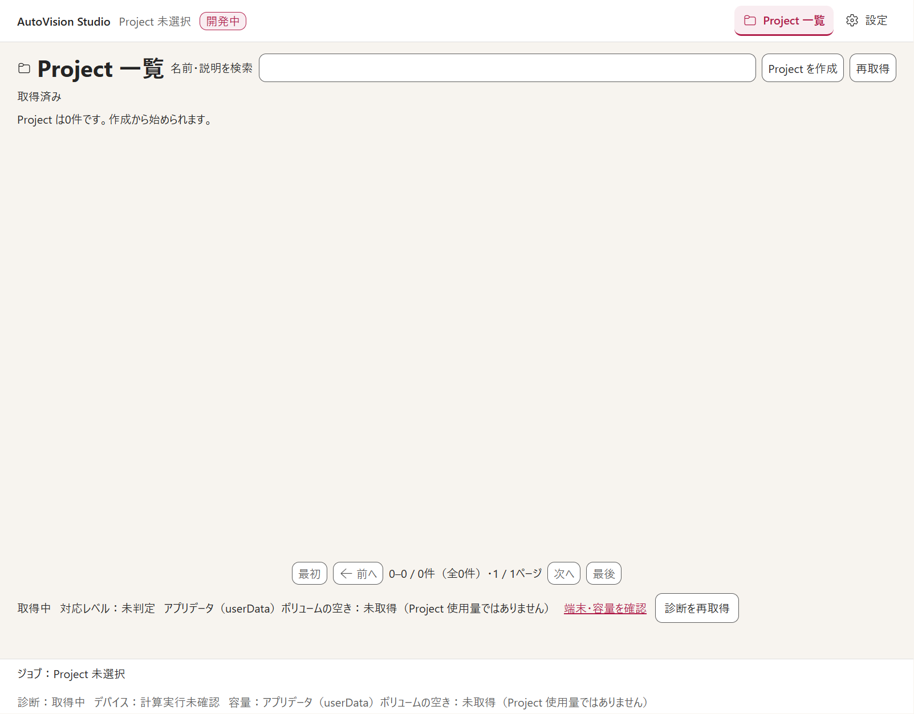
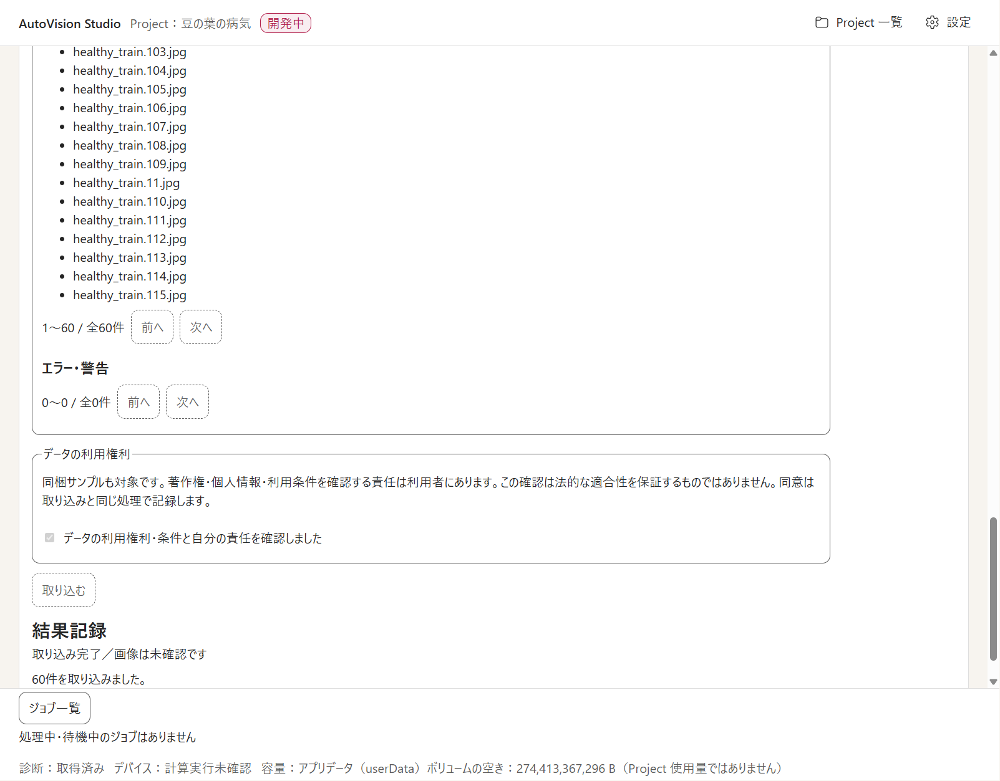

# 02. クイックスタート（画像分類を 15 分で）

同梱の Beans サンプル（豆の葉 60 枚）で、**Project 作成 → 取り込み → ラベル確認 → Dataset 確定**までを一通り体験します。物体検出は最後の [別コース](#物体検出で試す場合) にあります。

> 学習の実行以降は未実装です。このクイックスタートのゴールは「確認済みのデータを Dataset Revision として確定する」ところまでです。

**用意するもの:** [01. 準備と起動](01-getting-started.md) で起動したアプリ、`resources/samples/beans/images/`（フォルダー直下に `angular_leaf_spot`、`bean_rust`、`healthy` の 3 フォルダー）

## 手順 1. Project を作る

1. ヘッダーの **［Project 一覧］** を開き、**［Project を作成］** を押します。

   

2. 作成画面で次を入力します。
   - **［親フォルダーを選択］** … Project の保存先の親フォルダーを選びます（その中に専用フォルダーが作られます）。
   - **名前（必須）** … 例：`豆の葉の病気`
   - **タスク種別** … **画像分類**
3. **［作成］** を押します。作業画面が開きます。

   

> タスク種別は、最初の学習を作るまでは [設定 → Project] で変更できます。

## 手順 2. 画像を取り込む

1. 作業画面のタブ **［取り込む］** を開きます。

   

2. 「1. 形式と取り込み方法を選ぶ」で次を選びます。
   - **データ形式** … **クラス別フォルダー**（フォルダー名がそのままクラス名になります）
   - **取り込み方法** … **コピー（推奨）**

   

3. **［データを選択して検査］** を押し、`resources/samples/beans/images` を選びます。
4. 検査が終わると「2. 検査結果を確認して取り込む」に、画像件数（60 件）、クラス名（3 つ）、ファイル一覧、エラー・警告が出ます。内容を確認し、**［データの利用権利］** のチェックを入れて **［取り込む］** を押します。チェックを入れるまで、［取り込む］は押せません。

   

5. 「結果記録」に「取り込み完了／画像は未確認です」「60 件を取り込みました」と表示されれば完了です。

   

## 手順 3. ラベルを確認する

1. タブ **［教師データ］** を開きます。見出し「教師データ作成」の下に、画像の一覧（サムネイル）が並びます。取り込み直後はすべて **未着手** です。

   

2. 画像を 1 枚クリックします。下に **分類エディター** が開き、現在のクラスと **［クラス］** の選択欄が出ます。フォルダー名から取り込んだクラスが入っているので、内容が正しいか画像を見て確認します。違っていれば **［クラス］** から選び直します。

   

3. 正しければ **［確認済みにする］** を押します。「この画像は確認済みです。」と表示されます。取り込んだラベルも、人が確認するまで正解にはなりません。
4. 次の画像へ進みます（一覧のクリック、または矢印キー）。
5. 「表示分の未確認」が **0 件** になるまで繰り返します。
   - 学習に使わない画像は **［除外理由］** を選んで **［除外にする］** にします。
   - 間違えたら **［元に戻す］／［やり直す］** が使えます。編集内容は自動保存され、「保存状態」で確認できます。

> 60 枚を全部確認するのが大変な場合は、サンプルの一部だけを別フォルダーにコピーして取り込むと短時間で試せます。

## 手順 4. Dataset を確定する

1. 画面下部の **［Dataset を確定する］** を押します。
2. 確認ダイアログ「Dataset Revision を確定」で、全件数・確認済み・除外・エラーの件数を確認します。エラーが残っている間は確定できません。
3. 確定します。確認済みのデータが、後から変わらない Dataset Revision として固定され、学習の待ち行列に登録されます。

## 手順 5. 他の画面も見てみる

| タブ・画面 | いまの状態 |
|---|---|
| **［学習］** | 「学習の実行・履歴・進捗表示、キャンセル・再開は未実装です。」と表示されます |
| **［結果］** | レポート・モデル版の比較は未実装です |
| **［カメラで試す］** | 未実装です。カメラにはアクセスしません |
| ヘッダー **［設定］** | Project 設定、ラベル定義、端末・容量、ライセンス・情報を見られます（[03. 画面ガイド](03-screen-guide.md)） |
| ヘッダー **［Project 一覧］** | 作った Project を開く・設定する・削除対象を確認する |

## 物体検出で試す場合

1. 手順 1 で、タスク種別を **物体検出** にして Project を作ります（例：`小麦の穂の検出`）。
2. 手順 2 で、データ形式 **COCO アノテーション**、取り込み方法 **コピー（推奨）** を選びます。**［データを選択して検査］** を押すと、ダイアログが 2 回開きます。1 回目に `resources/samples/gwhd-2021/images`、2 回目に `resources/samples/gwhd-2021/annotations.coco.json` を選びます。
3. **［教師データ］** タブで画像を選ぶと **検出キャンバス** が開き、取り込んだ矩形（青い枠）が表示されます。

   

4. 矩形を追加するには、**［新規領域のクラス］** を選び、画像の上をドラッグします。右側の「領域一覧」で矩形ごとのクラスを変えられます。対象物がない画像は「対象物なし」を明示して確認します。
5. 確認が終わったら **［確認済みにする］** → **［Dataset を確定する］** の順に進みます（手順 3〜4 と同じです）。

## つまずいたら

[05. よくある質問と現在の制限](05-faq-and-limits.md) を確認してください。
