# 03. 画面ガイド（どこで何ができるか）

画面は大きく 3 つに分かれます。

1. **Project 一覧** — Project を探す・作る・開く
2. **Project の作業画面** — 5 つのタブ（取り込む／教師データ／学習／結果／カメラで試す）で作業する
3. **設定** — Project 設定、ラベル定義、推論、端末・容量、ライセンス・情報

すべての画面の上端に **ヘッダー**、下端に **共通状態バー** があります。

## 3.1 共通部分

| 場所 | 表示・操作 | 説明 |
|---|---|---|
| ヘッダー左 | 「AutoVision Studio」「Project：〈名前〉」「開発中」 | いま選択中の Project 名（未選択なら「Project 未選択」）。「開発中」は開発版の印です |
| ヘッダー右 | **［Project 一覧］** | Project 一覧へ移動します |
| ヘッダー右 | **［設定］** | 設定を開きます。開いている画面に戻るには設定の **［戻る］** を使います |
| 下端（左） | **［ジョブ一覧］**、「処理中・待機中のジョブはありません」 | 取り込みなど時間のかかる処理の状況 |
| 下端（下） | 診断・デバイス・容量 | 端末診断の結果と、アプリのデータ保存先ボリュームの空き容量 |

## 3.2 Project 一覧

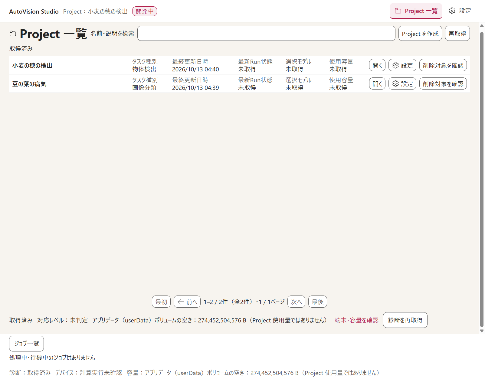

| 場所 | できること |
|---|---|
| 見出し横の **検索欄**（名前・説明を検索） | Project を絞り込みます |
| **［Project を作成］** | 新しい Project を作る画面を開きます（[04. 操作ガイド](04-how-to.md#project-を作る)） |
| **［再取得］** | 一覧を読み込み直します |
| 一覧の各行 | タスク種別、最終更新日時、最新 Run 状態、選択モデル、使用容量を表示します |
| 行の **［開く］** | その Project の作業画面を開きます |
| 行の **［設定］** | その Project の設定（保存先・名前など）を開きます |
| 行の **［削除対象を確認］** | 削除前に、何が削除されるかを確認します |
| 一覧下部のページ送り | 最初／前へ／次へ／最後 |
| 一覧下部の診断欄 | 対応レベル、空き容量、**［端末・容量を確認］**（設定の端末・容量へ）、**［診断を再取得］** |

Project が 0 件のときは「Project は 0 件です。作成から始められます。」と表示されます（[初期画面](images/01-project-list-empty.png)）。

## 3.3 Project の作成画面

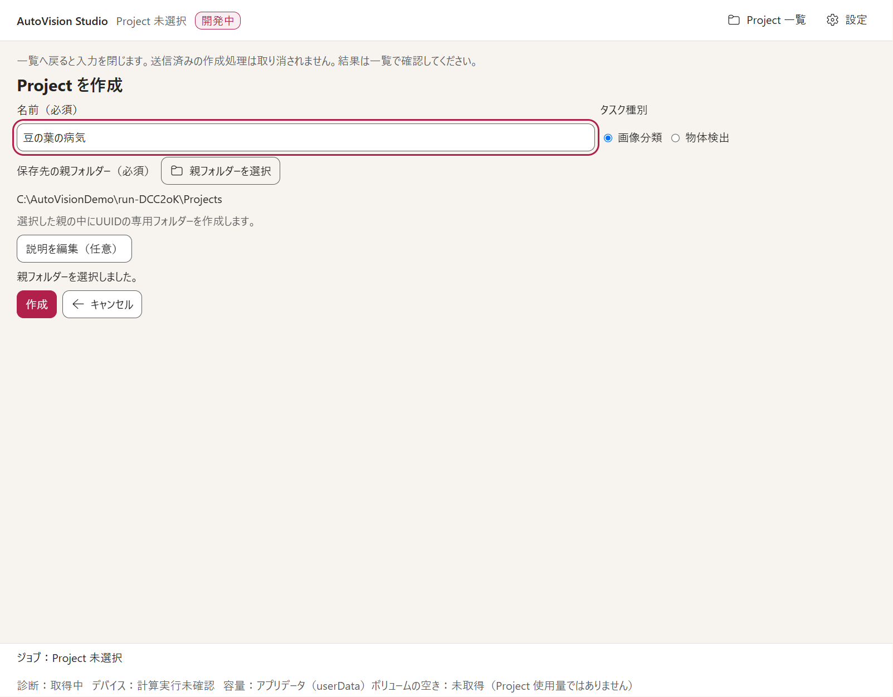

| 項目 | 説明 |
|---|---|
| **名前（必須）** | Project の名前 |
| **タスク種別** | **画像分類**（1 枚に 1 クラス）または **物体検出**（矩形で囲む） |
| **保存先の親フォルダー（必須）** | **［親フォルダーを選択］** で選びます。その中に ID 名の専用フォルダーが作られます |
| **［説明を編集（任意）］** | 説明文を入力します |
| **［作成］／［キャンセル］** | 作成するか、やめて一覧へ戻ります |

## 3.4 Project の作業画面（タブ）

Project の **［開く］** を押すか、作成が終わると開きます。

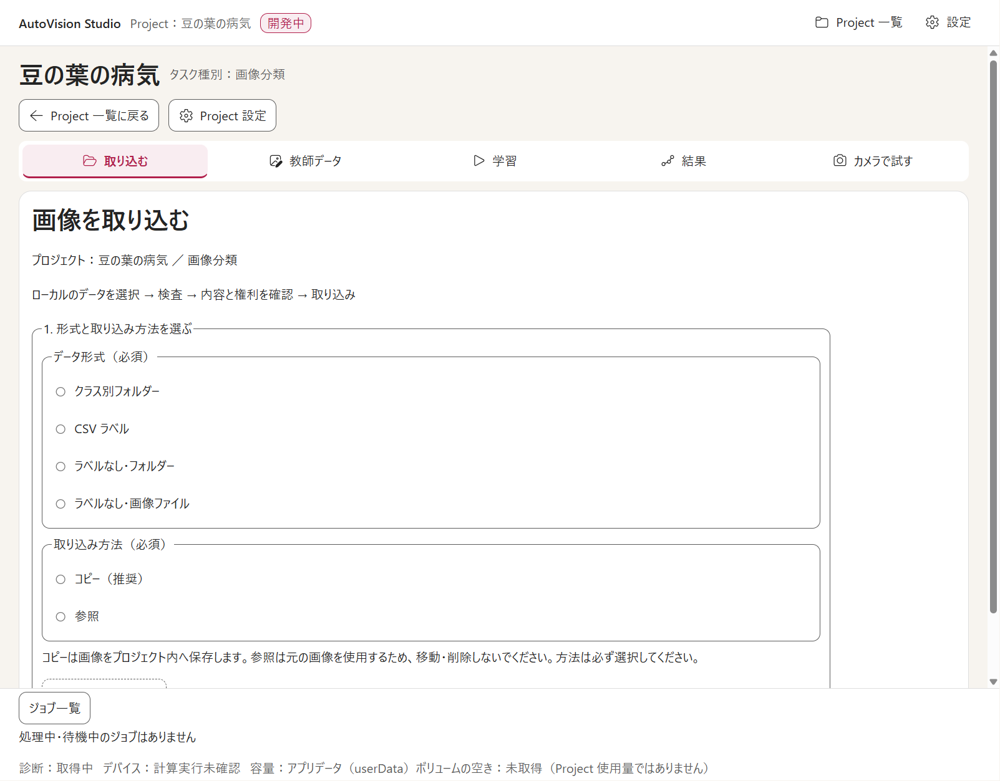

| 場所 | できること |
|---|---|
| 見出し | Project 名とタスク種別 |
| **［Project 一覧に戻る］** | 一覧へ戻ります |
| **［Project 設定］** | この Project の設定を開きます |
| タブ **［取り込む］** | 画像とラベルを取り込む（下記 3.5） |
| タブ **［教師データ］** | ラベル付け・確認・Dataset の確定（3.6） |
| タブ **［学習］** | 学習（**未実装**） |
| タブ **［結果］** | レポート・モデル版（**未実装**） |
| タブ **［カメラで試す］** | カメラ推論（**未実装**）。**［推論設定］** で設定画面へ移動できます |

### 3.5 ［取り込む］タブ

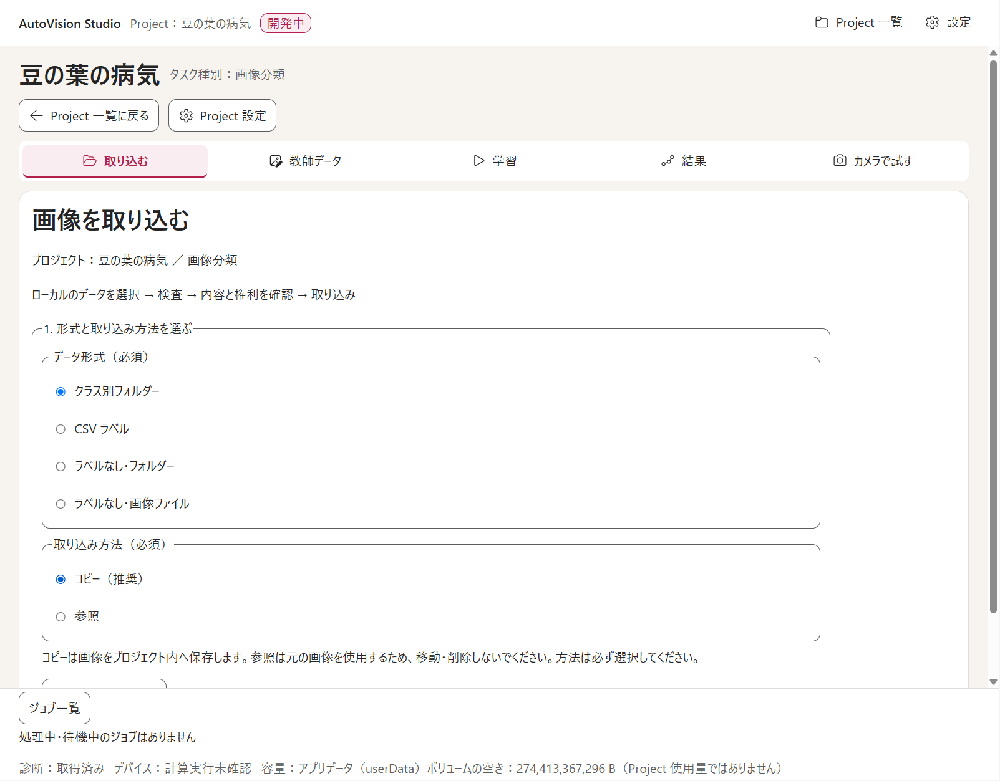

画面上部の「ローカルのデータを選択 → 検査 → 内容と権利を確認 → 取り込み」が流れです。

| 場所 | できること |
|---|---|
| **1. 形式と取り込み方法を選ぶ** | **データ形式**（画像分類：クラス別フォルダー／CSV ラベル／ラベルなし・フォルダー／ラベルなし・画像ファイル。物体検出：COCO アノテーション／ラベルなし）と、**取り込み方法**（**コピー（推奨）**／**参照**）を選びます |
| **［データを選択して検査］** | フォルダーやファイルを選び、画像の中身とラベルを検査します |
| **2. 検査結果を確認して取り込む** | 画像件数・クラス・ファイル一覧・エラー／警告の一覧を確認します。クラス名は取り込み前に編集できます |
| **データの利用権利** | 利用・学習する権利を確認したことのチェック。**チェックするまで［取り込む］は押せません** |
| **［取り込む］** | 取り込みを実行します |
| **［検査を破棄してやり直す］** | 検査結果を捨てて最初に戻ります |
| **結果記録** | 取り込んだ件数。「取り込み完了／画像は未確認です」と表示されます |

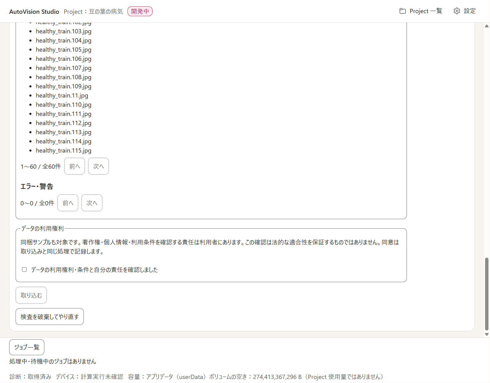

### 3.6 ［教師データ］タブ（教師データ作成）

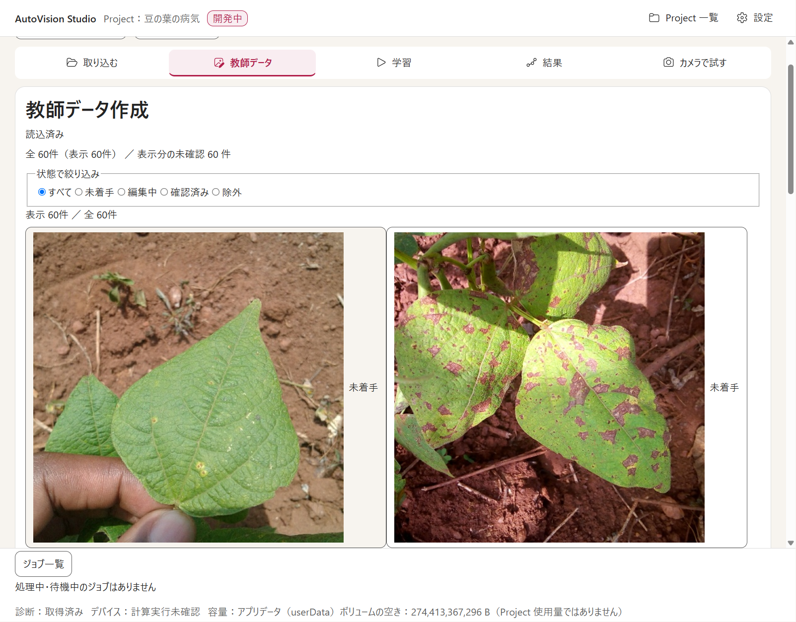

| 場所 | できること |
|---|---|
| 件数表示 | 全件数、表示件数、未確認の件数 |
| **状態で絞り込み** | すべて／未着手／編集中／確認済み／除外 |
| **画像一覧** | サムネイルをクリック（または矢印キー）で画像を選択。各画像の状態（未着手など）も表示 |
| エディター | 画像を選ぶと下に開きます（画像分類：分類エディター、物体検出：検出キャンバス） |
| **作業指示** | Project に設定した指示文（ラベル定義で設定）を常に表示します |
| **保存状態** | 保存中／保存済み／未保存の変更あり／保存失敗。編集は自動保存されます |
| **［確認済みにする］** | 人が確認して正解にします |
| **［Dataset を確定する］** | 確認済みのデータを不変の Dataset Revision にします |
| **［再読込］** | 保存済みの状態を読み込み直します |
| **参照元（Reference）の確認** | 「参照」で取り込んだ元ファイルが無事かを確認し、移動していたら選び直します |

**画像分類のエディター**

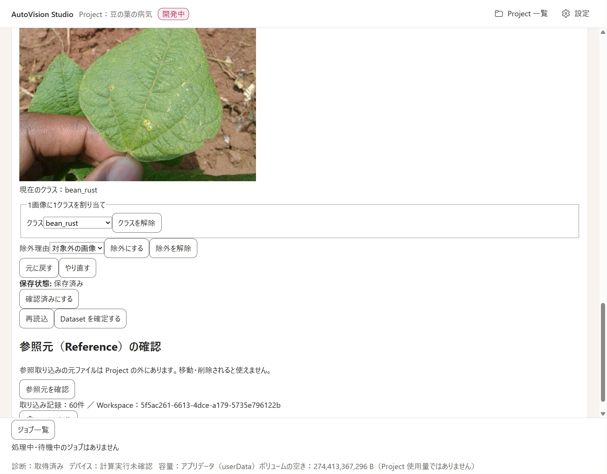

| 場所 | できること |
|---|---|
| 現在のクラス | 付いているクラス名（未割当／Schema 外のときはその旨） |
| **クラス** ／ **［クラスを解除］** | 1 画像に 1 つのクラスを選ぶ・外す |
| **除外理由** ／ **［除外にする］**／**［除外を解除］** | 学習に使わない画像にする・戻す |
| **［元に戻す］／［やり直す］** | 直前の編集を取り消す・戻す |

**物体検出のエディター**

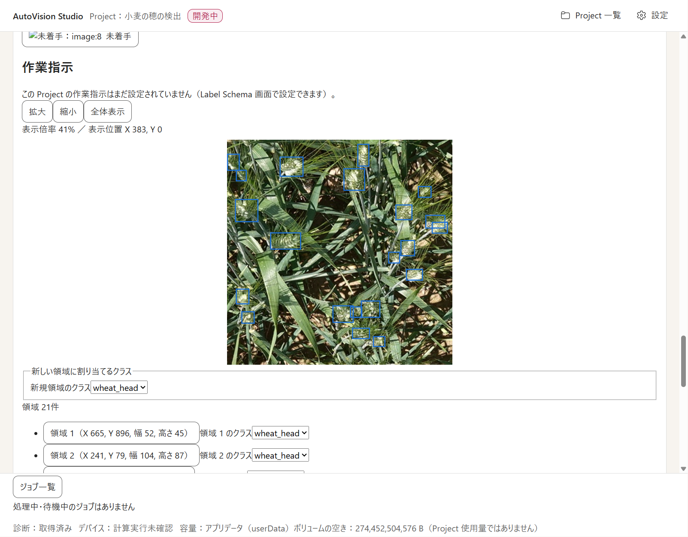

| 場所 | できること |
|---|---|
| **［拡大］［縮小］［全体表示］** | 表示倍率の変更。表示倍率と表示位置が数値で出ます |
| 画像上のドラッグ | 矩形（バウンディングボックス）を新しく描く。小さすぎる矩形や画像の外で離した矩形は作られません |
| **新規領域のクラス** | これから描く矩形のクラス |
| **領域一覧** | 矩形の一覧（座標は元画像のピクセル）。行を押すと画像上で選択、矩形ごとにクラスを変更 |
| 領域コマンド | 複製（Ctrl+D）、すべて選択（Ctrl+A）、削除（Delete）、選択解除（Esc） |
| 対象物なしの確認 | 物体が写っていない画像を、未着手と区別して「対象物なし」として確認 |
| 重なり警告 | 同じクラスで大きく重なる矩形があると知らせます。自動では削除・統合しません |

### 3.7 ［学習］［結果］［カメラで試す］タブ

どれも現在は「未実装です」の案内だけが表示されます。

| タブ | 表示 | 予定される内容（Version 1） |
|---|---|---|
| ［学習］ | 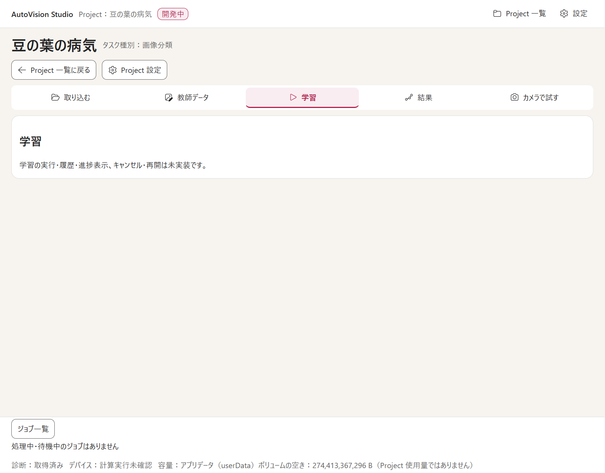 | 学習の実行・履歴・進捗・キャンセル・再開 |
| ［結果］ | 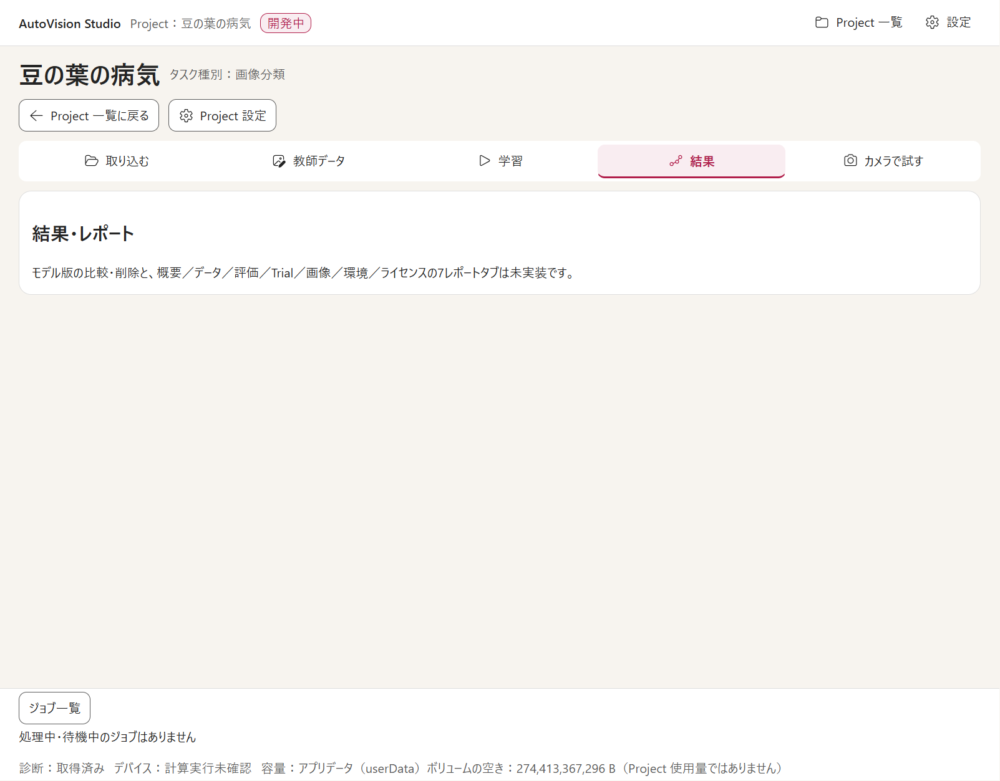 | 7 種類のレポートタブ（概要／データ／評価／Trial／画像／環境／ライセンス）とモデル版の比較・削除 |
| ［カメラで試す］ | 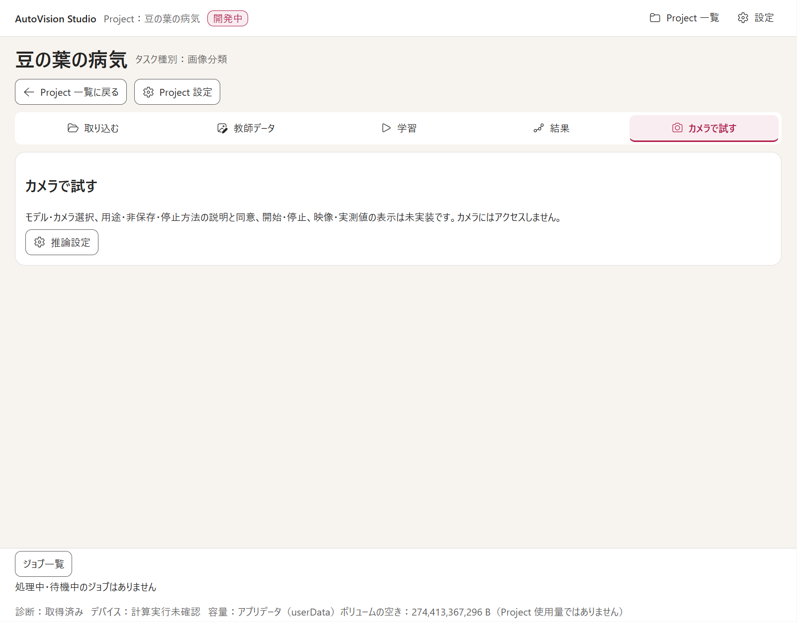 | モデル・カメラの選択、用途と非保存の説明、開始・停止、映像と実測値の表示 |

## 3.8 設定

ヘッダーの **［設定］**、または作業画面の **［Project 設定］**／**［ラベル定義］** から開きます。上部のカテゴリで切り替えます。

| カテゴリ | できること | 状態 |
|---|---|---|
| **Project** | 名前・タスク種別・説明の編集、保存場所の変更、旧保存場所の復旧確認 | 利用可 |
| **ラベル定義** | 作業指示の編集、クラスの追加・名前変更。Project の選択が必要 | 利用可 |
| **推論** | 推論設定の編集・保存 | 未実装 |
| **端末・容量** | OS・CPU・メモリ・ディスクの診断、**［再取得］**、**［診断要約を保存］** | 利用可 |
| **ライセンス・情報** | 製品バージョン、同梱アイコンとモデルの LICENSE／NOTICE | 一部利用可 |

### Project 設定

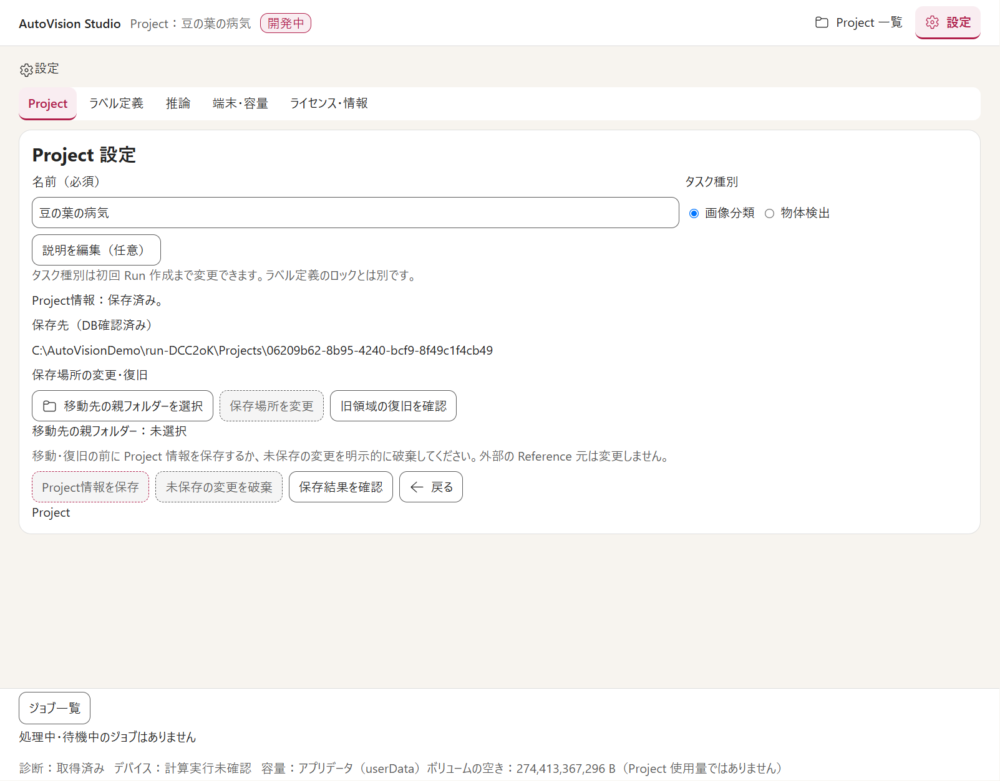

| 場所 | できること |
|---|---|
| 名前／タスク種別／説明 | 編集。タスク種別は最初の学習を作るまで変更できます |
| 保存先 | Project の保存先を表示します |
| **［移動先の親フォルダーを選択］** → **［保存場所を変更］** | Project の保存先を移動します |
| **［旧領域の復旧を確認］** | 移動が中断した場合の旧保存場所の復旧を確認します |
| **［Project 情報を保存］／［未保存の変更を破棄］／［保存結果を確認］／［戻る］** | 変更の保存・破棄・確認と、設定から戻る |

### ラベル定義

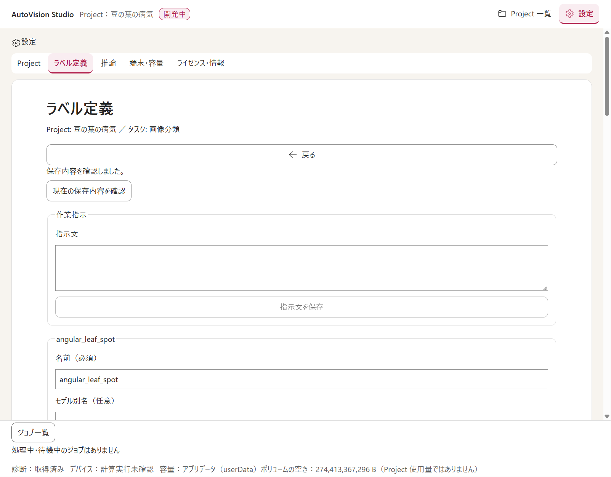

| 場所 | できること |
|---|---|
| **作業指示** → **［指示文を保存］** | ラベル付けの基準（例：「葉の病斑が見えるものだけ bean_rust」）を書きます。教師データ画面に常時表示されます |
| クラスごとの **名前（必須）**／**モデル別名（任意）** | クラス名の変更と別名の設定。空白だけの名前や、重複する名前は使えません |
| 新しいクラス | クラスを追加します |
| **［現在の保存内容を確認］** | 保存済みの内容を読み込み直して確認します |

### 推論

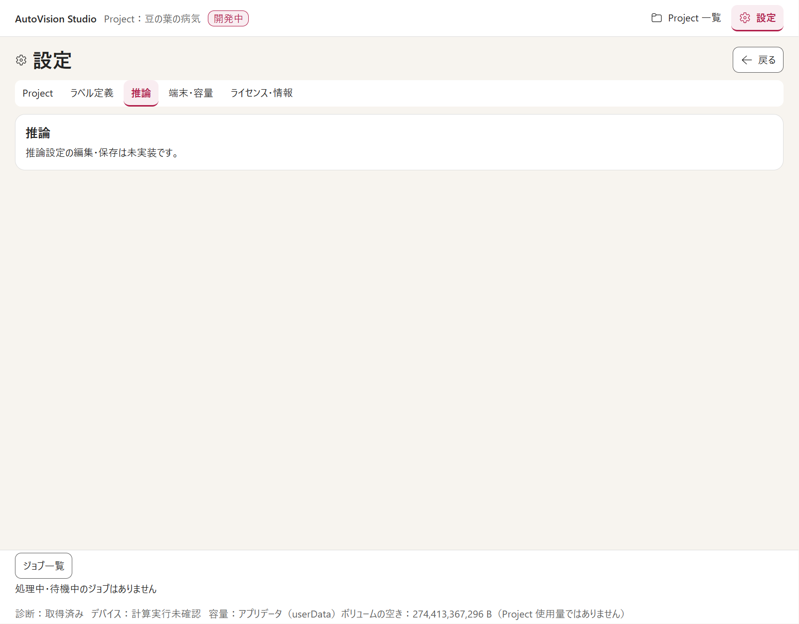

「推論設定の編集・保存は未実装です。」と表示されます。

### 端末・容量

この端末の OS、CPU、メモリ、ディスク容量を表示します。**［再取得］** で最新化し、**［診断要約を保存］** で結果を保存できます。**［端末］／［実行環境］** で表示を切り替えます。この端末固有の情報が表示されるため、スクリーンショットは載せていません。

### ライセンス・情報

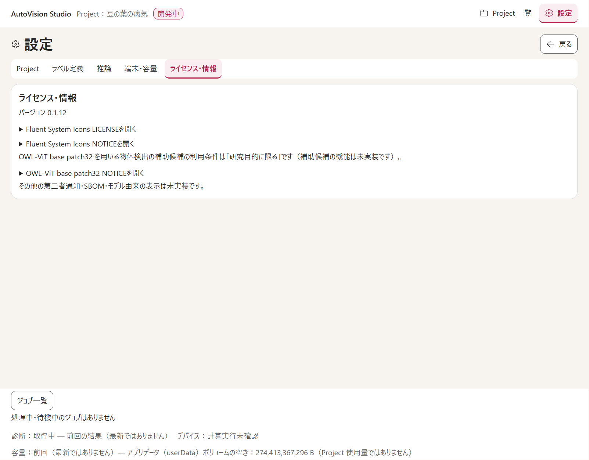

製品バージョンと、同梱するアイコン（Fluent System Icons）や物体検出の補助モデル（OWL-ViT。研究目的に限る）の LICENSE／NOTICE を展開して読めます。

次は [04. 操作ガイド](04-how-to.md) へ。
