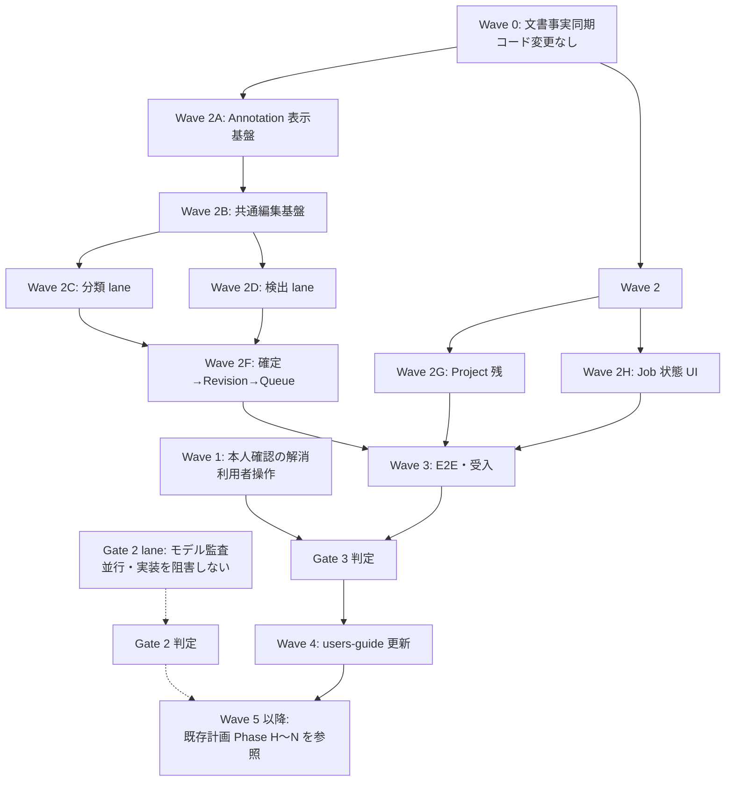

# AutoVision Studio タスク実行プラン

| 項目 | 内容 |
|---|---|
| 文書種別 | 一時作業文書（実行計画案・**未承認**） |
| 作成日時 | 2026-09-21 13:30 |
| 作成時 HEAD | `25dc1b7`（`Add UI shell probe test for M1 window verification`） |
| 作成時 worktree | クリーン（`git status --short` 出力なし） |
| 対象 | Version 1（MVP）／Windows 11 24H2 以降 x64 |
| 要求基準 | [`docs/requirement-definition.md`](../docs/requirement-definition.md) v0.5 Draft（245要求） |
| 計画正本 | [`docs/implementation-plan.md`](../docs/implementation-plan.md)（task ID・Gate の正本） |
| 状態 | **利用者承認待ち。本書の承認前にタスクを実行しない。** |

> 本書は 2026-09-21 の調査結果に基づく実行順の提案である。既存の task ID、Gate、承認履歴、完了記録を書き換えず、参照する。新しい Gate や新しい要求は追加しない。

---

## 0. 実行前の確認事項（承認が必要）

### 0.1 指示と実在物の差異

利用者の指示にあった参照先のうち、次は**実在を確認できなかった**。捏造を避けるため、実在物へ読み替えた前提で計画している。

| 指示された参照先 | 調査結果 | 本計画での扱い |
|---|---|---|
| `/hve-dev/requirement-definition.md` | `hve-dev/` は存在しない（`Test-Path` = False）。実在する要求定義は [`docs/requirement-definition.md`](../docs/requirement-definition.md) のみ | 実在する `docs/requirement-definition.md` を要求基準とする。これは既存計画の **D-01 で決定済み**の扱いと一致する（[implementation-plan.md §2](../docs/implementation-plan.md)） |
| `copilot-instructions.md` の `## §0 最優先ルール` | `copilot-instructions.md` と `.github/copilot-instructions.md` はいずれも存在しない | 無視対象そのものが存在しない。追加の作用なし |
| `/work/` | 作業ツリーに `work/` は存在しなかった（コミット `632beb9` で旧 `work/` 配下が削除済み） | リポジトリ root 直下に `work/` を新規作成し、本書を配置した |

### 0.2 不明点・選択肢・デフォルト

以下は実行前に確定が必要である。**利用者が変更しない限り、デフォルトの選択肢で実行する。**

| ID | 不明点 | 選択肢 | デフォルト | デフォルトを選んだ理由 |
|---|---|---|---|---|
| Q-01 | 要求定義の参照先 | A. `docs/requirement-definition.md` / B. `hve-dev/` を新設して移動 | **A** | A は実在し、v0.5 Draft・245要求を持つ唯一の要求文書である。B は実在しない文書を要求基準と称することになり、既存 D-01 の決定にも反する。移動は全文書のリンクと hash baseline を破壊する |
| Q-02 | 本計画文書の保存先 | A. リポジトリ内 `work/`（Git 追跡対象） / B. リポジトリ外の一時領域 | **A** | 指示の `/work/` をリポジトリ root 相対と解釈した。`.gitignore` に `work/` 除外は存在しないため追跡対象になる。追跡させたくない場合は Q-02 で B を指示すること |
| Q-03 | E2E 試験基盤の採用 | A. Playwright（Electron 対応） / B. 独自 harness / C. E2E を当面作らず単体試験のみ | **A** | 既存計画が `tests/e2e/*.spec.ts` を前提とし、出典 [P09] で Playwright の Electron 制約に言及済み。B は harness 自作となり過剰。C は Gate 3 の「縦スライス成立」を証明できない。**A は新規依存追加のため、C0 と同じ依存採用記録（必要性・license・脆弱性・lock）を W3-01 で必須とする** |
| Q-04 | 分類 lane と検出 lane の並列実行 | A. 直列（単一担当） / B. 並列（2担当以上） | **A** | 本計画は担当者数を確認できていない。並列は出力 file が重ならない設計にしてあるため、担当者を確保できる場合は B へ切替可能。切替時も共有 file（`AppShell.tsx` 等）の編集排他は維持する |
| Q-05 | UIR-017 等の「本人確認」の実施主体 | A. 利用者本人が実施し結果を記録 / B. 実装担当が代行 | **A** | 既存記録が「自己点検・JSDOM 結果を本人の実回答に代用しない」と明記している（[ui-ux-execution.md](../docs/ui-ux-execution.md)）。B は代行・捏造に該当する |
| Q-06 | Gate 2（モデル承認）の着手時期 | A. Wave 2〜3 と並行して監査を進める / B. Wave 3 完了後に着手 / C. 当面着手しない | **A** | 監査は法務・一次資料調査が主で、実装 lane と出力 file が重ならない。並行しても実装を阻害しない。ただし**承認が出るまで AST/TRN/REP/INF の実装は開始しない**境界は維持する |
| Q-07 | Dataset Revision 用の新規 migration | A. 追加しない（既存 `006_annotations.sql` を使う） / B. `008_revisions.sql` を追加 | **A** | `006_annotations.sql` に `dataset_revisions`(113行)、`dataset_items`(133行)、`workspace_revision_sources`(161行) が**既に存在する**ことを確認済み。B は重複テーブルの新設であり過剰実装かつ schema 破壊リスクがある |
| Q-08 | `src/main/annotations/provenance.ts`（ANN-16）の新規作成 | A. 新規作成しない / B. 新規モジュールとして切り出す | **A** | `annotation_provenance` テーブル（`006_annotations.sql:90`）と、`workspace-repository.ts`・`annotation-handlers.ts` の provenance 記録・返却経路が既に存在する。B は既存実装を別名で再実装する重複であり、YAGNI 違反 |
| Q-09 | `CHANGELOG.md` の新規作成時期 | A. 全対象タスク完了後（既存規約を維持） / B. Wave ごとに追記 | **A** | 既存 UI 実行記録が「全UIタスクと必要な既存依存・レビューが完了した後だけ CHANGELOG の Unreleased へ記載し、その後 root package/lock の PATCH を1増やす」と規定している。B はこの承認済み規約の変更にあたる |
| Q-10 | 本計画で扱う範囲 | A. Gate 3 到達までを詳細化し、Gate 2/4/5 は既存計画を参照 / B. Gate 5 までの全タスクを本書で再定義 | **A** | B は既存 [`implementation-plan.md`](../docs/implementation-plan.md) §7 の task 表（Phase H〜N）をほぼ全面複製することになり、正本の二重化を招く。Gate 2 未解消の段階で Gate 4/5 の詳細設計を確定するのは、未実測値に基づく先回り設計で過剰である |

---

## 1. 調査で確定した事実（計画の前提）

### 1.1 文書の記述と実装が一致していない箇所

次は**新規実装ではなく、状態記録の更新**が必要な項目である。既存実装を「未実装」として再実装しない。

| 文書の記述 | 実際の実装 | 根拠 |
|---|---|---|
| 「Preload は `contractVersion` だけを公開」 | `projects` / `labelSchemas` / `annotations` / `diagnostics` / `jobs` / `imports` の6 API を公開済み | [`src/preload/index.ts:15-37`](../src/preload/index.ts)、[`src/shared/contracts/app.ts:11-24`](../src/shared/contracts/app.ts) |
| 「Renderer は 11 route の見出しだけ」 | UI-01/02/03/04/09 は実 component が存在。UI-05/06/07/08/10/11 が `EmptyRoute` | `src/renderer/features/` 配下に `DiagnosticsPage` `ProjectListPage` `ProjectForm` `ImportPage` `LabelSchemaPage` `SettingsPage` が実在 |
| 「ANN-04 の Label Schema IPC が残件」 | 実装・Main 登録済み | [`src/main/ipc/label-schema-handlers.ts`](../src/main/ipc/label-schema-handlers.ts)、[`src/main/index.ts:232`](../src/main/index.ts) |
| 「ANN-06 の Workspace IPC が残件」 | 実装・Main 登録済み | [`src/main/ipc/annotation-handlers.ts`](../src/main/ipc/annotation-handlers.ts)、[`src/main/index.ts:234`](../src/main/index.ts) |
| 実装計画の予定名 `004_annotations.sql` 等 | 実際の適用済み migration は 001〜007 | `src/main/db/migrations/` に 001_core〜007_annotation_target_history が実在 |

### 1.2 実装済みで再作成しないもの

| 領域 | 実在する production file |
|---|---|
| App 基盤 | `app-lifecycle.ts`, `window.ts`, `security.ts`, `paths.ts`, `index.ts` |
| DB | `database.ts`, `migrate.ts`, `backup.ts`, migrations 001〜007 |
| Project | `project-repository.ts`, `project-service.ts`, `project-directory.ts`, `project-move.ts`, `project-move-receipt.ts`, `project-operation-lock.ts` |
| Job | `job-repository.ts`, `job-state.ts`, `job-service.ts`, `worker-supervisor.ts`, `recover-jobs.ts` |
| Import | `import-service.ts`, `import-repository.ts`, `import-files.ts`, `import-capacity.ts`, `copy-source.ts`, `reference-source.ts`, `reference-access.ts`, `rights-acknowledgement.ts`, `image-protocol.ts`, `safe-path.ts` |
| Annotation | `label-schema-repository.ts`, `label-schema-service.ts`, `workspace-repository.ts`, `workspace-service.ts`, `save-draft.ts`, `target-history.ts`, `validate-annotation.ts`（**item 単位のみ**） |
| Python | `cli.py`（health / probe-hardware / scan-dataset）, `image_scan.py`, `image_decode.py`, `classification_import.py`, `coco_import.py` |
| 版・診断・ログ | `product-version.ts`, `version-compatibility.ts`, `diagnostics-service.ts`, `redact.ts`, `diagnostic-export.ts`, `atomic-write.ts` |
| UI | `AppShell.tsx`, `WorkflowTabs.tsx`, `ProjectWorkspace.tsx`, `SystemIcon.tsx`, `tokens.css`, UI-01/02/03/04/09 の各 page |

### 1.3 未実装と確認した production file（本計画の主対象）

| 領域 | 不在を確認した file |
|---|---|
| Revision | `src/main/data/revision-manifest.ts`, `revision-repository.ts`, `revision-service.ts` |
| Workspace 派生 | `src/main/annotations/clone-workspace.ts`, `confirm-and-queue.ts` |
| Workspace 全体検証 | `validate-annotation.ts` 内に未実装（同 file のコメントに *"Whole-workspace totals/validation are deliberately NOT implemented by this leaf"* と明記） |
| 学習 Queue | `src/main/jobs/training-queue.ts` |
| Project 削除 | `src/main/projects/delete-preview.ts`, `delete-project.ts` |
| 電源・温度 | `src/main/diagnostics/power-thermal.ts` |
| Python split | `ml/src/autovision_ml/data/split_dataset.py` |
| Annotation UI 一式 | `src/renderer/features/annotations/` に `LabelSchemaPage` 以外の全 component |
| Job UI | `src/renderer/features/jobs/` ディレクトリ自体が不在 |
| E2E | `tests/e2e/` ディレクトリ自体が不在 |

### 1.4 外部条件で BLOCKED のもの（実装で解消できない）

| 条件 | 現状 | 根拠 |
|---|---|---|
| Gate 2（モデル承認） | **BLOCKED / NOT_COMPLETE** | [`docs/adr/0004-spike-decisions.md:13`](../docs/adr/0004-spike-decisions.md) |
| 承認済みモデル | 0件（`ready:false` / `models:[]`） | `resources/models/manifest.json` |
| C6 分類・C6 検出・C7 分類・C7 検出 | 全4役とも承認 0 件 | `docs/model-governance/` 配下4文書 |
| AutoML 予算（TBD-03 / D-15） | 未決定 | [`docs/requirement-definition.md:897`](../docs/requirement-definition.md) |
| UIR-017 本人確認 | `NOT_RUN` | [`tests/manual/ui-shell-review.md`](../tests/manual/ui-shell-review.md) |

---

## 2. 実行 Wave と依存関係

**並列規則:** 依存が完了し、かつ `作成・編集 file` が重ならない task だけを並列実行する（既存 §4.4 を継承）。`AppShell.tsx`・`routes.tsx`・`app.ts`・`index.ts` は共有 file であり、同時編集しない。

---

## 3. 詳細タスク

### 3.1 表の読み方

- **出力:** `作成・編集 file` 欄の file だけを変更する。未記載 file のついで編集は禁止。
- **粒度:** 既存 §4.1 を継承し、production 1〜3 file、test 1〜2 file、doc 1 section、観測可能な1挙動を上限とする。
- **DoD（完了条件）:** 各タスクは以下 **5項目すべて**を満たして初めて完了とする。これは既存 §4.3 の手順を DoD として明文化したものである。
  1. `完了条件（DoD）` 欄の観測可能な挙動が、記載の test file で検証されている
  2. 対象 test を実行し、**実コマンド・終了コード・件数**を記録した（件数の合算による水増しをしない）
  3. `npm run typecheck` 相当の型検査と editor diagnostics が 0 である
  4. 実装者とは別担当の独立敵対的レビューで blocking finding 0、または指摘を修正し再検証して閉じた
  5. 上記未達の場合は `REVIEW_PENDING` / `BLOCKED` を保持し、**依存タスクを開始しない**

---

### Wave 0 — 文書事実同期（コード変更なし・相互に並列可）

前提: なし。Wave 2 開始前に完了させる（誤った「未実装」記述に基づく重複実装を防ぐため）。

| ID | タスク | 作成・編集 file | 依存 | 完了条件（DoD） |
|---|---|---|---|---|
| W0-01 | architecture.md の「現行」節を実装実態へ同期 | `docs/architecture.md`（該当1節のみ） | なし | Preload 公開 API が6種である事実と、UI-01/02/03/04/09 が実 component・UI-05/06/07/08/10/11 が `EmptyRoute` である事実を記載。`node scripts/docs/verify-documentation.mjs` が exit 0。未実装機能を利用可能と書かない |
| W0-02 | README「現在の利用可否」を同期 | `README.md`（該当1節のみ） | なし | 現在到達している画面と未到達画面を区別して記載。要求 hash・版番号の既存行を変更しない。`verify-documentation.mjs` と `verify-product-version.mjs` が exit 0 |
| W0-03 | 実装計画へ現状確定を追記 | `docs/implementation-plan.md`（§15.10 を新設、追記のみ） | なし | ①ANN-04/06 の IPC が実装済みであること、②migration 006 に Revision 系テーブルが存在し新規 migration が不要であること、③現在の使用済み migration 番号が 001〜007 であることを記載。既存の表・承認履歴・過去の件数記録を書き換えない。`verify-documentation.mjs` が exit 0 |
| W0-04 | 事実ベースラインの再基準化 | `docs/documentation-fact-baseline.md` | W0-01〜03 | HEAD・日付・「機能状態」欄を現在の実装へ更新。未実行の test を PASS と記録しない。`verify-documentation.mjs` が exit 0 |

> **停止条件:** W0 は文書のみを変更する。source・test・依存・lock・証跡 JSON を変更した時点で範囲逸脱とする。

---

### Wave 1 — 本人確認の解消（利用者操作。実装 lane と並列可）

| ID | タスク | 作成・編集 file | 依存 | 完了条件（DoD） |
|---|---|---|---|---|
| W1-01 | UIR-017 の利用者本人確認を実施・記録 | `tests/manual/ui-shell-review.md`, `docs/ui-ux-execution.md`（該当1行） | なし（利用者の実施が必要） | 利用者本人が実アプリで「現在対象・状態／次の結果／戻り先」を回答し、期待 ID と実回答を照合した記録が残る。未実施なら `NOT_RUN` を保持し、**代行・推測で埋めない**。実施後に UIR-017 の状態を BLOCKED から更新 |
| W1-02 | UIR-041Q / UIR-084 の現況確定 | `docs/ui-ux-execution.md`（該当1節） | なし | 両 ID について「完了／未実施／未確認」のいずれかを証拠付きで確定。証拠が無い場合は **`未確認` と明記して保持**し、完了扱いにしない |
| W1-03 | UIR-025 親タスクの残条件確定 | `docs/ui-ux-execution.md`（該当1節） | W1-01, W1-02 | 親 UIR-025 を閉じるために残る条件（削除 preview、正式 Gate、署名、clean install、本人確認）を列挙し、各々の担当 Wave を対応付ける。leaf の完了を親の完了へ昇格させない |

---

### Wave 2A — Annotation 表示基盤（直列）

前提: Wave 0 完了。Gate 1 `CONDITIONAL_GO` に依存（core / manual annotation は開発可）。

| ID | タスク | 作成・編集 file | 依存 | 完了条件（DoD） |
|---|---|---|---|---|
| W2-01 | thumbnail の read-only 配信 | `src/main/data/image-protocol.ts`, `src/main/data/image-protocol.test.ts` | W0 | 既存 safe path 検証を維持したまま、縮小画像を配信する1経路を追加。Project allowlist 外・traversal・symlink 越境を拒否する既存の負例が引き続き失敗しない。**汎用画像変換 API や cache 層を作らない** |
| W2-02 | AnnotationPage 骨格と一覧表示 | `src/renderer/features/annotations/AnnotationPage.tsx`, `AnnotationPage.test.tsx` | W2-01 | `/annotations` が `EmptyRoute` ではなく、既存 `annotations` IPC 経由で workspace の item 一覧を表示する。件数と取得失敗時のエラー表示を検証 |
| W2-03 | gallery と前後移動・状態 filter | `src/renderer/features/annotations/ImageGallery.tsx`, `ImageGallery.test.tsx` | W2-02 | 未着手／編集中／確認済み／除外の filter と、前後移動が keyboard で操作できる。表示外件数を隠さない |

### Wave 2B — 共通編集基盤（直列）

| ID | タスク | 作成・編集 file | 依存 | 完了条件（DoD） |
|---|---|---|---|---|
| W2-04 | 保存 draft hook（autosave / undo） | `src/renderer/features/annotations/useAnnotationDraft.ts`, `useAnnotationDraft.test.ts` | W2-03 | 編集から **1秒以内に保存を開始**し、現在画像の undo / redo ができる。既存 `save-draft.ts` の契約（内容と確認解除の同時保存、古い更新の拒否）に従う。**汎用 undo framework を作らない** |
| W2-05 | 保存状態と共通 item 操作 | `src/renderer/features/annotations/SaveStatus.tsx`, `ItemActions.tsx`, `ItemActions.test.tsx` | W2-04 | 保存中／保存済み／失敗を色以外の手段でも区別して表示し、除外理由を選択できる。keyboard で全操作に到達できる |

### Wave 2C — 分類 lane（Wave 2D と並列可・Q-04 に従う）

| ID | タスク | 作成・編集 file | 依存 | 完了条件（DoD） |
|---|---|---|---|---|
| W2-06 | 分類エディター | `src/renderer/features/annotations/ClassificationEditor.tsx`, `ClassificationEditor.test.tsx` | W2-05 | 1画像に **ちょうど1クラス**を設定し、置換・解除・除外ができる。0個／複数指定を UI で作れない |
| W2-07 | ラベル選択と最近使用 | `src/renderer/features/annotations/LabelPicker.tsx`, `useRecentLabels.ts`, `LabelPicker.test.tsx` | W2-06 | 検索・最近使用・数字 shortcut が mouse と keyboard の双方で動作する。IME 入力中に shortcut が誤発火しない |
| W2-08 | 一括適用とクラス分布 | `src/renderer/features/annotations/ClassificationBulkBar.tsx`, `ClassDistribution.tsx`, `ClassificationBulkBar.test.tsx` | W2-07 | 複数選択への一括適用と、件数・偏り警告を表示する。**確認済み Ground Truth を上書きしない** |

### Wave 2D — 検出 lane（Wave 2C と並列可）

依存ライブラリ `konva@10.3.2` / `react-konva@19.2.5` は `package.json` に採用済みのため、新規依存追加は発生しない。

| ID | タスク | 作成・編集 file | 依存 | 完了条件（DoD） |
|---|---|---|---|---|
| W2-09 | 座標変換（純関数） | `src/renderer/features/annotations/canvas-coordinates.ts`, `canvas-coordinates.test.ts` | W2-05 | 画像 pixel ↔ 表示座標の相互変換が zoom / pan 適用下で往復一致する。境界値と非有限値を拒否 |
| W2-10 | 検出 canvas 基盤 | `src/renderer/features/annotations/DetectionCanvas.tsx`, `DetectionCanvas.test.tsx` | W2-09 | 画像表示と zoom / pan が動作する。矩形操作は本タスクに含めない |
| W2-11 | 矩形の作成・選択・削除 | `src/renderer/features/annotations/RectangleLayer.tsx`, `RectangleLayer.test.tsx` | W2-10 | 矩形の作成・選択・削除ができ、選択中 ID を表示する |
| W2-12 | 矩形の移動・リサイズ | `src/renderer/features/annotations/RectangleTransformer.tsx`, `RectangleTransformer.test.tsx` | W2-11 | 画像境界で clamp され、最小サイズ未満を作れず、**画像 pixel 座標**で保存される |
| W2-13 | 領域一覧・クラス変更・対象物なし | `src/renderer/features/annotations/RegionList.tsx`, `NoObjectButton.tsx`, `RegionList.test.tsx` | W2-12 | 矩形ごとのクラス変更ができ、「対象物なし」と「未着手」が区別して表示・保存される |
| W2-14 | 矩形コマンドと重複警告 | `src/renderer/features/annotations/RectangleCommands.tsx`, `src/main/annotations/duplicate-warning.ts`, `RectangleCommands.test.tsx` | W2-13 | 複製・全選択・keyboard 操作が動作し、同一クラスの高重複を警告する。**自動削除・自動統合はしない** |

### Wave 2E — 作業指示の常時表示

| ID | タスク | 作成・編集 file | 依存 | 完了条件（DoD） |
|---|---|---|---|---|
| W2-15 | Annotation 指示表示 | `src/renderer/features/annotations/AnnotationInstructions.tsx`, `AnnotationInstructions.test.tsx` | W2-06, W2-10 | Project 固有の遮蔽・端切れ・極小・曖昧境界の方針をエディター内で常時参照できる。**指示の編集 UI は本タスクに含めない** |

### Wave 2F — 確定 → Revision → Queue（Main 側・直列）

前提: Q-07 のとおり **新規 migration を追加しない**。`006_annotations.sql` の既存テーブルを使用する。

| ID | タスク | 作成・編集 file | 依存 | 完了条件（DoD） |
|---|---|---|---|---|
| W2-16 | workspace 全体の検証 | `src/main/annotations/validate-annotation.ts`, `workspace-validation.test.ts` | W2-08, W2-14 | workspace 全 item を走査し、未確認・除外・Schema 外・不正矩形の件数と内訳を返す。既存の **item 単位 API の契約を変更しない**。書き込みを行わない |
| W2-17 | データ分割 | `ml/src/autovision_ml/data/split_dataset.py`, `ml/tests/test_split_dataset.py` | W2-16 | 固定 seed で再現し、分類では層化を行い、同一 hash 画像が train/val/test に跨らない |
| W2-18 | Revision manifest writer | `src/main/data/revision-manifest.ts`, `revision-manifest.test.ts` | W2-16 | temp 書き込み → hash → atomic rename で manifest を生成する。**確認済み item だけ**を含め、未確認・候補が 0 件であることを検査する |
| W2-19 | Revision repository | `src/main/data/revision-repository.ts`, `revision-repository.test.ts` | W2-18 | `dataset_revisions` / `dataset_items` への読み書きを提供し、確定済み revision の更新を拒否する |
| W2-20 | Revision service | `src/main/data/revision-service.ts`, `revision-service.test.ts` | W2-19 | manifest 生成と DB 登録を 1 transaction で確定し、失敗時に部分状態を残さない。lineage（親 revision）を保持する |
| W2-21 | Revision IPC / Preload | `src/shared/contracts/revision-ipc.ts`, `src/main/ipc/revision-handlers.ts`, `src/preload/revision-api.ts` | W2-20 | sender origin・payload schema・Project ID を検証する。**channel 名や任意 path を Renderer から指定できる汎用 API を作らない** |
| W2-22 | 確定ダイアログ | `src/renderer/features/annotations/ConfirmDatasetDialog.tsx`, `ConfirmDatasetDialog.test.tsx` | W2-21 | 件数・provenance 内訳・未処理候補を表示し、**Error がある間は確定を block** する |
| W2-23 | 学習 Queue | `src/main/jobs/training-queue.ts`, `training-queue.test.ts` | W2-20 | training は同時 1 件で FIFO。**汎用 scheduler・優先度・再試行ポリシーを作らない** |
| W2-24 | 確定と Queue 引渡し | `src/main/annotations/confirm-and-queue.ts`, `confirm-and-queue.test.ts` | W2-22, W2-23 | commit 後 **5秒以内**に Training Run が `Queued` になる。学習 worker 未実装でも状態が整合する |
| W2-25 | 追加学習用 workspace 複製 | `src/main/annotations/clone-workspace.ts`, `clone-workspace.test.ts` | W2-20 | revision から編集可能 workspace を複製し、hash 重複を排除し、**元 revision を変更しない** |

### Wave 2G — Project 残機能（Wave 2A〜2F と並列可）

| ID | タスク | 作成・編集 file | 依存 | 完了条件（DoD） |
|---|---|---|---|---|
| W2-26 | 削除 preview（Main） | `src/main/projects/delete-preview.ts`, `delete-preview.test.ts` | W0 | 所有データと Reference 参照データを区別して件数・容量を返す。**この時点で削除を実行しない** |
| W2-27 | 削除確認ダイアログ | `src/renderer/features/projects/DeleteProjectDialog.tsx`, `DeleteProjectDialog.test.tsx` | W2-26 | preview 内容を表示し、明示確認なしに削除を実行しない |
| W2-28 | Project 削除の実行 | `src/main/projects/delete-project.ts`, `delete-project.test.ts` | W2-27, W2-20 | 所有 workspace / artifact を削除し、**Reference 元ファイルを削除・変更しない**。失敗時に部分削除状態を残さない |
| W2-29 | 電源・温度取得 | `src/main/diagnostics/power-thermal.ts`, `power-thermal.test.ts` | W0 | OS から取得できる値だけを返し、**取得不能時に状態を推測しない**（`unknown` を返す） |
| W2-30 | 長時間処理前の警告表示 | `src/renderer/features/diagnostics/PowerWarning.tsx`, `PowerWarning.test.tsx` | W2-29 | 取得できた場合のみ警告を表示し、`unknown` を「正常」と表示しない |

### Wave 2H — Job 状態 UI（Wave 2F と並列可）

| ID | タスク | 作成・編集 file | 依存 | 完了条件（DoD） |
|---|---|---|---|---|
| W2-31 | Job 状態バー | `src/renderer/features/jobs/JobStatusBar.tsx`, `JobStatusBar.test.tsx` | W0 | 既存 `jobs` IPC の progress 購読で現在処理・進捗・cancel を常時表示する |
| W2-32 | Job 一覧ページ | `src/renderer/features/jobs/JobPage.tsx`, `JobPage.test.tsx` | W2-31 | queue 内の job 一覧と状態を表示し、明示 cancel ができる。**自動再開・自動再試行を実装しない** |

---

### Wave 3 — E2E 基盤と Gate 3 受入

| ID | タスク | 作成・編集 file | 依存 | 完了条件（DoD） |
|---|---|---|---|---|
| W3-01 | E2E 基盤の依存採用 | `package.json`, `package-lock.json`, `docs/dependency-adoption/e2e-framework.md` | Q-03 承認 | Playwright の必要性・安定版・Windows x64 / Electron 対応・直接および transitive license・脆弱性を C0 と同じ様式で記録し、exact lock する。`npm ci` が exit 0 |
| W3-02 | E2E harness と fixture | `tests/e2e/harness.ts`, `tests/fixtures/project.ts` | W3-01 | packaging 前アプリを起動し、終了時に残 process が 0 であることを確認できる。**製品コードに test 専用の分岐を追加しない** |
| W3-03 | Project CRUD E2E | `tests/e2e/project-crud.spec.ts` | W3-02, W2-28 | 作成・編集・削除と、**再起動後の保持**、他 Project への非干渉を検証 |
| W3-04 | 取り込み E2E（分類） | `tests/e2e/import-classification.spec.ts` | W3-02 | folder / CSV / unlabeled、壊れた file、容量不足、権利未確認の各経路を検証 |
| W3-05 | 取り込み E2E（検出） | `tests/e2e/import-detection.spec.ts` | W3-02 | COCO 取り込みと不正 item の報告、Reference の再起動後アクセスと relink を検証 |
| W3-06 | Annotation E2E（分類） | `tests/e2e/annotation-classification.spec.ts`, `tests/fixtures/classification-images.ts` | W3-02, W2-24 | 取り込み → ラベル付け → 確認 → Revision 確定 → Queued までが成立し、未確認 0 件を検証 |
| W3-07 | Annotation E2E（検出） | `tests/e2e/annotation-detection.spec.ts`, `tests/fixtures/coco.ts` | W3-02, W2-24 | 同上を矩形作成・対象物なしを含めて検証 |
| W3-08 | Reference 実機受入 | `tests/manual/windows-file-picker.md` | W3-05 | 署名前 package で OS 標準 picker・複数選択・folder・cancel、アプリ再起動と **OS 再起動後**の Reference アクセス／relink を確認。結果を SPI-19 の PASS へ読み替えない |
| W3-09 | Gate 3 判定 | `docs/implementation-plan.md`（§15.11 を新設） | W3-03〜W3-08 | Project→Import→Annotation→Revision→Queued の縦スライス成立を実証拠付きで記録する。未実施項目を合格に数えない。不合格なら **Training / assist の実装を開始しない** |

---

### Wave 4 — users-guide 更新（機能完了後に実施）

**調査結果:** [`docs/users-guide.md`](../docs/users-guide.md) は全16章が存在するが、§6・§8・§9・§10 等に「主な操作（実装完了後に手順を記載予定）」の空欄が残る。したがって **users-guide の更新は必要**である。

| ID | タスク | 作成・編集 file | 依存 | 完了条件（DoD） |
|---|---|---|---|---|
| W4-01 | §6 Project の操作手順 | `docs/users-guide.md` §6 | W3-03 | 実画面の文言と一致する手順に置換。未実装機能を手順として書かない。`verify-documentation.mjs` が exit 0 |
| W4-02 | §7 取り込みの操作手順 | `docs/users-guide.md` §7 | W3-04, W3-05, W3-08 | Copy / Reference、容量、権利確認、形式、relink 手順を実測に基づいて記載 |
| W4-03 | §8 分類チュートリアル | `docs/users-guide.md` §8 | W3-06 | 実画面の操作手順へ置換 |
| W4-04 | §9 検出チュートリアル | `docs/users-guide.md` §9 | W3-07 | 同上 |
| W4-05 | §10 Label Schema 詳細 | `docs/users-guide.md` §10 | W3-06, W3-07 | 同上 |
| W4-06 | 状態凡例・目次の整合 | `docs/users-guide.md` 冒頭 | W4-01〜05 | 更新した章の「機能状態」「文書成熟度」を実態へ同期。未更新章の表示を変更しない |

> §11（補助）・§12（学習）・§13（カメラ）・§14（ストレージ／ライセンス）・§15（インストール）は、対応機能が Gate 2 / Gate 4 / Gate 5 に依存するため **本計画の対象外**とし、既存 `DOC-04`〜`DOC-09` の担当を維持する。

---

### Gate 2 lane — モデル承認（Wave 2〜3 と並行・実装 lane を阻害しない）

出力 file が実装 lane と重ならないため並行実行できる。**承認が出るまで AST/TRN/REP/INF の実装を開始しない**境界は維持する。

| ID | タスク | 作成・編集 file | 依存 | 完了条件（DoD） |
|---|---|---|---|---|
| G2-01 | 分類 Base Weight 監査 | `docs/model-governance/classification-base.md` | なし | 候補1件について license・学習データ由来・再配布可否・intended use・checkpoint hash を一次資料 URL と取得日付きで判定。不明が1つでも残れば `HOLD` を保持 |
| G2-02 | 検出 Base Weight 監査 | `docs/model-governance/detection-base.md` | なし | 同上 |
| G2-03 | 分類 Assist Model 監査 | `docs/model-governance/classification-assist.md` | なし | 同上 |
| G2-04 | 検出 Assist Model 監査 | `docs/model-governance/detection-assist.md` | なし | 同上 |
| G2-05 | 学習→ONNX 一致検証（分類） | `spikes/models/classification.py`, `classification-result.md` | G2-01 | 権利確認済み fixture で train → ONNX → CPU 推論の出力差を実測記録。閾値超過は失敗として記録 |
| G2-06 | 学習→ONNX 一致検証（検出） | `spikes/models/detection.py`, `detection-result.md` | G2-02 | box / score / label と mAP 差を実測記録 |
| G2-07 | 補助品質 baseline | `spikes/models/assist_benchmark.py`, `assist-result.md` | G2-03, G2-04 | gold set で coverage / accept / edit / reject / 所要時間を手作業のみと比較し実測記録 |
| G2-08 | AutoML 予算の決定 | `docs/implementation-plan.md`（D-15 の決定行） | G2-05, G2-06 | Windows 実機 mini-run に基づく有限の最大 Trial 数・最大時間を記録。**測定前の数値を置かない** |
| G2-09 | Gate 2 判定と manifest 更新 | `docs/adr/0004-spike-decisions.md`, `resources/models/manifest.json` | G2-01〜G2-08 | 4役すべてが承認された場合のみ `ready=true` と entry を追加。1役でも未承認なら `BLOCKED` を保持し、**空 manifest のまま**とする |

---

### Wave 5 以降 — Gate 4 / Gate 5（本計画では再定義しない）

Gate 2 判定後に着手する Phase H（Annotation Assist）・Phase I（Training）・Phase J（Report）・Phase K（Camera inference）・Phase L（hardening）・Phase M（installer）・Phase N（final acceptance）は、既存 [`docs/implementation-plan.md` §7](../docs/implementation-plan.md) の task 表を正本として使用する。

**本計画で再定義しない理由:** これらは未承認モデルの実測値・未決定の AutoML 予算・未取得の署名証明書に依存する。実測前に詳細設計を確定することは、未検証の前提に基づく先回り設計であり、過剰実装にあたる（Q-10）。

着手前に再確認が必要な既存の決定事項:

| ID | 内容 | 現状 |
|---|---|---|
| D-10 | Product identity | 暫定 `io.github.dahatake.autovisionstudio`。Gate 3 までに確定が必要 |
| D-16 | Windows コード署名証明書 | **利用者からの提示が必要**。未提示 |
| REP-11 | グラフ描画の依存採用 | 未決。Phase J 着手前に1つだけ採用、または追加依存なしと決定 |

---

## 4. 実行順のまとめ

| 順 | Wave | 並列性 | 主な成果 |
|---|---|---|---|
| 1 | Wave 0 | 4 task 並列可 | 文書と実装の不一致を解消（誤った重複実装を防ぐ） |
| 2 | Wave 1 | Wave 0 と並列可 | 本人確認の状態確定 |
| 3 | Wave 2A → 2B | 直列 | Annotation の表示・保存基盤 |
| 4 | Wave 2C ／ 2D ／ 2G ／ 2H | 4 lane 並列可（Q-04） | 分類・検出の編集 UI、Project 残、Job UI |
| 5 | Wave 2E → 2F | 直列 | 確定 → Revision → Queue |
| 6 | Wave 3 | W3-03〜W3-07 は並列可 | E2E と Gate 3 判定 |
| 7 | Wave 4 | 章ごとに並列可 | users-guide の実手順化 |
| — | Gate 2 lane | Wave 2〜3 と並行 | モデル承認（Gate 4 以降の前提） |

---

## 5. オーバーエンジニアリング禁止事項（本計画の全タスクに適用）

既存 [`implementation-plan.md` §1.3](../docs/implementation-plan.md) と §10 を継承し、本計画では特に次を禁止する。

1. **Q-07 / Q-08 の重複実装をしない。** Revision 用 migration を新設せず、`provenance.ts` を新規に切り出さない。
2. **汎用化の先回りをしない。** annotation editor は「単一クラス分類」と「軸平行矩形」だけを扱う。回転矩形・polygon・mask の拡張点を設けない。
3. **状態管理ライブラリを導入しない。** React state と画面単位 hooks で実装する。
4. **抽象レイヤーを作らない。** Strategy / Factory / DI container / 汎用 repository framework / plugin API を導入しない。
5. **未使用の設定・フラグを追加しない。** 要求に無い閾値・オプション・環境変数を作らない。
6. **予防的なエラー処理・ログを追加しない。** 要求された失敗経路と、実際に再現した失敗だけを扱う。
7. **test のために製品コードを変更しない。** E2E 用の分岐・hook を production file に入れない。
8. **範囲外 file を編集しない。** 各タスクの `作成・編集 file` 欄以外は変更しない。
9. **scheduler / 再試行 / 自動復旧を作らない。** training は 1件 FIFO、job は明示 cancel のみ、復旧は状態遷移のみとする。

---

## 6. 停止条件・終了条件

### 6.1 停止条件（該当したら進めない）

- Gate 2 が未解消の間、**AST / TRN / REP / INF の実装を開始しない**。
- Gate 3 が不合格の間、**Training / assist の機能実装を開始しない**。
- 本人確認が未実施の項目を、自己点検・JSDOM 結果・実装担当の代行で**合格に置き換えない**。
- `SPI-03` / `SPI-09` / `SPI-19` は `SKIPPED_BY_USER` を保持し、**別名で開発前提へ戻さない**。対応する製品受入（`DAT-15` / `INF-14` / `INF-15`）は個別に実施する。
- 未実行の test を PASS と記録しない。異なる対象集合の件数を合算しない。

### 6.2 最終化の条件（既存規約を維持）

1. 本計画の全対象タスクと、必要な既存依存・独立レビューが完了する
2. その後にのみ `CHANGELOG.md` の Unreleased へ概要と該当エントリーを記載する
3. その後に root `package.json` / `package-lock.json` の PATCH を **1 だけ**増やす（worker 版・model 版は変更しない）
4. commit / tag / release は本計画の範囲外とする

現在の製品版は `0.1.0` である（`verify-product-version.mjs` で確認、exit 0）。本計画の作成時点では CHANGELOG 追加・PATCH 更新を行っていない。

---

## 7. 本計画作成時の検証記録

| 検証 | コマンド | 結果 |
|---|---|---|
| 文書整合 | `node scripts/docs/verify-documentation.mjs` | exit 0（必須 Markdown 8件、SVG 5件） |
| 製品版整合 | `node scripts/release/verify-product-version.mjs` | exit 0（`0.1.0`） |
| 作業ツリー | `git status --short` | 出力なし（本書作成前） |

本計画の作成では source、test、依存、lock、証跡 JSON を変更していない。アプリ全体の test suite・build は再実行していないため、既存の PASS 記録を本日の合格として読み替えない。
