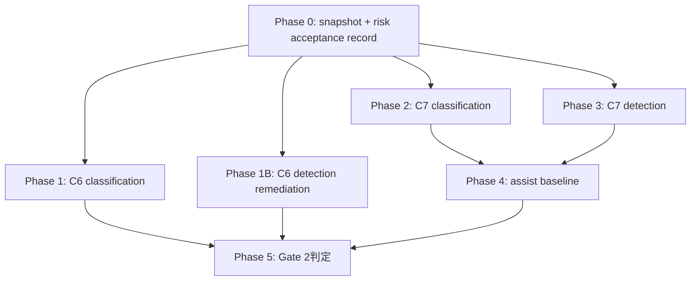

# Gate 2 残タスク実行プラン

| 項目 | 内容 |
|---|---|
| 文書種別 | 一時作業文書（実行計画） |
| 作成日時 | 2026-09-23 06:30 |
| 対象 | `### Gate 2 lane` の残タスク（G2-01〜G2-09 のうち Gate 2 完了を阻害しているもの） |
| 要求基準 | [`docs/requirement-definition.md`](../docs/requirement-definition.md) v0.6 Draft（FR-LIC-016 追加、246 要求） |
| 正本 | [`docs/implementation-plan.md`](../docs/implementation-plan.md)、[`docs/adr/0004-spike-decisions.md`](../docs/adr/0004-spike-decisions.md)、[`resources/models/manifest.schema.json`](../resources/models/manifest.schema.json) |
| 先行記録 | [`20260921-1330-TaskExecutionPlan.md`](20260921-1330-TaskExecutionPlan.md)、[`20260923-0025-Gate2LaneFinalization.md`](20260923-0025-Gate2LaneFinalization.md)、[`20260923-0546-RelaxedLicenseModelSurvey.md`](20260923-0546-RelaxedLicenseModelSurvey.md) |
| 現在状態 | Gate 2 **BLOCKED**。`resources/models/manifest.json` は `ready=false` / `models: []`。承認済み model は 0 件。D-15 は分類・検出とも CPU/CUDA 予算実測済み |

> この計画は、これまでの会話・実測・レビュー結果を前提に、**捏造せず** Gate 2 を完了へ進めるための残作業を分解する。未実施の測定を合格として書かない。FR-LIC-016 は license / training-data terms 未確認に対する risk acceptance 経路であり、**性能・hash・safe load・ONNX parity・CPU/DirectML 互換・補助品質 baseline を緩和しない**。

---

## 1. Gate 2 合格条件と現在の不足

### 1.1 Gate 2 合格条件

[`docs/implementation-plan.md` §6](../docs/implementation-plan.md) の Gate 2 条件:

> Windowsで分類/検出の Curated Base Weight と Assist checkpoint が法務・hash・実機品質 gate を通過し、Windows CPU/accelerator の AutoML budget を実測決定。

[`resources/models/manifest.schema.json`](../resources/models/manifest.schema.json) は `releaseStatus.ready=true` の場合に、少なくとも次の 4 役を要求する。

1. `C6` / `classification`
2. `C6` / `detection`
3. `C7` / `classification`
4. `C7` / `detection`

### 1.2 現在の不足

| 役・項目 | 現状 | 不足 | 主な出典 |
|---|---|---|---|
| C6 分類 | 承認 0 件。緩和後候補は torchvision MobileNetV3 | 取得、hash、safe load、ONNX parity、CPU/DirectML 性能、採用記録、FR-LIC-016 書面決定、manifest entry | [`20260923-0546-RelaxedLicenseModelSurvey.md`](20260923-0546-RelaxedLicenseModelSurvey.md) §3.1 |
| C6 検出 | SSDLite は権利・hash・parity 通過だが性能不適合で保留 | 採用基準を満たす最適化実測、または C6 に POC-03 閾値を適用しない owner 裁定、または性能未達の risk acceptance。加えて CVE 調査 | [`detection-base.md`](../docs/model-governance/detection-base.md) §15.8 |
| C7 分類 | SigLIP / SigLIP2 は候補。権利は FR-LIC-016 対象 | transformers 依存採用、取得、hash、safe load、ONNX parity、CPU/DirectML 性能、`inferenceConfig`、採用記録、manifest entry | [`20260923-0546-RelaxedLicenseModelSurvey.md`](20260923-0546-RelaxedLicenseModelSurvey.md) §3.2 |
| C7 検出 | Grounding DINO transformers 版が候補。HF safetensors 版は新規書面決定が必要 | transformers 依存採用、取得、hash、safe load、ONNX parity、CPU/DirectML 性能、`inferenceConfig`、採用記録、manifest entry | 同 §3.3 |
| G2-07 補助品質 baseline | `NOT_RUN`。承認済み C7 が 0 件 | 代表 gold set、manual-only / assisted session、coverage / accept / edit / reject / time、品質非劣化と時間短縮の判定 | [`assist-result.md`](../spikes/models/assist-result.md) |
| D-15 AutoML budget | 充足 | なし | [`detection-result.md`](../spikes/models/detection-result.md) §11〜12、[`classification-result.md`](../spikes/models/classification-result.md) |

---

## 2. デフォルト選択

利用者指示「不明点はデフォルトのプランを採用」に従い、次をデフォルトとして実行する。

| ID | 不明点 | デフォルト | 理由 |
|---|---|---|---|
| DQ-01 | C6 分類候補 | **torchvision `MobileNet_V3_Large_Weights.IMAGENET1K_V2`** | acc@1 が `75.274` と Small V1 より高く、既存依存のみで実装できる。payload 約 21MB で許容範囲。Small V1 は性能優先の代替候補として保持 |
| DQ-02 | C6 分類 FR-LIC-016 | **`LicenseRef-AutoVisionStudio`、承認者 `dahatake`、決定日 2026-09-23** とする書面決定を作成 | 既存の FR-LIC-016 運用と同じ形式。未確認項目を列挙し、publisher grant ではないことを NOTICE に明記 |
| DQ-03 | C6 検出 SSDLite の扱い | **保留維持。性能未達の risk acceptance は置かない** | 技術 gate は緩和しない方針。まず C6 分類と C7 を進め、SSDLite は最適化または別候補を後続で判断 |
| DQ-04 | C7 分類候補 | **既取得の `google/siglip-base-patch16-224` を優先** | SigLIP2 は 1.50GB で新規書面決定が必要。既取得 SigLIP は 812MB で既存の risk acceptance 対象 |
| DQ-05 | C7 検出候補 | **`IDEA-Research/grounding-dino-tiny`（HF transformers safetensors 版）** | HF API metadata 上は publisher SHA-256 が存在し、remote code 不要に見える。**取得時に実 byte の SHA-256 と repository contents を必ず照合する**。既存 GitHub `.pth` より安全側。ただし新規 risk acceptance が必要 |
| DQ-06 | transformers 依存 | **隔離 spike で検証後、採用記録と dependency-policy §10 に従って製品 lock へ追加判断** | 先に spike で実現性を確認し、不要なら lock を汚さない |
| DQ-07 | C7 `confidenceThreshold` | **gold set の実測から決める。事前固定しない** | TBD-08 の趣旨。測定前の数値を置かない |
| DQ-08 | C7 実測が性能不合格の場合 | **manifest 登録しない。別候補または risk acceptance ではなく技術改善へ戻す** | FR-LIC-016(5) により技術 gate は緩和しない |

---

## 3. タスク分解と DoD

### Phase 0 — 準備・基準固定

| ID | タスク | 作成・編集 file | 並列 | DoD |
|---|---|---|---|---|
| G2R-00 | 現在状態 snapshot | `work/20260923-0630-Gate2-TaskExecutionPlan.md` 追記、必要に応じて `work/*execution*.md` | 可 | `git status --short`、manifest `ready=false/models=[]`、version、既存候補 file の有無を記録。以後の測定の前提を固定 |
| G2R-01 | FR-LIC-016 decision record 雛形 | `docs/model-governance/evidence/2026-09-23-owner-risk-acceptance.md` | 可 | C6 分類、C7 検出 HF safetensors 版、必要なら C7 分類 SigLIP の決定範囲を**artifact 単位**で明記。未確認項目、`LicenseRef-AutoVisionStudio`、publisher grant でない旨、決定者 `dahatake`、決定日を記録 |

**敵対的レビュー:** Phase 0 完了時に、決定範囲が artifact 単位で曖昧でないこと、既存の 2026-09-22 決定と混同していないことをレビューする。blocking があれば次へ進まない。

### Phase 1 — C6 分類 Base Weight 承認（最短経路）

| ID | タスク | 作成・編集 file | 依存 | DoD |
|---|---|---|---|---|
| G2R-10 | MobileNetV3 Large V2 controlled retrieval | `vendor/models/`（Git 追跡外）、`docs/model-governance/evidence/*` | G2R-01 | publisher URL から `.pth` を取得し、byte size と SHA-256 を独立計算。保存 copy と取得日を記録。取得に失敗した場合は Small V1 へ切替し、切替理由を記録 |
| G2R-11 | C6 分類 adoption record | `docs/model-governance/mobilenet-v3-large-imagenet1k-v2-adoption.md` | G2R-10 | `adoption-template.md` に従い、C5/C6/C8、NOTICE、intended/out-of-scope、safe load、evidence、未確認項目、FR-LIC-016 開示を記入。未測定欄を空欄で承認しない |
| G2R-12 | C6 分類 parity / performance spike | `spikes/models/classification_checkpoint_parity.py` または既存 `classification.py` 拡張、`classification-checkpoint-result.md` | G2R-10 | checkpoint で torch ↔ ORT CPU ↔ ORT DirectML の出力差を実測。top-1/top-k、logit/softmax 差、p95 latency、FPS、累積 process peak working set を記録。閾値未達なら FAIL / 保留 |
| G2R-13 | C6 分類 manifest entry | `resources/models/manifest.json`, `scripts/models/manifest-schema.test.mjs` | G2R-11, G2R-12 | 採用記録が **Approved** の場合だけ C6 classification entry を追加。`ready=false` 維持。evidence localPath と SHA-256 を test で検証。保留なら entry を書かない |

**並列性:** G2R-11 の下書きと G2R-12 の spike 実装は G2R-10 の取得・hash 後に並列可。ただし manifest 編集は最後に単独。

**敵対的レビュー:** G2R-13 後、C6 分類の全 file を対象にレビュー。特に「ImageNet terms を risk acceptance で扱っていることを publisher grant と書いていないか」「性能未達を承認していないか」を確認。


### Phase 1B — C6 検出 Base Weight の再承認（性能未達からの復帰）

C6 検出は Gate 2 の 4 役の 1 つであり、現在の SSDLite は権利・hash・safe load・parity を満たす一方、採用記録 §11 の性能基準に不適合で **保留**である。Phase 1B は、性能要件を捏造せずに C6 検出を再承認できるかを判定する。

| ID | タスク | 作成・編集 file | 依存 | DoD |
|---|---|---|---|---|
| G2R-14 | SSDLite 推論最適化の最小再測定 | `spikes/models/detection-checkpoint-parity-result.md` 追補、必要なら `detection_checkpoint_parity.py` の最小修正 | なし | 既存 ONNX を対象に、過剰な汎用化をせず、session option・固定 input・graph optimization など**最小限の既存 API 設定**だけで p95/FPS を再測定。測定条件・warm-up・sample 数・percentile を記録。基準未達なら FAIL と記録 |
| G2R-15 | C6 検出基準の owner 裁定 | `docs/model-governance/ssdlite320-mobilenet-v3-large-coco-v1-adoption.md`, `detection-base.md` | G2R-14 | 次のいずれかを記録: (a) 最適化実測で `≤100 ms` / `≥10 FPS` を満たし Approved、(b) repository owner が「C6 は学習初期化用で POC-03 実時間推論閾値を適用しない」と裁定し、別の採用基準を採用記録へ明記。**性能未達そのものの risk acceptance は置かない**。owner 裁定を使う場合は、承認者氏名、役割、日時、exact artifact、対象基準、根拠、参照証拠、配布主体変更時の再審査条件を必須とする。いずれも無ければ **保留維持** |
| G2R-16 | C6 検出 manifest entry の復帰 | `resources/models/manifest.json`, `manifest-schema.test.mjs` | G2R-15 | 採用記録が Approved になった場合だけ C6 detection entry を追加。保留なら `models` へ書かない |
| G2R-17 | 代替検出 C6 の評価（SSDLite が復帰不能な場合） | `docs/model-governance/detection-base.md`, 新規 result/adoption | G2R-14 | SSDLite が性能・裁定とも不可の場合のみ実行。YOLOX-Nano または別候補を同じ DoD（FR-LIC-016、hash、safe load、CPU/DirectML parity、性能、採用記録）で評価。未実測のまま承認しない |

**敵対的レビュー:** Phase 1B 完了時に、(1) SSDLite の性能値が採用基準を満たすか、(2) owner 裁定がある場合に裁定範囲が C6 検出 artifact と基準だけへ限定されているか、(3) 技術未達を黙って Approved にしていないかをレビューする。
### Phase 2 — C7 分類 Assist Model 承認

| ID | タスク | 作成・編集 file | 依存 | DoD |
|---|---|---|---|---|
| G2R-20 | transformers spike 環境 | repository 外 venv、作業記録 | なし | `transformers` を repository 外に入れ、SigLIP / Grounding DINO を load / export できるか確認。失敗・必要 package を記録。**依存採用の判定条件**として、必要 package 一覧、wheel サイズ、transitive 依存、license、Critical/High CVE の有無、lockfile 変更量を記録し、採用しない場合は製品 lock を未変更に保つ |
| G2R-21 | SigLIP controlled retrieval | `vendor/models/`, `docs/model-governance/evidence/*` | G2R-20 | 既取得 artifact の再 hash または再取得。publisher metadata と照合。processor/tokenizer 等、実行に必要な payload を列挙 |
| G2R-22 | C7 分類 parity / performance / inferenceConfig | `spikes/models/siglip_assist_parity.py`, `siglip-assist-result.md` | G2R-21 | CPU/DirectML の出力一致、latency/FPS/memory、score range、scoreMeaning、seed、deterministicInference を実測記録。`confidenceThreshold` は gold set 前の仮値にしない |
| G2R-23 | C7 分類 adoption record | `docs/model-governance/siglip-base-patch16-224-adoption.md` | G2R-21, G2R-22 | FR-LIC-016 の未確認項目、WebLI terms 非公開、NOTICE、intended/out-of-scope、inferenceConfig を記録。性能・parity 合格時のみ Approved |
| G2R-24 | C7 分類 manifest entry | `resources/models/manifest.json`, schema test | G2R-23 | Approved の場合のみ C7 classification entry を追加。`inferenceConfig` 必須 6 項目を満たす。manifest の license / evidence / approval / intendedUse / support / inferenceConfig が adoption record と**値単位で一致**することを checklist または test で確認。未測定なら未登録 |

**敵対的レビュー:** G2R-24 後、C7 classification についてレビュー。特に `confidenceThreshold` と `deterministicInference` が測定根拠を持つか確認。

### Phase 3 — C7 検出 Assist Model 承認

| ID | タスク | 作成・編集 file | 依存 | DoD |
|---|---|---|---|---|
| G2R-30 | Grounding DINO tiny risk acceptance | `evidence/2026-09-23-owner-risk-acceptance.md` 更新 | G2R-01 | HF safetensors 版を artifact 単位で対象に含める。2026-09-22 GitHub `.pth` 決定と混同しない |
| G2R-31 | Grounding DINO tiny controlled retrieval | `vendor/models/`, `docs/model-governance/evidence/*` | G2R-30 | `model.safetensors` と processor/tokenizer/config を取得し、publisher SHA-256 と独立再計算が一致。remote code 不要を確認 |
| G2R-32 | C7 検出 parity / performance / inferenceConfig | `spikes/models/grounding_dino_assist_parity.py`, `grounding-dino-assist-result.md` | G2R-31 | CPU/DirectML parity、latency/FPS/memory、score semantics、threshold 候補、determinism を記録。custom code を実行しない |
| G2R-33 | C7 検出 adoption record | `docs/model-governance/grounding-dino-tiny-adoption.md` | G2R-31, G2R-32 | FR-LIC-016 未確認項目、学習データ由来、NOTICE、intended/out-of-scope、inferenceConfig を記録。性能・parity 合格時のみ Approved |
| G2R-34 | C7 検出 manifest entry | `resources/models/manifest.json`, schema test | G2R-33 | Approved の場合のみ C7 detection entry を追加。manifest の license / evidence / approval / intendedUse / support / inferenceConfig が adoption record と**値単位で一致**することを checklist または test で確認。未測定・性能未達なら未登録 |

**並列性:** Phase 2 と Phase 3 は、transformers の隔離検証（G2R-20）後に並列可。ただし製品 lock へ追加判断を行う場合は同時編集しない。

**敵対的レビュー:** G2R-34 後、C7 detection についてレビュー。特に HF safetensors 版と GitHub `.pth` 版の混同、publisher SHA-256 と自己計算値、remote code 不要の根拠を確認。

### Phase 4 — 補助品質 baseline（G2-07 / SPI-17）

| ID | タスク | 作成・編集 file | 依存 | DoD |
|---|---|---|---|---|
| G2R-40 | gold set と採用基準の固定 | `spikes/models/assist-goldset-plan.md` または採用記録内 §12 | G2R-24, G2R-34 | 分類/検出の representative gold set、品質指標、manual-only と assisted の比較方法、合格基準を事前固定。**最小 item 数、class / scene / object-size の coverage floor、除外条件、blind audit の有無**を明記し、測定後に基準を変えない |
| G2R-41 | manual-only session 記録 | `spikes/models/manual-session.jsonl`（必要なら Git 追跡外） | G2R-40 | 実作業から JSON Lines を記録。`item_id` 集合が固定。生成・推定しない |
| G2R-42 | assisted session 記録 | `spikes/models/assisted-session.jsonl`（必要なら Git 追跡外） | G2R-40, G2R-24, G2R-34 | 承認済み C7 を使った実作業から記録。coverage/accept/edit/reject/time を測定 |
| G2R-43 | assist benchmark 実行 | `spikes/models/assist-result.md` | G2R-41, G2R-42 | `assist_benchmark.py --assisted-session ... --manual-session ...` が `MEASURED`。品質非劣化と時間短縮を判定。未達なら Gate 2 BLOCKED |

**注意:** G2R-41 / G2R-42 は実作業が必要。AI が session を生成してはならない。ユーザー不在で進められない場合は、完了済み ID と未着手 ID を報告して停止。

**敵対的レビュー:** G2R-43 後、baseline の算術・item 集合一致・測定前基準固定をレビュー。PASS へ読み替えていないか確認。

### Phase 5 — Gate 2 判定（G2-09）

| ID | タスク | 作成・編集 file | 依存 | DoD |
|---|---|---|---|---|
| G2R-50 | manifest finalization | `resources/models/manifest.json` | G2R-13, G2R-24, G2R-34, G2R-43 | 4 役すべて Approved かつ SPI-17 が MEASURED/PASS の場合のみ `ready=true`、`productVersion` を現 version と一致。未達が 1 つでもあれば `ready=false` と理由を明記 |
| G2R-51 | ADR / plan / CHANGELOG / version 判断 | `docs/adr/0004-spike-decisions.md`, `work/*`, 必要な場合のみ `CHANGELOG.md` と root package/lock | G2R-50 | Gate 2 判定を記録。**CHANGELOG と PATCH 更新は、利用者指示または既存規約が要求する場合だけ実施**し、実施理由を作業記録へ明記。`verify-product-version` は version を変更した場合のみ必須 |
| G2R-52 | 最終検証 | なし | G2R-51 | `ruff`, `manifest-schema.test`, docs/version tests, `verify-documentation`, `verify-product-version`, `git diff --check` が PASS。必要なら対象 spike を再実行 |

**敵対的レビュー:** G2R-50〜52 後に全体レビュー。blocking 0 になるまで反映し、再検証する。

---

## 4. 実行順と並列計画



| 順 | 実行 | 並列性 | 完了条件 |
|---|---|---|---|
| 1 | Phase 0 | G2R-00 / G2R-01 は並列可 | risk acceptance の対象 artifact が曖昧でない |
| 2 | Phase 1 / 1B と Phase 2/3 の準備 | C6 分類、C6 検出の性能再測定、transformers 隔離検証は並列可 | C6 分類・C6 検出の合否、C7 実現性が判明 |
| 3 | Phase 2 / Phase 3 | 依存 file が分離されていれば並列可 | C7 2 役の合否が判明 |
| 4 | Phase 4 | session 記録はユーザー実作業が必要 | SPI-17 が MEASURED |
| 5 | Phase 5 | 単独 | Gate 2 判定確定 |

---

## 5. レビュー規則

各 Phase の DoD 達成後、次 Phase へ進む前に必ず敵対的レビューを実施する。

| レビュー観点 | 具体確認 |
|---|---|
| 捏造禁止 | 未実施測定を PASS と書いていないか。publisher metadata と自己計算 hash を混同していないか |
| FR-LIC-016 | 未確認項目を列挙しているか。`LicenseRef-` と `noticeText` に publisher grant でない旨があるか。技術 gate を緩和していないか |
| Schema | `support[].verified=true` が実測済みか。C7 の `inferenceConfig` 6 項目が測定根拠を持つか |
| Performance | p95/FPS/メモリの測定条件、warm-up、sample 数、percentile 方法、process-wide memory の説明が正確か |
| Overengineering | 新規依存や抽象化が候補検証に必要な範囲を超えていないか |
| 文書整合 | manifest 状態、承認数、Gate 2 状態が全記録で一致しているか |

blocking 指摘は**必ず反映**し、反映後に該当 test / spike を再実行する。non-blocking は反映または明確な理由を作業記録へ残す。

---

## 6. 停止条件と報告形式

次の場合は停止し、**完了済み ID / 未着手 ID / blocked ID** を報告する。

1. download / install がネットワークエラーで繰り返し失敗する
2. `transformers` 依存の導入が製品 lock に過大な変更を要求し、隔離 spike で代替できない
3. ONNX export / DirectML parity が未対応 op で失敗し、最小修正でも解決しない
4. 性能が採用基準に不適合で、候補変更または owner 裁定が必要
5. G2R-41 / G2R-42 の実作業 session が利用者不在で記録できない
6. 敵対的レビューで blocking が残り、反映方法が不明

報告形式:

```text
完了済み ID: ...
未着手 ID: ...
blocked ID: ...
停止理由: ...
最後に成功した検証: ...
次に必要な利用者判断: ...
```

---

## 7. この計画が意図的に行わないこと

- 未実施の parity / performance / assist baseline を PASS と記録しない。
- C5 code license を checkpoint license として流用しない。
- OpenAI CLIP、OWL-ViT、OWLv2 を FR-LIC-016 で復活させない（out-of-scope / intended-use mismatch は緩和対象外）。
- Phase H 以降（AST/TRN/REP/INF）の製品実装を Gate 2 完了前に開始しない。
- transformers を、隔離 spike で必要性が確認される前に製品 lock へ追加しない。
- SSDLite の性能未達を黙って受容しない。C6 への POC-03 閾値非適用は、性能未達の受容ではなく**基準適用範囲の owner 裁定**としてのみ扱う。

---

## 8. 成功時の最終状態

すべて成功した場合:

1. `resources/models/manifest.json` に C6 classification / C6 detection / C7 classification / C7 detection の 4 entry が存在する（C6 detection は Phase 1B で Approved になっている）。
2. 各 entry の evidence / approval / support / license / intendedUse / inferenceConfig（C7）が schema と採用記録に一致する。
3. `releaseStatus.ready=true`、`productVersion` が root package version と一致する。
4. `assist-result.md` が `MEASURED` で、NFR-ANN-006（品質非劣化・時間短縮）が合格している。
5. ADR-0004 に Gate 2 `GO` を記録し、Gate 4 以降の AST/TRN/REP/INF に進める。

いずれかが未達なら `ready=false` のまま、理由を manifest と ADR に明記し、Gate 2 は BLOCKED を維持する。
