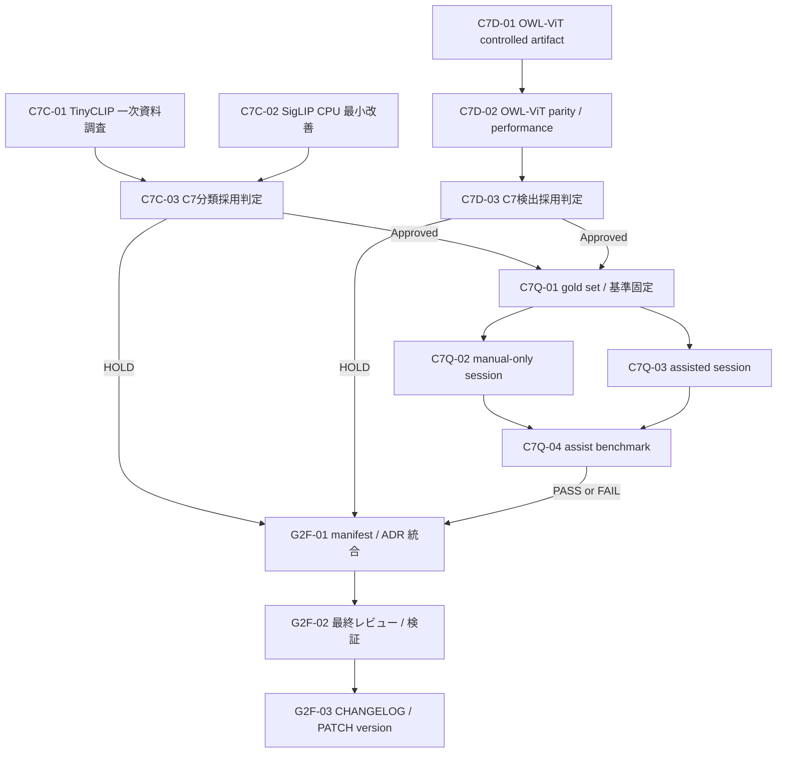

# C7 残タスク実行計画

| 項目 | 内容 |
|---|---|
| 文書種別 | 一時作業文書（ATG 分割計画） |
| 作成日時 | 2026-09-23 14:37 JST |
| 要求基準 | [`docs/requirement-definition.md`](../docs/requirement-definition.md) v0.7 Draft |
| 先行調査 | [`20260923-1015-NonCommercialModelSurvey.md`](20260923-1015-NonCommercialModelSurvey.md) |
| 先行実行 | [`20260923-0720-Gate2-TaskExecution.md`](20260923-0720-Gate2-TaskExecution.md) |
| 実行方針 | 不明点は先行調査の既定案を採用し、未実測を合格としない |

## 1. 受入条件

1. C7 分類について、TinyCLIP の一次資料調査と SigLIP の最小 CPU 改善を実行し、採否を実測と保存資料で確定する。
2. C7 検出について、OWL-ViT base patch32 の controlled retrieval、ONNX Runtime CPU / DirectML parity、性能を実測し、採否を確定する。
3. 承認できた C7 だけを manifest へ登録する。未測定、性能未達、parity 未達、権利根拠不足の候補は登録しない。
4. C7 分類と検出の両方が承認された場合だけ、事前固定した gold set と利用者の実作業 session による補助品質比較へ進む。
5. 各タスクは DoD の検証後に敵対的レビューを受け、実在する blocking 指摘を反映して再検証する。
6. 最後に Keep a Changelog の `[Unreleased]` を更新し、今回変更した package だけ PATCH version を 1 増やす。

## 2. 非対象

- 実作業に基づかない manual-only / assisted session の生成。
- 未確認の intended use、teacher provenance、性能、parity、ライセンス条件の推定。
- 複数候補を共通化する新規 framework、未使用 flag、将来用 abstraction。
- 製品 lock への spike 専用依存の追加。
- Gate 2 未通過のまま Gate 4 以降の製品実装を開始すること。

## 3. 最小棚卸し

| 対象 | 現状 | 根拠 | 検証手段 |
|---|---|---|---|
| TinyCLIP | intended use と teacher provenance が未確認で HOLD | [`20260923-1015-NonCommercialModelSurvey.md`](20260923-1015-NonCommercialModelSurvey.md) §4.3, §7 | 一次資料の保存 copy と SHA-256 |
| SigLIP | DirectML は合格、CPU は性能基準未達で HOLD | [`siglip-assist-result.md`](../spikes/models/siglip-assist-result.md) | 既存 parity / performance spike |
| OWL-ViT B/32 | risk acceptance と artifact hash は記録済み、技術検証は未実施 | [`2026-09-23-owner-risk-acceptance-c7-detection.md`](../docs/model-governance/evidence/2026-09-23-owner-risk-acceptance-c7-detection.md), [`20260923-1015-NonCommercialModelSurvey.md`](20260923-1015-NonCommercialModelSurvey.md) §9 | SHA-256、ONNX parity、性能 spike |
| 補助品質 | C7 2 役未承認のため NOT_RUN | [`assist-result.md`](../spikes/models/assist-result.md) | `assist_benchmark.py` と利用者実作業 JSONL |
| manifest | C6 2 件のみ、`ready=false` | [`manifest.json`](../resources/models/manifest.json) | manifest schema test |

## 4. 分割判定

| 項目 | 判定 |
|---|---|
| `task_scope` | `multi`。一次資料調査、分類性能改善、検出 parity / 性能、採用記録、補助品質、統合は独立してレビュー可能な複数成果物 |
| `context_size` | `large`。要求定義、先行調査、分類・検出 governance、採用 template、3 spike、manifest、schema test の 11 files を参照する |
| 判定 | `SPLIT_REQUIRED` |
| 根拠 | ATG planning 規約の `task_scope == "multi"` 分岐、および `context_size == "large"` 分岐 |

この判定により、本書を作成するターンでは計画だけを固定し、実装ファイルを変更しない。後続は以下の単一成果物ノードごとに `PROCEED` を再判定して実行する。

## 5. 実行グラフ

C7C-01、C7C-02、C7D-01 は write set が分離するため並列実行できる。C7C-03 と C7D-03 も以下に列挙した別 file だけを編集するため並列実行できる。manifest、ADR、アプリ内表示、CHANGELOG、package version は共有資源なので直列化する。採用判定後に実際の ATG graph を確定し、C7 のどちらかが HOLD なら HOLD branch、両方 Approved なら品質 branch の一方だけを G2F-01 の依存として登録する。これにより HOLD、補助品質 blocked、補助品質 FAIL のいずれでも G2F-01 へ到達し、manifest の未登録、`ready=false`、Gate 2 BLOCKED と理由を確定する。

## 6. ノード契約

### C7C-01 — TinyCLIP 一次資料調査

- 成果物: intended use / out-of-scope と teacher provenance の保存 copy、または探索範囲を記録した除外判断。
- 参照元: publisher model card、publisher repository、論文、先行調査。
- write set: `docs/model-governance/evidence/tinyclip-*`, `work/20260923-*-TinyCLIP*.md`, `docs/model-governance/classification-assist.md`。
- 参照ファイル数: 5。先行調査、要求定義、classification-assist、adoption-template、保存対象の一次資料。
- 見積: R 20 / P 5 / I 20 / V 10 / F 5 = 60 分。

#### 完了条件

- [ ] 保存した一次資料ごとに URL、取得日、revision、byte size、SHA-256 が記録される。
- [ ] intended use と teacher provenance の両方が一次資料で確認できない場合、候補を fail-closed で除外または HOLD 維持と記録する。
- [ ] 証拠 file の SHA-256 を記録値と比較し、不一致時に非ゼロ終了する検証コマンドが exit 0。
- [ ] 敵対的レビューで捏造、二次資料の一次資料扱い、OpenAI CLIP provenance の見落としを確認し、blocking 0 になるまで反映する。

### C7C-02 — SigLIP CPU 経路の最小改善

- 成果物: 既存 ONNX への単一の最小改善（既定は ONNX Runtime quantization を最初の 1 案だけ試す）と実測結果。
- 参照元: [`siglip_assist_parity.py`](../spikes/models/siglip_assist_parity.py), [`siglip-assist-result.md`](../spikes/models/siglip-assist-result.md)。
- write set: `spikes/models/siglip_assist_parity.py`, `spikes/models/siglip-assist-result.md`。spike artifact は Git 追跡外の `vendor/models/_spike/`。
- 参照ファイル数: 4。要求定義、adoption-template、既存 spike、既存結果。
- 見積: R 20 / P 10 / I 40 / V 60 / F 20 = 150 分。

#### 完了条件

- [ ] parity mode と performance mode が終了し、ハングしない。
- [ ] PyTorch / ORT CPU / ORT DirectML の比較結果、warm-up、sample 数、p95、FPS、process peak working set が記録される。
- [ ] CPU が `p95 <= 100 ms` かつ `FPS >= 10` を満たす場合だけ PASS。満たさなければ HOLD を維持し、追加最適化を無制限に試さない。
- [ ] `ruff check spikes\models\siglip_assist_parity.py` と `ruff format --check spikes\models\siglip_assist_parity.py` が exit 0。
- [ ] 敵対的レビューで測定条件、比較対象、閾値、性能値を確認し、blocking 0 になるまで反映・再測定する。

### C7D-01 — OWL-ViT controlled artifact

- 成果物: revision 固定 payload 一覧と独立 SHA-256 照合。
- 参照元: publisher API / model card、既存 risk acceptance。
- write set: `docs/model-governance/evidence/owlvit-*`, `work/20260923-*-OWLViT*.md`。binary は Git 追跡外の `vendor/models/_spike/`。
- 参照ファイル数: 5。先行調査、risk acceptance、保存済み model card、publisher API、config。
- 見積: R 15 / P 5 / I 20 / V 15 / F 5 = 60 分。

#### 完了条件

- [ ] model、config、processor/tokenizer の revision、byte size、publisher hash、独立計算 hash が記録される。
- [ ] `model.safetensors` の独立 SHA-256 を publisher LFS SHA-256 と比較し、不一致時に非ゼロ終了する検証コマンドが exit 0。
- [ ] remote code 不要であることを config と transformers 本体 class から確認する。
- [ ] 敵対的レビューで OpenAI CLIP weight との混同、revision 未固定、自己計算値と publisher 値の混同を確認し、blocking 0 にする。

### C7D-02 — OWL-ViT parity / performance

- 成果物: OWL-ViT 専用の最小 spike と結果記録。
- 依存: C7D-01。
- write set: `spikes/models/owlvit_assist_parity.py`, `spikes/models/owlvit-assist-result.md`。
- 参照ファイル数: 6。要求定義、adoption-template、先行調査、controlled artifact 記録、Grounding DINO spike、既存結果。
- 見積: R 30 / P 15 / I 90 / V 120 / F 30 = 285 分。

#### 完了条件

- [ ] local-only / revision 固定で load し、custom remote code を実行しない。
- [ ] PyTorch と ONNX Runtime CPU / DirectML の box、label、score の parity を固定 fixture で測定する。
- [ ] CPU / DirectML の warm-up、sample 数、p95、FPS、process peak working set、determinism を記録する。
- [ ] parity は数値出力で `rtol <= 1e-3` かつ `atol <= 1e-4`、性能は `p95 <= 100 ms` かつ `FPS >= 10` を採用基準とする。不適合なら非ゼロ終了か明示的 FAIL とし、採用へ進めない。
- [ ] `ruff check` と `ruff format --check` が exit 0。
- [ ] 敵対的レビューで post-process 座標変換、閾値、top-k、box scale、EP fallback を確認し、blocking 0 になるまで反映・再測定する。

### C7C-03 / C7D-03 — 採用判定

- 成果物: 候補ごとの adoption record。承認できない場合も HOLD 理由を確定する。
- 依存: C7C-03 は C7C-01 / C7C-02、C7D-03 は C7D-02。
- C7C-03 write set: `docs/model-governance/siglip-base-patch16-224-adoption.md`, `docs/model-governance/classification-assist.md`。
- C7D-03 write set: `docs/model-governance/owlvit-base-patch32-adoption.md`, `docs/model-governance/detection-assist.md`。
- 参照ファイル数: 各 6。要求定義、adoption-template、候補 evidence、技術結果、対象 governance、risk acceptance。
- 見積（各ノード）: R 20 / P 10 / I 30 / V 15 / F 10 = 85 分。

#### 完了条件

- [ ] adoption template の license、training data、NOTICE、intended / out-of-scope、safe load、hash、parity、性能、inferenceConfig を埋める。
- [ ] `unknown`、`NOT_RUN`、性能不適合、parity 不適合が 1 つでもあれば HOLD とし、manifest 登録しない。
- [ ] Approved の場合、決定者、役割、日付、exact artifact、revision が記録される。
- [ ] OWL-ViT を Approved とする場合、FR-LIC-003 に従い「研究目的に限る」表示文を採用記録の `noticeText` / `redistributionConditions` と G2F-01 のアプリ内表示へ引き渡す。
- [ ] 敵対的レビューで技術 gate の緩和、publisher grant との誤記、証拠の値不一致を確認し、blocking 0 にする。

### C7Q-01〜04 — 補助品質 baseline

- 実行条件: C7 分類・検出の両方が Approved。
- C7Q-01 write set: `spikes/models/assist-goldset-plan.md`。参照ファイル数 4。見積: R 15 / P 20 / I 15 / V 5 / F 5 = 60 分。
- C7Q-02 write set: `vendor/models/_spike/assist/manual-session.jsonl`。参照ファイル数 2。見積: R 5 / P 5 / I 60 / V 10 / F 10 = 90 分。
- C7Q-03 write set: `vendor/models/_spike/assist/assisted-session.jsonl`。参照ファイル数 3。見積: R 5 / P 5 / I 60 / V 10 / F 10 = 90 分。
- C7Q-04 write set: `spikes/models/assist-result.md`。参照ファイル数 4。見積: R 10 / P 5 / I 10 / V 25 / F 10 = 60 分。

#### 完了条件

- [ ] 測定前に item 数、class / scene / object-size coverage floor、除外条件、品質非劣化、時間短縮の基準を固定する。
- [ ] manual-only / assisted は同一 item 集合の利用者実作業記録であり、AI が生成しない。
- [ ] `assist_benchmark.py` が `MEASURED` を出力し、品質非劣化と時間短縮を判定する。
- [ ] 敵対的レビューで item 集合、算術、欠損、測定後の基準変更がないことを確認し、blocking 0 にする。

利用者実作業 session が存在しない場合、C7Q-02 / 03 は `blocked` とし、C7Q-04 を成功扱いしない。その場合も G2F-01〜03 は実行し、blocked の事実、`ready=false`、Gate 2 BLOCKED を整合させる。

### G2F-01〜03 — 統合、最終レビュー、release metadata

- G2F-01 write set: `resources/models/manifest.json`, `scripts/models/manifest-schema.test.mjs`, `docs/adr/0004-spike-decisions.md`, `docs/model-governance/classification-assist.md`, `docs/model-governance/detection-assist.md`。OWL-ViT が Approved の場合だけ `src/renderer/features/settings/SettingsPage.tsx`, `src/renderer/features/settings/SettingsPage.test.tsx`, `resources/licenses/owlvit-base-patch32.NOTICE.txt` も含む。参照ファイル数 8。見積: R 20 / P 10 / I 40 / V 30 / F 10 = 110 分。
- G2F-02 write set: なし（read-only review / validation）。参照ファイル数 8。見積: R 20 / P 5 / I 5 / V 45 / F 15 = 90 分。
- G2F-03 write set: `CHANGELOG.md`。root package を変更した場合は `package.json`, `package-lock.json`。ATG package を変更した場合は `.github/skills/atg/SKILL.md`, `tools/atg/skill/SKILL.md`。参照ファイル数 5。見積: R 10 / P 5 / I 20 / V 20 / F 10 = 65 分。

#### 完了条件

- [ ] Approved の C7 だけを manifest へ登録し、4 役と補助品質が揃う場合だけ `ready=true` にする。
- [ ] C7 が HOLD、または補助品質が blocked / FAIL の場合も manifest、ADR、governance 文書に未達理由を記録し、`ready=false` と Gate 2 BLOCKED を維持する。
- [ ] OWL-ViT が Approved の場合、manifest の `noticeText` / `redistributionConditions` と設定画面の「ライセンス・情報」に「研究目的に限る」条件を表示し、表示 test を追加する。
- [ ] manifest / ADR / governance / work record の承認数と Gate 状態が一致する。
- [ ] manifest schema test、documentation verification/tests、product version verification/tests、対象 Python lint/format、`git diff --check` がすべて exit 0。
- [ ] 全体敵対的レビューの blocking が 0 で、指摘反映後の対象検証が再実行される。
- [ ] `CHANGELOG.md` の `[Unreleased]` に Keep a Changelog の分類で概要を追加する。
- [ ] `src/`, `resources/`, `scripts/` のいずれかを変更した場合は root package の変更と判定し、`package.json` / `package-lock.json` の PATCH を 1 増やす。`docs/`, `work/`, `spikes/` だけの変更では root package を増やさない。
- [ ] Autonomous Task Graph package を変更した場合だけ `.github/skills/atg/SKILL.md` と `tools/atg/skill/SKILL.md` の PATCH を同期して 1 増やす。
- [ ] `hve`、Markdown query Skill、Code Query skill は repository 内に package が存在する場合、かつ今回変更した場合だけ PATCH を 1 増やす。現時点の棚卸しでは該当 package は存在しない。

## 7. 実行封筒

| 操作 | 可否 |
|---|---|
| 宣言済み write set 内のコード・文書変更 | 許可 |
| Git 追跡外 spike 環境への検証依存追加 | 条件付きで許可 |
| 製品 dependency / lock 追加 | 採用に必須と実測で判明した場合だけ別判断 |
| 外部資料の read / download | revision と hash を記録する場合だけ許可 |
| 外部 repository への write、公開、deploy、課金操作 | 禁止 |
| session データの生成・推定 | 禁止 |

## 8. ハング・停止条件

1. 同一ログが繰り返される、標準入力待ち、watch mode、10 分以上の無進捗を検出したら process ID を指定して停止する。
2. download / install の同一ネットワーク失敗は有限回で停止し、再試行ループにしない。
3. ONNX export / DirectML parity が最小修正で解決しない場合は FAIL とし、未確認の回避策を追加し続けない。
4. CPU 性能が最小改善後も基準未達なら HOLD を維持する。
5. 利用者実作業 session が無ければ補助品質 baseline は blocked とする。
6. 敵対的レビューの blocking を根拠なく無視しない。反映不能なら停止理由と証拠を記録する。

## 9. 各ステップの進捗報告

各ノード終了時に、Phase、Task、Progress、Last Successful Step、Current Action と、Infinite Loop、Waiting For Input、Network Issue、Tool Timeout、Build/Test Stuck を報告する。3 分以上進捗がなければ同形式で途中報告し、10 分以上なら強制停止条件に従う。
