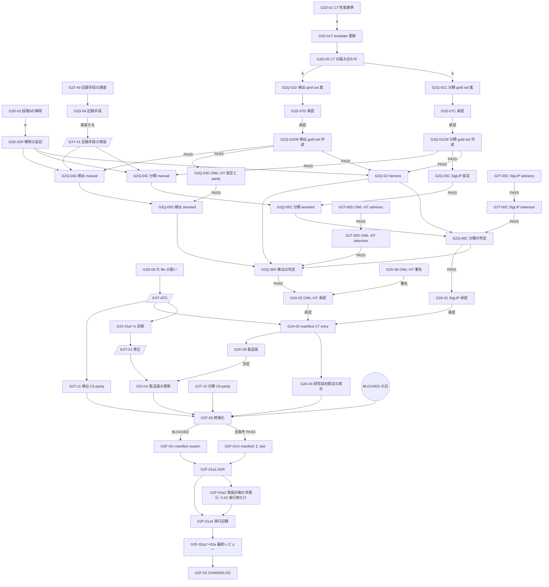

# Gate 2 残タスク実行計画

| 項目 | 内容 |
|---|---|
| 文書種別 | 一時作業文書（ATG 分割計画）。**採用決定・Gate 判定ではない** |
| 作成日時 | 2026-09-23 21:20 JST（同日の敵対的レビュー 4 回を反映した版） |
| 要求基準 | [`docs/requirement-definition.md`](../docs/requirement-definition.md) v0.7 Draft。各ノードは原本の代わりに抜粋 [`202609232120-Gate2-RequirementExtract.md`](202609232120-Gate2-RequirementExtract.md) を参照する |
| Gate 定義 | [`docs/implementation-plan.md`](../docs/implementation-plan.md) §6 Gate 2、§4 SPI-11〜18（同じ抜粋）、[`docs/adr/0004-spike-decisions.md`](../docs/adr/0004-spike-decisions.md) §1・§5 |
| 直前の実行記録 | [`20260923-2003-C7-RemainingTasksExecution.md`](20260923-2003-C7-RemainingTasksExecution.md)（§7 の追補を含む） |
| 方針 | 未実測を合格にしない。所有者の判断を要する事項は推測で決めず、判断ノードとして分離する。技術要件は緩和しない（FR-LIC-016(5)） |

## 1. Gate 2 の合格条件（受入条件）

[`implementation-plan.md`](../docs/implementation-plan.md) §6 の Gate 2 条件は「Windowsで分類/検出のCurated Base WeightとAssist checkpointが法務・hash・実機品質gateを通過し、Windows CPU/acceleratorのAutoML budgetを実測決定」である。同 §4 の SPI-18 Gate 2 部と ADR-0004 §5 から、次を受入条件として固定する。

1. **AC-1** C6 分類・C6 検出・C7 分類・C7 検出の 4 役それぞれに、採用記録が「承認」の checkpoint が 1 つ以上ある（SPI-11〜14、G-DEP-07 / 08）。
2. **AC-2** 承認済み C6 で初期化して学習した model の train → ONNX → CPU parity が、許容差内で実測されている（SPI-15 / 16。ADR-0004 §5 の「承認済み checkpoint に対する parity は未完」）。
3. **AC-3** C7 分類・検出それぞれについて、代表 gold set で manual-only と assisted の比較試験を行い、最終品質を悪化させず、annotation の中央所要時間を短縮する（SPI-17、NFR-ANN-006、POC-16）。
4. **AC-4** D-15 の有限 AutoML budget が Windows 実機の測定で決まっている。
5. **AC-5** `resources/models/manifest.json` に 4 役の承認済み entry と `releaseStatus.assistQuality[]` を記録し、`releaseStatus.ready=true`、`productVersion` を root product version と一致させる（manifest schema `2.0.0`、[`CONTRIBUTING.md`](../CONTRIBUTING.md) の 3 状態と「製品バージョンの更新順」）。ADR-0004 に Gate 2 部の判定を記録する。
6. **AC-6** 各ノードは完了条件の検証後に敵対的レビューを受け、実在する blocking 指摘を反映して再検証する。

いずれかが満たせない場合、Gate 2 部は **BLOCKED** として終端化ノード（G2F-00）と BLOCKED 記録（G2F-01）で理由を記録する。BLOCKED の記録は正当な終端であり、本計画の失敗ではない。

## 2. 非対象

- AST-01 以降の製品 assist 機能、TRN / REP / INF の製品実装（Gate 2 通過後の phase。実装計画 Phase H は「Gate 2 で承認された分類用・検出用 model だけを実装する」。抜粋 §2 の行 529）。
- **製品 worker の tokenizer 依存の採用と lock 更新**。AST-05 / 07 の実装時に [`dependency-policy.md`](../docs/dependency-policy.md) §10 で行う。Gate 2 では spike で使った tokenizer file の監査までを行う（G2T-50C / 50D）。
- **session 記録手段の実装**（別計画 `EXT-41`）、**既存の vitest の失敗の修正**（別計画 `EXT-X1`）、**ATG 規約の 500 行規則の扱い**（別計画 `EXT-ATG`、§6.1）。本計画はこれらの完了を外部の前提条件として扱う。
- PKG-01（model payload verifier）の実装全体。PKG-01 は Gate 2 に依存するため Gate 2 後に行う（抜粋 §2 の行 684）。ただし `ready=true` にする前に、`assistQuality[]` の照合だけは G2F-01m の test で機械検査する（§4 S8）。
- POC-03 / NFR-PERF-004（カメラ推論の実時間性能）の検証。INF phase で Model Version に対して行う（[owner rulings D1](../docs/model-governance/evidence/2026-09-23-owner-rulings.md)）。
- 実作業に基づかない session・gold label の生成・推定。
- 別の C7 候補の再調査、CPU 最適化の追加実験（G2D-01=B または G2D-05=B の場合は新しい計画を作る）。
- 複数候補を共通化する新規 framework、未使用の option・flag・抽象化。

## 3. 現状の棚卸し（2026-09-23 21:20 時点）

| Gate 2 入力 | 現状 | 残件 | 出典 |
|---|---|---|---|
| SPI-11 C6 分類 | **承認**（MobileNetV3 Large `IMAGENET1K_V2`）。manifest 登録済み | なし | [`mobilenet-v3-large-imagenet1k-v2-adoption.md`](../docs/model-governance/mobilenet-v3-large-imagenet1k-v2-adoption.md)、ADR-0004 §5.1.12 |
| SPI-12 C6 検出 | **承認**（SSDLite320 MobileNetV3 Large `COCO_V1`、owner ruling D1）。manifest 登録済み | なし | [`ssdlite320-mobilenet-v3-large-coco-v1-adoption.md`](../docs/model-governance/ssdlite320-mobilenet-v3-large-coco-v1-adoption.md)、ADR-0004 §5.1.13 |
| SPI-13 C7 分類 | SigLIP base は**保留**。権利は充足（risk acceptance 2026-09-22）、fp32 parity PASS、DirectML 性能は合格、**CPU p95 `302`〜`831` ms で不合格**。int8 量子化は parity・性能とも不合格。TinyCLIP は除外 | 承認できる候補が 0 件 | [`siglip-base-patch16-224-adoption.md`](../docs/model-governance/siglip-base-patch16-224-adoption.md) §15・§16、[`siglip-assist-result.md`](../spikes/models/siglip-assist-result.md) §5・§7 |
| SPI-14 C7 検出 | OWL-ViT B/32 は**保留**。権利は条件付き書面決定、生出力 parity PASS、DirectML 性能は合格、**CPU p95 `918`〜`1,570` ms で不合格**、検出単位の parity は fixture で 0 件のため未確認、prompt 形式・閾値の境界・製品 seed が未決定。Grounding DINO tiny は parity FAIL、OmDet-Turbo は HOLD | 承認できる候補が 0 件 | [`owlvit-base-patch32-adoption.md`](../docs/model-governance/owlvit-base-patch32-adoption.md) §9・§15、[`owlvit-assist-result.md`](../spikes/models/owlvit-assist-result.md) |
| SPI-15 分類 train/export parity | beans fixture で **PASS**。ただし**乱数初期化**での測定。承認済み C6 からの Fine-Tuning は精度比較（`--mode transfer`）だけで、学習後 model の ONNX export と parity はしていない | 承認済み C6 初期化の train → ONNX → CPU / DirectML parity | ADR-0004 §5、[`classification_checkpoint_parity.py`](../spikes/models/classification_checkpoint_parity.py) `run_transfer`（export なし） |
| SPI-16 検出 train/export parity | gwhd-2021 fixture で **PASS**（既定 60 epoch）。同じく乱数初期化 | 同上（SSDLite） | ADR-0004 §5、[`detection_checkpoint_parity.py`](../spikes/models/detection_checkpoint_parity.py) `run_transfer` |
| SPI-17 補助品質 | **NOT_RUN**。段階 3（実作業 session）は 2026-09-22 に `SKIPPED_BY_USER`。harness は schema 2.0.0 に合わせて修正済み | §4 の S2〜S5 の解消、gold set、session、判定 | [`assist-result.md`](../spikes/models/assist-result.md) §7・§9 |
| D-15 AutoML budget | 分類・検出とも CPU / CUDA の有限値を確定（分類 20 trial・CPU 180 秒・CUDA 120 秒、検出 20 trial・CPU 420 秒・CUDA 120 秒）。ADR-0004 §5 の箇条書きには「検出と実データ規模は未決定」という旧記述が残る | ADR §5 の旧記述を §5.1 の表に合わせる（G2F-01a1）。実データ規模の予算は TRN-09 で扱う | ADR-0004 §5・§5.1、[`20260923-0630-Gate2-TaskExecutionPlan.md`](20260923-0630-Gate2-TaskExecutionPlan.md) §1.2 |
| manifest | 承認 2 件（C6 のみ）、`ready=false`、`productVersion` なし、schema `2.0.0` | C7 2 件、`assistQuality[]`、`ready=true`、`productVersion` | [`manifest.json`](../resources/models/manifest.json) |
| 既存 test | `npm test` の vitest で 3 件失敗（`sample-assets.test.ts`、`reference-source.test.ts`、`copy-source.test.ts`）。`sample-assets.test.ts` は変更前の `HEAD` でも失敗する | CONTRIBUTING「製品バージョンの更新順」4 は版の更新時に aggregate `npm test` の成功を要求する | [実行記録](20260923-2003-C7-RemainingTasksExecution.md) §7 |

## 4. 調査で判明した構造的問題

| # | 問題 | 根拠 | 影響 | 本計画での扱い |
|---|---|---|---|---|
| S1 | **C7 の性能基準が要求定義と一致していない可能性**。採用記録テンプレートは C7 に POC-03（100 ms / 10 FPS）を適用するが、POC-03 は「30分連続…capture-to-display…10Hzの全フレーム処理」というカメラ推論の基準で、C7 を名指ししていない。要求定義上の C7 の性能に関する要件は NFR-ANN-003（補助候補生成中も UI を妨げない。製品の assist 実装の性質）と POC-16（manual-only より中央所要時間を短縮）である | 抜粋 §1 の行 654・797・810、[`adoption-template.md`](../docs/model-governance/adoption-template.md) §11、[`NonCommercialModelSurvey`](20260923-1015-NonCommercialModelSurvey.md) §8 | 現行基準のままでは、DirectML で合格し CPU で 3〜15 倍遅い既存候補はすべて不合格のまま | **所有者判断 G2D-01**。D1 は C7 を対象外としたため、委任なしに読み替えない |
| S2 | **比較試験と承認の循環**。adoption-template §12 は C7 の承認前に比較試験を必須とし、manifest は承認済み entry しか持てない（`approval.status: const Approved`）。一方 `assist_benchmark.py` は manifest に承認済み C7 entry があることを前提条件にしている | [`assist_benchmark.py`](../spikes/models/assist_benchmark.py) `check_manifest`、[`manifest.schema.json`](../resources/models/manifest.schema.json) `approvalRecord.status`、[`adoption-template.md`](../docs/model-governance/adoption-template.md) §11・§12 | 承認前に試験できず、試験前に承認できない | manifest の「承認済みだけ」の規則から、仮登録は選択肢にならない。**技術的に次の順序へ固定する**: §12 以外の技術・権利 gate を通過した採用候補（採用記録「保留（§12 待ち）」）で比較試験を行い、合格後に承認して manifest に登録する。G2Q-02 で harness の前提を変える |
| S3 | **段階 3 が `SKIPPED_BY_USER`**。SPI-17 は実作業 session なしには測定できず、ADR-0004 §3 の規約でスキップは PASS に読み替えない | [`assist-result.md`](../spikes/models/assist-result.md) §7 | このままでは AC-3 を満たせない | **所有者判断 G2D-02**（スキップの解除） |
| S4 | **session の記録手段がない**。harness は JSON Lines（`item_id`・`proposed`・`outcome`・`seconds`）を入力とするが、それを実作業から生成する手段が repository にない。製品の editor は manual annotation と import provenance（`import-unmodified` / `import-edited`）を持つが、画像ごとの所要時間の記録と、補助候補の提示（AST phase）は持たない | [`assist-result.md`](../spikes/models/assist-result.md) §3、`src/shared/contracts/annotation.ts`（provenance）、実装計画 AST-01〜07（Gate 2 依存） | 段階 3 を解除しても session を記録できない | 調査ノード G2T-40 → **所有者判断 G2D-04** → 別計画 `EXT-41` |
| S5 | **品質非劣化の判定が harness にない**。harness は coverage / accept / edit / reject / 時間を出すが、gold set に対する最終品質を計算しない | [`assist_benchmark.py`](../spikes/models/assist_benchmark.py) `summarise` | NFR-ANN-006 の「品質を悪化させない」を判定できない | G2Q-01C / 01D で基準案を作り、所有者が承認（G2D-07C / 07D）した後、G2Q-02 で実装する |
| S6 | **製品で text prompt を tokenize する依存が未決定**。spike は transformers を隔離 venv でのみ使っている | 2 件の C7 採用記録 §15 | 製品実装の前提が未確定 | 製品依存の採用は AST phase（§2）。Gate 2 では tokenizer file の監査（G2T-50C / 50D）を行う |
| S7 | **C7 の `inferenceConfig` が未確定**。manifest は C7 に `confidenceThreshold`・`thresholdPolicy`・`seeds` を必須とする。閾値は gold set の実測から決める（DQ-07）。OWL-ViT は prompt 形式、閾値の境界（schema は `score >= threshold`、transformers の後処理は `score > threshold`）、製品 seed も未決定 | [`owlvit-base-patch32-adoption.md`](../docs/model-governance/owlvit-base-patch32-adoption.md) §9（schema の field と形を対応づけた表） | C7 の manifest entry を書けない | G2Q-03C / 03D（gold set での model 単体評価） |
| S8 | **`assistQuality[]` の照合がない**。schema は `modelId`・`recordPath`・`recordSha256` の照合を release verifier（PKG-01、未実装）に委ねている。現在の schema test は実 manifest の evidence・承認記録の存在と SHA-256 は検査するが、`assistQuality` は検査しない | [`manifest.schema.json`](../resources/models/manifest.schema.json) `$comment`、[`manifest-schema.test.mjs`](../scripts/models/manifest-schema.test.mjs) | 任意の 64 桁の hash や別 model の記録でも `ready=true` にできる | G2F-01m で、既存の実 manifest 検査と同じ形の test を 1 件追加する（PKG-01 全体は実装しない） |
| S9 | **既存の vitest の失敗が版の更新を妨げる**。CONTRIBUTING は版の更新時に aggregate `npm test` の成功を要求する | [`CONTRIBUTING.md`](../CONTRIBUTING.md)「製品バージョンの更新順」4、§3 の「既存 test」 | `ready=true` に必要な `productVersion` の更新（G2V-01）ができない | 診断ノード G2X-01a〜c → 別計画 `EXT-X1`（修正）を G2V-01 の前提にする |
| S10 | **編集が必要な file の一部が 500 行を超える**。ATG planning 規約は「タスク実行に参照する単一ファイルが 500 行を超える」場合を `context_size=large`（`SPLIT_REQUIRED`）とし、行範囲だけを読む例外を持たない。該当: `manifest-schema.test.mjs`（626 行）、`manifest.schema.json`（668 行）、`detection_checkpoint_parity.py`（605 行）、`SettingsPage.test.tsx`（617 行）、`implementation-plan.md`（1,869 行）、vitest の失敗 3 件の test（1,021〜1,731 行）と `copy-source.ts`（706 行） | [`planning.md`](../.github/skills/atg/references/planning.md) §1・§2・§3 | これらの file を編集するノードは本計画の中では `PROCEED` にできない | 本計画の中で規則を緩めない。**別計画 `EXT-ATG`**（所有者判断 G2D-09 で方式を選ぶ）の完了を、該当ノードの外部の前提条件にする（§6.1）。BLOCKED の記録経路は該当 file を編集しないよう組む |

## 5. 所有者の判断が必要な事項

本計画は以下を推測で決めない。各判断は、利用者 dahatake の書面回答を `docs/model-governance/evidence/<判断日>-owner-ruling-<判断ID>.md`（判断ごとに 1 file）に記録してから後続ノードを起動する。推奨は理由を示した提案であり、判断ではない。

| ID | 判断事項 | 選択肢 | 推奨（理由） | 判断がない場合 |
|---|---|---|---|---|
| G2D-01 | C7 の性能の採用基準（S1） | **A.** C7 の採用判定に POC-03 の 100 ms / 10 FPS を適用せず、POC-16（AC-3 の中央所要時間の短縮）で判定する。CPU / DirectML の p95・FPS は測定値として記録する。NFR-ANN-003 は製品の assist 実装の要件として AST phase で検証し、緩和しない（D1 と同じ構造）。 **B.** 現行どおり POC-03 を C7 にも適用する | **A**。要求定義で POC-03 はカメラ推論の基準であり、C7 の採用時に比較試験で測れる性能要件は POC-16 である。NFR-ANN-003 は候補生成を行う製品の実装（AST phase）でしか検証できない | BLOCKED |
| G2D-02 | SPI-17 段階 3 の `SKIPPED_BY_USER` の解除（S3） | **A.** 解除し、利用者が実作業 session を記録する **B.** スキップを維持する | **A**（B では AC-3 を満たせない） | BLOCKED |
| G2D-04 | session の記録手段（S4） | G2T-40 の調査結果に基づき提示する。「実装しない」も選択肢に含める | 調査前は決めない | BLOCKED |
| G2D-05 | C7 の組み合わせ | **A.** 分類 SigLIP base、検出 OWL-ViT B/32（いずれも取得・parity 測定済み） **B.** 別候補の再調査から始める | **A**（G2D-01=A の場合。ほかの候補は権利または parity で不利: TinyCLIP 除外、Grounding DINO parity FAIL、OmDet-Turbo は FR-LIC-015 の判断待ち、MobileCLIP-S0 は製品開発を除外する license） | BLOCKED（B の場合は新しい計画を作る） |
| G2D-06 | OWL-ViT の risk acceptance §3.2 の確認・署名 | 署名する / しない | G2A-02 の直前に判断 | BLOCKED |
| G2D-07C / 07D | 分類 / 検出の gold set と判定基準の承認（S5、TBD-08） | G2Q-01C / 01D の数値案を承認する / 修正する | 要求定義は数値を定めていない（TBD-08。抜粋 §1 の行 905）ため、実装担当が数値を確定させない | BLOCKED |
| G2D-08 | 製品版の決定（AC-5） | Gate 2 を `ready=true` で記録する時点の product version | CONTRIBUTING「製品バージョンの更新順」1 は release 責任者の明示決定を要求する | BLOCKED |
| G2D-09 | 500 行を超える file の扱い（S10）。**本計画の中で ATG 規則を免除する判断ではなく、別計画 `EXT-ATG` の方式を選ぶ判断** | **A.** ATG package の planning 規約を改訂し、「編集箇所を含む行範囲だけを読み、範囲を計画に記載する」場合の扱いを定める（ATG package の変更として別途レビューし、ATG の PATCH を上げる） **B.** 該当 file を 500 行以下へ分割する refactor を、file ごとの別計画で先に行う | **A**（B は test 3 件・schema・spike・UI test・実装計画を含む 8 file 以上の構造変更になり、Gate 2 と無関係な差分が大きい） | 該当ノードを起動せず、BLOCKED の記録だけを行う |

## 6. 分割判定

| 項目 | 判定 |
|---|---|
| `task_scope` | `multi`。判断記録、parity spike、gold set、benchmark、採用記録、manifest、UI 表示、ADR は独立してレビュー可能な複数成果物 |
| `context_size` | `large`。本計画の作成で読んだ file は 20 件以上。`requirement-definition.md`（987 行）・`implementation-plan.md`（1,869 行）・`manifest.schema.json`（668 行）・`manifest-schema.test.mjs`（626 行）は単独で 500 行を超える |
| 判定 | **`SPLIT_REQUIRED`** |
| 根拠 | ATG planning 規約 §3 の `task_scope == "multi"` 分岐（および `context_size == "large"` 分岐） |

このため本ターンでは計画だけを作成し、実装 file を変更しない。後続は §8 のノードごとに `PROCEED` を再判定して実行する。500 行を超える要求定義と実装計画は、各ノードが原本の代わりに抜粋 [`202609232120-Gate2-RequirementExtract.md`](202609232120-Gate2-RequirementExtract.md)（206 行。原本の該当 32 箇所を変更せずに転記し、原本の SHA-256 を記録）を参照する。

### 6.1 ノードごとの分割判定

「外部前提」は、そのノードを起動する前に完了していなければならない別計画である。500 行を超える file を読む・編集するノードは `EXT-ATG` を外部前提とし、`EXT-ATG` の完了後に、その時点の規約で分割判定をやり直す（本計画の中では `PROCEED` にしない）。

| ノード | 成果物数 | 参照ファイル数 | 500 行超の file | 判定 | 外部前提 |
|---|---:|---:|---|---|---|
| G2D-01、02、04〜09（各。判断記録のみ） | 1 | 3 | なし（抜粋を参照） | `PROCEED` | — |
| G2D-01T（adoption-template §11 の更新） | 1 | 2 | なし（398 行） | `PROCEED` | — |
| G2D-02R（assist-result への解除の追記） | 1 | 2 | なし（213 行） | `PROCEED` | — |
| G2T-10 | 1 | 5 | なし | `PROCEED` | — |
| G2T-11 | 1 | 5 | `detection_checkpoint_parity.py` | `SPLIT_REQUIRED` | `EXT-ATG` |
| G2T-40 | 1 | 7 | なし（最大 280 行） | `PROCEED` | — |
| G2T-50C / 50D、G2T-60C / 60D（各） | 1 | 3〜4 | なし | `PROCEED` | — |
| G2X-01a〜c（各、診断のみ） | 1 | 2 | 各 test（1,021〜1,731 行）、`copy-source.ts` | `SPLIT_REQUIRED` | `EXT-ATG` |
| G2Q-01C / 01D、01CM / 01DM（各） | 1 | 3〜5 | なし | `PROCEED` | — |
| G2Q-02 | 1 | 4 | なし | `PROCEED` | — |
| G2Q-03C / 03D（各） | 1 | 4 | なし（最大 401 行） | `PROCEED` | — |
| G2Q-04C〜05D（各） | 1 | 2 | なし | `PROCEED` | `EXT-41` |
| G2Q-06C / 06D（各） | 1 | 4 | なし | `PROCEED` | — |
| G2A-01 / 02（各） | 1 | 6 | なし | `PROCEED` | — |
| G2A-03 | 1 | 4 | `manifest-schema.test.mjs` | `SPLIT_REQUIRED` | `EXT-ATG` |
| G2A-04 | 1 | 5 | `SettingsPage.test.tsx` | `SPLIT_REQUIRED` | `EXT-ATG` |
| G2V-01 | 1 | 3 | なし（lock は `npm version` が更新し、読まない） | `PROCEED` | `EXT-X1` |
| G2F-00（終端化） | 1 | 2 | なし | `PROCEED` | — |
| G2F-01r（BLOCKED 時の manifest `reason`） | 1 | 2 | なし（218 行） | `PROCEED` | — |
| G2F-01m（`ready=true` 時の manifest と test） | 1 | 5 | `manifest-schema.test.mjs` | `SPLIT_REQUIRED` | `EXT-ATG` |
| G2F-01a1（ADR-0004） | 1 | 3 | なし（463 行） | `PROCEED` | — |
| G2F-01a2（実装計画の Gate 2 状態行） | 1 | 2 | `implementation-plan.md` | `SPLIT_REQUIRED` | `EXT-ATG` |
| G2F-01a3（実行記録） | 1 | 4 | なし | `PROCEED` | — |
| G2F-02a1 / 02b1 / 02c / 02d（各、read-only） | 1 | 3〜6 | なし | `PROCEED` | — |
| G2F-02a2 / 02b2 / 02e（各、read-only） | 1 | 2〜3 | test / spike / UI test | `SPLIT_REQUIRED` | `EXT-ATG` |
| G2F-03 | 1 | 3 | なし | `PROCEED` | — |

**BLOCKED の記録経路**（G2F-00 → G2F-01r → G2F-01a1 → G2F-01a3 → G2F-02a1 → G2F-03）は、500 行を超える file を編集しないため、`EXT-ATG` がなくても実行できる。

## 7. 実行グラフ

- **BLOCKED の辺**（図では `BLK` に集約）: G2D-01=B / 未判断、G2D-02=B / 未判断、G2D-04 で「実装しない」/ 未判断、G2D-05=B / 未判断、G2D-06 で不署名 / 未判断、G2D-07C / 07D で未承認、G2D-08 未決定、G2D-09 で `EXT-ATG` を行わない / 未判断、G2Q-01CM / 01DM・G2Q-03C / 03D・G2T-50 / 60・G2Q-06C / 06D・G2T-10 / 11 の `FAIL`、G2A-01 / 02 の保留、`EXT-41` / `EXT-X1` / `EXT-ATG` の不成立。
- **G2F-00 の起動条件**: BLOCKED の辺が 1 つでも発火した時点、または G2V-01・G2A-04・G2T-10・G2T-11 がすべて `PASS` で完了した時点。G2F-00 は、実行中のノードの終了を待ち、未開始のノードを起動しないことを記録してから G2F-01 へ進む（§8.20）。
- **並列に実行できるもの**（write set が分離している）: G2D-01・02・09、G2T-10、G2T-40、G2T-60C / 60D は判断を待たずに開始できる。分類 lane と検出 lane（01C と 01D、01CM と 01DM、03C と 03D、04C と 04D、05C と 05D、A1 と A2）は並列にできる。各 lane の中では manual-only（04）→ assisted（05）の順にする。
- **直列にするもの**（共有資源）: `spikes/models/assist-result.md` は G2D-02R → G2Q-02 → G2Q-06C → G2Q-06D の順。各 C7 採用記録は G2T-60（§13）→ G2T-50（§2〜4）→ G2Q-06（§12）→ G2A（承認）の順。`resources/models/manifest.json` は G2A-03 → G2V-01 → G2F-01m / 01r の順。`manifest-schema.test.mjs` は G2A-03 → G2F-01m の順。ADR-0004 は G2F-01a1 だけが、`CHANGELOG.md` は G2F-03 だけが変更する。

## 8. ノード契約

### 8.0 共通の定義

repository root で、Windows PowerShell 5.1 から実行する。

| 記号 | 内容 |
|---|---|
| `NPM12` | exact npm `12.0.0` の準備。system の npm が別版の場合は、repository 外で `Push-Location $env:TEMP; npx --yes npm@12.0.0 --version; Pop-Location` を実行し、`Get-ChildItem $env:LOCALAPPDATA\npm-cache\_npx -Recurse -Filter npm.cmd` で見つかる `node_modules\.bin` を `$env:PATH` の先頭に置く。`npm --version` が `12.0.0` を返すことを確認してから以降の `npm` を実行する |
| `DOCS` | `NPM12` の後に `npm run verify:docs` |
| `RUFF(<file>)` | `$r = (Get-ChildItem "$env:USERPROFILE\.vscode\extensions" -Recurse -Filter ruff.exe | Select-Object -First 1).FullName; & $r check <file>; if ($?) { & $r format --check <file> }` |
| `PY` | `vendor\models\_spike\venv\Scripts\python.exe`（spike 用の隔離 venv。`$PY` に代入して使う） |
| `MANIFEST` | `node --test scripts/models/manifest-schema.test.mjs` |
| `JSONOUT(<dir>, <cmd>, <out>)` | Windows PowerShell 5.1 の `>` は native の出力を UTF-16 で書くため使わない。`cmd /d /c "cd /d <dir> && set PYTHONUTF8=1 && <cmd> > <out>"; $code = $LASTEXITCODE` とし、`$code` を結果記録に転記する |
| `CHECKJSON(<out>, <keys>)` | `& $PY -c "import json,sys; d=json.load(open(r'<out>',encoding='utf-8')); sys.exit(0 if d.get('verdict') in ('PASS','FAIL') and all(d.get(k) not in (None,'',[],{}) for k in (<keys>)) else 1)"` が exit 0 |
| `RECORDED(<md>, <out>)` | `$h=(Get-FileHash <out>).Hash.ToLower(); if (-not (Select-String -Path <md> -SimpleMatch $h -Quiet) -or -not (Select-String -Path <md> -Pattern '測定コマンドの exit code: -?\d+' -Quiet)) { exit 1 }` が exit 0（結果記録に出力 JSON の SHA-256 と測定コマンドの exit code が書かれている） |
| gold set と session の配置 | Git 追跡外の `vendor/models/_spike/assist/`。gold set は `goldset-classification.json` / `goldset-detection.json`、session は `manual-classification.jsonl`・`assisted-classification.jsonl`・`manual-detection.jsonl`・`assisted-detection.jsonl` |

**測定と完了の区別:** 測定の verdict（`PASS` / `FAIL`）はノードの完了と別である。各測定ノードは `CHECKJSON` と `RECORDED` が exit 0 なら完了とし、`FAIL` は承認ノードを通さずに BLOCKED の辺へ進む（§7）。`CHECKJSON` の key は、そのノードで script に出力させる key であり、現時点の script がすべてを出すとは限らない（§13）。

### 8.1 判断ノード（G2D-01、02、04〜09）と追随ノード（G2D-01T、02R）

- 判断ノードの成果物: 判断ごとに `docs/model-governance/evidence/<判断日>-owner-ruling-<判断ID>.md`。[`2026-09-23-owner-rulings.md`](../docs/model-governance/evidence/2026-09-23-owner-rulings.md) と同じ形式で、回答の原文、判断、要求定義上の根拠、判断が意味しないことを書く。既存の証拠文書は変更しない。参照ファイル数: 3（抜粋、owner rulings、判断に関係する 1 file）。見積: 各 R 10 / P 5 / I 15 / V 5 / F 5 = 40 分。
- G2D-01T（G2D-01=A の場合）: [`adoption-template.md`](../docs/model-governance/adoption-template.md) §11 の C7 の行と注記を判断に合わせる。参照ファイル数: 2。見積: R 5 / P 5 / I 10 / V 5 / F 5 = 30 分。
- G2D-02R（G2D-02=A の場合）: [`assist-result.md`](../spikes/models/assist-result.md) に解除の記録を追記する（§7 は履歴として変更しない）。参照ファイル数: 2。見積: 30 分（内訳は G2D-01T と同じ）。

#### 完了条件

- [ ] 判断ノード: `Test-Path docs\model-governance\evidence\<判断日>-owner-ruling-<判断ID>.md` が True で、file に回答の原文（引用 block）、判断者、日付、選んだ選択肢がある。判断がない場合は「未判断」と記録されている。
- [ ] 追随ノード: 変更後の file に判断記録への相対 link がある（`Select-String -SimpleMatch '<判断記録の file 名>' -Quiet` が True）。
- [ ] `DOCS` が exit 0。
- [ ] 敵対的レビューで、利用者が選んでいない内容を判断として記録していないこと、技術要件を緩和していないことを確認し、blocking 0。

### 8.2 G2T-10 — 分類: 承認済み C6 初期化の train → ONNX parity（SPI-15 の残件）

- 成果物: 既存の `--mode transfer` で承認済み MobileNetV3 から学習した model を ONNX へ export し、torch ↔ ORT CPU ↔ ORT DirectML の parity を測る最小の追加と結果記録。新しい script と新しい mode は作らない。許容差は SPI-15 と同値を実行前に固定する。
- write set: [`classification_checkpoint_parity.py`](../spikes/models/classification_checkpoint_parity.py)（341 行）、[`classification-checkpoint-result.md`](../spikes/models/classification-checkpoint-result.md)。
- 参照ファイル数: 5（上記 2 件、`classification.py`、`classification-result.md`、`detection_checkpoint_parity.py` の共通関数 `measure_latency` 等の定義部分）。※ `detection_checkpoint_parity.py` は 605 行のため、共通関数の import 先として名前だけを参照し、本文は読まない。
- 測定: `JSONOUT(spikes\models, ..\..\vendor\models\_spike\venv\Scripts\python.exe classification_checkpoint_parity.py --mode transfer, ..\..\vendor\models\_spike\c6-cls-transfer.json)`。
- 見積: R 20 / P 10 / I 40 / V 40 / F 20 = 130 分。

#### 完了条件

- [ ] `CHECKJSON(vendor\models\_spike\c6-cls-transfer.json, 'environment','checkpoint','onnx_sha256','comparisons','repeat_run_bitwise_identical')` が exit 0。`comparisons` に torch ↔ CPU、torch ↔ DirectML、CPU ↔ DirectML の 3 件がある。
- [ ] `RECORDED(spikes\models\classification-checkpoint-result.md, vendor\models\_spike\c6-cls-transfer.json)` が exit 0。
- [ ] `RUFF(spikes\models\classification_checkpoint_parity.py)` が exit 0。
- [ ] 敵対的レビューで、乱数初期化の結果を流用していないこと、recipe・許容差を事後に変えていないことを確認し、blocking 0。

### 8.3 G2T-11 — 検出: 承認済み C6 初期化の train → ONNX parity（SPI-16 の残件、外部前提 `EXT-ATG`）

- 成果物・方法は G2T-10 と同じ（SSDLite320、SPI-16 の recipe と許容差、後処理閾値は採用記録の値）。比較対象の検出件数が 0 件なら `FAIL`。
- write set: [`detection_checkpoint_parity.py`](../spikes/models/detection_checkpoint_parity.py)、[`detection-checkpoint-parity-result.md`](../spikes/models/detection-checkpoint-parity-result.md)。
- 参照ファイル数: 5（上記 2 件、`detection.py`、`detection-result.md`、SSDLite の採用記録）。
- 測定: `JSONOUT(spikes\models, ..\..\vendor\models\_spike\venv\Scripts\python.exe detection_checkpoint_parity.py --mode transfer, ..\..\vendor\models\_spike\c6-det-transfer.json)`。
- 見積: R 20 / P 10 / I 50 / V 60 / F 20 = 160 分。

#### 完了条件

- [ ] `CHECKJSON(vendor\models\_spike\c6-det-transfer.json, 'environment','checkpoint','onnx_sha256','comparisons','repeat_run_bitwise_identical','compared_detections')` が exit 0。
- [ ] `RECORDED(spikes\models\detection-checkpoint-parity-result.md, vendor\models\_spike\c6-det-transfer.json)` が exit 0。
- [ ] `RUFF(spikes\models\detection_checkpoint_parity.py)` が exit 0。
- [ ] 敵対的レビューで blocking 0。

### 8.4 G2T-40 — session 記録手段の調査（S4）

- 成果物: `work/<yyyymmdd-hhmm>-AssistSessionRecording.md`。製品 editor（manual annotation と import provenance `import-unmodified` / `import-edited`）で manual-only / assisted の session を記録できるかを、実際の code から確認し、画像ごとの所要時間と accept / edit / reject を取得する方法の候補を、変更範囲・Gate 2 前に製品 code を変える必要の有無・工数で比較する。code は変更しない。
- 参照ファイル数: 7（`src/shared/contracts/annotation.ts`、`src/shared/contracts/annotation-ipc.ts`、`src/main/annotations/workspace-service.ts`、`src/main/annotations/save-draft.ts`、`src/main/annotations/target-history.ts`、`spikes/models/assist_benchmark.py`、`spikes/models/assist-result.md`）。いずれも 500 行以下。
- 見積: R 60 / P 20 / I 30 / V 10 / F 20 = 140 分。

#### 完了条件

- [ ] work file の各候補に、根拠にした file と行番号（`<path>:<行>` の形）が 1 つ以上ある: `(Select-String -Path <work file> -Pattern '\S+\.(ts|py|md):\d+').Count -ge 3`。
- [ ] 候補ごとに「Gate 2 前に製品 code の変更が必要か: はい / いいえ」の行がある。
- [ ] `DOCS` が exit 0。
- [ ] 敵対的レビューで、未確認の機能を実装済みと書いていないことを確認し、blocking 0。

### 8.5 外部前提（本計画のノードではない）

| ID | 起動条件 | 別計画に固定する制約 | 別計画の完了条件（本計画が確認するもの） |
|---|---|---|---|
| `EXT-41` | G2D-04 で「実装する」 | 記録は実作業から得る。記録手段は `seconds`・`outcome` を生成・推定・補完しない。harness の入力形式（[`assist-result.md`](../spikes/models/assist-result.md) §3）を変えない | 合成データの session が `assist_benchmark.load_session` を通る test が exit 0。値を補完しないことの否定 test が exit 0 |
| `EXT-ATG` | G2D-09 で A または B | A: ATG package の planning 規約の改訂は ATG package の変更として別途レビューし、`.github/skills/atg/SKILL.md` と `tools/atg/skill/SKILL.md` の PATCH を同期して上げる。B: file ごとの refactor で既存 test を弱めない | A: 改訂した規約が repository にあり、ATG の既存 test が exit 0。B: 分割後の各 file が 500 行以下で、対象の test が exit 0 |
| `EXT-X1` | G2X-01a〜c の診断の後 | test を弱めて通さない。file ごとに別ノードで直す | `NPM12` の後、`npx vitest run src/main/samples/sample-assets.test.ts src/main/data/reference-source.test.ts src/main/data/copy-source.test.ts` を 3 回続けて実行し、3 回とも exit 0 |

### 8.6 G2T-50C / 50D — tokenizer file の監査（S6）

| ノード | `<dir>` | `<api>` | `<files>` |
|---|---|---|---|
| G2T-50C | `vendor\models\_spike\siglip` | `docs\model-governance\evidence\siglip-base-patch16-224-hf-api-20260923.json` | `'spiece.model','tokenizer.json','tokenizer_config.json','special_tokens_map.json'` |
| G2T-50D | `vendor\models\_spike\owlvit-b32` | `docs\model-governance\evidence\owlvit-base-patch32-hf-api-20260923.json` | `'vocab.json','merges.txt','tokenizer_config.json','special_tokens_map.json'` |

- 成果物: 該当する採用記録の §2〜4 への追記（tokenizer file の byte size・独立計算した hash・publisher の値、C5 code として spike が import した package と version）。製品の依存の選定は行わない（§2）。
- write set: G2T-50C は SigLIP、G2T-50D は OWL-ViT の採用記録（G2T-60 の後に直列）。
- 参照ファイル数: 各 3（採用記録、API metadata、spike）。見積: 各 R 15 / P 5 / I 20 / V 15 / F 10 = 65 分。

#### 完了条件

- [ ] 次のコマンドの exit code が結果として採用記録に書かれている（0 なら `PASS`、それ以外は `FAIL` として BLOCKED の辺へ進む）: `$api=Get-Content <api> -Raw|ConvertFrom-Json; $bad=0; foreach ($n in @(<files>)) { $s=@($api.siblings|Where-Object rfilename -eq $n); $p=Join-Path <dir> $n; if ($s.Count -ne 1 -or -not (Test-Path $p)) { $bad++; continue }; $got = if ($s[0].lfs) { (Get-FileHash $p -Algorithm SHA256).Hash.ToLower() } else { git hash-object $p }; $want = if ($s[0].lfs) { $s[0].lfs.sha256 } else { $s[0].blobId }; if (((Get-Item $p).Length -ne $s[0].size) -or ($got -ne $want)) { $bad++ } }; exit $bad`。
- [ ] `DOCS` が exit 0。
- [ ] 敵対的レビューで blocking 0。

### 8.7 G2T-60C / 60D — C7 の依存の advisory 照会

- 成果物: 該当する採用記録 §13 の更新（照会日、照会先 GitHub Global Security Advisories、対象 package と version、結果）。
- 照会コマンド（`<pkgs>` は G2T-60C が `'transformers','tokenizers','safetensors','huggingface-hub','sentencepiece','torch','onnx','onnxruntime-directml','numpy','pillow'`、G2T-60D は同じ一覧から `sentencepiece` を除いたもの）: `$list = & $PY -c "import importlib.metadata as m; print(' '.join(n+'@'+m.version(n).split('+')[0] for n in (<pkgs>)))"; $n=0; foreach ($p in $list.Split(' ')) { $j = gh api "/advisories?ecosystem=pip&affects=$p&per_page=100" | ConvertFrom-Json; if ($LASTEXITCODE -ne 0) { exit 2 }; $n += @($j | Where-Object { $_.severity -in 'high','critical' }).Count }; exit [int]($n -gt 0)`。`+cpu` 等の local version は [`security-vulnerability-policy.md`](../docs/security-vulnerability-policy.md) と同じく公開版で照会し、元の exact 版を記録に残す。
- write set: G2T-60C は SigLIP、G2T-60D は OWL-ViT の採用記録 §13。
- 参照ファイル数: 各 3（採用記録、`security-vulnerability-policy.md`、`dependency-policy.md` §11）。見積: 各 R 10 / P 5 / I 15 / V 10 / F 5 = 45 分。

#### 完了条件

- [ ] 照会コマンドの exit code と、各 package の exact 版・件数が採用記録 §13 にある。exit 0 なら `PASS`。exit 1 の場合は、該当 advisory が `security-vulnerability-policy.md` の例外台帳（現在は `{"schemaVersion":1,"exceptions":[]}`）の有効期限内の entry と exact に一致する場合だけ `PASS`、それ以外は `FAIL`。exit 2 は照会失敗として `FAIL`（[`dependency-policy.md`](../docs/dependency-policy.md) §11）。`FAIL` は BLOCKED の辺へ進む。
- [ ] `DOCS` が exit 0。
- [ ] 敵対的レビューで blocking 0。

### 8.8 G2X-01a〜c — 既存の vitest 失敗の診断（S9、外部前提 `EXT-ATG`）

| ノード | 対象 test | 呼び出し先の実装 |
|---|---|---|
| G2X-01a | `src/main/samples/sample-assets.test.ts` | `src/main/samples/sample-assets.ts` |
| G2X-01b | `src/main/data/reference-source.test.ts` | `src/main/data/reference-source.ts` |
| G2X-01c | `src/main/data/copy-source.test.ts` | `src/main/data/copy-source.ts` |

- 成果物: 各 1 件の診断記録 `work/<yyyymmdd-hhmm>-VitestFailure-<a|b|c>.md`（失敗した test 名、再現率、原因の候補と根拠の行、test 側・実装側・環境側の切り分け）。code は変更しない。修正は `EXT-X1` で行う。
- 参照ファイル数: 各 2。見積: 各 R 30 / P 10 / I 20 / V 20 / F 10 = 90 分。

#### 完了条件

- [ ] `NPM12` の後、`for ($i=0;$i -lt 5;$i++) { npx vitest run <対象 test>; "run $i exit=$LASTEXITCODE" }` の 5 行の出力が診断記録にある（`(Select-String -Path <記録> -Pattern 'run \d exit=\d+').Count -eq 5`）。
- [ ] `DOCS` が exit 0。
- [ ] 敵対的レビューで、推測を原因と断定していないことを確認し、blocking 0。

### 8.9 G2Q-01C / 01D — gold set と判定基準の案（TBD-08）

- 成果物: G2Q-01C は `spikes/models/assist-goldset-plan-classification.md`、G2Q-01D は `spikes/models/assist-goldset-plan-detection.md`。gold set の出典と権利、item 数、class / scene / object size の被覆の下限と、それを集計する検査コマンド、除外条件、最終品質の指標と非劣化の判定式、所要時間は item ごとの中央値で比較すること、sample 数の根拠、測定順序（manual-only と assisted の順序効果の扱い）、gold set manifest の形式（§8.10 の key を含む）の**数値案**を、根拠（既存資料または計算）とともに示す。確定は G2D-07C / 07D で所有者が行う。
- 参照ファイル数: 各 5（抜粋の NFR-ANN-006・POC-16・TBD-08、`assist-result.md`、`assist_benchmark.py`、候補 fixture の README、候補 fixture の annotation）。
- 見積: 各 R 30 / P 20 / I 30 / V 10 / F 10 = 100 分。

#### 完了条件

- [ ] 計画 file に「判定式」「非劣化の閾値」「item 数」「被覆の下限」「被覆の検査コマンド」「変更の規則」の見出しがあり、各数値の直後に根拠または「所有者の判断事項」の記載がある（`Select-String` で 6 見出しを確認するコマンドが exit 0）。
- [ ] `DOCS` が exit 0。
- [ ] 敵対的レビューで、測定後に基準を動かせる余地がないことを確認し、blocking 0。

### 8.10 G2Q-01CM / 01DM — gold set の作成（G2D-07C / 07D の承認後）

- 成果物: 承認された計画に従い、§8.0 の path に gold set manifest を作る。manifest は `expected_item_count` と `items[]` を持ち、各 item は `item_id`、画像の相対 path `image`、`image_sha256`、gold label（分類）または gold box と class（検出）、画像の出典 `source`（URL または dataset 名と revision）と `license` を持つ。画像は Git 追跡外の同じ directory の下に置く。repository の file は変更しない。gold label を model の出力から作らない。
- 参照ファイル数: 各 3（承認された計画、判断記録、画像の出典の license）。
- 見積: 各 R 15 / P 15 / I 40 / V 20 / F 10 = 100 分（gold label の作成を利用者が行う場合、その作業時間は含めない）。

#### 完了条件

- [ ] 次の検査の exit code を `vendor/models/_spike/assist/<goldset file>.check.txt` に書く。0 なら `PASS`、それ以外は `FAIL` として BLOCKED の辺へ進む: `& $PY -c "import hashlib,json,sys,pathlib; b=pathlib.Path(r'vendor\models\_spike\assist'); m=json.load(open(b/'<goldset file>',encoding='utf-8')); it=m['items']; ids=[i['item_id'] for i in it]; ok=len(ids)==len(set(ids))==m['expected_item_count'] and all(hashlib.sha256((b/i['image']).read_bytes()).hexdigest()==i['image_sha256'] and i.get('license') and i.get('source') for i in it); sys.exit(0 if ok else 1)"`。
- [ ] 承認された計画に書いた被覆の検査コマンドの exit code も同じ file にあり、0 でなければ `FAIL`。
- [ ] 敵対的レビューで、gold label を model の出力から作っていないこと、権利が記録されていることを確認し、blocking 0。

### 8.11 G2Q-02 — harness の前提と品質判定（S2・S5）

- 起動条件: G2D-02R、G2Q-01CM と G2Q-01DM の両方が `PASS`（§7。一方だけの場合は起動しない）。
- 成果物: [`assist_benchmark.py`](../spikes/models/assist_benchmark.py) の変更。(1) 前提条件を manifest の承認済み entry から、「§12 以外の gate を通過した採用候補」へ変える（`--candidate-record <採用記録の path> --candidate-sha256 <SHA-256>` で受け取り照合する）。(2) `--goldset <gold set manifest>` を受け取り、G2D-07C / 07D で確定した指標で最終品質を計算し、非劣化と中央所要時間の短縮を判定する。(3) 出力 JSON に `verdict`、`environment`、`assisted`・`manual_only` の要約、`session_sha256`（2 件）、`goldset_sha256`、`candidate_sha256` を含める。
- write set: `spikes/models/assist_benchmark.py`、`spikes/models/assist-result.md`。
- 参照ファイル数: 4（上記 2 件、2 件の gold set 計画）。
- 見積: R 20 / P 20 / I 60 / V 40 / F 20 = 160 分。

#### 完了条件

- [ ] `& $PY spikes\models\assist_benchmark.py --self-test` が exit 0。self-test に、品質非劣化の境界、中央値の境界、採用記録の SHA-256 不一致、gold set と session の item id の不一致の否定 test が含まれる。
- [ ] 引数なしの実行が `verdict: BLOCKED` かつ非ゼロ: `$o = & $PY spikes\models\assist_benchmark.py | Out-String; $code=$LASTEXITCODE; if ($code -eq 0 -or ($o | ConvertFrom-Json).verdict -ne 'BLOCKED') { exit 1 }` が exit 0。
- [ ] `RUFF(spikes\models\assist_benchmark.py)` が exit 0。
- [ ] 敵対的レビューで、判定が fail-open になる経路がないことを確認し、blocking 0。

### 8.12 G2Q-03C — SigLIP の `inferenceConfig`

- 成果物: gold set に対する model 単体の評価（利用者の session を使わない）から、G2D-07C で確定した方針で `confidenceThreshold` / `thresholdPolicy` を決め、prompt 形式（label 名から prompt を作る規則）と製品の seed の値を定める。[`siglip_assist_parity.py`](../spikes/models/siglip_assist_parity.py)（327 行）に `--mode goldset`、`--goldset <path>`、`--output <path>`（UTF-8 で JSON を書く）を追加する。`verdict` は、計画で固定した model 単体の評価基準と、fp32 ONNX と torch の score 差（既存の許容差 `1.0e-04`）の両方を満たす場合だけ `PASS`。
- write set: `spikes/models/siglip_assist_parity.py`、`spikes/models/siglip-assist-result.md`。
- 参照ファイル数: 4（上記 2 件、分類の gold set 計画、SigLIP の採用記録 §9）。
- 測定: `cmd /d /c "cd /d spikes\models && ..\..\vendor\models\_spike\venv\Scripts\python.exe siglip_assist_parity.py --mode goldset --goldset ..\..\vendor\models\_spike\assist\goldset-classification.json --artifact-dir ..\..\vendor\models\_spike\onnx --output ..\..\vendor\models\_spike\siglip-goldset.json"; $code=$LASTEXITCODE`。
- 見積: R 15 / P 15 / I 40 / V 40 / F 15 = 125 分。

#### 完了条件

- [ ] `CHECKJSON(vendor\models\_spike\siglip-goldset.json, 'environment','goldset_sha256','onnx_sha256','confidenceThreshold','thresholdPolicy','prompt_rule','seeds')` が exit 0。
- [ ] `RECORDED(spikes\models\siglip-assist-result.md, vendor\models\_spike\siglip-goldset.json)` が exit 0。
- [ ] `RUFF(spikes\models\siglip_assist_parity.py)` が exit 0。
- [ ] 敵対的レビューで、閾値を決めた後に基準を変えていないことを確認し、blocking 0。

### 8.13 G2Q-03D — OWL-ViT の `inferenceConfig` と検出単位 parity

- 成果物: G2Q-03C と同じ手順で閾値・閾値方針・prompt 形式・製品 seed を定め、閾値の境界（schema の `score >= threshold` と transformers の `score > threshold`）の扱いを決め、その完全な設定で検出が 1 件以上ある状態の検出単位 parity（torch ↔ ORT CPU ↔ DirectML）を測る。[`owlvit_assist_parity.py`](../spikes/models/owlvit_assist_parity.py)（401 行）に `--mode goldset`、`--goldset <path>`、`--output <path>` を追加する。
- write set: `spikes/models/owlvit_assist_parity.py`、`spikes/models/owlvit-assist-result.md`。
- 参照ファイル数: 4（上記 2 件、検出の gold set 計画、OWL-ViT の採用記録 §9。schema の field と形は採用記録 §9 の表を使い、`manifest.schema.json` は読まない）。
- 測定: `cmd /d /c "cd /d spikes\models && ..\..\vendor\models\_spike\venv\Scripts\python.exe owlvit_assist_parity.py --mode goldset --goldset ..\..\vendor\models\_spike\assist\goldset-detection.json --artifact-dir ..\..\vendor\models\_spike\owlvit-onnx --output ..\..\vendor\models\_spike\owlvit-goldset.json"; $code=$LASTEXITCODE`。
- 見積: R 20 / P 20 / I 60 / V 60 / F 20 = 180 分。

#### 完了条件

- [ ] `CHECKJSON(vendor\models\_spike\owlvit-goldset.json, 'environment','goldset_sha256','onnx_sha256','compared_detections','confidenceThreshold','thresholdPolicy','threshold_boundary','prompt_rule','seeds')` が exit 0。`compared_detections` が 0 の場合、script は `verdict: FAIL` を出す。
- [ ] `RECORDED(spikes\models\owlvit-assist-result.md, vendor\models\_spike\owlvit-goldset.json)` が exit 0。
- [ ] `RUFF(spikes\models\owlvit_assist_parity.py)` が exit 0。
- [ ] 敵対的レビューで、後処理の境界が manifest の規則と一致していることを確認し、blocking 0。

### 8.14 G2Q-04C / 04D / 05C / 05D — session（利用者の実作業、外部前提 `EXT-41`）

| ノード | 内容 | session file（§8.0） |
|---|---|---|
| G2Q-04C | 分類の manual-only session | `manual-classification.jsonl` |
| G2Q-04D | 検出の manual-only session | `manual-detection.jsonl` |
| G2Q-05C | 分類の assisted session（G2Q-03C の設定を使う） | `assisted-classification.jsonl` |
| G2Q-05D | 検出の assisted session（G2Q-03D の設定を使う） | `assisted-detection.jsonl` |

- 成果物: 各 1 本の JSON Lines と、同じ directory の受け渡しメモ `<session file>.meta.txt`（記録日時、記録者、使った設定）。repository の file は変更しない。
- 担当: **利用者**。実装担当は記録手段の操作説明だけを行い、値を作らない。
- 参照ファイル数: 各 2（gold set 計画、`EXT-41` の操作説明）。見積（受け取りと確認だけ）: 各 R 5 / P 5 / I 10 / V 10 / F 10 = 40 分。

#### 完了条件

- [ ] `& $PY -c "import sys,pathlib; sys.path.insert(0, r'spikes\models'); import assist_benchmark as a; a.load_session(pathlib.Path(r'vendor\models\_spike\assist\<session file>'))"` が exit 0。
- [ ] `Test-Path vendor\models\_spike\assist\<session file>.meta.txt` が True。
- [ ] 敵対的レビューで、session が実作業以外から作られていないことを確認し、blocking 0。

### 8.15 G2Q-06C / 06D — 比較試験の判定

- 成果物: `assist_benchmark.py` の出力を [`assist-result.md`](../spikes/models/assist-result.md) の該当 task の節に転記し、該当する採用記録 §12 を記入する。
- write set: G2Q-06C は `assist-result.md` の分類節と SigLIP の採用記録 §12、G2Q-06D は検出節と OWL-ViT の採用記録 §12。
- 参照ファイル数: 各 4（`assist-result.md`、採用記録、gold set 計画、session の受け渡しメモ）。
- 測定（分類。検出は `classification` を `detection` に、採用記録を OWL-ViT に置き換える）: `$sha=(Get-FileHash docs\model-governance\siglip-base-patch16-224-adoption.md).Hash.ToLower(); JSONOUT(., vendor\models\_spike\venv\Scripts\python.exe spikes\models\assist_benchmark.py --assisted-session vendor\models\_spike\assist\assisted-classification.jsonl --manual-session vendor\models\_spike\assist\manual-classification.jsonl --goldset vendor\models\_spike\assist\goldset-classification.json --candidate-record docs\model-governance\siglip-base-patch16-224-adoption.md --candidate-sha256 $sha, vendor\models\_spike\assist\benchmark-classification.json)`（`$sha` は §12 を記入する前の採用記録の SHA-256）。
- 見積: 各 R 10 / P 5 / I 20 / V 20 / F 10 = 65 分。

#### 完了条件

- [ ] `CHECKJSON(vendor\models\_spike\assist\benchmark-<task>.json, 'environment','assisted','manual_only','session_sha256','goldset_sha256','candidate_sha256')` が exit 0。
- [ ] `RECORDED(spikes\models\assist-result.md, vendor\models\_spike\assist\benchmark-<task>.json)` が exit 0。
- [ ] 敵対的レビューで、算術・欠損・基準の事後変更がないことを確認し、blocking 0。

### 8.16 G2A-01 / 02 — C7 採用記録の承認

- G2A-01: [`siglip-base-patch16-224-adoption.md`](../docs/model-governance/siglip-base-patch16-224-adoption.md)。§11（G2D-01 の基準）、§12（G2Q-06C）、§9 の `inferenceConfig`（G2Q-03C）、§5 NOTICE、§13（G2T-60C）、tokenizer と依存の扱い（G2T-50C と §2 の非対象）を確認し、決定者の承認を得る。
- G2A-02: [`owlvit-base-patch32-adoption.md`](../docs/model-governance/owlvit-base-patch32-adoption.md)。同上（G2Q-03D・G2Q-06D・G2T-60D・G2T-50D）に加え、risk acceptance §3.2 の確認・署名（G2D-06）、「研究目的に限る」の NOTICE 文（FR-LIC-003、owner rulings D2）。
- 参照ファイル数: 各 6（採用記録、adoption-template、risk acceptance、判断記録、2 件の結果記録）。見積: 各 R 20 / P 10 / I 40 / V 20 / F 10 = 100 分。

#### 完了条件

- [ ] 技術 gate（hash、安全形式、parity、G2D-01 で決めた性能基準、比較試験、`inferenceConfig`、G2T-50 と G2T-60 の `PASS`）に `unknown`・`NOT_RUN`・不合格が 1 つでも残る場合は承認せず、保留の理由を記録する。
- [ ] 権利層の未確認項目は、FR-LIC-014 / 016（抜粋 §1 の行 428・430）が許す範囲（checkpoint 層ライセンスまたは学習データ terms を確認できない場合）に限り、FR-LIC-016(1)〜(4) をすべて満たしたときだけ承認を妨げない。範囲外の未確認項目が残る場合は承認しない。
- [ ] 採用記録 §15 の最終判定が `承認` または `保留` のどちらか 1 つで、`承認` の場合は決定者・役割・日付・exact artifact・revision の行がある（`Select-String` で確認するコマンドが exit 0）。
- [ ] `DOCS` が exit 0。
- [ ] 敵対的レビューで、技術 gate の緩和、publisher grant との誤記、証拠との値の不一致がないことを確認し、blocking 0。

### 8.17 G2A-03 — manifest の C7 entry（外部前提 `EXT-ATG`）

- 成果物: 承認された C7 だけを [`manifest.json`](../resources/models/manifest.json) に登録する（`support[]` の CPU / DirectML、`inferenceConfig`、evidence、`approval`）。[`manifest-schema.test.mjs`](../scripts/models/manifest-schema.test.mjs) の `EXPECTED_APPROVED_ENTRIES` を更新する。`ready` は変えない。
- 参照ファイル数: 4（2 件の採用記録、manifest、test）。見積: R 20 / P 10 / I 30 / V 30 / F 10 = 100 分。

#### 完了条件

- [ ] `MANIFEST` が exit 0（実 manifest の evidence・承認記録の存在と SHA-256 の既存検査を含む）。
- [ ] 敵対的レビューで、登録値が採用記録と一致することを確認し、blocking 0。

### 8.18 G2A-04 — OWL-ViT の研究目的限定の表示（OWL-ViT を承認した場合だけ、外部前提 `EXT-ATG`）

- 成果物: 設定画面の「ライセンス・情報」に、manifest の OWL-ViT entry の `noticeText` にある「研究目的に限る」条件を表示し、表示 test を追加する（FR-LIC-003・FR-LIC-012）。NOTICE file `resources/licenses/owlvit-base-patch32.NOTICE.txt` を追加する。
- write set: `src/renderer/features/settings/SettingsPage.tsx`、`src/renderer/features/settings/SettingsPage.test.tsx`、上記 NOTICE file。
- 参照ファイル数: 5（上記 3 件、OWL-ViT の採用記録 §5、manifest）。見積: R 20 / P 10 / I 40 / V 30 / F 10 = 110 分。

#### 完了条件

- [ ] `NPM12` の後、`npx vitest run src/renderer/features/settings/SettingsPage.test.tsx` が exit 0。追加した test は、表示文が manifest の `noticeText` と一致することを確認する。
- [ ] 敵対的レビューで blocking 0。

### 8.19 G2V-01 — 製品版の更新（G2D-08 と `EXT-X1` の後）

- 成果物: [`CONTRIBUTING.md`](../CONTRIBUTING.md)「製品バージョンの更新順」2〜4 に従い、`NPM12` の後に `npm version <G2D-08 で決めた版> --no-git-tag-version` で root `package.json` と `package-lock.json` を同時に更新し、`resources/models/manifest.json` の `productVersion` を同じ値にする（`ready` は G2F-01m で変える）。
- 参照ファイル数: 3（CONTRIBUTING、`package.json`、manifest）。見積: R 10 / P 5 / I 10 / V 60 / F 15 = 100 分。

#### 完了条件

- [ ] `npm run verify:version`、`npm run test:version`、`npm test`、`npm run typecheck`、`npm run build` がすべて exit 0。
- [ ] 更新前に `$before = @(git tag)`、更新後に `if (Compare-Object $before @(git tag)) { exit 1 }` が exit 0（tag が増えていない）。
- [ ] 敵対的レビューで blocking 0。

### 8.20 G2F-00 — 終端化

- 起動条件: §7 の G2F-00 の起動条件。
- 成果物: `work/<yyyymmdd-hhmm>-Gate2-TerminalState.md`。§6.1 の全ノード ID（外部前提を含む）について、状態（`done` / `failed` / `blocked` / `not-started`）と、発火した BLOCKED の辺を記録する。起動時点で実行中のノードは終了を待ってから記録し、以後は新しいノードを起動しない。ATG の耐久状態を使って実行した場合は `python -m atg report --execution-id <id>` の出力も同じ file に残す。
- 参照ファイル数: 2（本計画、各ノードの結果記録の一覧）。見積: R 10 / P 5 / I 15 / V 10 / F 5 = 45 分。

#### 完了条件

- [ ] 全ノード ID が 1 回ずつ、許可した状態のどれかで記録されている: `$t=Get-Content <file> -Raw; foreach ($i in <§6.1 の ID 一覧>) { if (([regex]::Matches($t, "(?m)^\| $([regex]::Escape($i)) \| (done|failed|blocked|not-started) \|")).Count -ne 1) { exit 1 } }` が exit 0。
- [ ] `running` の状態が記録されていない（`Select-String -Path <file> -Pattern '\| running \|' -Quiet` が False）。
- [ ] 敵対的レビューで blocking 0。

### 8.21 G2F-01 — Gate 2 判定の記録

**規則:** 4 役の承認、2 task の比較試験の `PASS`、G2T-10 / 11 の `PASS`、G2V-01 の完了がすべて揃った場合だけ `ready=true`（G2F-01m）。それ以外は `ready=false` のまま理由を記録する（G2F-01r）。PKG-01 が未実装で、`ready=true` の manifest を PKG-01 の照合前に出荷物へ使わないことを ADR に記録する。

| ノード | 成果物 | write set | 参照ファイル数 | 見積 R / P / I / V / F |
|---|---|---|---:|---|
| G2F-01r（BLOCKED の場合） | manifest の `reason` に、発火した BLOCKED の辺と理由を追記する。`ready`・entry は変えない | `resources/models/manifest.json` | 2（manifest、G2F-00 の記録） | 10 / 5 / 10 / 10 / 5 = 40 分 |
| G2F-01m（全条件 PASS の場合、外部前提 `EXT-ATG`） | `assistQuality[]`（G2Q-06C / 06D の記録）、`ready=true`、`reason` の更新。[`manifest-schema.test.mjs`](../scripts/models/manifest-schema.test.mjs) の既存 test「accepts the actual non-ready manifest with its current approved set」を実 manifest の状態に合わせて書き換え（`ready=true` なら 4 役・`productVersion` と root version の一致・`assistQuality` 2 件、`ready=false` なら承認件数と `assistQuality` がないこと）、実 manifest の `assistQuality` 照合 test を 1 件追加（各 `recordPath` の存在と SHA-256、`modelId` が同じ task の C7 entry を指し、その `approval.recordPath` と一致すること。hash を 1 文字変えた copy で失敗する否定 case を含む）。合成 fixture の検査は残す | `resources/models/manifest.json`、`scripts/models/manifest-schema.test.mjs` | 5（上記 2 件、2 件の採用記録、`assist-result.md`） | 20 / 10 / 40 / 20 / 10 = 100 分 |
| G2F-01a1 | ADR-0004 §1・§5 の Gate 2 部の判定（§5 の旧記述の整合を含む） | `docs/adr/0004-spike-decisions.md` | 3（ADR、manifest、G2F-00 の記録） | 15 / 5 / 25 / 10 / 5 = 60 分 |
| G2F-01a2（G2A-03 を実行した場合だけ、外部前提 `EXT-ATG`） | 実装計画の Gate 2 状態行（抜粋 §2 には含めていない行 1262 付近）を manifest に合わせる | `docs/implementation-plan.md` | 2 | 10 / 5 / 10 / 10 / 5 = 40 分 |
| G2F-01a3 | 実行記録 `work/<yyyymmdd-hhmm>-Gate2-RemainTaskExecution.md`（ノード別の結果、検証結果、`npm test` の結果と既知の失敗の区別） | 上記 work file | 4（G2F-00 の記録、manifest、ADR、本計画） | 15 / 5 / 30 / 15 / 5 = 70 分 |

#### 完了条件

- [ ] G2F-01r / 01m: `MANIFEST` が exit 0。
- [ ] G2F-01a1〜01a3: `DOCS`、`npm run test:docs`、`npm run verify:version`、`npm run test:version`、`git diff --check` が exit 0。
- [ ] G2F-01a3: manifest の承認件数・`ready` と、ADR・実行記録の記載が一致することを確認するコマンド（`($m = Get-Content resources\models\manifest.json -Raw | ConvertFrom-Json).models.Count` と `ready` の値を実行記録の値と比較する）が exit 0。
- [ ] 敵対的レビューで blocking 0。

### 8.22 G2F-02 — 最終レビュー（read-only）

| ノード | 対象 | 参照ファイル数 | 外部前提 |
|---|---|---:|---|
| G2F-02a1 | manifest、ADR-0004、実行記録、4 件の採用記録 | 7 | — |
| G2F-02a2 | `manifest-schema.test.mjs`（G2A-03 / G2F-01m で変更した場合） | 2 | `EXT-ATG` |
| G2F-02b1 | `classification_checkpoint_parity.py` と結果記録 | 2 | — |
| G2F-02b2 | `detection_checkpoint_parity.py` と結果記録（G2T-11 を実行した場合） | 2 | `EXT-ATG` |
| G2F-02c | `siglip_assist_parity.py`・`owlvit_assist_parity.py` と各結果記録 | 4 | — |
| G2F-02d | `assist_benchmark.py`、`assist-result.md`、2 件の gold set 計画 | 4 | — |
| G2F-02e | `SettingsPage.tsx`、`SettingsPage.test.tsx`、NOTICE file（G2A-04 を実行した場合） | 3 | `EXT-ATG` |

- 実行したノードの成果物だけを対象にする。見積: G2F-02a1 R 20 / P 5 / I 5 / V 30 / F 10 = 70 分、ほかは各 R 10 / P 5 / I 5 / V 20 / F 10 = 50 分。

#### 完了条件

- [ ] 対象範囲の敵対的レビューの blocking が 0 で、指摘の反映後に該当ノードの完了条件のコマンドを再実行して exit 0。

### 8.23 G2F-03 — CHANGELOG

- 成果物: `CHANGELOG.md` の `[Unreleased]` に概要文と Keep a Changelog の分類で entry を追加する。版の更新は G2V-01 で行い、本ノードでは行わない。ATG package は `EXT-ATG` で変更した場合だけ、その別計画で PATCH を上げる。hve / Markdown query Skill / Code Query skill は repository に package が存在しないことを確認して記録する。
- 参照ファイル数: 3（CHANGELOG、実行記録、ADR-0004）。見積: R 10 / P 5 / I 20 / V 10 / F 10 = 55 分。

#### 完了条件

- [ ] `DOCS` が exit 0。
- [ ] 敵対的レビューで、CHANGELOG の記述が実際の変更と一致することを確認し、blocking 0。

## 9. 見積の集計（上界指標のみ。合否には使わない）

| 区分 | ノード | 合計（分） |
|---|---|---:|
| 判断記録 | G2D-01、02、04〜06、07C、07D、08、09（9 件 × 40）、G2D-01T・02R（2 件 × 30） | 420 |
| 技術 | G2T-10、11、40、50C、50D、60C、60D、G2X-01a〜c | 130 + 160 + 140 + 65 × 2 + 45 × 2 + 90 × 3 = 920 |
| 補助品質 | G2Q-01C、01D、01CM、01DM、02、03C、03D、04C〜05D、06C、06D | 100 × 4 + 160 + 125 + 180 + 40 × 4 + 65 × 2 = 1,155 |
| 採用 | G2A-01〜04 | 100 × 2 + 100 + 110 = 410 |
| 版・統合 | G2V-01、G2F-00、01r、01m、01a1〜01a3、02a1〜02e（7 件）、03 | 100 + 45 + 40 + 100 + 60 + 40 + 70 + 70 + 50 × 6 + 55 = 880 |

利用者の session 作業時間と gold label の作成時間、所有者の判断待ち、`EXT-41`・`EXT-X1`・`EXT-ATG` は含めない。

## 10. 実行封筒

| 操作 | 可否 |
|---|---|
| 宣言済み write set 内の code・文書の変更 | 許可 |
| Git 追跡外の spike 環境（`vendor/models/_spike/`）への検証依存の追加 | 許可 |
| 製品 lock への依存追加 | 本計画では行わない（§2） |
| 製品版の変更 | G2D-08 の決定後、G2V-01 の手順でだけ |
| ATG 規約の変更 | 本計画では行わない（`EXT-ATG`） |
| 外部資料の read / download、GitHub advisory の照会 | revision と hash、照会日を記録する場合だけ |
| 外部 repository への write、公開、deploy、課金、tag 作成 | 禁止 |
| session データ・gold label・所有者の判断の生成・推定 | 禁止 |

## 11. ハング・停止条件

1. 同じログの繰り返し、標準入力待ち、watch mode、10 分以上の無進捗を検出したら、process ID を指定して停止し、1 回だけ再実行する（OWL-ViT の export が一度 10 分以上止まった実績がある）。
2. 同じ network 失敗は有限回（3 回）で停止する。
3. ONNX export / parity が最小修正で解決しない場合は `FAIL` とし、未確認の回避策を追加し続けない。
4. 性能・parity・品質の基準は実行前に固定し、結果を見て変えない。
5. 所有者の判断・利用者の session・外部前提がない場合、依存するノードを起動せず、G2F-00 へ進む。
6. 敵対的レビューの blocking 指摘を根拠なく無視しない。範囲外と判断する場合は、要求定義上の根拠を示してレビュー側と合意し、記録する。

## 12. リスク

| リスク | 影響 | 対応 |
|---|---|---|
| G2D-01 が B | 既存候補は CPU 性能で不合格のまま | BLOCKED を記録する。CPU 最適化や別候補は新しい計画で扱う |
| assisted が manual-only より遅い、または品質が下がる | Gate 2 は通過しない | `FAIL` を記録する。候補の変更は新しい計画で扱う |
| OWL-ViT の score が低い対象がある（gwhd-2021 の最大 `0.0272`） | 補助効果が出ない、または検出単位の parity が測れない | G2Q-01D で対象用途に合う gold set を提案し、G2Q-03D で model 単体の評価を先に行う |
| session の記録手段が製品 code の変更を要する | Gate 2 前に AST 相当の実装が必要になる可能性 | G2T-40 で変更範囲を明示し、G2D-04 で所有者が判断する |
| `EXT-ATG` が成立しない | manifest の C7 登録、C6 検出の parity、表示、vitest の修正ができない | BLOCKED の記録経路（§6.1）で理由を残す |
| 既存の vitest の失敗の原因が深い | G2V-01 が進まない | G2X-01a〜c で切り分けを先に行う |
| PKG-01 未実装 | `ready=true` の manifest の照合漏れ | G2F-01m の test で `assistQuality[]` だけを照合し、PKG-01 の実装までは出荷物に使わない |

## 13. 本計画が主張しないこと

1. Gate 2 の合格や候補の承認を決めない。
2. 所有者の判断（G2D-01、02、04〜09）を代わりに決めない。推奨は理由を示した提案である。
3. 利用者の作業時間、比較試験の結果、閾値を予測しない。
4. `--mode goldset`・`--goldset`・`--output`・`--candidate-record`・`--candidate-sha256` と、`CHECKJSON` で要求する出力 key（`environment`、`onnx_sha256`、`compared_detections`、`prompt_rule`、`threshold_boundary`、`session_sha256` 等）は、各ノードで追加する予定のものであり、現時点の script には存在しないものを含む。gold set manifest の key も G2Q-01C / 01D で確定する予定の形式である。
5. 本計画の作成では実装 file を変更していない。

