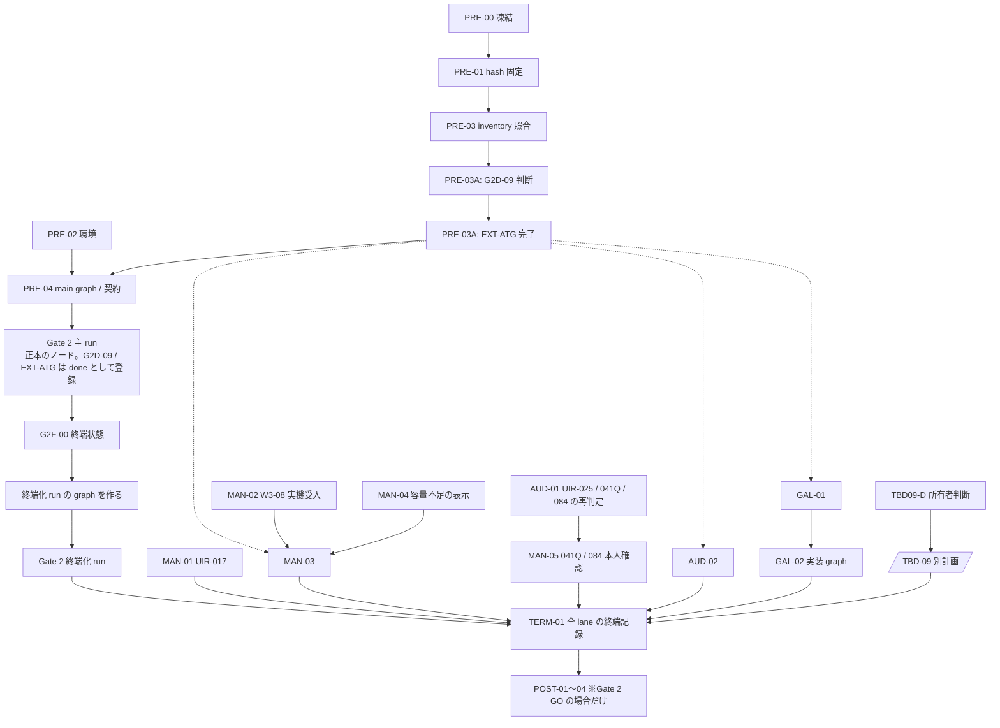

# `/work/` 未完了タスク統合実行計画（最終版）

| 項目 | 内容 |
|---|---|
| 文書種別 | `/work/` の計画・実行記録を統合した残タスク実行計画。**採用決定・Gate 判定ではない** |
| 版 | 最終版（2026-09-24 00:18 JST 以降の敵対的レビュー [`20260924-0018-RemainTaskPlan-AdversarialReview.md`](20260924-0018-RemainTaskPlan-AdversarialReview.md) の 41 件を反映） |
| 調査の時点 | 2026-09-24 00:30 JST。`work/` の 17 file（本計画とレビュー記録を除く）|
| Gate 2 の正本 | [`202609232120-RemainTaskExecutionPlan.md`](202609232120-RemainTaskExecutionPlan.md) と [`202609232120-Gate2-NodeInventory.md`](202609232120-Gate2-NodeInventory.md)。**別 session `e7dfa34f` が編集中**のため、本計画はそのノード一覧・起動順・見積を書き写さない。実行開始時に PRE-00・PRE-01 で凍結して hash を固定した版だけを使う |
| 原則 | 実測・利用者の操作・所有者の判断を生成または推定しない。file の存在だけで完了にしない。新しい証拠が古い記録と矛盾する場合は新しい証拠を使い、古い ID を重複して実行しない |

## 1. 受入条件

1. `work/` の 17 file を分類し、各 file の未完了事項を §5 に漏れなく載せる。
2. 後の記録で完了を確認できた旧タスクを、再び残タスクにしない。確認できないものは「未照合」と書く。
3. `NOT_RUN`、`SKIPPED_BY_USER`、`BLOCKED`、未実装、条件付き PASS、未実測を完了へ読み替えない。
4. すべての実行ノードに、成果物、依存、分割判定、exit code で判定できる完了条件、R/P/I/V/F の見積（別計画で決めるものはその旨）を付ける。
5. Gate 2 は、主 run が全成功した場合だけ `ready=true` にし、そうでない場合も BLOCKED の終端記録を作る。
6. すべての lane の終端状態を 1 つの記録（TERM-01）にまとめる。

## 2. 非対象

- 既存記録の `PASS`・測定値・採用判断を、測り直さずに変えること。
- 所有者の選択、利用者の本人確認、manual-only / assisted session、gold label、OS 再起動を伴う実機受入を代行・推定すること。
- Gate 2 を通過する前に Phase H 以降の製品機能を実装すること。
- `docs/ui-ux-execution.md` の UIR backlog のうち、`/work/` の計画が扱っていないもの（同 file 67 行の時点で 133 件中 114 件が未着手）。本計画は `/work/` が扱う UIR-017・041Q・084・025 だけを対象にする。
- [`20260923-0945-ATG-AnalyticsReport.md`](20260923-0945-ATG-AnalyticsReport.md) §7 の推奨 R1〜R10。推奨でありタスク計画ではない。R3（ATG の commit）は `git ls-files` で追跡中の file が 40 件あることを確認した。ほかの推奨の状態は確認していない。
- 別 session が編集中の Gate 2 計画・inventory の変更。
- 外部 repository への write、公開、deploy、課金、tag の作成。

## 3. 調査した file と位置づけ

| file | 種別 | 扱い |
|---|---|---|
| [`20260921-1330-TaskExecutionPlan.md`](20260921-1330-TaskExecutionPlan.md) | 全体計画と追補の実行記録 | Wave 1（W1-01 BLOCKED、W1-02 / 03 は状態の確定のみ）、W3-08、W4-02（条件付き）、Wave 5 以降の残件を採用 |
| [`20260922-0840-AdversarialReview.md`](20260922-0840-AdversarialReview.md) | レビュー・残件の記録 | §7.5 の残件（W3-08、全体並列実行時の失敗、200 件を超える画像への導線、Gate 依存の機能）を採用 |
| [`20260922-1340-Gate2LaneAdoption.md`](20260922-1340-Gate2LaneAdoption.md) | Gate 2 の途中記録 | 後の記録で置き換わった履歴 |
| [`20260923-0025-Gate2LaneFinalization.md`](20260923-0025-Gate2LaneFinalization.md) | Gate 2 の終端・要求変更の記録 | UIR-017 未変更、G2-07 NOT_RUN の根拠 |
| [`20260923-0546-RelaxedLicenseModelSurvey.md`](20260923-0546-RelaxedLicenseModelSurvey.md) | model の調査 | Gate 2 計画の入力 |
| [`20260923-0630-Gate2-TaskExecutionPlan.md`](20260923-0630-Gate2-TaskExecutionPlan.md) | 旧 Gate 2 計画 | 後の実行記録と正本に置き換わった |
| [`20260923-0720-Gate2-TaskExecution.md`](20260923-0720-Gate2-TaskExecution.md) | 旧 Gate 2 の実行記録 | G2R 系の終端。§4 のとおり扱う |
| [`20260923-0945-ATG-AnalyticsReport.md`](20260923-0945-ATG-AnalyticsReport.md) | ATG の分析 | ATG の運用上の制約だけを採用（§2） |
| [`20260923-1015-NonCommercialModelSurvey.md`](20260923-1015-NonCommercialModelSurvey.md) | model の調査 | §7 の 6 番（**TBD-09 の schema field 名の改訂**）が未完了 → §12 |
| [`20260923-1437-C7-RemainingTasksExecutionPlan.md`](20260923-1437-C7-RemainingTasksExecutionPlan.md) | C7 の旧計画 | 実行済み（下の行）。補助品質の比較試験は Gate 2 正本へ引き継がれた |
| [`20260923-1520-OWLViT-ControlledArtifact.md`](20260923-1520-OWLViT-ControlledArtifact.md) | 調査の成果物 | 完了の証拠 |
| [`20260923-1546-TinyCLIP-PrimarySourceSurvey.md`](20260923-1546-TinyCLIP-PrimarySourceSurvey.md) | 調査の成果物 | 完了の証拠 |
| [`20260923-2003-C7-RemainingTasksExecution.md`](20260923-2003-C7-RemainingTasksExecution.md) | C7 の実行記録 | C7 の最新実績。PKG-01 が未実装であることの根拠 |
| [`202609232120-Gate2-RequirementExtract.md`](202609232120-Gate2-RequirementExtract.md) | 要求の抜粋 | 原本 2 件の SHA-256 が抜粋の記載と一致することを 2026-09-24 に確認した |
| [`202609232120-RemainTaskExecutionPlan.md`](202609232120-RemainTaskExecutionPlan.md) | Gate 2 の正本 | 編集中（本計画の作成中にも内容が少なくとも 2 回変わり、行数は 598 → 602 → 614 と増えた）。§9 |
| [`202609232120-Gate2-NodeInventory.md`](202609232120-Gate2-NodeInventory.md) | Gate 2 のノード一覧 | 編集中（確認した時点で 46 件）。§9 |
| （本計画の初版） | — | レビュー後に本版で置き換えた |

## 4. 完了済み・再実行しないもの

| 範囲 | 判定 | 根拠と留保 |
|---|---|---|
| Wave 0、W1-02、W1-03 | 完了（状態の確定） | 1330 計画 385 行（W0-04 PASS）、`docs/ui-ux-execution.md` の W1-02 / 03 節。**確定した対象（UIR-041Q / 084 / 025）そのものは未完了**で §5 に載せる |
| Wave 2 | 再実行しない。ID 単位の照合は**未実施** | Gate 3 PASS の記録（1330 計画の Wave 4 記録が参照する実装計画 §15.12）。ID 単位の完了を確認できたのは W2-31 / 32 だけ → AUD-02 |
| W3-01〜07、W3-09 | 完了 | E2E 13 pass / 1 skip、Gate 3 PASS の記録 |
| W4-01、W4-03〜06 | 完了 | 1330 計画 522 行 |
| C7C-01〜03、C7D-01〜03、schema 2.0.0、harness の self-test | 完了 | 2003 実行記録 §1・§7、CHANGELOG 15〜47 行 |
| G2R 系 | 再実行しない | G2R-16 / 24 / 34 / 40〜43 は Gate 2 正本の G2A / G2Q へ引き継がれた。**G2R-17** は実行条件（SSDLite が性能・裁定とも不可）が成立しなかった（owner ruling D1 で SSDLite を承認し、manifest に登録済み）ため、条件不成立で閉じる |
| SPI-03 / 09 / 19 | `SKIPPED_BY_USER` を保持 | PASS にしない。製品機能の完成後の通常受入で検証する規則を保つ |

## 5. 未完了タスクの棚卸し

| # | 未完了事項 | 状態 | 根拠 | 担当ノード |
|---|---|---|---|---|
| 1 | Gate 2（4 役の承認、C6 初期化 parity、C7 の比較試験、版、manifest、ADR） | BLOCKED | Gate 2 正本 §3 | §9（正本のノード） |
| 2 | Gate 2 の外部前提 `EXT-41`・`EXT-ATG`・`EXT-X1` | 計画も成果物もない | `work/` に該当する file がない | 正本の同名ノード。中身は別計画（§9.3） |
| 3 | UIR-017 の本人確認（W1-01） | `NOT_RUN`、W1-01 BLOCKED | `tests/manual/ui-shell-review.md` 50〜54 行 | MAN-01 |
| 4 | UIR-041Q / UIR-084 | 未実施。前提の実装と本人確認が必要 | `docs/ui-ux-execution.md` W1-02 節・438 行 | AUD-01 → MAN-05 |
| 5 | 親 UIR-025 | 未完（残条件 9 件） | 同 W1-03 節 | AUD-01 |
| 6 | W3-08 の Reference 実機受入 | `SKIPPED_BY_USER`、記録簿は「未実施（NOT RUN）」 | `tests/manual/windows-file-picker.md` 8 行 | MAN-02 |
| 7 | W4-02 の最終化（実機部分） | 条件付き | `docs/users-guide.md` 320 行の最終化条件 | MAN-03 |
| 8 | 保存先の容量不足時の表示 | 未実測 | `docs/users-guide.md` 320・423 行 | MAN-04 → MAN-03 |
| 9 | 200 件を超える画像へ到達する導線 | 未実装 | レビュー記録 §7.5。`AnnotationPage.tsx:83`（`offset: 0, limit: 200`）、`AnnotationWorkspacePage.tsx:30`（`PAGE_LIMIT = 200`） | GAL-01〜02 |
| 10 | 全体を並列実行したときの test の失敗 | 2026-09-22 は 5 件、2026-09-23 は 3 file（`sample-assets`・`reference-source`・`copy-source`）。**両者が同じ失敗かは確認していない** | レビュー記録 §7.5、2003 実行記録 §7 | Gate 2 の G2X-01a〜c / `EXT-X1`。2026-09-22 の 5 件との関係は G2X の診断記録に書く |
| 11 | TBD-09（manifest schema の field 名の改訂） | 未着手。「次の schema 変更時」とされたが 2.0.0 の変更では行っていない。`commercialUseConfirmed` / `commercialDerivativesPermitted` は schema に残る | NonCommercialModelSurvey §7 の 6 番、`manifest.schema.json` | TBD09-D → 別計画 |
| 12 | PKG-01（release verifier） | 未実装 | 2003 実行記録 §7 末尾 | POST-02 |
| 13 | Phase H・I・I.1・J・K・L・M・N と users-guide §11〜15 | Gate 依存で未着手 | 1330 計画「Wave 5 以降」、実装計画 527〜715 行の Phase 見出し | POST-01〜04 |
| 14 | D-16（コード署名証明書） | 利用者の提示待ち | 1330 計画「Wave 5 以降」 | POST-03 の blocked 条件 |
| 15 | REP-11（グラフ描画の依存） | 未決 | 同上 | POST-03 の blocked 条件 |

## 6. 実行の前提（最初に実行する）

| ID | 内容 | 完了条件（exit code で判定） | 停止する場合 | 見積 R/P/I/V/F |
|---|---|---|---|---|
| PRE-00 | Gate 2 正本の凍結 | 正本 2 file と要求の抜粋を編集している session がないことを利用者が確認し、その旨の 1 行を実行記録に書く。確認後 10 分おいて 2 回取った SHA-256 が同じ | 編集中の session がある、または hash が変わる | 5/5/5/5/5 = 25 |
| PRE-01 | hash の固定 | 正本 2 file、要求の抜粋、原本 2 件（抜粋の記載値と一致）の SHA-256 を `work/<日時>-RemainTaskRun-Baseline.md` に書き、`Get-FileHash` の再計算と一致する | 抜粋の原本 hash が一致しない（抜粋を作り直すまで Gate 2 を起動しない） | 10/5/10/10/5 = 40 |
| PRE-02 | 実行環境 | ① `pwsh.exe -NoLogo -NoProfile -Command 'exit 0'` が exit 0（2026-09-24 時点のこの環境では起動しない）。② `pwsh` の中で `npm --version` が exact `12.0.0`（Windows PowerShell 5.1 では `npm.ps1` が実行 policy で読めず、`npm.cmd` は `11.17.0` を返した）。③ `$env:PYTHONPATH="$PWD\tools\atg\vendor"; python -m atg --help` が exit 0（この環境で動作を確認済み） | ① または ② が失敗した場合、npm と `pwsh` を使う node を起動しない。取得・代用はしない（CONTRIBUTING 95・137 行） | 10/5/10/10/5 = 40 |
| PRE-03 | inventory と正本の照合 | ① 正本 §6.1 と §8 のノード ID が inventory §1 と一致する。② inventory §2 の状態の語彙について、ATG の状態との対応（`succeeded→done`、`failed→failed`、`blocked`・`pending→not-started`、根拠の列に ATG の生の状態）が正本か inventory に書いてある | ① が一致しない、または ② の対応がない → 正本を編集する session か利用者へ修正を依頼して停止する（本 session は編集しない） | 15/5/10/15/5 = 50 |
| PRE-03A | graph 化の前に G2D-09 と `EXT-ATG` を行う | 正本 §8.1 の形式で G2D-09 の判断記録があり、正本 §8.5 の `EXT-ATG` の完了条件が exit 0。どちらも正本 §6.1 で参照 file が 500 行以下の node であり、graph の外で先に実行できる | G2D-09 の判断がない、または `EXT-ATG` が完了しない → PRE-04 を起動しない。TERM-01 に理由を記録する | 正本 §8.1（G2D-09）と `EXT-ATG` の別計画の値 |
| PRE-04 | main run の graph と契約 | PRE-03A の後、`EXT-ATG` で定まった規約に従って分割判定をやり直し、正本 §7 に従って main graph と root contract を作る。inventory §3 の検査、`python -m atg graph check`、`python -m atg contract check` がすべて exit 0。契約の `acceptance_command` を確定する。PRE-03A で完了した G2D-09 と `EXT-ATG` は、その成果物の SHA-256 を handoff にして `node start` → `node finish` で done にする（新しく作業しない）。**終端化 run の graph は G2F-00 の後に作る**（正本 §7.2） | `acceptance_command` を exit code で判定できる形に確定できない | 20/15/30/20/10 = 95 |

`node fail` は失敗した node の子孫をすべて `blocked` にする（`tools/atg/vendor/atg/cli.py` の `cmd_node_fail`）。PRE-03 ② の対応は、この挙動を前提にしている。

## 7. 分割判定

### 7.1 計画全体

| 項目 | 判定 |
|---|---|
| `task_scope` | `multi`（Gate 2、手動受入、UI 状態の再判定、gallery、TBD-09、Gate 後の phase は独立した成果物） |
| `context_size` | `large`（17 file を調査。500 行を超える file を含む） |
| 判定 | **`SPLIT_REQUIRED`**（planning §3 の `task_scope == "multi"` と `context_size == "large"` の分岐） |

本計画の作成では実装・測定・判断を行わない。

### 7.2 本計画で追加したノード

Gate 2 のノードの判定は正本 §6.1 に従う。行数は 2026-09-24 に数えた値。

| ノード | 成果物数 | 参照ファイル数 | 500 行を超える file | 判定 | 外部前提 |
|---|---:|---:|---|---|---|
| PRE-00〜03（各） | 1 | 2〜4 | なし（正本は hash 計算と ID の抽出だけで、本文を読まない） | `PROCEED` | — |
| PRE-03A | 2（判断記録、`EXT-ATG` の別計画の成果物） | 正本 §6.1 の G2D-09 の値（3） | なし | G2D-09 は正本 §6.1 のとおり `PROCEED`。`EXT-ATG` は別計画で判定する | 所有者（G2D-09） |
| PRE-04 | 1 | 3 | 正本（2026-09-24 00:30 時点で 614 行。編集中のため変わり得る）を読む | 現行規約では `SPLIT_REQUIRED` | PRE-03A（`EXT-ATG`）。完了後の規約で判定をやり直し、`PROCEED` にならなければ Gate 2 を起動せず TERM-01 に記録する |
| MAN-01 | 1 | 2（`ui-shell-review.md` 61 行、`ui-ux-execution.md` 470 行） | なし | `PROCEED` | 利用者 |
| MAN-02 | 1 | 1（`windows-file-picker.md` 99 行） | なし | `PROCEED` | 利用者、署名前 package |
| MAN-03 | 1 | 3 | `docs/users-guide.md`（1,079 行） | `SPLIT_REQUIRED` | `EXT-ATG` |
| MAN-04 | 1 | 2 | なし（結果は work file へ書く） | `PROCEED` | 利用者または測定環境 |
| MAN-05 | 1 | 2 | なし | `PROCEED` | AUD-01、利用者 |
| AUD-01 | 1 | 3（`ui-ux-execution.md`、実在確認する file 一覧、実装計画の抜粋） | なし | `PROCEED` | — |
| AUD-02 | 1 | 2 | 1330 計画（744 行） | `SPLIT_REQUIRED` | `EXT-ATG` |
| GAL-01 | 1 | 4 | `AnnotationWorkspacePage.tsx`（544 行） | `SPLIT_REQUIRED` | `EXT-ATG` |
| GAL-02 | 1 | 2 | なし | `PROCEED` | GAL-01 |
| TBD09-D | 1 | 3 | なし（抜粋を参照） | `PROCEED` | — |
| TERM-01 | 1 | 3 | なし | `PROCEED` | — |
| POST-01 | 1 | 1 | `docs/implementation-plan.md`（1,869 行） | `SPLIT_REQUIRED` | `EXT-ATG`、Gate 2 GO |

`SPLIT_REQUIRED` のノードは、`EXT-ATG` の完了後に、その時点の規約で判定をやり直すまで起動しない。

## 8. 実行 DAG

- 点線は、PRE-03A で `EXT-ATG` が完了したことを条件にする辺である（本計画の lane は ATG の main run の node ではない）。
- `EXT-ATG` を graph 化の前に行うのは、graph 化（PRE-04）自体が 500 行を超える正本を読むため、`EXT-ATG` を main run の中に置くと PRE-04 と `EXT-ATG` が互いを待つからである。
- `EXT-ATG` が完了しない場合、点線の先は `not-started` のまま TERM-01 に記録する。
- 共有資源の直列化（擬似 write set）: 同じ host での性能測定は `lock:perf-host`（ATG Analytics R8）。root の `package.json` / `package-lock.json` を変える node（Gate 2 の G2V-01、GAL の実装、TBD-09 の実装）は `lock:root-version`。`resources/models/manifest*.json` を変える node（Gate 2、TBD-09）は `lock:model-manifest`。

## 9. Gate 2 lane（正本に従う）

### 9.1 実行

1. PRE-00〜04 の後、PRE-01 で hash を固定した正本 §7・§8 に従って main run を進める。ノードの write set、測定コマンド、完了条件、見積は正本の値を使い、本計画では書き換えない。
2. 開始時から起動できる node は `python -m atg node next` の出力で決める。本計画では一覧を持たない（正本の更新で古くなるため）。
3. 判断 node（G2D-*）は、利用者の書面回答を正本 §5 の path に記録した場合だけ成功にする。推奨を判断として記録しない。
4. 利用者の session（G2Q-04 / 05）がない場合、その node と子孫を起動しない。

### 9.2 終端化

1. G2F-00 は、main run が静止（`node next` が空で `running` がない）または全成功したときに行う。
2. 状態は PRE-03 ② の対応で記録し、根拠の列に ATG の生の状態を書く。記録と `python -m atg report` が合わない場合は**記録を直す**。ATG の durable state は書き換えない。
3. 終端化 run の graph は、G2F-00 の結果（全成功か、G2A-03 が done か）に合わせて作る（正本 §7.2）。G2F-01m と G2F-01r を同じ graph に置かない。
4. main run と終端化 run のそれぞれで、PRE-04 と終端化 run の graph 作成時に確定した `acceptance_command` を使って `python -m atg run finish` を実行し、exit 0 を確認する。非ゼロなら成功にしない。

### 9.3 外部前提の別計画

| 正本の ID | 本計画で固定すること |
|---|---|
| `EXT-ATG` | PRE-03A で、正本の G2D-09 で所有者が選んだ方式（A: ATG の planning 規約の改訂、B: file ごとの分割）の別計画を作って完了させる。本計画の PRE-04・MAN-03・AUD-02・GAL-01・POST-01 も、この完了を待つ |
| `EXT-41` | 正本の G2T-40 → G2D-04（「実装する」）の後に別計画を作る。session の値を生成・補完しない |
| `EXT-X1` | 正本の G2X-01a〜c の診断の後、file ごとの修正計画を作る。test を弱めない。2026-09-22 の 5 件との関係は診断記録で確かめる |

別計画の中の ID と見積は、それぞれの別計画で決める。本計画では決めない。

## 10. 手動受入・UI 状態 lane

### MAN-01 — UIR-017 の本人確認

- 実行者: 利用者本人。実行主体は隔離 preview の起動と手順の提示だけを行う。
- 成果物: `tests/manual/ui-shell-review.md` の本人確認の節への実回答、`docs/ui-ux-execution.md` の UIR-017 の状態。
- 完了条件: 実回答（現在対象・表示状態・次の結果・戻り先）と期待 ID の照合が記録され、`Select-String -Path tests\manual\ui-shell-review.md -Pattern '<実施日>' -Quiet` が True。実施されなければ `NOT_RUN` を保ち、TERM-01 に `not-started（利用者）` と書く。
- 見積: 10/5/20/10/5 = 50 分（利用者の操作時間を除く）。

### MAN-02 — W3-08 の Reference 実機受入

- 前提: `electron-builder` で作った署名前 package（`windows-file-picker.md` 9・33 行。開発ビルドで代用しない）。
- 実行者: 利用者。**OS 再起動（R-03）は利用者だけが行う**。
- 成果物: `tests/manual/windows-file-picker.md` §4 の記録表。
- 完了条件: 記録表のすべての行に実測結果・日時・環境があり、冒頭の「実施状態」が更新されている。結果を SPI-19 の PASS へ読み替えない。
- 見積: 10/10/30/30/10 = 90 分（OS 再起動の待ち時間を除く）。

### MAN-04 — 保存先の容量不足時の表示

- 成果物: `work/<日時>-CapacityShortageMeasurement.md`（測定環境、手順、表示された文言、画面の証拠）。
- 方法: 空き容量が足りない保存先を利用者が用意し、その上で取り込みを行う。実行主体はディスクを埋める・partition を作るなどの環境操作を行わない。
- 完了条件: 記録 file に表示文言と、その文言が source にあることを示す `<path>:<行>` がある（`Select-String -Pattern '\S+\.tsx?:\d+'` が 1 件以上）。用意できない場合は未実測のまま TERM-01 に記録する。
- 見積: 10/10/20/20/10 = 70 分。

### MAN-03 — W4-02 の最終化（`EXT-ATG` の後）

- 依存: MAN-02 の完了（MAN-04 は結果がある場合だけ反映）。
- 成果物: `docs/users-guide.md` §7 と冒頭の章状態。
- 完了条件: 実測した範囲だけを手順に反映し、未実測のものは未実測のまま残す。`npm run verify:docs` と `npm run test:docs` が exit 0（PRE-02 の環境で実行）。
- 見積: 10/5/20/15/5 = 55 分。

### AUD-01 — UIR-025 / 041Q / 084 の状態の再判定

- 成果物: `work/<日時>-UirStatusRedetermination.md`。
- 内容: `docs/ui-ux-execution.md` W1-03 の残条件 9 件と、W1-02 の UIR-041Q / 084 の前提について、**現在の** code・test・記録から状態を判定する。W1-03 で「file 不在」とされた `delete-preview.ts`・`delete-project.ts`・`tests/e2e` は現在存在するが、存在だけでは完了にしない（受入条件を満たす test・記録があるかを見る）。
- 完了条件: 各項目に `完了 / 未完了 / 未確認` のどれか 1 つと、根拠の `<path>:<行>` がある。`docs/ui-ux-execution.md` は変更しない（変更は判定を利用者が確認した後の別ノード）。
- 見積: 30/10/20/15/10 = 85 分。

### MAN-05 — UIR-041Q / 084 の本人確認

- 依存: AUD-01 で前提が「完了」と判定されたこと。そうでなければ起動せず、TERM-01 に理由を書く。
- 実行者・完了条件: MAN-01 と同じ形式。自己点検・JSDOM の結果・承認済み DU を本人の回答に代用しない（docs 438 行）。
- 見積: 10/5/20/10/5 = 50 分（利用者の操作時間を除く）。

### AUD-02 — Wave 2 の ID 単位の照合（`EXT-ATG` の後）

- 成果物: `work/<日時>-Wave2CompletionAudit.md`。1330 計画の Wave 2 の各 ID について、完了の記録（完了済み ID の行、test、file）を照合する。
- 完了条件: Wave 2 の全 ID が `照合済み / 未照合 / 未完了` のどれか 1 つで 1 回ずつ記録されている（ID の一覧は 1330 計画の表から抽出し、件数を記録に書く）。未完了が見つかった場合は、その ID を TERM-01 に載せ、別の実行ノードを作る。
- 見積: 45/10/20/15/10 = 100 分。

## 11. 200 件を超える gallery lane

### GAL-01 — 調査（`EXT-ATG` の後）

- 入口（確認済み）: `src/renderer/features/annotations/AnnotationPage.tsx:83`、`src/renderer/features/annotations/AnnotationWorkspacePage.tsx:30`、`ImageGallery.tsx`（84 行）、annotation の list の IPC 契約と handler。
- 成果物: `work/<日時>-GalleryBeyond200Investigation.md`。現在の取得上限、総件数の出所、201 件目へ到達できない最初の境界、Main / IPC / Renderer のどこに変更が要るか。
- 完了条件: 各結論に `<path>:<行>` がある（3 件以上）。201 件の fixture で到達できないことを test または手順で再現した記録がある。すでに到達できる場合は実装しないで完了とする。
- 見積: 45/15/20/20/10 = 110 分。

### GAL-02 — 実装 graph の作成

- 成果物: 1 ノード 1 成果物の実装 graph。page の大きさ、順序、filter を変えたときの位置、総件数、重複・欠落の扱い、keyboard での前後移動、最後の item の境界を固定する。必須の test（0・1・200・201 件、複数 page、filter の境界、最後の item、重複なし、取得失敗）と、root version・CHANGELOG の更新ノード（`lock:root-version`。版の値は release 責任者が決める）を含める。
- 禁止: 調査の前に方式（offset / cursor 等）を決めること。全件の一括読み込みを既定にすること。
- 完了条件: `python -m atg graph check` が exit 0。実装はこの graph のノードとして行い、本計画の見積に含めない。
- 見積: 20/30/20/10/10 = 90 分。

## 12. TBD-09 lane

### TBD09-D — 改訂の要否と時期の所有者判断

- 成果物: `docs/model-governance/evidence/<判断日>-owner-ruling-TBD-09.md`（回答の原文、判断、根拠、判断が意味しないこと、`選択: <選択肢>` の行）。
- 選択肢: A. 次の独立した schema 変更として改訂する（別計画）。B. Gate 2 の終端まで改訂しない。推奨は示さない（schema の MAJOR 変更と Gate 2 の manifest 変更の順序に関わり、所有者の判断に属する）。
- 完了条件: `Select-String -Pattern '^選択: (A|B)$' -Quiet` が True。
- 見積: 10/5/15/5/5 = 40 分。
- A の場合: 別計画を作る。`manifest.schema.json`（668 行）と `manifest-schema.test.mjs` を変えるため `EXT-ATG` を前提にし、`lock:model-manifest` と `lock:root-version` で Gate 2 と直列にする。

## 13. Gate 2 の後（Gate 2 GO の場合だけ）

Gate 2 が BLOCKED で終端した場合、本章のノードは TERM-01 に `not-started（Gate 2）` と記録する。

### POST-01 — Phase H〜N の inventory（`EXT-ATG` の後）

- 入力: `docs/implementation-plan.md` の Phase H（527 行）、I（558 行）、I.1（599 行）、J（607 行）、K（624 行）、L（649 行）、M（678 行）、N（715 行）。
- 事実（2026-09-24 に数えた）: 527〜883 行の表の task 行は 150 件（先頭は `AST-01`）。この範囲には Phase N の後の表が含まれる可能性があるため、正確な集合は POST-01 で確定する。
- 成果物: task ID・依存・成果物・write set・DoD を原文から写した inventory と graph。
- 完了条件: 原本の該当範囲の task ID 集合と inventory の集合が一致する検査、`python -m atg graph check` がともに exit 0。本計画で task ID や path を補わない。

### POST-02 — PKG-01

- 実装計画の PKG-01 の DoD に従う（`sourcePath` の approved hash / size だけを通す、download しない）。`releaseStatus.assistQuality[]` の model・記録・SHA-256 の照合を含める。
- 完了条件: PKG-01 の DoD と、改変した payload・hash・記録を拒否する否定 test が exit 0。

### POST-03 — Phase H〜N の実行

- POST-01 の graph の依存順に実行する。Gate 4 / 5 の未達を後続の PASS に使わない。
- blocked 条件: D-16（コード署名証明書）が必要な node は、利用者が証明書を提示するまで起動しない。REP-11 は Phase J の前に所有者が「1 つの依存を採用」か「追加の依存なし」を決める。

### POST-04 — users-guide §11〜15 と最終受入

- 対応する製品機能を実測した後にだけ更新する。未実装の機能、未署名の package、未実測の clean install を操作できると書かない。

## 14. TERM-01 — 全 lane の終端記録

- 成果物: `work/<日時>-RemainTaskTerminalState.md`。
- 内容: §5 の 15 事項と §6〜§13 のすべてのノードを、`done / failed / not-started` のどれかと理由（利用者・所有者・外部前提・Gate 待ち）で 1 回ずつ記録する。Gate 2 の行は G2F-00 の記録を参照する。
- 完了条件: §6〜§13 のノード ID（PRE-00〜03、PRE-03A、PRE-04、MAN-01〜05、AUD-01〜02、GAL-01〜02、TBD09-D、POST-01〜04）と、Gate 2 の終端化の記録 file への参照がすべて 1 回ずつある（ID の一覧を配列にした `Select-String` の件数検査が exit 0）。`running` がない。
- 見積: 10/5/20/10/5 = 50 分。

## 15. 見積（上界の指標。合否には使わない）

| 区分 | 合計 |
|---|---:|
| PRE-00〜04 | 25 + 40 + 40 + 50 + 95 = 250 分（PRE-03A は正本 §8.1 の G2D-09 の値と `EXT-ATG` の別計画の値） |
| MAN-01〜05 | 50 + 90 + 55 + 70 + 50 = 315 分（利用者の操作時間を除く） |
| AUD-01〜02 | 85 + 100 = 185 分 |
| GAL-01〜02 | 110 + 90 = 200 分（実装は GAL-02 の graph で見積もる） |
| TBD09-D | 40 分（A の場合の別計画は別に見積もる） |
| TERM-01 | 50 分 |
| Gate 2 | PRE-01 で固定した正本 §9 の値（2026-09-24 00:30 時点の版では 3,540 分。外部前提、利用者の session、gold label の作成、判断待ちを除く） |
| `EXT-41` / `EXT-ATG` / `EXT-X1`、POST-01〜04 | それぞれの別計画・POST-01 で見積もる |

## 16. 実行封筒

| 操作 | 可否 |
|---|---|
| 宣言した write set の中の code・文書の変更 | 許可 |
| Git 追跡外の spike directory の検証成果物 | hash と生成コマンドを記録する場合だけ許可 |
| 製品の依存・lock の追加 | 採用ノードと所有者の判断がある場合だけ |
| root version の変更 | CONTRIBUTING「製品バージョンの更新順」に従い、exact npm 12.0.0 の `npm version` でだけ行う。版の値は release 責任者が決める |
| 別 session が編集中の file（Gate 2 正本・inventory）の変更 | 本 session では行わない |
| OS 再起動、ディスク容量を減らす操作、partition の操作 | 実行主体は行わない。利用者だけが行う |
| 所有者の判断・利用者の session・gold label・本人確認の回答の生成 | 禁止 |
| 未承認 model の manifest 登録、Gate 2 前の Phase H〜N の実装 | 禁止 |
| deploy、公開、課金、外部 repository への write、tag の作成 | 禁止 |

## 17. 停止・再試行の規則

1. 必要な判断・利用者の操作・外部前提がない場合、依存するノードを起動しない。推奨を判断として記録しない。
2. 同じ network の失敗は 3 回までとし、backoff の後も失敗すれば `transient` の失敗として記録する。
3. 同じログの繰り返し、標準入力の待ち、watch mode、10 分以上の無進捗は、process ID を指定して停止する。同じ条件での再試行は 1 回まで。
4. parity・性能・品質の基準は測定の前に固定し、結果を見て変えない。
5. `contract` クラスの失敗は再試行しない。`implementation` クラスは原因を直した場合だけ ATG の上限の中で再試行する。
6. 宣言していない書込みを検出したノードは完了にしない。
7. 正本の hash が PRE-01 の値から変わった場合、Gate 2 の新しい node を起動せず、PRE-00 からやり直す。
8. Gate 2 が成立しなくても、G2F-00 以降の終端化と TERM-01 は必ず行う。

## 18. 最終完了条件

「全残タスクの完了」は次がすべて成り立つ状態である。

1. TERM-01 の完了条件のコマンドが exit 0 で、すべての事項が `done` か、理由付きの `failed` / `not-started` で記録されている。
2. UIR-017・041Q・084 と W3-08 は、利用者の実回答・実測があるか、未実施として理由付きで記録されている。
3. W4-02 の記述が、W3-08 と容量不足の実測の結果と一致している。
4. 200 件を超える gallery は、201 件目以降へ到達でき、境界の test が通っているか、GAL-01 で到達できると確認されている。
5. Gate 2 は GO か、証拠付きの BLOCKED で終端し、inventory、ATG の report、manifest の `reason`、ADR、実行記録が一致している。
6. GO の場合、Phase H〜N、PKG-01、users-guide §11〜15、Gate 4 / 5、最終受入が POST-01 の graph どおり終端している。
7. すべての ATG の run で `python -m atg run finish` が exit 0。

## 19. 本計画が主張しないこと

1. Gate 2 が通過できる、C7 の候補が比較試験に合格する、とは主張しない。
2. 利用者が本人確認・実機受入・session を行ったとは記録しない。
3. `EXT-41`・`EXT-ATG`・`EXT-X1`・TBD-09 の別計画の方式と変更する path は、判断と調査の前には決まっていない。
4. UIR-025 の残条件が完了したとは主張しない（関係する file の存在を確認しただけ）。
5. Wave 2 の全 ID が完了したとは主張しない（AUD-02 で照合する）。
6. 2026-09-22 の 5 件の失敗と 2026-09-23 の 3 file の失敗が同じものだとは主張しない。
7. Phase H〜N の task ID と write set は、POST-01 で原本から抽出するまで補わない。
