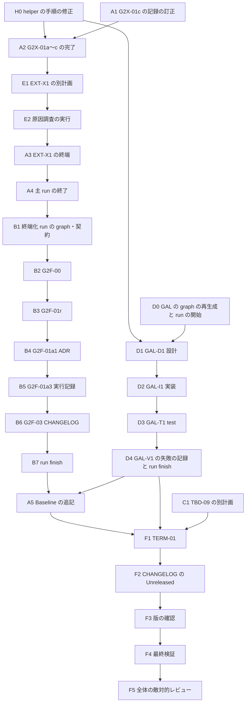

# 残タスク実行計画（2026-09-24 08:30 JST 時点）

| 項目 | 内容 |
|---|---|
| 文書種別 | 一時作業文書。これまでの実行結果を分析し、残タスクとその実行手順を定めた計画。**採用決定・Gate 判定・所有者判断ではない** |
| 上位の計画 | [`202609232400-RemainTaskExecutionPlan.md`](202609232400-RemainTaskExecutionPlan.md)（以下「2400 計画」）。Gate 2 の正本は [`202609232120-RemainTaskExecutionPlan.md`](202609232120-RemainTaskExecutionPlan.md)（以下「Gate 2 計画」）と [`202609232120-Gate2-NodeInventory.md`](202609232120-Gate2-NodeInventory.md)（以下「inventory」） |
| 固定した hash | Gate 2 計画 `B6EE4952…`、inventory `AD3BF6E9…`（2026-09-24 08:30 に `Get-FileHash` で再計算。PRE-01 の値と一致）。変わった場合は 2400 計画 §17 の規則 7 に従い、Gate 2 の新しい node を起動しない |
| 優先する要求 | [`docs/requirement-definition.md`](../docs/requirement-definition.md)。本計画は要求にない機能・抽象化・設定を追加しない |
| 原則 | 実測・利用者の操作・所有者の判断を生成または推定しない。file があるだけでは完了にしない。`contract` クラスの失敗は再試行しない（2400 計画 §17 の規則 5） |

## 1. 本計画の受入条件

1. 完了済みのタスクを、根拠の file と一緒に §2 に列挙する。
2. 残タスクをすべて §3 に列挙し、それぞれを「実行主体が完了できる」か「利用者・所有者の入力を待つ」に分ける。
3. 実行主体が完了できる残タスクには、成果物、write set、依存、並列の可否、exit code で判定できる完了条件、敵対的レビュー、見積 R/P/I/V/F を付ける（§5〜§10）。
4. 利用者・所有者の入力を待つ残タスクには、必要な入力と、入力が届いたときの再開手順を付ける（§11）。
5. 完了条件に使う検査コマンドは、既存の file（inventory §2・§4、Gate 2 計画 §8.0 の `NPM12` / `DOCS` / `MANIFEST`）から写す。新しい検査の仕組みは作らない。

## 2. 完了済みタスクの分析

### 2.1 2400 計画のノード

| ID | 状態 | 根拠 |
|---|---|---|
| PRE-00 | failed（利用者） | 利用者本人の確認がない。利用者の回答は「C: 私が後で行います」（§11 の U-01）。機械的な部分（編集中の session がないこと、10 分おいた 2 回の hash の一致）は成立（[Baseline](20260924-0306-RemainTaskRun-Baseline.md) §6.2） |
| PRE-01 | done | Baseline §6.3。08:30 の再計算でも一致 |
| PRE-02 | done（完了条件 ①〜③ は成立。**留保あり**） | 利用者の指示「A: インストールしてください」で、npm `12.0.0` を `%LOCALAPPDATA%\npm-12.0.0` へ install した。`pwsh` exit 0、`npm --version` = `12.0.0`（PATH の先頭に追加した場合）、ATG exit 0。ただし、2400 計画 PRE-02 の停止条件「取得・代用はしない」は利用者の指示で外れた。さらに、Gate 2 計画の `NPM12`（245 行）が前提とする「組織承認済みの方法」は確認していない（G2D-11 は `選択: 未確定`。§12 の 2）。**Baseline にはまだ書いていない**（§6 の A5） |
| PRE-03 | done | Baseline §6.5 |
| PRE-03A | done | 準備 run 2 `d77c9409-405d-44cc-8bbd-afb37eb92961`（`work/20260924-0345-Gate2-atg-state/prep2.sqlite3`）で G2D-09・`EXT-ATG` が succeeded、`accepted: true`。判断記録 [`2026-09-24-owner-ruling-G2D-09.md`](../docs/model-governance/evidence/2026-09-24-owner-ruling-G2D-09.md)、[`20260924-0620-EXT-ATG-Confirmation.md`](20260924-0620-EXT-ATG-Confirmation.md)。**Baseline には未記載**（A5） |
| PRE-04 | done | [`20260924-0710-Gate2-SplitRejudgment.md`](20260924-0710-Gate2-SplitRejudgment.md)（§3 の敵対的レビュー 5 回目で blocking 0）。main graph は 44 node、graph check・contract check・inventory §3 の検査がすべて exit 0 |
| AUD-01 | done | [`20260924-0300-UirStatusRedetermination.md`](20260924-0300-UirStatusRedetermination.md) |
| AUD-02 | done | [`20260924-0630-Wave2CompletionAudit.md`](20260924-0630-Wave2CompletionAudit.md) |
| GAL-01 | done | [`20260924-0630-GalleryBeyond200Investigation.md`](20260924-0630-GalleryBeyond200Investigation.md)。201 件目へ到達できない（同 file 40 行: `AnnotationWorkspacePage.tsx:30`・`:169`・`:170`） |
| GAL-02 | done | [`20260924-0700-GAL02-GraphRecord.md`](20260924-0700-GAL02-GraphRecord.md)。graph check exit 0。**実装ノード GAL-D1〜V1 は未実行**（§8） |
| TBD09-D | failed（所有者） | [`2026-09-24-owner-ruling-TBD-09.md`](../docs/model-governance/evidence/2026-09-24-owner-ruling-TBD-09.md) は「要否: 改訂する」、時期は `選択: 未確定`。2400 計画 §12 の完了条件 `^選択: (A|B)$` は満たさない |
| MAN-01〜05 | not-started（利用者） | 利用者の実回答・実測がない（§11） |
| TERM-01 | 更新が必要 | [`20260924-0325-RemainTaskTerminalState.md`](20260924-0325-RemainTaskTerminalState.md) は 04:30 の状態のまま（§10 の F1） |
| POST-01〜04 | not-started（Gate 待ち） | Gate 2 は GO にならない（§3.1） |

### 2.2 Gate 2 主 run（実行 ID `e7c6da3f-8f62-4785-b40e-fab254437a4b`、状態 DB `work/20260924-0730-Gate2Main-atg-state/main.sqlite3`）

08:30 の `python -m atg report` の結果（blocked 以外）:

| 状態 | node | 根拠 |
|---|---|---|
| succeeded（6） | G2T-11、G2T-40、G2T-50C、G2T-50D、G2T-60C、G2T-60D | 各 `work/20260924-0730-Gate2Main-<ID>-Review.md`（`blocking: 0`）と handoff |
| failed（8） | G2D-01、G2D-02、G2D-04、G2D-06、G2D-10、G2D-12（所有者の回答なし。[`20260924-0740-Gate2Main-UndecidedRulings.md`](20260924-0740-Gate2Main-UndecidedRulings.md)）。G2D-11（所有者は導入を指示したが、導入の方法が組織承認済みかは未確認で、成功条件「用意の完了」が成立しない。[`2026-09-24-owner-ruling-G2D-11.md`](../docs/model-governance/evidence/2026-09-24-owner-ruling-G2D-11.md) 20 行）。G2T-10（parity の実測が FAIL、exit 1。[`classification-checkpoint-result.md`](../spikes/models/classification-checkpoint-result.md)、[`20260924-0730-Gate2Main-G2T-10-Review.md`](20260924-0730-Gate2Main-G2T-10-Review.md)） | `node fail --class contract` |
| pending（4） | G2X-01a、G2X-01b、G2X-01c、EXT-X1 | 診断記録 `work/20260924-0730-VitestFailure-{a,b,c}.md` はある。rubber-duck agent のレビュー（2 回目）は agent の出力の中で 3 件とも blocking 0 だったが、**Review file にはまだ記録していない**。このため、blocking 0 は A2 で Review file を作って検査した後にだけ確定する。`EXT-X1` は [`20260924-0730-EXT-X1-Status.md`](20260924-0730-EXT-X1-Status.md) で「別計画を作っていない」と記録した。ただし 2400 計画 §9.3 は別計画の作成を求めているため、E1・E2 で作る |
| blocked | 上記以外（26 件） | 失敗した node の子孫（`cmd_node_fail`） |

### 2.3 ATG package の変更（本 session）

| 変更 | 状態 | 根拠 |
|---|---|---|
| `EXT-ATG`: planning 規約 §1.1（500 行を超える file の行範囲の列挙） | done | kit `0.2.2` → `0.2.3`（`tools/atg/KIT-VERSION.json`） |
| `node start` が `failed` / `blocked` の node を lock の選択に含めていた不具合の修正 | done | `tools/atg/vendor/atg/cli.py` の `cmd_node_start` で `terminal_ids` を渡す（`cmd_node_next` と同じ形）。engine `0.1.4` → `0.1.5`。敵対的レビュー（rubber-duck agent `7621139b`）で blocking 0。修正後に G2D-10 を起動して記録した |

PATCH の更新は package ごとに 1 回とする。kit はすでに `0.2.3` へ 1 回上げてあるため、これ以上は上げない。hve・Markdown query Skill・Code Query skill の package は repository にない（08:30 の確認: package の manifest は `package.json`、`ml/pyproject.toml`、`tools/atg/KIT-VERSION.json` だけ。`.github/skills/` の中は `atg` だけ）。

## 3. 残タスクの一覧

### 3.1 実行主体が完了できるもの

| # | 残タスク | ノード | 節 |
|---|---|---|---|
| 1 | ATG の実行規約（作業の前の `node start`、書込み検査）に合わせた helper の手順の修正 | H0 | §6 |
| 2 | G2X-01c の診断記録の不正確な記述の訂正（33 行「…単独で合格した test と同じ」。以前の記録 `20260923-2003-C7-RemainingTasksExecution.md:87` にあるのは file 名だけ） | A1 | §6 |
| 3 | G2X-01a〜c の Review file の作成と node の完了 | A2 | §6 |
| 4 | `EXT-X1` の別計画（2400 計画 §9.3「G2X-01a〜c の診断の後、file ごとの修正計画を作る」）の作成と、その原因調査の実行 | E1・E2 | §6.1 |
| 5 | 主 run の `EXT-X1` の終端（E2 の結果により完了または失敗） | A3 | §6 |
| 6 | 主 run の終了（静止の確認、受入コマンド、`run finish`） | A4 | §6 |
| 7 | 終端化 run の graph と契約（variant `静止`） | B1 | §7 |
| 8 | G2F-00・G2F-01r・G2F-01a1・G2F-01a3・G2F-03 と終端化 run の `run finish` | B2〜B7 | §7 |
| 9 | Baseline への本 session の記録の追記（npm 12、準備 run 2、PRE-04、主 run、終端化 run） | A5 | §6 |
| 10 | 200 件を超える gallery の実装（GAL-D1・GAL-I1・GAL-T1）と、GAL-V1 の終端の記録 | D0〜D4 | §8 |
| 11 | TBD-09 の別計画（field 名の案と実装ノード） | C1 | §9 |
| 12 | TERM-01 の更新、CHANGELOG、版の確認、最終検証 | F1〜F5 | §10 |

### 3.2 利用者・所有者の入力を待つもの（実行主体は完了できない）

| # | 残タスク | 待つ入力 | 節 |
|---|---|---|---|
| 13 | PRE-00 の本人確認 | 利用者（「私が後で行います」） | §11 U-01 |
| 14 | Gate 2 の所有者判断 G2D-01・02・04・05・06・07C・07D・08・10・12 | 所有者の書面回答 | §11 U-02 |
| 15 | `EXT-41`（G2T-40 → G2D-04 で「実装する」が選ばれた後に別計画を作る。2400 計画 §9.3）。G2D-04 が未判断のため起動条件が成立していない | G2D-04 の所有者の回答 | §11 U-02 |
| 16 | G2D-11（npm の用意の方法が組織承認済みか。所有者は導入を指示したが、方法の承認はしていない: `2026-09-24-owner-ruling-G2D-11.md:20`） | 所有者 | §11 U-03 |
| 17 | G2T-10 の FAIL（分類の train → ONNX parity） | 所有者の判断（許容値の変更は測定前に固定する規則のため、実行主体は変えない） | §11 U-04 |
| 18 | `EXT-X1` の修正（E2 で原因が確定しなかった場合） | 別計画の続き | §11 U-05 |
| 19 | TBD-09 の時期（A / B）と field 名の案の承認 | 所有者 | §11 U-06 |
| 20 | GAL-V1 の root version の値 | release 責任者 | §11 U-07 |
| 21 | MAN-01〜05（UIR-017、W3-08、W4-02、容量不足の表示、UIR-041Q / 084） | 利用者の本人確認・実機受入 | §11 U-08 |
| 22 | POST-01〜04、D-16、REP-11 | Gate 2 GO | §11 U-09 |
| 23 | UIR-025 の残条件 #2・#4・#7（削除 preview の古い応答を使わない guard と test、CORE-13A の受入、Gate 3 の再判定）と、UIR-084 の前提（UIR-082T / 082D の設定・運用 domain）の実装（AUD-01 の記録 `20260924-0300-UirStatusRedetermination.md` の #2・#4・#7・#11）。#6・#8・#9 は利用者・証明書・clean install を待つ | 利用者の範囲の判断。2400 計画には、これらを閉じる実装ノードがない（2400 計画 §2 の UIR backlog の非対象。TERM-01 §3 の §5-5）。本計画でノードを追加すると上位計画の範囲を広げることになるため、利用者が範囲に入れると決めた場合にだけ別計画を作る | §11 U-10 |

## 4. 分割判定と実行 DAG

### 4.1 分割判定（`.github/skills/atg/references/planning.md` §3 と §1.1）

本計画全体は `task_scope=multi`（Gate 2 の終端化、gallery、TBD-09、終端記録は独立した成果物）であるため `SPLIT_REQUIRED` とし、次のノードに分ける。行数は 2026-09-24 08:33 に数えた値。

| ノード | 成果物数 | 参照ファイル数 | 500 行を超える file | 判定 |
|---|---:|---:|---|---|
| H0、A1〜A5、B1〜B3、B5〜B7、E1、F1、F3、F5 | 1 | 1〜4 | なし（inventory 105 行、manifest 218 行、Baseline 149 行、TERM-01 89 行、CHANGELOG 94 行） | `PROCEED` |
| E2（`EXT-X1` の原因調査） | 1 | E1 で決める（失敗した test file の許可範囲。G2X-01a〜c と同じく 500 行を超える file は行範囲を列挙する） | E1 で決める | E1 が行範囲を列挙した場合 `PROCEED` |
| B4（G2F-01a1） | 1 | 3 | なし（ADR-0004 は 463 行） | `PROCEED` |
| B6・F2（CHANGELOG） | 1 | 3 | なし | `PROCEED` |
| D1（GAL-D1） | 1 | 3 | `AnnotationWorkspacePage.tsx`（544 行） | planning §1.1 に従い、読む行範囲を D1 で列挙した場合 `PROCEED` |
| D2（GAL-I1） | 1 | 2 | 同上 | D1 が列挙した行範囲だけを読み書きする場合 `PROCEED` |
| D3（GAL-T1） | 1 | 2 | なし（test は 164 行） | `PROCEED` |
| C1（TBD-09 の別計画） | 1 | 4 | `manifest.schema.json`（668 行）、`manifest-schema.test.mjs`（626 行）、`requirement-definition.md`（987 行） | 3 file は `commercialUseConfirmed` / `commercialDerivativesPermitted` を含む行の番号だけを grep で取り、本文は該当行の前後だけを読む（planning §1.1 の行範囲の列挙）。`PROCEED` |

### 4.2 DAG と並列実行

- **並列に実行するもの**: A 系（A1 → A2 → E1 → …）、D 系（D0 → … → D4）、C1 の 3 本は、互いの write set が重ならないため同時に進める。ただし、共有の作業 tree へ書く作業は `lock:shared-tree` で直列にする（下記）。並列に進むのは、書込みを伴わない作業である。つまり、調査（log・code の読み取り）、敵対的レビュー（rubber-duck agent は読み取りだけ）、設計・計画の下書きの検討、測定・検証のコマンドの実行（ただし E2 の集約 vitest の間は下記のとおり他を止める）。A2 の 3 node（G2X-01a / b / c）は、読み取りとレビューを並列に行い、`begin` 〜 `end` だけを順に行う。
- **`lock:shared-tree`**: ATG の node の `begin` から `end` まで、および次の作業が repository の file を書く間（最初の書込みの前から最後の書込みの後まで）、ほかの lane は共有の作業 tree に書かない。対象は、ATG の run の外の計画のノード（H0・A1・E1・E2・A5・B1・C1・D0・F1〜F5）、A3 の失敗の経路（Status file の更新）、A4・B7・D4 の Acceptance file の作成、D4 の GAL-V1 の記録。ATG の状態 DB・handoff・`begin` の保存 file は各状態 directory の `.gitignore`（`*`）で git の対象外なので、`git status` の差には現れない（`work/20260924-0730-Gate2Main-atg-state/.gitignore`。GAL の状態 directory も `ATG init` で同じ `.gitignore` を作る）。この lock は §5 の書込み検査（`end` は write set の外の変更をすべて違反にする）を成り立たせるためのものである。
- **`lock:perf-host`**（E2 の集約 vitest の各回）: 各回を始める前に、ほかの lane のコマンドと書込みがすべて終わるのを待つ。1 回の実行を始めてから、すべての vitest の process が終わるまで、ほかの lane のコマンド（vitest、typecheck、`npm run verify:docs`、C1 の grep など）と書込みを新しく始めない。回と回の間は、読み取りの並列の作業に戻ってよいが、次の回の前にまたそれらの終了を待つ（2400 計画 §8 の末尾の `lock:perf-host`）。
- **直列にするもの**（擬似 write set）:
  - `CHANGELOG.md` を書くのは B6 と F2 だけ（D4 の GAL-V1 は起動した後すぐに失敗として記録するため、書かない）。F2 は B7 の後。
  - `resources/models/manifest.json` を書くのは B3 だけ。C1 は計画を作るだけで、manifest を変えない。
  - D3 の vitest が timeout で失敗した場合は、ほかの lane を止めてから単独で 1 回だけ再実行する（2400 計画 §17 の規則 3）。

## 5. 共通の定義

| 名前 | 内容 |
|---|---|
| `ATG` | `$env:PYTHONPATH="$PWD\tools\atg\vendor"; python -m atg` |
| run の識別 | 本計画の `ATG report` / `ATG node next` / `ATG node start` / `ATG node fail` / `ATG run finish` は、**常に**対象の run の `--execution-id` と `--state` を付けて呼ぶ（`node next` は `--graph` も。`report` の `--execution-id` は必須で、`--state` を省くと既定の `.atg/state.sqlite3` を読む: `tools/atg/vendor/atg/cli.py` 123〜126 行・610〜612 行）。主 run: `e7c6da3f-8f62-4785-b40e-fab254437a4b`、`work\20260924-0730-Gate2Main-atg-state\main.sqlite3`、graph `work\202609232120-atg-graph-main.json`。終端化 run: B1 の `run begin` が返す ID、`work\<ts>-Gate2Final-atg-state\final.sqlite3`。GAL の run: D0 の `run begin` が返す ID、`work\<ts>-GAL-atg-state\gal.sqlite3` |
| 試行の終端の検査 | `work/<ts>-RunFinish-check.ps1 <Acceptance file> <実行 ID> <状態 DB>`。Acceptance file に `acceptance_exit: <数>` と `accepted: <true|false>` の行がそれぞれ 1 行あり（`run finish` をやり直した場合は、この 2 行を最新の結果で置き換え、各回の出力は `## 試行 <n>` の節に残す）、`ATG report` の出力の `accepted=1` / `accepted=0` がその値と一致すれば exit 0（`accepted` が false でも exit 0）。A4・B7・D4 の「試行の終端」の完了条件はこの script の exit 0 とする。`accepted: true` そのものは §15 の 2 で検査する（`tools/atg/vendor/atg/report.py` 80〜85 行、`cli.py` 474〜478 行）。A4 の前に作る（A4 の見積に含める） |
| `NPM12` / `DOCS` / `MANIFEST` | Gate 2 計画 §8.0（245〜249 行）のとおり。npm は `$env:PATH = $env:LOCALAPPDATA + '\npm-12.0.0;' + $env:PATH` を前に置く |
| helper | H0 の修正の後の形。`python work\20260924-0620-atg-node.py begin <graph> <state> <実行 ID> <ID>` と `python work\20260924-0620-atg-node.py end <graph> <state> <実行 ID> <ID> <契約> <handoff> "<判断>" "<出典>"`。`end` は、書込み検査が通った場合にだけ `verify_command` を実行し、入力と出力の hash を取って `node finish` する。失敗した場合は `end` 自身が `node fail` を呼び、その出力を表示して exit 非 0 で終わる（失敗の場合も `running` を必ず解消する）。class は `.github/skills/atg/references/execution-loop.md` §6・§7 のとおり分ける。書込み検査の失敗は `--class contract`（exit 3。再試行しない）、`verify_command` の失敗は `--class implementation`（exit 4。node の `max_attempts` の範囲で `pending` に戻り再試行できる。主 run の graph では 21 node が 2、23 node が 1。`tools/atg/vendor/atg/state.py` 330〜331 行）。0345 の終端化 graph の verify は npm の PATH を自分で設定しないため、helper を呼ぶ前に npm 12.0.0 を PATH の先頭に置く |
| node の手順 | ATG の実行規約（`.github/skills/atg/references/execution-loop.md` §3「実作業の前に」`node start`、§7 の書込み検査）に合わせて、次の順に行う。(1) `ATG node next` に出ることを確かめる。(2) `begin` で `node start` し、`git status --porcelain=v1 -uall` に出るすべての path と、その内容の SHA-256 を保存する。(3) 成果物と Review file を作る。(4) `end` で、もう一度 path と SHA-256 を取り、新しく出た path と内容が変わった path（`begin` の時点ですでに未 commit だった file の内容の変更も含む）のうち、node の write set に入らないものが 1 件でもあれば、`node fail --class contract` で終える。**共有の作業 tree への書込みは直列にする**（§4.2 の `lock:shared-tree`）。`begin` から `end` までの間は、ほかの lane は共有の作業 tree に書かない。このため、別の lane の書込みを誤って許す仕組み（実行中の node の write set による許可など）は置かない。**`ATG node check-writes` は使わない**。全 lane が 1 つの作業 tree を共有し、未 commit の変更が多数あるため、`--base` からの差に他 lane の変更が混ざる（`tools/atg/docs/LIMITS.md` §2、`tools/atg/vendor/atg/cli.py` の `cmd_node_check_writes`）。node ごとに worktree を作る標準の方法（`execution-loop.md` §2）は、未追跡の入力の copy と worktree ごとの `npm ci` が要るため採らない。この代わりの検査は §12 の 8 に逸脱として書く |
| 敵対的レビュー | rubber-duck agent に、成果物と完了条件を渡して blocking / non-blocking を返させる。blocking を反映した後、同じ agent に再確認させ、blocking 0 になってから次へ進む。捏造の禁止と、根拠に `<path>:<行>` を付けることを依頼文に含める。**結果は各ノードの Review file（`work/<ts>-<ノード>-Review.md`。Gate 2 主 run の node は `work/20260924-0730-Gate2Main-<ID>-Review.md`）に、指摘・反映・再確認の結果と `blocking: 0` の行を書いて残す。** 各ノードの完了条件には、この file に `Select-String -Pattern '^blocking: 0$' -Quiet` が True であることを含める（以下の各ノードの「レビュー」の行は、この検査を含むものとする）。review 記録の置き場所は次のとおり。ATG の run の外のノードと、A4・A5・B7・D4 は `work/<ts>-RemainPlan-<ノード>-Review.md`。主 run の node は `work/20260924-0730-Gate2Main-<ID>-Review.md`（例外: A3 の `EXT-X1` は Confirmation または Status file の `## 敵対的レビュー` 節）。終端化 run の node は `work/<ts>-Gate2Final-<ID>-Review.md`。GAL の run は GAL-D1 が `work/20260924-0700-GalleryPagingDesign-Review.md`、GAL-I1・GAL-T1 が D0 で決める path。F5 は `work/<ts>-FinalReview.md` |
| 見積 | R 調査 / P 計画 / I 実装 / V 検証 / F 修正（分）。上界の指標で、合否には使わない |

## 6. Lane A — Gate 2 主 run の終了

### H0 — helper の手順の修正

- 成果物: `work/20260924-0620-atg-node.py`。第 1 引数に `begin` / `end` を取る（§5 の helper と node の手順）。`begin` は `node start` と、`node start` が返した `attempt` および path と内容の SHA-256 の保存（`<state>.<ID>.pre.json`。状態 directory の中なので git の対象外）だけを行う。`end` は write set（`graph._write_set_covers` と同じく directory の接頭辞を含む）の外の変更が 1 件でもあれば、`node finish` を呼ばずに `node fail --class contract` を呼んで exit 3 で終わる。検査が通った場合は verify を実行し、失敗なら `node fail --class implementation --max-attempts <graph の contract.max_attempts>` を呼んで exit 4（`node fail` の `--max-attempts` の既定は 3 で graph を読まないため、必ず渡す: `cli.py` 557〜565 行）、成功なら handoff（`attempt` は `begin` で保存した値。現在の helper は 1 に固定している: `work/20260924-0620-atg-node.py` 26 行）→ `node finish` を行う。`end` は `node start` を呼ばない。
- 依存: なし。H0 の後に起動するすべての ATG の node（A2・A3・B2〜B6・D1〜D3）は、§5 の「node の手順」（`begin` → 作業 → `end`）で行う。本計画で「helper で完了する」と書いた箇所はこの手順を指す。例外は、作業をせずに失敗として記録する node（A3 の原因未確定の経路、D4 の GAL-V1）で、`node start` → `node fail --class contract` を直接行う（`lock:shared-tree` の中で行い、Status file の更新は `node fail` の後に行う）。これより前に完了した node（主 run の succeeded の 6 node など）はやり直さない（§12 の 8）。
- 完了条件: hello-atg の graph（`tools/atg/examples/hello-atg/`）で、使い捨ての状態 DB と作業用の copy を使い、次の 4 つを確かめる（状態は `ATG report --execution-id … --state …` で見る）。(a) write set の中だけを変えた場合、`end` が exit 0 で node が `succeeded`。(b) write set の外の file（`begin` の前から未 commit だった file の内容の変更を含む）を変えた場合、`end` が exit 3 で node が `failed`。(c) `max_attempts` 2 の node で verify を 1 回失敗させると、`end` が exit 4 で node が `pending`。続けて `begin` → 直して `end` とすると、attempt 2 の handoff が受理されて `succeeded`。(d) `max_attempts` 1 の node で verify を失敗させると、`end` が exit 4 で node が `failed`。
- 見積: 5/5/20/15/5 = 50。

### A1 — G2X-01c の診断記録の訂正

- 成果物: `work/20260924-0730-VitestFailure-c.md` の 33 行。「…単独で合格した test と同じ」を「…単独で合格した test file（`copy-source.test.ts`）と同じ file の test。以前の記録は test 名を記録していないため、同じ test かは確認できない」に直す。
- write set: 同 file。依存: なし。
- 完了条件: `Select-String -Path work\20260924-0730-VitestFailure-c.md -SimpleMatch '単独で合格した test と同じ' -Quiet` が False、かつ inventory の `Diagnosis` の条件（`run \d exit=\d+` がちょうど 5 行）が保たれる。
- レビュー: G2X-01c のレビュー agent に訂正を確認させ、blocking 0。
- 見積: 5/0/5/5/0 = 15。

### A2 — G2X-01a / 01b / 01c の完了（3 node を並列に実行する）

- 成果物: `work/20260924-0730-Gate2Main-G2X-01{a,b,c}-Review.md`（レビューの指摘・反映・再確認の結果と `blocking: 0` の行）と handoff `work/20260924-0730-Gate2Main-atg-state/handoffs/G2X-01{a,b,c}.json`。
- 依存: A1（01c だけ）、H0。01a・01b は A1 を待たない。
- 手順: §5 の「node の手順」で行う（`begin` → Review file を書く → `end`。verify は `work/20260924-0730-Gate2Main-verify.ps1 G2X-01x` の `Diagnosis`: 5 行の検査、`Review`、`DOCS`）。主 run の graph は PRE-04 で固定した。G2X-01a〜c の Review file は、graph の各 node の `write_set` と `contract.outputs` にすでに入っている（`work/202609232120-atg-graph-main.json`）ため、graph は変えない。
- 完了条件: helper が exit 0 で、`ATG report`（主 run の実行 ID と状態 DB）で 3 node が `succeeded`。
- 見積: 各 5/0/10/10/5 = 30。

### E1 — `EXT-X1` の別計画の作成

- 成果物: `work/20260924-0730-EXT-X1-Plan.md`（主 run の graph の `EXT-X1` の入力の path。`work/202609232120-atg-graph-main.json` の `EXT-X1.contract.inputs`）。
- 内容:
  1. 観測の整理。集約 `npm test`（`work/20260924-0730-EXT-X1-npmtest.raw.log`）で失敗した 7 file・21 件の一覧を、log から `<file>:<行>` 付きで抜き出す。単独での再現率は G2X-01a〜c の記録のとおりである。
  2. 原因の調査の手順。負荷の条件（同時に動かす process、vitest の worker 数）を固定して、失敗した 7 file だけをまとめて実行する。条件と所要時間を記録し、再現率を測る。回数の上限は測定の前に固定する（2400 計画 §17 の規則 4）。
  3. file ごとの修正ノードの形。原因が確定した場合にだけ、1 file 1 ノードで作る。test を弱めない（timeout の延長・test の skip・assert の緩和はしない。Gate 2 計画 L322）。原因が確定しない場合は修正ノードを作らない。
  4. `EXT-X1` の完了の判定。Gate 2 計画 L322 の「3 file の vitest を 3 回続けて exit 0」（`Vitest3`）に加えて、Confirmation の `evidence:` 行に、修正した file の vitest の結果を書く。
- 完了条件: file があり、7 file の一覧の件数が log の失敗 file の数と一致する（`Select-String` の件数の照合）。Review file に `blocking: 0`。
- 見積: 15/15/10/10/5 = 55。

### E2 — 原因調査の実行（E1 の手順）

- 成果物: `work/20260924-0730-EXT-X1-ExecutionRecord.md`（主 run の graph の `EXT-X1` の入力の path）。E1 の手順で実行したコマンド、条件、各回の exit code、所要時間、失敗した test 名を書く。原因を確定できた場合は根拠の `<path>:<行>` を書き、E1 の形で file ごとの修正ノードを実行する。
- 時間の上限: 集約の実行は E1 で固定した回数まで。10 分以上進まない場合は process ID を指定して止める（2400 計画 §17 の規則 3）。
- 完了条件: 記録に `run \d+ exit=\d+` の行が E1 で固定した回数だけある。Review file に `blocking: 0`。
- 見積: 10/5/30/40/10 = 95（修正ノードを除く。修正ノードは E1 の形で別に見積もる）。

### A3 — 主 run の `EXT-X1` の終端

- 依存: E2（graph 上では `EXT-X1` は G2X-01a〜c に依存する。Plan と ExecutionRecord は E1・E2 の成果物）。
- 手順: `ATG node next` に `EXT-X1` が出ることを確かめる。
  - E2 で原因が確定して修正が終わった場合: `begin` → `Vitest3` を実行して、Confirmation（`work/20260924-0730-EXT-X1-Confirmation.md`。`evidence: <コマンド> exit=0` の行を含む）を書く。主 run の graph の `EXT-X1` の write set と出力は Confirmation だけで（`work/202609232120-atg-graph-main.json`）、graph は PRE-04 で固定したため、敵対的レビューの結果は別の file にせず、Confirmation の末尾の `## 敵対的レビュー` 節に書く（`blocking: 0` の行を含む）。その後 `end` で完了する。
  - 原因が確定しなかった場合: `node start` → `node fail --class contract`。理由は E2 の記録と [`20260924-0730-EXT-X1-Status.md`](20260924-0730-EXT-X1-Status.md) §2。Status file は E1・E2 の結果に合わせて更新し（「別計画を作っていない」という記述を直す）、敵対的レビューの結果を Status file の末尾に書く（`blocking: 0` の行を含む）。Status file は主 run の graph の node の成果物ではない。
- 完了条件: `end` が exit 0 で `EXT-X1` が `succeeded`、または `node fail` が `retry: false` を返して `EXT-X1` が `failed`。どちらの場合も、上記の file に `Select-String -Pattern '^blocking: 0$' -Quiet` が True。G2V-01 は、ほかの依存（G2D-08・G2D-10・G2D-11）が成功していないため `blocked` のまま。
- 見積: 5/0/10/10/5 = 30。

### A4 — 主 run の終了

- 依存: A3。
- 手順:
  1. 静止を確かめる。`ATG node next --graph work\202609232120-atg-graph-main.json --execution-id e7c6da3f-… --state …\main.sqlite3 --limit 50` が空で、`ATG report` に `running` と `pending` がない。
  2. 契約の `acceptance_command`（`work/202609232120-atg-contract-main.json`: `NPM12`、`npm run verify:docs`、`MANIFEST`）を実行し、全出力と exit code を `work/<yyyymmdd-hhmm>-Gate2Main-Acceptance.md` に保存する。
  3. `ATG run finish --execution-id … --state … --acceptance-exit <実際の exit> --evidence <上記 file>`。その出力を Acceptance file に `acceptance_exit: <数>` と `accepted: <true|false>` の行として追記する。
- 完了条件（試行の終端）: §5 の試行の終端の検査（`work/<ts>-RunFinish-check.ps1 <Acceptance file> e7c6da3f-8f62-4785-b40e-fab254437a4b work\20260924-0730-Gate2Main-atg-state\main.sqlite3`）が exit 0。`run finish` が exit 0（`accepted: true`）にならない場合は、原因を直して（test や検査を弱めない）受入コマンドと `run finish` をやり直す。直せない場合でも、`accepted: false` を記録して検査が exit 0 になった時点で A4 は終端とし、B1 へ進む（2400 計画 §17 の規則 8）。**B1 以降が依存するのはこの「試行の終端」であり、`accepted: true` は §15 の最終完了条件でだけ要求する**（B7・D4 も同じ）。
- 見積: 5/0/10/10/5 = 30（試行の終端の検査 script の作成を含む）。

### A5 — Baseline への追記

- 成果物: Baseline の §7（新しい節）。内容は次のとおり。npm `12.0.0` の install（方法、場所、組織承認済みかどうかは未確認で G2D-11 は `選択: 未確定`）、G2D-09 と TBD-09 の判断記録、準備 run 2 の実行 ID・状態 DB・`accepted: true`、PRE-04 の記録への参照、主 run・終端化 run・GAL の run の実行 ID・状態 DB・node の結果・`run finish` の結果、ATG engine `0.1.5` の修正、逸脱（§12）。
- 依存: B7、D4。write set: Baseline。
- 完了条件: `Select-String` で次の 4 つの実行 ID がすべて Baseline にある。`d77c9409-405d-44cc-8bbd-afb37eb92961`、`e7c6da3f-8f62-4785-b40e-fab254437a4b`、B1 の終端化 run の ID、D0 の GAL の run の ID。さらに `DOCS` が exit 0。
- 見積: 5/0/15/5/5 = 30。

## 7. Lane B — Gate 2 終端化 run（Gate 2 計画 §7.2・§8.20〜§8.22）

### B1 — 終端化 run の graph と契約

- variant の判定: A4 の report から求める。主 run は全成功ではなく、`G2A-03` は `blocked` であるため、variant は `静止`。G2F-01r を使い、G2F-01m と G2F-01a2 は含めない。
- 成果物:
  - 既存の `work/202609232120-atg-graph-final.json`（終端化 run 3 の graph。0345 の file を指す）を、`work/20260924-0425-Gate2Final-Run3-atg-graph.json` へ copy して残す。run 3 の状態 DB は graph を持っているが、repository の中でも参照できるようにするため。
  - `work/202609232120-atg-graph-final.json` を、G2F-00 → G2F-01r → G2F-01a1 → G2F-01a3 → G2F-03 の graph として作り直す。成果物の path は新しい日時（`<ts>` = 作成時の `yyyymmdd-hhmm`）にする: `work/<ts>-Gate2-TerminalState.md`、`work/<ts>-Gate2-AtgReport.md`、`work/<ts>-Gate2-RemainTaskExecution.md`。各 node の `verify_command` は 0345 の graph の同じ node から、path だけを変えて写す。G2F-00 の冒頭行の検査だけは variant に合わせて替える。TerminalState の 1 行目は `主 run: 静止（失敗あり）`、2 行目は `G2A-03: not-done` とする。AtgReport は report の出力そのものなので、1 行目を `# ATG 終端レポート` とする（inventory §2 は `主 run: 未作成` の場合にだけ前置きの行を要求する）。G2F-01a3 は Gate 2 計画 556 行の `承認件数:` / `ready:` の検査を含める。0345 の graph の verify は敵対的レビューを検査しないが、Gate 2 計画 §8.20〜§8.22 の完了条件は各 node の敵対的レビュー（blocking 0）を含む。このため、各 node の verify の末尾に、その node の Review file（`work/<ts>-Gate2Final-<ID>-Review.md`）の `^blocking: 0$` の検査を加え、Review file をその node の `write_set` と `contract.outputs` に加える（node が作る file なので、handoff の出力の hash に束縛する）。
  - 検査 script `work/<ts>-Gate2-TerminalState-check.ps1`（inventory §2 の本文の `<file>` / `<report>` だけを置き換えた写し）。
  - 契約 `work/<ts>-Gate2Final-atg-contract.json`（`work/20260924-0345-Gate2Final-atg-contract.json` の写し。objective の variant と成果物の path だけを変える）。
  - 状態 DB `work/<ts>-Gate2Final-atg-state/final.sqlite3`。`ATG run begin --contract <上記の契約> --graph work/202609232120-atg-graph-final.json --state <状態 DB>` で終端化 run を開始し、返された実行 ID を §5 の「run の識別」に使う（`run begin` が実行を登録し、`node start` が読む context を書く: `cli.py` 251〜279 行）。
- 完了条件: inventory §4 の検査（`$variant = '静止'`）、`ATG graph check`、`ATG contract check`、`ATG run begin` がすべて exit 0。
- レビュー: graph の node・依存が inventory §4 と一致し、verify と 0345 の graph との差が、path、G2F-00 の variant の検査、末尾に加えた Review file の検査、各 node の `write_set` と `contract.outputs` への Review file の追加、の 4 種類だけであることを diff で確かめ、blocking 0。それ以外の差があれば直す。
- 見積: 10/10/20/10/5 = 55。

### B2 — G2F-00（終端状態の記録）

- 成果物: `work/<ts>-Gate2-TerminalState.md`。1 行目は `主 run: 静止（失敗あり）`、2 行目は `G2A-03: not-done`。44 node をそれぞれ `| <ID> | <done|failed|not-started> | <根拠（ATG の生の状態を含む）> |` で 1 回ずつ書く。`work/<ts>-Gate2-AtgReport.md` には A4 の後の `ATG report --execution-id e7c6da3f-…` の出力をそのまま置く。
- 状態の対応（inventory §2）: `succeeded` → `done`、`failed` → `failed`、それ以外 → `not-started`。
- 完了条件: helper で node を完了する（verify: 検査 script exit 0、冒頭 2 行の検査）。
- レビュー: report と記録の状態が 44 件すべて一致し、根拠の列の理由が §2.2 の出典と一致することを確かめ、blocking 0。理由は固定の文言ではなく A4 の後の report と各記録から書く。少なくとも次を区別する。所有者の回答がない判断（G2D-01・02・04・06・10・12）、導入の指示はあるが方法の組織承認が未確認の G2D-11、parity の FAIL の G2T-10、A3 の結果に応じた `EXT-X1`（succeeded、または原因未確定・修正後の検証失敗による failed）。
- 見積: 10/5/15/10/5 = 45（Gate 2 計画 §8.20）。

### B3 — G2F-01r（manifest の `reason`）

- 成果物: `resources/models/manifest.json` の `releaseStatus.reason` を、主 run の結果に書き換える。書く内容は、B2 の記録から取った失敗した node とその理由（G2D-01・02・04・06・10・12 は所有者の回答なし、G2D-11 は導入方法の組織承認が未確認、G2T-10 は parity の FAIL、`EXT-X1` は A3 の結果）と、それらによって blocked になった範囲（4 役の承認、比較試験、G2V-01）。`ready=false` と `models` の 2 件は変えない。
- 完了条件: helper で完了する（verify は 0345 の graph の G2F-01r と同じ `MANIFEST`）。
- レビュー: `git diff resources/models/manifest.json` で、変わったのが `reason` だけであり、`ready` と `models` が変わっていないことを確かめ、blocking 0。
- 見積: 10/5/10/10/5 = 40。

### B4 — G2F-01a1（ADR-0004 §1・§5）

- 成果物: `docs/adr/0004-spike-decisions.md`（463 行）の §1・§5 に、Gate 2 部の判定を書く。判定は BLOCKED で、理由と主 run の実行 ID を含める。§5 の「検出と実データ規模は未決定」という旧記述を §5.1 の表に合わせる（Gate 2 計画 47 行）。G2D-10 は未判断のため、POC-16 の分担は未決定と書く。PKG-01 が未実装であり、PKG-01 の照合の前に `ready=true` の manifest を出荷物に使わないことも書く（Gate 2 計画 §8.21 の規則）。
- 完了条件: `DOCS`、`npm run test:docs`、`npm run verify:version`、`npm run test:version`、`git diff --check` がすべて exit 0（Gate 2 計画 555 行）。
- レビュー: ADR の記述が manifest・G2F-00 の記録・Gate 2 計画 §3 の 47 行と矛盾しないことを確かめ、blocking 0。
- 見積: 15/5/25/10/5 = 60。

### B5 — G2F-01a3（Gate 2 の実行記録）

- 成果物: `work/<ts>-Gate2-RemainTaskExecution.md`。内容は、node ごとの結果、検証の結果、集約 `npm test` の結果（`work/20260924-0730-EXT-X1-npmtest.raw.log` の 7 file / 21 件）と既知の失敗との区別、`承認件数: 2`、`ready: false`。
- 完了条件: Gate 2 計画 556 行の検査（manifest の `models.Count` と `ready` との照合）と、B4 と同じ 5 つのコマンドがすべて exit 0。
- レビュー: 変更全体（`git diff` と未追跡の file）の整合を確かめ、blocking 0（Gate 2 計画 559 行）。
- 見積: 15/5/30/15/5 = 70。

### B6 — G2F-03（CHANGELOG の Gate 2 の entry）

- 成果物: `CHANGELOG.md` の `[Unreleased]` に、Gate 2 の終端化（BLOCKED、主 run と終端化 run の結果、manifest の `reason`、ADR-0004）の entry を追加する。Keep a Changelog の分類（`Changed` / `Fixed` 等）に入れる。版は変えない。
- 完了条件: `DOCS` が exit 0。
- レビュー: CHANGELOG の記述が実際の変更と一致することを確かめ、blocking 0。
- 見積: 10/5/20/10/10 = 55。

### B7 — 終端化 run の `run finish`

- 手順: 契約の `acceptance_command` を実行し、出力と exit code を `work/<ts>-Gate2Final-Acceptance.md` に保存して、`ATG run finish --execution-id <終端化 run の ID> --state <終端化 run の状態 DB> --acceptance-exit <実際の値> --evidence <同 file>` を実行する。`--execution-id` を省くと ATG は node の終端を検査しない（`tools/atg/vendor/atg/cli.py` の `cmd_run_finish`、468〜473 行）ため、必ず付ける。
- 完了条件（試行の終端）: `run finish` の出力を Acceptance file に `acceptance_exit:` / `accepted:` の行として追記し、§5 の試行の終端の検査（B1 の実行 ID と状態 DB）が exit 0。exit 0 でない場合は A4 と同じく原因を直してやり直し、直せない場合は A5 と F1 に記録して進む（§15 の 2 は成立しない）。
- 見積: 5/0/5/10/5 = 25。

## 8. Lane D — 200 件を超える gallery（GAL-02 の graph `work/20260924-0700-GAL02-atg-graph.json`）

2400 計画 §18 の 4（201 件目以降へ到達でき、境界の test が通る）を満たすため、GAL-02 の graph を ATG の run として実行する。graph は D0 で直す 2 点のほかは変えない。ほかに変える必要が出た場合は graph を作り直し、graph check をやり直す。

### D0 — run の開始

- 成果物: 契約 `work/<ts>-GAL-atg-contract.json`（objective: GAL-02 の graph の実行。non_goals: 全件の一括読み込みを既定にしない、root version を決めない、`AnnotationPage.tsx` を変えない。acceptance: `NPM12`、`npm run typecheck`、`.\node_modules\.bin\vitest.cmd run src/renderer/features/annotations`）と状態 DB `work/<ts>-GAL-atg-state/gal.sqlite3`。
- GAL-02 の graph の再生成（2 点だけ直す）:
  1. GAL-T1 の verify は `npx vitest run …` を使う（`work/20260924-0700-GAL02-atg-graph.json` 76 行）。Gate 2 計画の `NPM12`（245 行）は `npx` / `npm exec` を使わないとするため、`.\node_modules\.bin\vitest.cmd run src/renderer/features/annotations` に替える（G2X-01a〜c の診断と同じ実行方法）。
  2. GAL-I1・GAL-T1 の verify に、それぞれの Review file（`work/<ts>-GAL-I1-Review.md`、`work/<ts>-GAL-T1-Review.md`）の `^blocking: 0$` の検査を加え、Review file をその node の `write_set` と `contract.outputs` に加える（§5 の敵対的レビューの規則）。
  - ほかの node・write set・依存は変えない。`work/20260924-0700-GAL02-GraphRecord.md` に変更の理由を追記する。
- 完了条件: `ATG graph check`（再生成した graph）、`ATG contract check`、`ATG run begin` がすべて exit 0。`work/<ts>-RemainPlan-D0-Review.md`（graph の差が上の 2 点だけであることの確認）に `blocking: 0`。
- 見積: 5/5/5/5/0 = 20。

### D1 — GAL-D1（設計）

- 成果物: `work/20260924-0700-GalleryPagingDesign.md` とそのレビュー。GAL-01 の結論（`AnnotationWorkspacePage.tsx:30`・`:169`・`:170`、`ImageGallery.tsx:36`・`:39`・`:71`）を入力にして、次を決める。page の大きさ（既存の `PAGE_LIMIT = 200` を保つか）、取得の方式（既存の list の IPC がすでに受け付ける `offset` / `limit` で足りるか。足りるなら IPC と Main を変えない）、順序、filter を変えたときの位置、総件数の出所、重複・欠落の扱い、keyboard での前後移動、最後の item の境界。
- 規則: 要求 FR-UI-010（`docs/requirement-definition.md:213`「page/filter/resize で対象を勝手に追加せず」）に合わせる。全件の一括読み込みを既定にしない。**既存の IPC で足りる場合、新しい IPC・設定・抽象層を追加しない**（過剰な設計の禁止）。`AnnotationWorkspacePage.tsx` の読む・書く行範囲を列挙する（planning §1.1）。`AnnotationPage.tsx:83` の standalone の入口を変える必要があると判断した場合は、この run を止め、graph を作り直す。
- 完了条件: helper で完了する。graph の GAL-D1 の verify は次を検査する。見出し `## 方式`・`## page の大きさ`・`## 順序`・`## filter 変更時の位置`・`## 総件数`・`## 重複・欠落`・`## keyboard の前後移動`・`## 最後の item の境界`・`## 読み・編集の行範囲`・`## 必須 test` があること、`<path>:<行>` が 3 件以上あること、`work/20260924-0700-GalleryPagingDesign-Review.md` に `blocking: 0` の行があること。
- レビュー: 設計が要求と GAL-01 の根拠に合い、過剰な設計がないことを確かめ、blocking 0。結果を上記の Review file に書く。
- 見積: graph の値。

### D2 — GAL-I1（実装）

- 成果物: `src/renderer/features/annotations/AnnotationWorkspacePage.tsx`（D1 で列挙した行範囲だけを変更する）。
- 完了条件: graph の verify（typecheck）が exit 0。
- レビュー: 変更が D1 の設計と行範囲の中に収まり、既存の挙動（200 件以下の場合）が変わらないことを確かめ、blocking 0。
- 見積: graph の値。

### D3 — GAL-T1（test）

- 成果物: `src/renderer/features/annotations/AnnotationWorkspacePage.test.tsx`。必須の test は 0・1・200・201 件、複数 page、filter の境界、最後の item、重複なし、取得失敗。test 名は graph の verify が確かめる文字列（`GAL 0 items`、`GAL 1 item`、`GAL 200 items`、`GAL 201 items`、`GAL multiple pages`、`GAL filter boundary`、`GAL last item`、`GAL no duplicates`、`GAL fetch failure`）を含める。既存の test を弱めない。
- 完了条件: graph の verify（上記の 9 つの test 名と、`vitest run src/renderer/features/annotations`）が exit 0。
- レビュー: test が実装の境界を実際に確かめていること（常に通る test でないこと）を確かめ、blocking 0。
- 見積: graph の値。

### D4 — GAL-V1（root version と CHANGELOG）

- root version の値は release 責任者が決める（CONTRIBUTING「製品バージョンの更新順」、2400 計画 §11）。値がないため作業はしない。ATG の `node fail` は `running` の node だけを受け付ける（`tools/atg/vendor/atg/state.py` 322〜327 行）ため、D3 の後に `node next` に GAL-V1 が出ることを確かめ、`node start` → `node fail --class contract` で記録する。CHANGELOG の `[Unreleased]` への記載は F2 で行う（利用者の指示による）。
- run の終了: D4 の記録の後、D0 の acceptance を実行し、全出力と exit code を `work/<ts>-GAL-Acceptance.md` に保存して、`ATG run finish --execution-id <GAL の run の ID> --state <状態 DB> --acceptance-exit <実際の値> --evidence work/<ts>-GAL-Acceptance.md` を行う（`--acceptance-exit` と `--evidence` は必須。`tools/atg/vendor/atg/cli.py` の `run finish` の引数定義）。failed は終端状態（`state.py` の `is_terminal`）なので、GAL-V1 が failed でも受理されうる。
- 完了条件（試行の終端）: `run finish` の出力を Acceptance file に `acceptance_exit:` / `accepted:` の行として追記し、§5 の試行の終端の検査（D0 の実行 ID と状態 DB）が exit 0。`run finish` が exit 0 でない場合は A4 と同じく原因を直してやり直し、直せない場合は `accepted: false` を記録して A5・F1 へ進む（`accepted: true` は §15 の 2 でだけ要求する）。
- 見積: 5/0/5/5/0 = 15。

## 9. Lane C — TBD-09 の別計画

### C1 — 別計画の作成

- 成果物: `work/<ts>-TBD09-SchemaFieldRenamePlan.md`。
- 内容:
  1. 影響する file の一覧。08:33 の grep（`work/` を除く）で 2 つの field 名を含む file は 13 件ある。`manifest.schema.json`（4）、`manifest.json`（8）、`manifest-schema.test.mjs`（5）、`requirement-definition.md`（2）、ADR-0004（1）、`docs/model-governance/` の 5 file（evidence を除く）、evidence 3 件。`src/` にはない。
  2. 変えないもの。`docs/model-governance/evidence/` の file は証拠として変更しない（各 file の「版管理」節）。
  3. field 名の**案**（所有者の承認前であることを明記する）。案は FR-LIC-016(3) の意味、つまり「製品のモデル利用条件（非商用の研究・教育目的）での利用・派生の許可」を表す名前にする。
  4. schema の版。必須 field の名前を変えると、旧 manifest は検証に通らなくなる。これは schema の `schemaVersion` の説明（「constraint tightening is a MODEL change」、2.0.0 への更新の前例）に照らすと MODEL の変更にあたるため、`3.0.0` を案とする。
  5. 実装ノード（1 ノード 1 成果物）。T9-S（schema）、T9-M（manifest）、T9-T（test。旧 field 名を拒否する否定 case を含める）、T9-G（`docs/model-governance/` と ADR の参照の更新）、T9-R（要求定義の TBD-09 行と FR-LIC-016(3)。要求の変更なので所有者の承認が要る）、T9-V（root version と CHANGELOG。`lock:root-version`、版の値は release 責任者が決める）。各ノードに完了条件（`MANIFEST`、`DOCS`、`npm run test:docs`）と、`lock:model-manifest` による Gate 2 との直列化を付ける。
  6. 実行の条件。所有者が時期（A / B）と field 名の案を承認すること。TBD-09 の判断記録にある記録者の運用（Gate 2 の終端化 run の後に行う）に従い、B7 より前には実行しない。
- 完了条件: 別計画の実装ノードの graph `work/<ts>-TBD09-atg-graph.json` で `ATG graph check` が exit 0。影響する file の一覧が grep の結果と一致すること（`Select-String` の件数の照合）。
- レビュー: 案が要求定義の FR-LIC-016(3) の意味を変えていないこと、影響範囲に漏れがないこと、過剰な設計（互換の alias、移行用の設定など、要求にないもの）がないことを確かめ、blocking 0。
- 本 lane で行わないこと: schema・manifest・test・要求定義の変更（所有者の承認がないため）。
- 見積: 20/20/20/10/10 = 80。

## 10. Lane F — 終端記録と仕上げ

### F1 — TERM-01 の更新

- 成果物: `work/20260924-0325-RemainTaskTerminalState.md`。§2 の node の状態を §2.1 の表のとおりに更新する（PRE-02・PRE-03A・PRE-04・AUD-02・GAL-01・GAL-02 は done、TBD09-D は failed（所有者、時期が未確定）、PRE-00 と MAN-01〜05 は理由付き）。§3 の 15 事項を更新する（§5-2 `EXT-41`・`EXT-ATG`・`EXT-X1`、§5-9 gallery は D3・D4 の結果、§5-10 は A2・E1・E2・A3 の結果、§5-11 は C1）。依存: A5、D4、C1。Gate 2 の終端化の記録への参照を、B2 の `work/<ts>-Gate2-TerminalState.md` に替える。
- 検査 script: `work/20260924-0325-TERM01-Check.ps1`（17 行）の node の一覧は 2400 計画 §14 の完了条件のとおりで変えない。Gate 2 の終端化の記録への参照がちょうど 1 件あることの検査はそのまま使う。
- 完了条件: `pwsh -NoLogo -NoProfile -File work\20260924-0325-TERM01-Check.ps1` が exit 0。
- レビュー: 各行の状態が ATG の report、§2 の根拠、各成果物と一致することを確かめ、blocking 0。
- 見積: 10/5/20/10/5 = 50。

### F2 — CHANGELOG の `[Unreleased]`

- 成果物: `CHANGELOG.md`。最初に概要文を置き、本 session の変更を Keep a Changelog の分類で追加する。追加する内容は次のとおり。npm 12.0.0 の用意（開発環境の前提。製品の依存ではない）、G2D-09・TBD-09・G2D-11 の判断記録、ATG kit `0.2.3`（planning §1.1）と engine `0.1.5`（`node start` の修正。分類は `Fixed`）、準備 run 2・主 run・終端化 run の結果（B6 の entry と重複させない）、GAL-01・GAL-02・AUD-02、gallery の実装（D3 まで。版は未更新）、G2T 系の実測結果（G2T-10 FAIL、G2T-11 PASS など）、TBD-09 の別計画、逸脱（§12）。
- 依存: F1、B6。
- 完了条件: `DOCS` が exit 0、`git diff --check` が exit 0。
- レビュー: 記述が `git diff` と未追跡の file に一致し、存在しない変更を書いていないことを確かめ、blocking 0。
- 見積: 10/5/20/10/10 = 55。

### F3 — 版の確認

- 内容: 変更した package は ATG だけであり、kit は `0.2.2` → `0.2.3` へ 1 回だけ上げてある（`git diff tools/atg/KIT-VERSION.json`）。追加の更新はしない。engine の `0.1.4` → `0.1.5` は同じ package の中の engine 版であり、`vendor/atg/__init__.py` と `KIT-VERSION.json` の `engine_version` が一致していることを確かめる。hve・Markdown query Skill・Code Query skill は repository にないため更新しない（§2.3）。root の製品版は変えない（release 責任者が決める）。
- 完了条件: `python tools/atg/install.py --verify` が exit 0。`KIT-VERSION.json` の `version` が `0.2.3`、`engine_version` が `__version__` と一致する（`python -c` での照合が exit 0）。
- 見積: 5/0/5/5/0 = 15。

### F4 — 最終検証

- コマンド: `NPM12`、`npm run verify:docs`、`npm run test:docs`、`npm run verify:version`、`npm run test:version`、`MANIFEST`、`git diff --check`、`python tools/atg/install.py --verify`、D3 の vitest。
- 完了条件: すべて exit 0。失敗した場合は原因を直す。既知の失敗（集約 `npm test` の 7 file）は F4 に含めない（`EXT-X1` として未解決のまま記録する）。
- 見積: 5/0/0/20/10 = 35。

### F5 — 全体の敵対的レビューと一時 file の整理

- 内容: 本計画の §3.1 のすべての項目が完了したか、§3.2 の項目が理由付きで記録されたかを、rubber-duck agent に確かめさせる。blocking を反映する。検証用の一時 file（`*.raw.log` のうち記録から参照していないもの）がないことを確かめる。
- 成果物: `work/<ts>-FinalReview.md`（指摘・反映・再確認の結果）。
- 完了条件: `Select-String -Path work\<ts>-FinalReview.md -Pattern '^blocking: 0$' -Quiet` が True。
- 見積: 10/0/5/15/10 = 40。

## 11. 利用者・所有者の入力を待つもの（再開手順）

| ID | 必要な入力 | 入力が届いた場合の再開手順 |
|---|---|---|
| U-01 | PRE-00: Gate 2 計画・inventory・要求の抜粋を編集している session がないことを、利用者本人が確認した旨の 1 行 | Baseline に 1 行を書き、TERM-01 の PRE-00 を done にする |
| U-02 | G2D-01・02・04・05・06・07C・07D・08・10・12 の所有者の書面回答（Gate 2 計画 §5、70〜84 行） | 失敗は `contract` クラスで再試行できない（2400 計画 §17 の規則 5）。このため、新しい実行 ID で主 run をやり直す。手順は次のとおり。回答を `docs/model-governance/evidence/<日付>-owner-ruling-<ID>.md` に記録する。main graph と契約を作り直す（hash が変わらなければ PRE-04 の分割判定を再利用する）。succeeded の 6 node の成果物は、hash が変わっていなければ handoff を再利用して `node start` → `node finish` で done にする。終端化 run もやり直す |
| U-03 | G2D-11: npm `12.0.0` を用意した方法（`npm install --global --prefix … npm@12.0.0`、組織の registry を使用）が組織承認済みかどうか | 承認なら U-02 と同じ手順で G2D-11 を記録する。承認されない場合は、承認済みの方法で用意し直して PRE-02 をやり直す |
| U-04 | G2T-10: 分類の parity が FAIL（logits が約 4.2e10 に達し、float32 の 2〜3 ULP の差が絶対許容値 1e-4 を超える）。許容値や入力の見直しの要否 | 基準は測定の前に固定する規則（2400 計画 §17 の規則 4）のため、実行主体は許容値を変えない。所有者の判断の後、U-02 の新しい主 run の中で G2T-10 をやり直す |
| U-05 | `EXT-X1`: E2 で原因が確定しなかった場合の続き（負荷の条件を変えた再現、または原因の候補ごとの切り分け） | E1 の別計画を更新し、U-02 の新しい主 run の `EXT-X1` の Plan / ExecutionRecord / Confirmation にする |
| U-06 | TBD-09: 時期（A / B）の選択と、C1 の field 名の案の承認 | 新しい日付の判断記録を追加する（既存の記録は変えない）。C1 の graph を run として実行する |
| U-07 | GAL-V1 と T9-V: root version の値 | CONTRIBUTING「製品バージョンの更新順」に従い、`npm version <値> --no-git-tag-version` を npm 12.0.0 で実行する |
| U-08 | MAN-01〜05: 本人確認・実機受入・容量不足の保存先の用意（2400 計画 §10） | 各記録簿に実回答を書き、TERM-01 を更新する |
| U-09 | POST-01〜04、D-16、REP-11 | Gate 2 が GO になった後にだけ起動する（2400 計画 §13） |
| U-10 | UIR-025 の残条件 #2・#4・#7 と UIR-084 の前提を、本計画の範囲に入れるかどうかの利用者の判断 | 範囲に入れる場合は、AUD-01 の記録の根拠行を入力にして別計画（1 ノード 1 成果物、graph check exit 0）を作る。#6・#8・#9 は U-08・D-16・clean install を待つ |

## 12. 逸脱（記録に必ず書く）

1. Gate 2 計画 §7.0 は、準備 run の後に計画と inventory を更新するとしているが、更新していない（hash `B6EE4952` / `AD3BF6E9` を保つため。2400 計画 §16）。
2. npm `12.0.0` の用意の方法が組織承認済みかどうかは確認していない（G2D-11 は `選択: 未確定`）。`DOCS`・`NPM12` を完了条件に含むノード（主 run の succeeded の node、B4〜B6、F2、F4 など）は、この npm で検証している。U-03 で方法が承認されない場合は、承認済みの方法で用意し直した npm で、これらの検証をやり直す。
3. TBD09-D の完了条件は満たしていない（時期が未確定）。
4. G2Q-01C / 01D の verify の数値行の読み方は、実行主体が決めた（PRE-04 の記録 §3）。
5. 未判断の所有者判断は work file（`20260924-0740-Gate2Main-UndecidedRulings.md`）にだけ記録し、evidence には記録していない。
6. 実行の途中で ATG の `node start` の不具合を直した（engine `0.1.5`）。修正前に `node fail` で記録した node の結果は変わらない。
7. 準備 run 2 と主 run の記録が Baseline に書かれていない時間があった（A5 で解消する）。
8. 書込み検査は `ATG node check-writes` ではなく、helper の `begin` / `end` による path と内容の SHA-256 の差で代え、その代わりに共有の作業 tree への書込みを直列にする（§5 の「node の手順」、§4.2 の `lock:shared-tree`）。H0 より前に完了した node（主 run の succeeded の 6 node、失敗として記録した node）は、作業の後に helper が `node start` した。この順序の違いによって node の結果は変わらないが、ATG の lease による保護は受けていない。また、それらの node の失敗はすべて `contract` で記録した。G2T-10 は verify の失敗であり、ATG の実行規約では `implementation` にあたる（graph の `max_attempts` は 2）。parity の FAIL は 2 回の実測（修正の前と後）で同じく FAIL だった決定的な測定の結果で、再試行しても変わらないと判断して `contract` にしたが、この分類は規約と異なる。

## 13. 停止・再試行の規則と監視

- 2400 計画 §17 に従う。network の失敗は 3 回まで。同じログの繰り返し、標準入力の待ち、watch mode、10 分以上の無進捗が起きた場合は、process ID を指定して止める。
- vitest は `vitest run` だけを使う（watch mode にしない）。`npm test` の集約実行（約 852 秒）は F4 に含めない。
- 各ノードの完了時に、Current Status / Risk Check / Recommendation の形式で報告する。

## 14. 見積の合計（基準見積）

| lane | 合計（分） |
|---|---:|
| A・E・H（H0、A1〜A5、E1・E2） | 50 + 15 + 90 + 30 + 30 + 30 + 55 + 95 = 395 |
| B（B1〜B7） | 55 + 45 + 40 + 60 + 70 + 55 + 25 = 350 |
| D（D0〜D4） | 20 + GAL-D1 90 + GAL-I1 120 + GAL-T1 120 + D4（GAL-V1 の失敗の記録と `run finish`）15 = 365（GAL-02 の graph の GAL-V1 30 は、版の更新を行わないため数えない） |
| C（C1） | 80 |
| F（F1〜F5） | 50 + 55 + 15 + 35 + 40 = 195 |

A・C・D は並列に実行するため、既知のノードの基準見積のクリティカルパスは H0（A1 と並行）→ A2 → E1 → E2 → A3 → A4 → B1〜B7 → A5 → F1〜F5 で、50 + 90 + 55 + 95 + 30 + 30 + 350 + 30 + 195 = 925 分になる。D 側は H0（D0 と並行）→ D1〜D4 → A5 → F で 50 + 345 + 30 + 195 = 620 分。共有の作業 tree への書込みの直列化（§4.2）による待ちは含めない。E2 で原因が確定した場合の file ごとの修正ノード（最大 7 file）は含めないため、これは上界ではない。修正ノードは E1 の形で見積もって追加する。

## 15. 最終完了条件（本計画）

1. §3.1 の 12 項目がすべて完了条件を満たし、それぞれの review 記録（§5 の敵対的レビューの行で決めた置き場所）に `^blocking: 0$` の行がある。
2. 主 run、終端化 run、GAL の run のすべてで `ATG run finish --execution-id …` が exit 0（`accepted: true`）であり（2400 計画 §18 の 7）、その結果が Baseline と TERM-01 に記録されている。1 つでも非 0 なら、本計画は完了していない。
3. TERM-01 の検査 script が exit 0。
4. F4 のコマンドがすべて exit 0。
5. §3.2 の各項目が、必要な入力と理由を付けて TERM-01 に記録されている。

## 16. 本計画が主張しないこと

1. Gate 2 が通過するとは主張しない。主 run は BLOCKED で終わる見込みである。
2. 未解決の所有者判断（§3.2）・利用者の確認・release の版を、完了したとは主張しない。
3. 集約 `npm test` の失敗の原因が負荷による timeout だとは主張しない（未確認）。
4. TBD-09 の field 名の案が採用されたとは主張しない。
5. gallery の設計の方式（offset / cursor 等）は D1 で決まるまで決まっていない。

## 17. 本計画のレビュー記録

rubber-duck agent による敵対的レビューを 10 回行い、blocking の指摘は毎回すべて本文へ反映した。

| 回 | blocking | 主な反映 |
|---|---|---|
| 1 | 9 | PRE-02 を「done（注記付き）」と記載、UIR-025/084 を §3.2 へ移動、E1/E2 を追加、`run finish` exit 0 を完了条件に追加、GAL の verify から npx を排除 |
| 2 | 5 | `run finish` の引数、B2/B3 の理由を report から導出、Review file を write_set と outputs に追加、試行の終端を定義 |
| 3 | 4 | helper を fail-closed 化、H0→D1 の依存、D4 の試行の終端、EXT-X1 の Review は Confirmation の中に記録 |
| 4 | 2 | 失敗クラスの割り当て（宣言外書込み = contract、verify 失敗 = implementation） |
| 5 | 3 | `lock:shared-tree` で書込み主体を直列化、`end` から node fail を呼ぶ |
| 6 | 2 | lock の対象となる書込み主体の一覧、`lock:perf-host` |
| 7 | 6 | perf 計測前の待機、B1 に run begin を追加、H0 で試行回数を保存、RunFinish の検査 script、§5 に「run の識別」を追加、A5 が D4 に依存、§14 を再計算 |
| 8 | 1 | §5 に review 記録の保存先を定義 |
| 9 | 2 | D0 の Review の path を §5 の規則にそろえた、B1 の差分の許可一覧に write_set/outputs への追加を加えた |
| 10 | 0 | 確認のみ（blocking: 0） |
